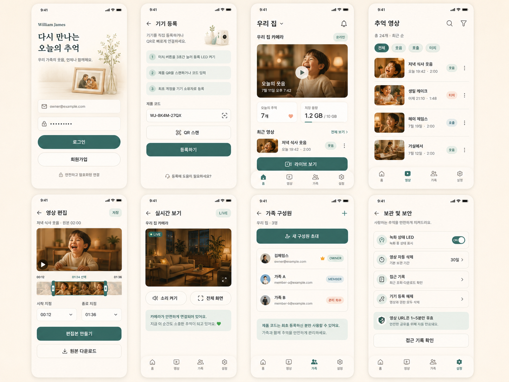

# AIoT 공통 프로젝트 주간 활동 정리

## 1. 이번 주 주요 활동

이번 주에는 AIoT 공통 프로젝트의 주제를 선정하기 위해 다양한 아이디어를 제안하고, 각 아이디어의 필요성, AIoT 기술 활용 가능성, 구현 난이도를 검토했습니다.

최종 주제가 선정된 이후에는 서비스에 필요한 기능과 사용자 흐름을 정리하고, 이를 바탕으로 Figma를 활용해 모바일 애플리케이션의 화면 초안을 제작했습니다.

---

## 2. 프로젝트 아이디어 제안 및 검토

최종 주제를 선정하기 전, 생활 속 문제를 AI와 IoT 기술로 해결할 수 있는 아이디어를 고민하여 다음 두 가지 주제를 제안했습니다.

### ① FireRoad: 소방차 진입 가능 여부 판단 시스템

좁은 골목길의 불법주정차 차량과 장애물을 AI로 감지하고, 소방차가 해당 골목에 진입할 수 있는지를 판단하는 시스템을 제안했습니다.

카메라 영상 기반 객체 인식과 오린카를 활용할 수 있으며, 골든타임 확보라는 사회적 문제를 다룬다는 장점이 있었습니다. 다만 실제 진입 가능 여부를 정확히 판단하려면 거리 측정과 원근 보정이 필요하여 프로젝트 기간 내 구현 난이도가 높을 수 있다고 판단했습니다.

### ② 도서관 도서 오배치 감지 시스템

도서관에서 책이 지정된 위치에 제대로 꽂히지 않았을 때 이를 감지하고, 이용자나 관리자에게 올바른 위치를 안내하는 시스템을 제안했습니다.

카메라, RFID, 센서 등을 활용해 도서 관리의 불편을 줄일 수 있다는 장점이 있었습니다. 다만 책등과 청구기호를 정확하게 인식해야 하고, 도서별 위치 데이터를 사전에 구축해야 한다는 점에서 구현 범위가 커질 수 있다고 판단했습니다.

---

## 3. 최종 프로젝트 주제 선정

아이디어별 구현 가능성, AIoT 장비 활용도, 시연 효과 등을 비교한 결과, 팀의 최종 프로젝트 주제로 **일상 속 웃음 수집기**가 선정되었습니다.

### 프로젝트 한 줄 소개

> 집 안에서 자연스럽게 발생한 웃음소리를 AI가 감지하고, 웃음이 발생하기 전후의 영상을 자동으로 저장하여 가족의 소중한 추억을 기록하는 AIoT 서비스입니다.

### 주제 선정 과정에서 확인한 장점

* 누구나 쉽게 공감할 수 있는 일상 속 경험을 다룸
* 웃음소리 감지라는 AI 기능이 명확함
* 카메라, 마이크, 젯슨 오린 나노, 라즈베리파이 등을 활용할 수 있음
* 웃음 발생 전후의 영상을 저장하는 블랙박스 방식으로 차별화할 수 있음
* 최종 발표에서 감성적인 스토리텔링과 직관적인 시연이 가능함
* 저장된 영상을 가족과 공유하는 서비스로 확장할 수 있음

---

## 4. Figma를 활용한 애플리케이션 UI 초안 제작

정리한 기능과 사용자 흐름을 시각적으로 확인하기 위해 Figma를 활용하여 애플리케이션의 주요 화면을 제작했습니다.

### 제작한 화면

#### ① 로그인 화면

* 이메일과 비밀번호 입력
* 로그인 및 회원가입 버튼 구성
* 안전한 연결과 보안을 안내하는 문구 배치
* 가족의 추억을 기록하는 서비스에 맞는 따뜻한 분위기 표현

#### ② 기기 등록 화면

* 제품 코드 입력
* QR 코드 스캔
* 기기 등록 순서 안내
* 최초 등록 사용자의 소유자 권한 안내

#### ③ 홈 화면

* 오늘 저장된 추억 개수 표시
* 저장 공간 사용량 표시
* 대표 추억 영상 재생
* 최근 영상 목록 제공
* 실시간 카메라 화면 이동 버튼 배치

#### ④ 추억 영상 목록 화면

* 저장된 영상 목록 제공
* 영상 제목, 날짜 및 재생 시간 표시
* 감지 유형별 필터 구성
* 검색 및 정렬 기능 배치

#### ⑤ 영상 편집 화면

* 영상 미리보기
* 타임라인을 통한 편집 구간 설정
* 편집본 생성
* 원본 영상 다운로드

#### ⑥ 실시간 보기 화면

* 카메라의 실시간 영상 제공
* LIVE 상태 표시
* 소리 켜기 및 전체 화면 기능
* 카메라 연결 상태 안내

#### ⑦ 가족 구성원 화면

* 등록된 가족 구성원 목록 확인
* 새로운 구성원 초대
* 소유자와 일반 구성원의 권한 구분
* 구성원 관리 기능 배치

#### ⑧ 보관 및 보안 화면

* 녹화 상태 LED 설정
* 영상 자동 삭제 기간 설정
* 접근 기록 확인
* 기기 등록 해제
* 영상 공유 링크의 유효기간 안내

---

## 5. 디자인 방향 설정

서비스가 감시 카메라 애플리케이션처럼 느껴지지 않고, 가족의 행복한 순간을 기록하는 서비스로 전달될 수 있도록 디자인 방향을 설정했습니다.

* 따뜻한 느낌을 주는 베이지 계열의 배경 사용
* 안정감과 신뢰감을 주는 초록색을 주요 색상으로 활용
* 가족사진, 식물, 조명 등의 요소를 활용해 편안한 분위기 표현
* 기술적인 표현보다 사용자가 쉽게 이해할 수 있는 문구 사용
* 영상과 주요 정보를 카드 형식으로 구성해 가독성 향상
* 주요 메뉴를 하단 내비게이션에 배치해 접근성 강화

---

## 6. 이번 주에 수행한 내용

* AIoT 프로젝트 아이디어 조사 및 제안
* FireRoad 아이디어의 기능과 구현 가능성 검토
* 도서관 도서 오배치 감지 시스템의 기능과 구현 가능성 검토
* 최종 프로젝트 주제 선정 과정 참여
* 일상 속 웃음 수집기의 주요 기능 정리
* 애플리케이션 사용자 흐름 구성
* Figma를 활용한 모바일 UI 초안 제작
* 실시간 영상, 영상 목록, 편집, 가족 관리 및 보안 화면 구성
* 향후 개발에 필요한 기능과 고려 사항 확인

---

## 7. 한 줄 요약

> 이번 주에는 FireRoad와 도서관 도서 오배치 감지 시스템을 제안하고 구현 가능성을 검토했으며, 최종 주제로 선정된 ‘일상 속 웃음 수집기’의 기능과 사용자 흐름을 정리한 뒤 Figma를 활용해 모바일 애플리케이션 UI 초안을 제작했습니다.