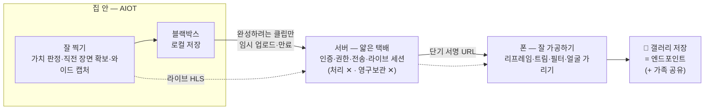

# 17. 방향 재정의 제안 — 우리 서비스는 무엇을 만들어 주는 서비스인가

> 작성: 2026-07-21 코치 피드백 반영. 팀 논의용 제안 문서.
> 목적: 피드백에서 지적받은 **"페르소나의 최종 목적과 엔드포인트가 없다"**에 답을 정하고, 그 답에 맞춰 파트별 역할을 다시 배치하자는 제안.

---

## 1. 우리가 받은 지적 — 지금 기획엔 "끝"이 없다

코치 피드백의 핵심은 기능이 부족하다는 게 아니었다. **사용자가 최종적으로 뭘 얻는지가 없다**는 것이었다.

지금 흐름을 그대로 따라가 보면:

> 웃음 감지 → 영상 생성 → 서버 저장 → …그 다음은?

사용자에게 남는 건 "서버에 쌓인 2분짜리 CCTV 영상 더미"다. 다시 볼 이유가 없고, 기존 홈캠(이미 움직임 감지·저장 다 됨)과 다를 게 없고, 보관할수록 서버비만 나간다. **감지와 저장은 재료지 결과물이 아니다.** 여기서 끝나면 우리 서비스는 "왜 이걸 써야 하지?"에 답을 못 한다.

---

## 2. 그래서 끝을 정하자 — 페르소나와 엔드포인트

**페르소나:** 아기·반려동물·가족과 함께 사는 사람. 가장 좋은 순간엔 **본인이 그 순간 안에 있거나, 그 자리에 없어서** 카메라를 들 수 없다. 아기가 처음 웃을 때 부모는 같이 웃고 있지 찍고 있지 않고, 강아지가 혼자 신나게 노는 순간엔 집에 없다.

**최종 목적:** 내가 못 찍는 우리집 최고의 순간을, 내 손으로 완성해서 간직하고 보여주고 싶은 사람들에게 보여주는 것.

**엔드포인트(사용자가 마지막에 얻는 것):**

> **완성된 짧은 영상 한 편이 내 폰 갤러리에 저장된다.** (원하면 가족·지인·SNS 등 원하는 범위로 공유)

코치 질문에 그대로 답하면 — 어디 보관? **폰 갤러리(완성본만)**. 어떻게 다시 보나? **갤러리에서, 보여주고 싶은 사람들과**. 다운로드? **그게 핵심 행동 그 자체(완성=저장)**. 공유? **완성본은 일반 파일이라 카톡·SNS 어디로든 사용자가 자유롭게** — 공유 범위를 서비스가 제한하지 않는다. SNS 게시용 세로 포맷이 그래서 MVP 리프레임에 들어 있다.

한 줄 정의:

> **내가 못 찍는 순간을 집(AIOT)이 대신 잡아주고, 나는 그걸 폰에서 완성해 간직하는 서비스.**

---

## 3. 이 끝에서 거꾸로 내려오면, 역할 분배가 저절로 정해진다

**좋은 결과물(간직하고 싶은 영상)이 나오려면 두 가지가 필요하다: ① 잘 찍혀야 하고, ② 잘 가공되어야 한다.** 이 두 가지를 누가 감당할 수 있는지 따져 보자.

### ① 잘 찍기 — AIOT만 할 수 있다

폰은 그 순간에 못 찍는다(내가 그 안에 있거나, 그 자리에 없으니까). 항상 켜져 있고, 순간을 판정하고, 그 **직전 장면까지** 잡는 건 AIOT만 가능하다. 이건 대체 불가능한 역할이고, Jetson의 AI 리소스는 이미 여기(감지·판정·인코딩)에 쓰이고 있다. **AIOT에 가공까지 시킬 여유는 없다.**

### ② 잘 가공하기 — 서버는 못 하고, 폰은 할 수 있다

가공(리프레임·트림·필터·얼굴 처리)은 하드웨어 리소스가 필수다. 후보를 다 따져 보면:

| 후보 | 가능한가 | 이유 |
| --- | --- | --- |
| AIOT (Jetson) | ✕ | AI 감지·인코딩에 이미 리소스 소진. 가공까지 얹으면 본업(잘 찍기)이 무너짐 |
| 서버 | ✕ | 제공 서버에 GPU 없음. 있어도 사용자·기기 수만큼 처리 비용이 늘어 수익 구조가 성립 안 함. 사생활 영상을 서버 AI에 넣는 것도 우리 보안 원칙(§5.3 온디바이스 우선) 위반 |
| **폰** | **○** | 요즘 폰은 GPU·NPU를 갖췄고, **사용자 수가 늘수록 가공 리소스도 같이 늘어난다(사용자가 자기 하드웨어를 들고 옴).** 비용 0 |

결론은 하나뿐이다: **가공은 폰이 한다. 즉, 프론트가 이 서비스의 결과물 품질을 책임지는 파트가 된다.**

이게 "프론트가 더 중요해졌다"의 근거다. 취향 문제가 아니라 **리소스 소거법의 결론**이다.

### 서버의 역할 — 얇은 택배

그럼 서버는 뭘 하나. 기기는 집 공유기(NAT) 뒤에 있고 폰은 밖에 있어서 직접 연결이 안 된다. **서버는 둘 사이의 권한 검사와 전송(택배)을 맡는다.** 영상 처리는 안 하고, 영구 보관도 안 한다.

이건 비즈니스 관점에서도 맞다. 우리가 파는 건 **AIOT 기기**(판매 또는 대여+월 사용료)다. 기기가 팔릴수록 서버비가 비례해서 늘면 안 된다. 서버가 얇을수록 이 모델이 성립한다. — 그래서 저장도 **기기 로컬(블랙박스)**이 기본이고, 사용자가 완성하려 할 때만 해당 클립이 서버를 거쳐 폰으로 내려온 뒤 만료된다.

---

## 4. 자주 나올 반론에 미리 답한다

**"서버에 저장 안 하면, 폰 용량 안 먹는다는 기존 장점이 사라지잖아?"**
→ 기존 모델은 "모든 원본을 서버에 영구 보관"이라 장점이 아니라 비용이었다. 새 모델에서 폰에 남는 건 **엄선해서 완성한 짧은 영상뿐**이다. 원본 더미는 기기(블랙박스)에 있고, 서버비 없이 보관된다. "다 저장"이 아니라 "고른 것만 완성해서 저장"이라 용량도 감당된다.

**"편집은 부가 기능 아니었나? 프론트 일이 너무 많아진다."**
→ 맞다, 많아진다. 그래서 이 문서의 후반부가 전부 **프론트 스코프를 지키기 위한 컷 목록**이다(§6). 편집이 부가가 아니라 결과물 그 자체가 됐기 때문에, 대신 다른 걸 걷어낸다. 코치 피드백 #5·#7도 같은 말이다: "일반 편집기 전부 만들지 말고, 홈캠·쇼츠에 맞는 것만 특화하라."

**"하이라이트 추천 같은 건 서버가 해줘야 하는 것 아닌가?"**
→ 하이라이트 **판정은 기기가 이미 한다**(웃음·움직임 신호는 감지 시점에 나옴). 그걸 타임스탬프 메타데이터로 클립에 딸려 보내면, 폰이 트림 핸들을 그 위치에 미리 놓는다. 서버는 바이트만 옮긴다. **판정=기기, 전송=서버, 완성=폰.**

**"AI가 알아서 다 편집해 주는 게 더 편하지 않나?"**
→ 프레이밍(누굴 찍을지·언제 자를지)은 연출 의도라 AI가 정하면 틀렸을 때 되돌릴 수 없는 불만이 된다. 원칙: **의도는 사람이 정하고, 노동(추적·크롭 계산·구간 제안)은 AI가 한다.** AI 결과는 항상 "초안·제안"이고 최종 결정은 사용자다.

---

## 5. 확정 제안 사항

| # | 항목 | 제안 | 한 줄 이유 |
| --- | --- | --- | --- |
| D-1 | 정체성 | 서버 = 임시 택배, 폰 = 완성·보관 | §3 소거법의 결론 |
| D-2 | 실시간 스트리밍 | 포함 | 홈캠의 기본 기대치 + 백엔드·IoT의 기술 depth 축. 최대 리스크라 우선 검증 |
| D-3 | 카메라 구동 | **2축 팬·틸트(상하·좌우)만** | "잘 찍기"에 필요한 만큼만. 이동형·복잡한 구동은 과함 |
| D-4 | 저장 | 기기 로컬 블랙박스, 요청 시에만 전송 | 다기기 상용 가정에서 기기당 서버비 최소화 |
| D-5 | 대시보드 | 분석(웃음 잔디·평균·캘린더) 제거 → "기기 상태 + 완성 대기 목록" | 코치 반응 애매 + 엔드포인트와 무관. 대시보드는 편집의 입구로만 |
| D-6 | 서버측 생성형 콘텐츠(4컷 만화 등) | 후순위 | 서버 처리 불가 원칙과 충돌, 결정 게이트([15번](./15_AI_편집_생성_결정안.md) §4) 미충족 |

---

## 6. 파트별로 무엇이 바뀌나

### 프론트 (김수원·서유정) — 결과물 품질의 주인. 가장 중요해졌고, 가장 많이 지켜줘야 한다

편집이 "부가"에서 "서비스의 결과물"로 격상됐다. 대신 전부 만들면 죽으니 **홈캠 영상 특화로만** 좁힌다:

| 우선순위 | 기능 | 왜 이것부터 |
| --- | --- | --- |
| MVP | 가로→세로 리프레임 | 와이드 원본을 "볼만한 영상"으로 바꾸는 첫 관문. FFmpeg 크롭이라 실현성 높음 |
| MVP | 트림 + 하이라이트 구간 자동 제안 | 기기가 보낸 메타데이터 재사용. 2분 → 알짜 몇십 초 |
| MVP | 원탭 분위기 필터 | CCTV 색감 → 홈비디오 톤. 실패 없는 기능 |
| MVP 추천 | **AR 얼굴 가리기** (MediaPipe 온디바이스) | 공유 범위가 SNS까지 열려 있으므로 타인·손님·아이 얼굴 보호가 필수에 가까움. **개인정보 차별화 카드** |
| 심화 | 자막(STT), 효과음·음악(저작권 안전 에셋), 수동 줌 키프레임 | 여유 시. ⚠️ 자막은 STT(음성→텍스트)임. TTS는 다른 기능 |

- SDK: 완성형 유료 SDK(Banuba·img.ly) 대신 **FFmpeg + 자체 UI** ([15번 문서](./15_AI_편집_생성_결정안.md) §6 검토 결론 — 무료 완성형은 존재하지 않음).
- 기술 depth: 온디바이스 ML(MediaPipe/TFLite) + FFmpeg 파이프라인. 이게 우리 팀 프론트의 포트폴리오 한 문제다.

### AIOT — AI (이재준) — "잘 찍기"의 두뇌

| 할 일 | 내용 |
| --- | --- |
| 다중신호 가치 판정 | 웃음(YAMNet)+사람(YOLO)+움직임 세기 **점수화**. "의미 이해"가 아니라 신호 합산 — 엣지에서 실현 가능한 수준으로 정직하게 |
| 하이라이트 후보 산출 | 신호 피크로 in/out 타임스탬프 생성 → 클립 메타데이터로 폰에 전달 |
| 대상 좌표 추적 | bbox 추적 → 팬·틸트 제어 입력 |
| 온디바이스 최적화 | TensorRT/TFLite 실시간 추론 |

### IoT (유지호) — "잘 찍기"의 몸

| 할 일 | 내용 |
| --- | --- |
| **와이드·고해상 캡처** + 순환 버퍼 | 폰에서 크롭·줌할 여지를 남기는 게 핵심. 프레이밍 결정을 폰으로 미룬다 |
| 로컬 블랙박스 | 판정된 클립을 SD/SSD 보관, 요청 시 전송 |
| 단일 인코더 tee + 라이브 송출 | 기존 설계 유지 (H.264/AAC 1회 인코딩) |
| **2축 팬·틸트** | 수동 방향 제어 우선. 3D 프레임은 최소 설계 또는 기성 키트(안정성이 출력물보다 중요 — 피드백 #6) |
| (심화) 자동 팬·틸트 | 피사체를 **느슨하게 화면 안에 유지**만. 최종 프레이밍은 폰의 몫 — 물리는 "놓치지 않기", 폰은 "프레이밍" |

### 백엔드 (박찬형) — 얇지만 깊게

| 할 일 | 상태 |
| --- | --- |
| 인증·기기·RBAC·초대·양도·감사 로그 | 구현됨 — 그대로 자산 |
| **실시간 세션 관리** (MQTT 명령·HLS·heartbeat/TTL) | 백엔드의 기술 depth. 계속 핵심 |
| 단기 전송 택배 (서명 URL + 만료 스케줄러) | 기존 인프라 재사용, 역할만 "보관→택배"로 전환 |
| [변경] 모든 이벤트 자동 업로드 → **온디맨드 클립 전송** | **박찬형과 합의 필요.** 기기 오프라인 시 전송 불가 제약 포함 |
| [축소] 대시보드 API | 분석 제거 → 기기 상태 + 완성 대기 목록 |

분석을 걷어내도 실시간 세션·권한이라는 깊은 문제가 남아 백엔드 분량은 죽지 않는다.

### PM (사지한)

- 이 방향 합의 → 요구사항·[WBS](./10_WBS_리스크_회의체.md) 재배치, "완성 대기 만료 알림"(안 만들면 사라짐 → 완성 유도) UX 정의, 통합 시나리오를 §7 데모 흐름으로 교체.

---

## 7. 이 방향의 성공 기준 (데모 한 장면)

> 거실에서 가족이 웃는다 → 기기가 직전 장면부터 잡아 블랙박스에 저장 → 앱에 "완성 대기" 알림 → 사용자가 열면 하이라이트 구간에 핸들이 미리 놓여 있음 → 세로 리프레임·필터 원탭 → **갤러리에 저장, 원하는 곳(가족 단톡·SNS)에 공유** → 서버 원본 만료.

이 한 흐름이 끊기지 않고 도는 것 — 그게 MVP다. (라이브 보기는 이 흐름과 별도로 항상 가능.)

---

## 8. 남은 논의 사항

1. **온디맨드 전송 모델 합의** (박찬형) — 기존 "전량 MinIO 업로드"에서 변경. 기기 오프라인 제약 수용 여부.
2. **얼굴 가리기·STT 개인정보 게이트** — [15번](./15_AI_편집_생성_결정안.md) §4 + [06_보안 문서](./06_보안_개인정보_설계.md) 재확인 (온디바이스 유지·타인/미성년자 동의 고지).
3. **블랙박스 보관 주기** — 기기 저장소 용량 기준 자동 삭제 정책.
4. 합의 후 갱신할 문서: [기획서](../윌리엄_제임스_프로젝트_기획서.md) 1·2장, [01_요구사항](./01_요구사항_명세서.md), [03_ERD](./03_ERD_데이터사전.md), [04_아키텍처](./04_시스템_아키텍처.md), [05_하드웨어](./05_하드웨어_구성_및_배선계획.md), [15_편집 결정안](./15_AI_편집_생성_결정안.md).
