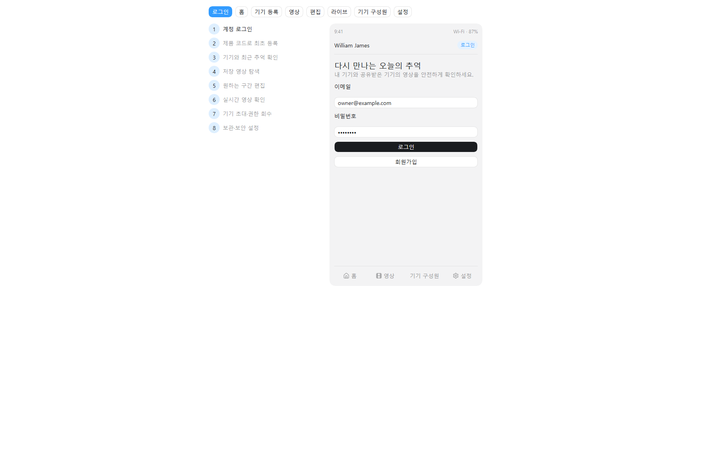

# Flutter 앱 와이어프레임

## 목적

기본 사용자 흐름과 화면별 필수 요소를 개발 전에 합의하기 위한 클릭형 저충실도 와이어프레임이다. 시각 디자인 확정본이 아니며, 기능·정보 구조·오류 흐름 확인을 우선한다.

## 실행 방법

브라우저에서 [`index.html`](./index.html)을 연다. 별도 서버나 패키지 설치가 필요하지 않다.

편집 가능한 화면은 [Figma 앱 와이어프레임](https://www.figma.com/design/kDAk0NTRltBHJsaIeyyXQd)에서 확인한다.

## 포함 화면

| 단계 | 화면 | 핵심 확인 사항 |
| --- | --- | --- |
| `[기본]` | 로그인 | 이메일 로그인, 회원가입 진입 |
| `[기본]` | 홈 대시보드 | 내 기기 목록·선택, 기기별 역할·상태, 최근 영상, 저장 수, 라이브 진입 |
| `[기본]` | 기기 등록 | 물리적 등록 모드 안내, 기기 화면의 1회용 등록 코드 입력, 최초 소유자 등록 |
| `[기본]` | 영상 목록 | 감지 유형 필터, 썸네일, 촬영 시각, 길이 |
| `[기본]` | 영상 편집 | 재생, 시작·종료·효과 선택, 단말 내보내기, 서버 미저장 안내 |
| `[기본]` | 실시간 보기 | 온디맨드 시작 대기 수초, `PENDING/READY/CLOSED/EXPIRED/FAILED`, HLS 재생, 15초 heartbeat, 정상 종료 |
| `[기본]` | 기기 구성원 관리 | 선택한 기기의 `OWNER/MEMBER`, 기기 초대, 권한 회수 |
| `[기본]` | 설정 | 선택한 기기의 녹화 LED, 보관 기간, 접근 기록, 기기 등록 해제 |

## 개발 인계 규칙

- Flutter 화면 이름과 API 명칭은 OpenAPI·요구사항 ID를 기준으로 맞춘다.
- 영상 구간 편집은 앱에서 원본을 재인코딩하지 않고 `startMs`, `endMs`만 백엔드로 전송한다.
- 재생 URL 만료 시 앱은 고정 URL을 저장하지 않고 재발급 API를 호출한다.
- 라이브 진입은 시청 세션 생성 후 `PENDING→READY`를 표시하며, 여러 시청자는 기기당 하나의 edge 송출을 공유한다.
- 라이브 화면이 `PENDING/READY`인 동안 앱은 15초마다 heartbeat하고 정상 이탈 시 DELETE를 호출한다. active TTL은 45초이며 서버는 마지막 유효 heartbeat 또는 정상 DELETE부터 최대 60초 안에 `STOP_STREAM`을 보낸다. TTL 만료 후 60초를 추가하지 않고, 그 전에 새 세션이 오면 예약을 취소한다. 활성 시청 중 `EXTEND_STREAM`으로 `hardExpiresAt`을 약 120초 뒤로 연장하며 장애 시 기기는 마지막 연장부터 최대 약 120초 안에 자체 종료한다.
- 앱은 `CLOSED/EXPIRED`를 하나의 종료 화면으로 매핑하고 `FAILED`에는 재시도를 제공한다.
- 미디어 흐름은 Jetson 단일 H.264/AAC 인코더→기기 live publisher→별도 미디어 계층 후보 순서다. 미디어 계층은 단일 ingest를 `-c copy` 또는 동등한 방식으로 HLS remux·다중 시청 fan-out하므로 별도 인코더를 만들지 않는다.
- 사용자는 여러 기기의 구성원이 될 수 있고 한 기기에도 여러 사용자가 참여할 수 있으므로 모든 영상·설정 화면은 현재 선택한 기기와 해당 기기에서의 `OWNER/MEMBER` 역할을 명확히 표시한다.
- 기기 구성원 권한 회수·기기 오프라인·영상 처리 실패 화면을 구현 시 반드시 추가한다.
- Figma 시각 디자인을 진행하더라도 이 문서의 사용자 흐름과 보안 안내는 유지한다.
