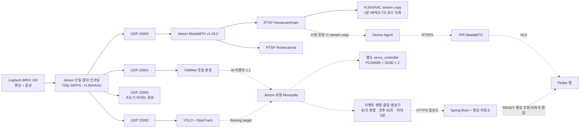

# AI 파트 2026-07-23 개발 진행 및 팀 공유 규격

> 개발 활동 기준일: 2026-07-23  
> 팀 합의 반영일: 2026-07-24  
> 대상 장치: NVIDIA Jetson Orin Nano 8GB + Logitech BRIO 100  
> 문서 성격: 2026-07-23 진행 보고와 이후 개발에 사용할 AI·Edge Media 기준안  
> 관련 문서: [README.md](./README.md), [AI_EDGE_INTEGRATION_SPEC.md](./AI_EDGE_INTEGRATION_SPEC.md), [10분 시험 결과](./AI_RTSP_10MIN_TEST_2026-07-23.md)

이 문서는 구현된 기능과 실제 Jetson에서 검증한 기능을 구분한다. 다른 보드나
개발 환경에서 검증한 결과는 Jetson 검증 완료로 간주하지 않는다. 실제 `device_id`,
토큰, 인증서, 비밀번호와 서명 URL은 문서와 로그에 기록하지 않는다.

## 상태 구분

| 상태 | 의미 |
| --- | --- |
| **구현 완료** | 코드 또는 설정이 준비됐지만 해당 기능 전체의 Jetson 종단 검증은 완료되지 않음 |
| **Jetson 검증 완료** | 명시한 시험 범위 안에서 실제 Jetson Orin Nano로 동작을 확인함 |
| **부분 검증** | 일부 구성요소, 짧은 시험 또는 다른 환경에서만 확인함 |
| **미검증** | 구현 여부와 관계없이 요구하는 실제 동작 증거가 아직 없음 |
| **다음 작업** | 이후 구현·통합·시험 대상으로 합의한 항목 |

## 1. 오늘의 한 줄 요약

> 웃음 전후 60초 영상을 서버와 앱에 제공하는 다음 단계로 나아가기 위해,
> Jetson에서 BRIO 100을 중복 점유하지 않는 공통 미디어 기반을 구축하고
> RTSP·상시 녹화·YOLO·YAMNet 동시 실행을 10분간 예비 검증했다.

## 2. 오늘 작업의 목표

최종 서비스는 집에서 24시간 녹화하면서 웃음을 감지하면 최초 웃음 60초 전부터
마지막 웃음 60초 후까지의 영상을 서버에 올리고, 사용자가 Flutter 앱에서 재생하고
비파괴 편집할 수 있어야 한다.

이 기능을 안정적으로 만들려면 AI 모델부터 수정하기 전에 다음 기반이 필요했다.

1. 카메라와 마이크를 여러 프로세스가 동시에 열지 않는다.
2. 영상과 음성을 한 번만 인코딩하고 AI·녹화·라이브가 공유한다.
3. Python 메모리에 60초 분량의 원본 프레임을 보관하지 않는다.
4. 압축 스트림을 짧은 세그먼트로 상시 저장해 과거 구간을 추출할 수 있게 한다.
5. 사용자가 라이브를 요청해도 로컬 AI와 녹화가 중단되지 않게 한다.
6. 이후 UDP에서 RTSP로 전환해도 AI 소비자 코드의 변경을 최소화한다.

따라서 오늘의 핵심 목표는 최종 앱 기능을 완성하는 것이 아니라,
**AI·녹화·라이브가 함께 사용할 Jetson 미디어 기반을 마련하고 짧게 검증하는 것**이었다.

## 3. 기존 문제와 이번에 선택한 해결 방향

| 기존 문제 또는 위험 | 선택한 해결 방향 |
| --- | --- |
| YOLO·YAMNet·라이브가 각각 BRIO 100을 열면 장치 점유 충돌 가능 | 하나의 캡처 프로세스만 카메라와 마이크를 열도록 통합 |
| 소비자마다 인코딩하면 CPU 사용량과 지연 증가 | H.264/AAC로 한 번만 인코딩한 뒤 네 경로로 분기 |
| 60초 원본 프레임을 Python 메모리에 보관하면 RAM 부담 증가 | 1분 단위 MPEG-TS 순환 세그먼트에서 필요한 구간을 remux |
| FFmpeg가 UDP를 받아 다시 RTSP로 게시하면 프로세스와 장애 지점 증가 | MediaMTX가 MPEG-TS UDP를 직접 수신 |
| AI 처리 속도가 입력보다 느리면 오래된 프레임이 누적 | YOLO는 대기열 대신 최신 프레임만 유지 |
| 라이브 시청자가 없는데도 클라우드로 계속 송출하면 대역폭 낭비 | 시청 요청이 있을 때만 Device Agent가 RTSPS publisher 실행 |
| 업로드 성공 전 파일을 삭제하면 이벤트 영상 유실 가능 | 서버 `complete` 성공과 로컬 영수증 기록 후에만 MP4 삭제 |

## 4. 변경된 시스템 구조

실선은 2026-07-23 Jetson에서 동작을 확인한 경로이고, 점선은 구현됐지만
종단 검증이 남았거나 이후 연결할 경로다.



현재 YOLO와 YAMNet은 각각 UDP 23000과 23001을 사용한다. 로컬 RTSP
`/homecam/ai` 입력 어댑터는 구현됐지만 두 모델이 해당 RTSP를 동시에 소비하는
Jetson 시험은 아직 진행하지 않았다. UDP 23002와 기존 RTSP-over-SSH 경로는
Jetson 직접 RTSPS 전환 전까지 유지하는 과도기 경로다.

## 5. 오늘 수행한 작업

### 5.1 단일 캡처와 네 경로 분기

- BRIO 100의 영상과 음성을 하나의 FFmpeg 프로세스만 열도록 구성했다.
- 720p, 30FPS 영상을 H.264 2.5Mbps로 인코딩한다.
- mono 음성을 AAC-LC 48kHz, 128kbps로 인코딩한다.
- 한 번 인코딩한 결과를 UDP 23000, 23001, 23002, 23003으로 분기했다.
- 카메라가 부팅 시 없거나 잠시 분리되면 빠른 재시작 반복 대신 장치 복귀를 기다리게 했다.

### 5.2 Jetson 로컬 MediaMTX

- Jetson ARM64에 MediaMTX v1.19.2를 설치했다.
- MediaMTX가 UDP 23003의 MPEG-TS를 직접 수신하도록 구성했다.
- 불필요한 FFmpeg RTSP 재게시 프로세스를 제거했다.
- RTSP listener는 `127.0.0.1:8554`에만 바인딩했다.
- MoQ 등 사용하지 않는 네트워크 서버는 비활성화했다.
- 다음 두 로컬 주소를 제공한다.

```text
rtsp://127.0.0.1:8554/homecam/main
rtsp://127.0.0.1:8554/homecam/ai
```

현재 `ai`는 `main`을 재인코딩 없이 참조한다. 두 주소를 분리한 이유는 향후
AI 전용 해상도나 FPS를 도입하더라도 소비자 인터페이스를 유지하기 위해서다.

### 5.3 상시 녹화와 저장공간 보호

- `main` 스트림의 H.264/AAC를 재인코딩하지 않고 1분 단위 MPEG-TS로 저장한다.
- 테스트용 Jetson 내부 저장소에는 `RECORDING_MAX_GIB=8` 상한을 적용했다.
- 상한을 넘으면 완료된 오래된 세그먼트부터 삭제한다.
- 삭제 및 이벤트 추출 대상 경로에는 안전 마커를 요구해 잘못된 디렉터리 삭제를 방지한다.
- 최종 목표는 256GB 저장장치에서 최근 7일 상시 녹화를 유지하는 것이다.

### 5.4 AI 입력과 이벤트 코드

- YOLO와 YAMNet에 RTSP/UDP 입력 옵션과 자동 재연결 로직을 구현했다.
- YOLO는 오래된 프레임 누적을 방지하기 위해 최신 프레임 하나만 유지한다.
- YAMNet 입력에서만 오디오를 16kHz mono PCM으로 변환한다.
- 사람·고양이·강아지만 YOLO 탐지 대상으로 제한했다.
- 객체가 사라진 뒤 5초 `HOLD`, 이후 `HOME`으로 전환하는 프레이밍 목표를 구현했다.
- 30초 이내 웃음 병합과 최초 웃음 60초 전·마지막 웃음 60초 후 클립 코드를 구현했다.
- 병합된 이벤트는 첫 웃음의 UUID를 대표 `sourceEventId`로 사용한다.
- `segment_clip_uploader.py` 단위 테스트 5개가 통과했다.

현재 운영 기본값은 앞뒤 5초 MVP 클립이다. 디스크 기반 전후 60초 경로는
코드와 단위 테스트가 준비됐지만 Jetson 종단 검증 후 기본값으로 전환한다.

### 5.5 서비스와 시험 도구

- 로컬 MediaMTX, 상시 녹화, 녹화 정리 서비스를 systemd 단위로 구성했다.
- 10분 동안 서비스·RTSP·녹화량·프로세스·Jetson 자원을 기록하는 통합 시험을 수행했다.
- 로컬 Mosquitto가 Jetson에 설치되고 실행 중인 것을 확인했다.

## 6. Jetson 검증 결과

시험 시간은 2026-07-23 17:12:44부터 17:22:56까지 총 612초다.
이는 AI-06 공식 완료 조건인 1시간 시험이 아니라 **10분 예비 통합 시험**이다.

| 검증 항목 | 결과 |
| --- | --- |
| 미디어 캡처 서비스 | 시험 중 활성 상태 유지 |
| 로컬 MediaMTX | 시험 중 활성 상태 유지 |
| 상시 녹화 서비스 | 시험 중 활성 상태 유지 |
| 녹화 정리 타이머 | 시험 중 활성 상태 유지 |
| RTSP `main` probe | 실패 없음 |
| RTSP `ai` probe | 실패 없음 |
| YOLO 프로세스 | 녹화와 동시에 실행됨 |
| YAMNet 프로세스 | 녹화와 동시에 실행됨 |
| 스왑 | 사용하지 않음 |
| 서비스 중단 | 관찰되지 않음 |

녹화 파일은 약 30,076,788바이트에서 237,679,924바이트로 증가했다.
시험 전체 기준 증가는 209,700,288바이트로 약 200MiB다.

YOLO와 YAMNet이 실행된 것은 확인했지만 다음을 의미하지는 않는다.

- 실제 사람·고양이·강아지 탐지가 성공했다는 증거가 아니다.
- 실제 웃음이 감지돼 이벤트가 생성됐다는 증거가 아니다.
- 두 모델이 로컬 RTSP 주소를 직접 사용했다는 증거가 아니다.

시험 중 모델 입력은 YOLO가 UDP 23000, YAMNet이 UDP 23001이었다.
다운로드한 10분 영상은 AI 이벤트 영상이나 탐지 박스 영상이 아니라,
H.264/AAC를 재인코딩하지 않고 저장한 깨끗한 상시 녹화 원본이다.

## 7. 현재 확인된 성능과 한계

| 지표 | 관찰 결과 | 해석 |
| --- | ---: | --- |
| 녹화 증가량 | 약 200MiB/10분 | 현재 비트레이트에서 8GiB는 약 7시간 |
| 평균 압축 비트레이트 | 약 2.74Mbps | 256GB의 실제 7일 보관은 별도 실측 필요 |
| RAM | 약 4.0GB → 4.2GB | 10분 증가만으로 메모리 누수를 판단할 수 없음 |
| 스왑 | 0 | 시험 중 스왑 압박 없음 |
| 온도 | 약 50°C | 짧은 시험 범위에서 안정적 |
| CPU | 시험 후반 코어별 약 85~94% | 현재 최적화가 필요함 |
| GPU 순간값 | 시작 98%, 종료 8% | 두 순간값이므로 평균 GPU 사용률이 아님 |

CPU 사용률이 높았기 때문에 당분간 기본 해상도는 720p를 유지한다.
YOLO 추론 FPS, 입력 크기, 프레임 샘플링과 H.264 하드웨어 인코딩 가능성을
검토한 뒤 1080p를 비교 시험한다. MQTT로 720p/1080p를 동적으로 바꾸는 기능은
현재 MVP보다 후순위로 둔다.

## 8. 완료·부분 완료·미완료 상태표

| 항목 | 상태 | 비고 |
| --- | --- | --- |
| BRIO 100 단일 캡처·인코딩 구성 | **Jetson 검증 완료** | 10분 시험 중 AI·녹화가 함께 유지됨 |
| UDP 23000~23003 네 경로 분기 | **Jetson 검증 완료** | YOLO·YAMNet·MediaMTX 소비 확인 |
| MediaMTX v1.19.2 설치와 로컬 RTSP | **Jetson 검증 완료** | `main`, `ai` probe 실패 없음 |
| RTSP loopback 제한·불필요 서버 비활성화 | **구현 완료** | 외부에 로컬 8554 포트를 노출하지 않음 |
| H.264/AAC 1분 MPEG-TS 상시 녹화 | **Jetson 검증 완료** | 10분간 파일 수와 용량 증가 |
| 8GiB 임시 상한과 오래된 파일 정리 | **구현 완료** | 64GB 루트 디스크 보호용 |
| YOLO·YAMNet 동시 프로세스 실행 | **부분 검증** | 실행 확인, 실제 탐지 성공은 미확인 |
| YOLO·YAMNet RTSP 입력 어댑터 | **구현 완료** | Jetson RTSP 동시 소비 시험 필요 |
| 앞뒤 5초 MVP 이벤트 클립 | **Jetson 검증 완료** | 기존 기본 경로이며 이번 10분 원본과는 별개 |
| 30초 웃음 병합·전후 60초 클립 | **구현 완료** | 코드·단위 테스트 완료, Jetson 종단 미검증 |
| 이벤트 최대 길이 5분 제한 | **다음 작업** | 초과 시 다음 웃음부터 새 이벤트로 분리 |
| 실제 객체 탐지 성공 | **미검증** | 라벨이 있는 현장 시험 필요 |
| 실제 웃음 감지 성공 | **미검증** | 큰/작은/TV 웃음과 혼동음 평가 필요 |
| 전후 60초 클립 서버 업로드 | **미검증** | HTTP 409 처리 보완 포함 |
| 앱 이벤트 영상 조회·비파괴 편집 | **미검증** | 서버 `READY` 이후 앱 노출 예정 |
| 로컬 Mosquitto 설치·실행 | **Jetson 검증 완료** | AI 토픽 종단 연결은 다음 작업 |
| 다른 환경의 RTSPS 1인 Live View | **부분 검증** | Jetson이 아닌 다른 보드·개발 환경에서 확인 |
| Jetson 직접 RTSPS 송출 | **미검증** | 전달받을 publisher를 Jetson에 배포해야 함 |
| 다중 사용자 단일 라이브 공유 | **미검증** | 2~3명 동시 재생 시험 필요 |
| MediaMTX 강제 중단 후 자동 복구 | **미검증** | 저장된 10분 보고서에는 증거 없음 |
| AI-06 공식 1시간 통합 시험 | **다음 작업** | FPS·지연·자원·온도·재연결 기록 필요 |
| SG90 실제 PWM 제어 | **미검증** | 별도 `servo_controller` 구현과 실물 보정 필요 |
| 256GB에서 7일 순환 보관 | **미검증** | 마운트 경로·상한·비상 여유 확정 필요 |

## 9. 각 파트에 공유할 인터페이스와 영향

### 9.1 AI·Edge Media

AI 파트는 다음 범위를 담당한다.

- BRIO 100 단일 캡처와 H.264/AAC 인코딩
- Jetson 로컬 MediaMTX와 상시 순환 녹화
- YOLO·ByteTrack 및 YAMNet 분석
- 웃음 세션 병합, 이벤트 MP4 생성과 업로드
- 로컬 AI MQTT 메시지
- 프레이밍 목표 계산
- 별도 `servo_controller`를 통한 PCA9685·SG90 실제 제어

서보 제어는 YOLO 프로세스에 직접 결합하지 않는다.

```text
YOLO
→ homecam/v1/{device_id}/control/framing/target
→ servo_controller
→ PCA9685 Channel 0/1
→ PAN/TILT SG90
```

AI는 `direction`, 정규화된 `error_x`, `error_y`, `TRACKING/HOLD/HOME`,
`target_ids`, `ttl_ms`를 전달한다. `servo_controller`는 50Hz PWM, 이동 속도,
물리적 각도 제한, stale 메시지 폐기와 안전 정지를 담당한다. SG90 전원은
Jetson 핀에서 직접 공급하지 않고 별도 5V 전원을 사용하며 GND는 공통으로 연결한다.

### 9.2 IoT·Device Agent

IoT·Device Agent는 다음 범위를 담당한다.

- 클라우드 MQTTS 단일 연결과 기기 등록
- 등록 코드, ONLINE/OFFLINE 상태와 명령 ACK
- `START_STREAM`, `EXTEND_STREAM`, `STOP_STREAM` 처리
- 라이브 publisher 프로세스와 `hardExpiresAt` 수명 관리
- 필요한 AI 이벤트 메타데이터의 클라우드 전달
- 터치 센서와 등록 버튼 GPIO 입력

AI 모델은 동일한 기기 인증정보로 별도 클라우드 MQTT 연결을 만들지 않는다.
클라우드 자격증명은 Device Agent가 소유한다.

### 9.3 라이브 미디어 인터페이스

Jetson에 전달할 직접 RTSPS publisher는 다음 계약을 따라야 한다.

```text
입력:
  rtsp://127.0.0.1:8554/homecam/main

출력:
  서버가 전달한 rtsps://.../live/{streamId}

미디어:
  H.264/AAC stream copy
  추가 재인코딩 없음

수명:
  시청 요청 시에만 실행
  START/EXTEND/STOP과 hardExpiresAt 준수
  종료 시 자식 프로세스 정리

보안:
  URL·자격증명은 환경변수 또는 제한된 설정 파일로 주입
  로그에서 인증정보 마스킹
```

다른 보드·개발 환경에서는 한 명의 RTSPS Live View가 확인됐지만,
이 publisher를 Jetson으로 옮긴 뒤 AI·녹화와 동시에 동작하는지는 아직 검증하지 않았다.

### 9.4 MQTT 스키마

메시지 종류에 따라 버전을 관리한다.

| 메시지 영역 | 버전 | 현재 상태 |
| --- | --- | --- |
| 라이브·기기 제어 | 1.0 | 백엔드와 Device Agent 결합 상태 |
| 신규 AI 웃음 이벤트 | 1.1 | AI 구현 및 백엔드·IoT 종단 결합 필요 |

신규 웃음 이벤트의 기본 토픽은 다음과 같다.

```text
homecam/v1/{device_id}/ai/laughter/detected
```

필수 정보는 UUID `event_id`, UTC ISO-8601 `detected_at`, 0~1 `score`,
전후 60초 범위와 당시 `vision_context`다. YOLO 문맥이 없더라도 웃음 이벤트를
폐기하지 않고 `vision_context.available=false`로 발행한다.

Jetson 내부에서는 다음 흐름을 사용한다.

```text
YAMNet → 로컬 MQTT → 이벤트 관리자
YOLO   → 로컬 MQTT → servo_controller 및 이벤트 문맥
Device Agent → 필요한 이벤트만 클라우드 MQTT로 전달
```

작은 JSON 상태 파일은 장애 복구, 업로드 멱등성과 ACK 기록용으로 유지할 수 있다.

### 9.5 이벤트 업로드와 보관

업로드 순서는 다음과 같이 합의했다.

```text
웃음 감지
→ 이벤트 구간 추출·mux
→ 파일 크기와 SHA-256 계산
→ POST /api/iot/videos/upload-url
→ presigned URL로 파일 PUT
→ POST /api/iot/videos/complete
→ 서버 크기·SHA-256 검증
→ READY
→ 로컬 uploaded 영수증 기록
→ Jetson 이벤트 MP4 삭제
→ 앱 알림과 목록 노출
```

- `sourceEventId`와 `Idempotency-Key`는 같은 대표 이벤트 UUID를 사용한다.
- `complete` 성공 전에는 로컬 이벤트 MP4를 삭제하지 않는다.
- 업로드 완료 후 MP4는 Jetson에 중복 보관하지 않는다.
- 작은 `.uploaded.json`에는 대표 이벤트 ID, 서버 영상 ID, 완료 시각,
  병합된 이벤트 ID와 MQTT ACK 상태를 남긴다.
- 상시 녹화 원본은 Jetson에서 최근 7일간 별도로 순환 보관한다.
- 서버 이벤트 영상은 7일 보관하며 사용자가 저장하거나 편집하면 자동 삭제하지 않는다.
- 편집은 원본을 바꾸지 않고 `trimStartMs`, `trimEndMs`, 제목 등의 메타데이터로 처리한다.

앱에는 웃음 감지 직후가 아니라 영상 업로드와 서버 `READY` 처리 이후 알림을 보낸다.

### 9.6 HTTP 오류와 멱등성

HTTP 409는 이미 완료된 성공을 뜻하지 않는다. 이미 동일 이벤트 업로드가
완료된 경우 서버는 정상 응답과 `alreadyCompleted=true`를 반환해야 한다.

409는 등록되지 않은 기기, 동일 이벤트 ID의 다른 파일 정보, 일치하지 않는
멱등성 키, 크기·SHA-256 불일치 또는 현재 상태에서 처리할 수 없는 요청 등
실제 충돌에 사용한다.

- 429, 5xx, 네트워크 오류: 같은 이벤트 ID로 지수 백오프 재시도
- 만료된 업로드 URL: 같은 멱등성 키로 업로드 URL부터 다시 요청
- 일반 4xx와 409: 오류 코드를 확인하고 무한 재시도하지 않음
- 현재 MVP 업로더의 409 매초 반복 재시도는 수정 필요

### 9.7 저장공간 부족 정책

삭제 우선순위는 다음과 같다.

1. 오래된 업로드 완료 임시파일
2. 오래된 상시 녹화 세그먼트
3. 오래된 진단 로그
4. 미업로드 또는 업로드 실패 이벤트 MP4는 가장 마지막까지 보호

디스크가 임계 수준이면 7일이 지나지 않은 상시 세그먼트도 오래된 순서대로
삭제하고 저장소 오류 상태를 보고한다. 업로드되지 않은 이벤트 영상은 일반
순환 삭제 대상에서 제외한다.

### 9.8 Backend와 Flutter

Backend는 사용자·기기 권한, 라이브 세션, 업로드 URL, 완료 검증, 영상 메타데이터,
7일 삭제, 사용자 저장과 비파괴 편집 정책을 담당한다.

Flutter는 로컬 RTSP에 직접 접속하지 않는다. Backend가 권한 검증 후 제공하는
HLS 또는 영상 접근 URL을 사용한다. 현재 다른 환경에서 1인 라이브 재생만 확인했으며,
2~3명이 하나의 Jetson 상행 스트림을 공유하는 시험은 남아 있다.

## 10. 발견된 문제와 위험 요소

1. **CPU 사용률이 높다.**  
   720p를 유지하면서 YOLO 추론 FPS와 입력 크기, 프레임 샘플링,
   하드웨어 H.264 인코딩 가능성을 먼저 검토한다.

2. **10분 시험으로 장시간 안정성을 판단할 수 없다.**  
   RAM 증가가 누수인지, 재연결 후 지연이 누적되는지, 저장량이 선형인지 확인하려면
   최소 1시간 시험이 필요하다.

3. **실제 AI 탐지 성공을 확인하지 않았다.**  
   프로세스 실행은 모델 정확도, Recall과 탐지 지연 검증을 대신하지 않는다.

4. **전후 60초 경로는 Jetson 종단 미검증이다.**  
   실제 웃음, 세그먼트 대기, 병합, remux, 업로드, `READY`, 앱 조회까지 확인해야 한다.

5. **기존 업로더가 HTTP 409를 반복한다.**  
   오류 코드 분류와 지수 백오프가 없으면 서버와 Jetson 로그에 불필요한 부하가 생긴다.

6. **Jetson 직접 RTSPS는 아직 검증되지 않았다.**  
   다른 환경의 성공 결과를 Jetson 완료로 표현하지 않고, 전달받은 publisher를
   Jetson의 AI·녹화와 동시에 시험해야 한다.

7. **저장공간 목표와 현재 시험 환경이 다르다.**  
   8GiB는 루트 디스크 보호용이며 7일 보관을 의미하지 않는다.
   256GB 장치를 장착한 후 720p와 1080p의 실제 시간당 사용량을 측정해야 한다.

8. **기존 전체 아키텍처 문서에 오래된 가정이 남아 있다.**  
   현재 AI·Edge Media 기준에서는 Raspberry Pi를 사용하지 않고, 로컬 상시 녹화는
   24시간이 아니라 최근 7일을 목표로 한다. 현재 웃음 모델은 TensorFlow Hub
   YAMNet이며, 근거가 확인되지 않은 TFLite A/B 결과를 완료 성능으로 사용하지 않는다.

## 11. 다음 작업 우선순위

### 우선순위 1: 실제 AI 동작 확인

1. 사람·고양이·강아지 객체 탐지와 ByteTrack ID 유지 확인
2. 큰 웃음·작은 웃음·여러 사람·TV 웃음과 혼동음 실제 감지 확인
3. Recall, 오탐 횟수 또는 FP/hour, 평균 감지 지연 기록
4. 현재 `threshold=0.05`, `consecutive=2`, `gain=1.5`, `cooldown=12초` 기준선 측정

### 우선순위 2: 이벤트 경로 종단 검증

1. YAMNet → 로컬 MQTT → 이벤트 관리자 연결
2. 30초 병합과 전후 60초 실제 클립 생성
3. 이벤트 최대 길이 5분 제한과 초과 시 분할 구현
4. HTTP 409 분류와 429·5xx·네트워크 오류 지수 백오프 구현
5. 업로드·`complete`·`READY`·앱 조회·비파괴 편집 확인
6. 성공 후 MP4 삭제와 `.uploaded.json` 영수증 유지 확인

### 우선순위 3: Jetson 직접 RTSPS 통합

1. 다른 파트에서 구현한 RTSPS publisher 파일을 전달받아 Jetson에 배포
2. 입력이 `/homecam/main`인지 확인
3. H.264/AAC stream copy와 인증서 검증 확인
4. 잘못된 기기의 다른 경로 publish 차단 확인
5. `START/EXTEND/STOP`, `hardExpiresAt`, 재연결 확인
6. 라이브 시작·종료가 YOLO·YAMNet·상시 녹화에 영향을 주지 않는지 확인
7. 2~3명 사용자가 하나의 상행 스트림을 공유하는지 확인

### 우선순위 4: AI-06 공식 1시간 시험

1. 720p로 최소 1시간 연속 실행
2. FPS, 탐지 지연, CPU, GPU, RAM, 온도와 녹화 증가량 기록
3. MediaMTX를 강제로 중단하고 자동 재연결 확인
4. 최신 프레임 정책과 지연 누적 여부 확인
5. 메모리 사용량이 지속 증가하는지 확인
6. 시험을 통과한 뒤 RTSP 기반 녹화 스택을 기본 서비스로 전환

### 우선순위 5: 서보와 저장장치

1. `servo_controller`를 별도 프로세스로 구현
2. PCA9685 Channel 0/1과 SG90 PAN/TILT 결합
3. 별도 5V 전원·공통 GND 확인
4. HOME, 최소·최대 PWM, 기구물 안전 각도와 최대 속도 보정
5. stale 메시지, MQTT 단절, AI 장애 시 `HOLD` 확인
6. 256GB 저장장치 마운트와 최근 7일 순환 정책 검증
7. 720p 시험 통과 후 1080p 비교 시험

## 12. 팀원과 결정한 사항 및 남은 운영값

### 합의 완료

| 항목 | 합의 내용 |
| --- | --- |
| 카메라 점유 | BRIO 100은 하나의 캡처 프로세스만 사용 |
| 인코딩 | H.264/AAC 한 번 인코딩 후 AI·녹화·라이브로 분기 |
| AI 입력 | 현재 UDP 유지, 로컬 RTSP 입력 어댑터 제공 |
| 최종 라이브 입력 | Jetson `/homecam/main` |
| 클라우드 라이브 | 시청 요청 시에만 Device Agent가 직접 RTSPS 송출 |
| 로컬 녹화 | 최근 7일 상시 순환 보관 |
| 이벤트 영상 로컬 보관 | 서버 완료 후 MP4 삭제, 작은 업로드 영수증 유지 |
| 서버 이벤트 보관 | 기본 7일, 저장·편집 시 자동 삭제 제외 |
| 웃음 병합 | 마지막 웃음 기준 30초 연장 |
| 이벤트 범위 | 최초 웃음 60초 전부터 마지막 웃음 60초 후 |
| 이벤트 최대 길이 | 최대 5분, 초과 시 다음 웃음부터 새 이벤트 |
| 사용자 알림 | 서버 `READY` 이후 알림 및 목록 노출 |
| MQTT 버전 | 기존 라이브·기기 1.0, 신규 AI 이벤트 1.1 |
| 서보 담당 | AI 파트가 목표 계산과 별도 PWM 제어 서비스 담당 |
| 영상 화질 | 당분간 720p 유지, 1080p와 동적 전환은 후순위 |

### 실기 시험 후 확정할 값

- 256GB 저장장치의 실제 마운트 위치와 비상 여유 공간
- SG90 최소·중립·최대 PWM과 팬·틸트 물리적 안전 각도
- 오차에서 각도 변화량으로 변환하는 계수와 최대 이동 속도
- 현장 데이터 기준 YAMNet threshold, consecutive, gain, cooldown
- 1080p 비트레이트, 추론 FPS와 전환 가능 여부
- 직접 RTSPS publisher의 Jetson 배포 결과와 운영 인증 방식
- 다중 사용자 Live View의 허용 지연과 마지막 사용자 종료 grace period

## 13. 회의·메신저용 요약

> 7/23에는 웃음 전후 60초 이벤트 영상 기능으로 가기 위한 Jetson 미디어 기반을 구축했습니다.  
> BRIO 100을 한 프로세스만 열고 H.264/AAC를 한 번 인코딩해 YOLO·YAMNet·라이브·MediaMTX로 분기했습니다.  
> MediaMTX v1.19.2와 로컬 RTSP `main/ai`, 1분 단위 무재인코딩 상시 녹화를 적용했습니다.  
> 10분 예비 시험 동안 서비스 중단과 RTSP 실패가 없었고, 약 200MiB가 녹화됐으며 온도는 약 50°C였습니다.  
> YOLO와 YAMNet의 동시 실행은 확인했지만 실제 객체·웃음 탐지 성공은 아직 검증하지 않았습니다.  
> 30초 병합과 전후 60초 클립 코드는 구현됐지만 Jetson부터 서버·앱까지의 종단 시험이 남아 있습니다.  
> 직접 RTSPS 1인 재생은 다른 환경에서 확인됐으며 Jetson 적용과 다중 사용자 시험은 아직입니다.  
> 다음 단계는 실제 탐지 평가, 60초 클립 업로드·READY 검증, Jetson RTSPS 통합과 공식 1시간 시험입니다.  
> 당분간 720p를 유지하고, 서버 업로드 완료 후 이벤트 MP4는 Jetson에서 삭제하기로 합의했습니다.
