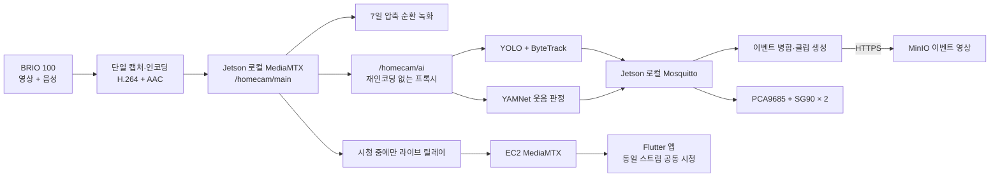

# 홈캠 Edge Media & AI 통합 규격

> 문서 버전: 0.2  
> 작성일: 2026-07-23  
> 상태: 팀 공유용 기준안·단계적 구현 중  
> 대상 장치: NVIDIA Jetson Orin Nano 8GB + Logitech BRIO 100

## 1. 문서 목적

이 문서는 홈캠의 영상·음성 캡처, 7일 순환 녹화, YOLO/YAMNet 분석,
웃음 이벤트 영상 생성, 팬·틸트 제어, 라이브 송출 사이의 공통 규격을 정의한다.

다음 원칙을 기준으로 한다.

- 카메라와 마이크는 Jetson에 직접 연결한다.
- Raspberry Pi는 사용하지 않는다.
- BRIO 100은 하나의 캡처 프로세스만 연다.
- 영상과 음성은 H.264/AAC로 한 번만 인코딩한다.
- AI 분석과 로컬 순환 녹화는 라이브 시청 여부와 관계없이 계속 동작한다.
- 클라우드 라이브 송출은 사용자가 시청할 때만 동작한다.
- MQTT에는 제어 메시지와 메타데이터만 전달하고 영상 파일은 전달하지 않는다.
- 이벤트 MP4는 HTTPS로 서버 저장소에 업로드한다.

## 2. 서비스 동작 요약

### 평상시

1. Jetson이 BRIO 100 영상과 음성을 계속 캡처한다.
2. 압축 스트림을 최근 7일 분량까지 순환 저장한다.
3. YOLO는 사람·고양이·강아지를 탐지하고 자동 프레이밍 목표를 계산한다.
4. YAMNet 기반 판정 로직은 웃음소리를 감지한다.
5. 서버에는 상시 영상을 올리지 않는다.

### 웃음 이벤트 발생 시

1. 최초 웃음 감지 시 이벤트 UUID를 발급한다.
2. 30초 이내에 다시 감지된 웃음은 같은 이벤트로 병합한다.
3. `최초 감지 60초 전`부터 `마지막 감지 60초 후`까지 압축 녹화 구간을 추출한다.
4. 구간을 MP4로 remux하고 서버가 발급한 업로드 URL로 전송한다.
5. 연결된 사용자는 앱에서 영상을 재생하고 비파괴 방식으로 편집할 수 있다.

### 라이브 시청 시

1. 첫 번째 사용자가 라이브를 요청하면 Spring Boot가 MQTT로 `START_STREAM`을 보낸다.
2. Device Agent가 Jetson의 기존 압축 스트림을 EC2 MediaMTX로 릴레이한다.
3. 추가 사용자는 같은 라이브 스트림에 참가한다.
4. Jetson에서 클라우드로 보내는 상행 스트림은 사용자 수와 관계없이 한 개다.
5. 마지막 사용자가 나가거나 heartbeat가 만료되면 라이브 릴레이를 종료한다.
6. 로컬 AI와 순환 녹화는 라이브 종료 후에도 계속 동작한다.

## 3. 목표 시스템 구조



## 4. 하드웨어 규격

| 구성요소 | 규격 | 역할 |
| --- | --- | --- |
| AI/엣지 보드 | Jetson Orin Nano 8GB | 캡처, AI, 녹화, 서보 목표 계산, 라이브 릴레이 |
| 카메라/마이크 | Logitech BRIO 100 | 영상 및 mono 음성 입력 |
| PAN 서보 | SG90 1개 | 좌우 회전 |
| TILT 서보 | SG90 1개 | 상하 회전 |
| PWM 드라이버 | PCA9685 16-Channel 12-Bit | SG90 PWM 출력 |
| 발표용 저장장치 | 256GB 메모리카드 | 로컬 순환 녹화와 업로드 대기 파일 |

### 4.1 SG90/PCA9685 연결 원칙

- PCA9685 Channel 0을 PAN, Channel 1을 TILT에 사용한다.
- PCA9685 PWM 주파수는 50Hz로 시작한다.
- PCA9685 논리 전원 `VCC`는 Jetson의 3.3V 로직에 맞춘다.
- SG90 전원 `V+`는 Jetson 전원 핀에서 공급하지 않는다.
- SG90에는 별도의 안정적인 5V 전원을 사용한다.
- Jetson, PCA9685, 외부 서보 전원의 GND는 공통으로 연결한다.
- SG90의 최소·중립·최대 펄스와 물리적 회전 한계는 실물로 보정한다.
- 소프트웨어 각도 제한을 보정하기 전에는 카메라를 장착한 상태에서 끝각까지 이동하지 않는다.

## 5. 영상·음성 스트림 규격

### 5.1 목표 로컬 RTSP 주소

| 용도 | 주소 |
| --- | --- |
| Main | `rtsp://127.0.0.1:8554/homecam/main` |
| AI | `rtsp://127.0.0.1:8554/homecam/ai` |

`/homecam/ai`는 초기에는 `/homecam/main`과 같은 압축 스트림을 참조한다.
두 URL을 분리하는 목적은 향후 AI 전용 해상도나 FPS가 필요할 때 소비자 코드를
바꾸지 않기 위해서다. 초기 버전에서는 AI 경로를 위해 영상을 다시 인코딩하지 않는다.

로컬 MediaMTX RTSP listener는 `127.0.0.1`에만 바인딩하고 외부 네트워크에 노출하지 않는다.

### 5.2 기본 미디어 규격

| 항목 | MVP 기본값 | 비고 |
| --- | --- | --- |
| 해상도 | 1280×720 | 장시간 시험 후 1920×1080 검토 |
| 캡처 FPS | 30 | YOLO가 모든 프레임을 추론할 필요는 없음 |
| 영상 코덱 | H.264 | 소프트웨어 인코딩 1회 |
| 영상 비트레이트 | 2.5Mbps | 저장공간·품질 시험 후 조정 |
| 픽셀 형식 | yuv420p | 앱/미디어 서버 호환성 |
| GOP | 1초 | 30FPS 기준 keyframe 간격 30 |
| 오디오 코덱 | AAC-LC | 녹화 및 라이브용 |
| 오디오 규격 | 48kHz, mono, 128kbps | 최종 녹화 품질 유지 |
| RTSP 전송 | TCP | 로컬 안정성 우선 |

YAMNet 입력에서만 오디오를 16kHz mono PCM으로 변환한다.
이 변환은 최종 녹화와 라이브 오디오에 영향을 주지 않는다.

### 5.3 AI 입력 호환성

YOLO와 YAMNet은 다음 입력 경로를 지원한다.

| 입력 | 용도 |
| --- | --- |
| `rtsp://...` | 목표 운영 입력 |
| `udp://...` | 현재 Jetson에서 검증된 공유 스트림 및 전환 fallback |
| 영상/음성 파일 | 재현 가능한 개발·회귀 테스트 |
| 직접 카메라/마이크 | 독립 smoke test |

권장 실행 옵션 이름은 다음과 같다.

```text
YOLO:   --stream-url <URI> | --video <PATH> | --camera <INDEX>
YAMNet: --stream-url <URI> | --device <DEVICE>
```

스트림 재연결은 1초, 2초, 4초 순서로 늘리고 최대 10초로 제한한다.
YOLO는 처리 지연이 누적되지 않도록 최신 프레임만 유지한다.
2026-07-23 기준 모델 입력 어댑터와 `run_ai_stack.sh` 옵션 구현 및
하드웨어 독립 단위 테스트를 완료했다. Jetson의 실제 RTSP 단절·복구 시험은
로컬 MediaMTX 구성을 추가한 뒤 수행한다.

## 6. UDP에서 RTSP로의 단계적 전환

현재 Jetson에서 검증된 구조는 BRIO 100을 한 번 열어 다음 UDP 포트로 분배한다.

```text
UDP 23000 → YOLO
UDP 23001 → YAMNet
UDP 23002 → 라이브 릴레이
```

발표 직전 안정성을 해치지 않도록 다음 순서로 전환한다.

1. 기존 UDP 구성을 fallback으로 보존한다.
2. Jetson 로컬 MediaMTX와 `/homecam/main` 경로를 추가한다.
   `main`은 네 번째 loopback MPEG-TS UDP 분기를 MediaMTX가 직접 수신하며
   별도의 FFmpeg RTSP 재게시 프로세스를 두지 않는다.
3. `/homecam/ai`가 main 스트림을 재인코딩 없이 참조하도록 구성한다.
4. YOLO와 YAMNet에 RTSP URL을 전달하여 병행 시험한다.
5. RTSP 단절·복구와 최신 프레임 정책을 확인한다.
6. 최소 1시간 통합 시험 후 기본 입력을 RTSP로 변경한다.
7. 전환 완료 전에는 UDP 설정과 복구 절차를 제거하지 않는다.

## 7. 순환 녹화와 저장공간

### 7.1 로컬 녹화

- H.264/AAC 압축 스트림을 1분 단위 세그먼트로 저장한다.
- 최근 7일을 초과한 세그먼트는 오래된 순서대로 삭제한다.
- Python의 YOLO/YAMNet 프로세스에 60초 분량의 원본 프레임을 보관하지 않는다.
- 업로드되지 않은 완성 이벤트 파일은 일반 순환 세그먼트보다 먼저 삭제하지 않는다.
- 파일 생성 중 전원이 꺼져도 이전에 완료된 세그먼트는 재생 가능해야 한다.
- 저장공간 부족 시 AI와 라이브는 유지하고 녹화 상태 오류를 보고한다.

### 7.2 예상 저장공간

2.5Mbps 영상과 128kbps 음성 기준 예상값이다.

| 보관 기간 | 예상 사용량 |
| --- | ---: |
| 1일 | 약 28.4GB |
| 7일 | 약 199GB |

256GB 메모리카드는 발표용 MVP에 사용한다. 실제 7일 운영에서는 파일시스템,
로그, 이벤트 파일, 업로드 대기 공간을 포함한 실측이 필요하다.
저장공간은 최소 10% 이상 여유를 유지한다.

초기 통합 시험은 현재 젯슨의 64GB 루트 디스크를 임시로 사용하며,
순환 녹화 상한을 `RECORDING_MAX_GIB=8`로 둔다. 이 단계에서는 디스크
안전이 7일 보관보다 우선이므로 상한을 넘으면 7일 이내의 완료 세그먼트도
오래된 순서대로 삭제한다. 7일 보관 검증은 256GB 저장장치로 이전한 뒤
상한을 다시 산정하여 진행한다.

## 8. 웃음 감지 규격

### 8.1 현재 모델과 판정 로직

- Google TensorFlow Hub YAMNet을 사용한다.
- 별도로 학습한 커스텀 가중치는 현재 사용하지 않는다.
- YAMNet 웃음 관련 클래스의 시간 패치 점수를 `max`, `mean`, `p90`으로
  집계할 수 있다.
- threshold, consecutive, gain, cooldown을 운영 환경에서 조정한다.
- 웃음을 놓치지 않는 Recall 우선 정책을 사용한다.

현재 큰 웃음 기반 최소 MVP 임시값은 다음과 같으며 최종 운영값은 아니다.

| 항목 | 현재 MVP 값 |
| --- | ---: |
| score aggregation | mean |
| threshold | 0.125 |
| consecutive | 3 |
| gain | 1.5 |
| cooldown | 12초 |
| episode merge gap | 30초 |

2026-07-24 통제 시험에서 기존 `max / 0.05 / 2회`는 무음과 일반 말소리에서
과탐했다. `mean / 0.125 / 3회`는 수집된 큰 웃음과 일반 말소리를 구분한
임시 후보지만 작은 웃음은 감지하지 못했다. `max`, `mean`, `p90`, 최상위
클래스 대비 점수 비율을 조합해도 말소리 오탐 없이 큰 웃음과 작은 웃음을
모두 잡는 단일 기준은 없었다.

따라서 작은 웃음 지원은 완료로 간주하지 않는다. 큰 웃음, 작은 웃음,
여러 사람, TV 웃음, 대화, 기침, 재채기, 비명, 음악과 생활 소음을
추가 수집하고 YAMNet 임베딩 기반 커스텀 분류기를 별도 정확도 Task로
평가한다.

### 8.2 웃음 평가 데이터 규격

평가 샘플은 다음 파일을 기본 단위로 사용한다.

| 파일 | 용도 |
| --- | --- |
| `source_segment.ts` | 삭제·재인코딩 전 상시 녹화 원본 보존 |
| `context.mp4` | 사람이 영상과 음성을 함께 검토 |
| `audio_16k_mono.wav` | YAMNet·커스텀 분류기 공통 입력 |
| `yamnet_diagnostics.jsonl` | 점수·RMS·최상위 클래스 근거 |
| `operator_window.txt` | 시험 안내 시각과 임시 구간 |
| `waveform.png` | 구간 검토 보조 |
| `metadata.json` | 환경, 정답, 모델 설정, 결과와 SHA-256 |

정답 구간은 `audio_16k_mono.wav`의 초 단위 좌표를 기준으로 한다. 안내
시각만 기록한 샘플은 `provisional`이며, 실제 파일을 재생해 웃음 시작과
종료를 확인한 뒤에만 `verified`로 바꾼다. 집의 일반 USB 웹캠과 회사의
BRIO 100 데이터는 `environment`와 `captureDevice`로 분리하고, BRIO
최종 평가에는 `targetDeviceValidation=true`인 검증 샘플만 사용한다.

모든 파일은 크기와 SHA-256을 검증해야 한다. 토큰, 인증정보, 실제
`deviceId`는 평가 데이터와 카탈로그에 저장하지 않는다. 표준 생성·확정·
검증·카탈로그 명령은 `yamnet/laughter_eval_dataset.py`를 사용한다.

### 8.3 이벤트 병합

- 최초 웃음 감지 시 새로운 `eventId`를 발급한다.
- 30초 이내의 추가 웃음은 같은 `eventId`를 사용한다.
- 첫 메시지는 `START`, 추가 메시지는 `EXTEND`로 구분한다.
- `START`와 `EXTEND`는 모두 마지막 감지 시각을 전달한다.
- 최종 영상 범위는 `firstDetectedAt - 60초`부터 `lastDetectedAt + 60초`다.
- 최종 이벤트 영상은 하나만 생성하고 업로드한다.

## 9. YOLO 자동 프레이밍 규격

- COCO 클래스 중 `person`, `cat`, `dog`만 탐지한다.
- ByteTrack으로 객체 ID를 유지한다.
- 객체가 하나이면 해당 객체 중심을 목표로 한다.
- 객체가 여러 개이면 화면 안에 가장 많은 객체가 들어오는 그룹 중심을 선택한다.
- 새 대상과 새 그룹은 여러 프레임 유지될 때만 반영한다.
- EMA와 중앙 dead zone으로 떨림을 줄인다.
- 객체 유실 후 5초 동안 `HOLD`하고 이후 `HOME`으로 전환한다.
- AI는 서보 각도나 PWM 값을 직접 만들지 않는다.
- AI는 정규화된 `errorX`, `errorY`와 추적 문맥만 전달한다.
- YOLO 목표 추론 처리량은 10~15FPS로 시작한다.

`errorX`, `errorY` 범위는 `-1.0`부터 `1.0`이다.

```text
errorX < 0: 대상이 화면 왼쪽
errorX > 0: 대상이 화면 오른쪽
errorY < 0: 대상이 화면 위쪽
errorY > 0: 대상이 화면 아래쪽
```

## 10. 로컬 MQTT 규격

Jetson 내부 프로세스 통신에는 로컬 Mosquitto를 사용한다.
로컬 broker는 외부 네트워크에 노출하지 않는다.

### 10.1 토픽

| 토픽 | QoS | Retain | 발행자 | 구독자 |
| --- | ---: | --- | --- | --- |
| `homecam/v2/{device_id}/ai/vision/state` | 0 | false | YOLO | 융합기·진단 |
| `homecam/v2/{device_id}/ai/laughter/detected` | 1 | false | YAMNet | 이벤트 관리자 |
| `homecam/v2/{device_id}/events/memory-candidate` | 1 | false | 이벤트 관리자 | 녹화·업로드 관리자 |
| `homecam/v2/{device_id}/control/framing/target` | 0 | false | YOLO | 서보 제어기 |
| `homecam/v2/{device_id}/control/framing/status` | 0 | false | 서보 제어기 | 진단·Device Agent |

클라우드 MQTTS 자격증명은 YOLO와 YAMNet에 전달하지 않는다.
Device Agent가 기기 인증정보를 소유하고 필요한 이벤트만 클라우드로 전달한다.

### 10.2 웃음 이벤트 메시지

```json
{
  "schema_version": "1.1",
  "event_id": "0a61d047-63ea-4ae0-917e-3787a572ec02",
  "device_id": "11111111-1111-4111-8111-111111111111",
  "event_type": "laughter",
  "detected_at": "2026-07-23T03:30:00.000Z",
  "score": 0.82,
  "clip": {
    "pre_seconds": 60,
    "post_seconds": 60
  },
  "vision_context": {
    "available": true,
    "object_count": 3,
    "track_ids": [1, 4, 7]
  }
}
```

YOLO 상태가 없거나 2초보다 오래됐어도 이벤트를 폐기하지 않고
`vision_context.available=false`, `object_count=0`, `track_ids=[]`로 발행한다.
최종 이벤트 토픽의 QoS는 1이며 retain은 사용하지 않는다. `event_id`는 UUID,
`detected_at`은 UTC ISO-8601, `score`는 0부터 1 사이의 숫자여야 한다.

다음은 필수 필드와 타입이 잘못된 메시지 예시다.

```json
{
  "schema_version": "1.1",
  "event_id": "not-a-uuid",
  "device_id": "",
  "event_type": "laughter",
  "detected_at": "2026-07-23 12:30:00",
  "score": "high"
}
```

30초 내 여러 웃음 트리거를 영상 하나로 병합할 때 첫 `event_id`를 대표 UUID로
사용하고 나머지 UUID는 `mergedEventIds` 완료 메타데이터에 기록한다.

### 10.3 서보 목표 메시지

```json
{
  "schema_version": "1.0",
  "device_id": "11111111-1111-4111-8111-111111111111",
  "sent_at": "2026-07-23T03:30:00.000Z",
  "sequence": 1251,
  "state": "TRACKING",
  "direction": "RIGHT",
  "error_x": 0.18,
  "error_y": -0.03,
  "target_ids": [1, 4],
  "ttl_ms": 500
}
```

서보 제어기는 `direction`보다 `error_x`, `error_y`를 기준으로 현재 각도를
점진적으로 수정한다.

- 500ms가 지난 메시지는 폐기한다.
- 일시적으로 목표 메시지가 없으면 현재 각도를 `HOLD`한다.
- AI가 5초 동안 대상을 찾지 못해 `HOME`을 보내면 보정된 중립 위치로 이동한다.
- MQTT 연결이 끊기거나 메시지가 비정상이면 임의로 움직이지 않고 `HOLD`한다.
- 실물 보정값으로 PAN/TILT 최소·최대 각도와 최대 이동 속도를 제한한다.

## 11. 장치 식별자

백엔드·MQTT·업로드 API에 사용하는 `deviceId`는 백엔드가 발급한 UUID다.

```text
DEVICE_ID=11111111-1111-4111-8111-111111111111
DEVICE_NAME=homecam-01
```

`homecam-01`은 앱에 표시하는 이름으로 사용하고 보안·토픽 식별자로 사용하지 않는다.
UUID와 인증정보는 코드에 직접 작성하지 않고 환경변수 또는 제한된 권한의 설정 파일로 주입한다.

## 12. 라이브 다중 사용자 정책

- 한 홈캠에는 여러 사용자가 연결될 수 있다.
- 첫 번째 시청자가 들어오면 하나의 클라우드 상행 스트림을 시작한다.
- 이후 시청자는 이미 활성화된 동일 스트림에 참가한다.
- 사용자마다 별도 FFmpeg 인코더나 별도 Jetson 송출을 만들지 않는다.
- Spring Boot는 사용자별 홈캠 접근 권한을 검증한다.
- 마지막 시청자가 나간 뒤 짧은 grace period 후 송출을 종료한다.
- heartbeat와 `hardExpiresAt`으로 비정상 종료된 세션을 정리한다.
- grace period 기본값은 백엔드와 합의 전까지 30초를 제안값으로 사용한다.

## 13. 이벤트 영상 보관과 편집

### 서버 보관

- 이벤트 영상의 기본 보관 기간은 업로드 완료 시점부터 7일이다.
- 사용자가 저장한 영상은 `pinned=true`로 표시하고 자동 삭제하지 않는다.
- 저장된 영상은 사용자가 직접 삭제할 때까지 보관한다.
- 업로드와 완료 API는 같은 `eventId`에 대해 멱등성을 보장해야 한다.
- Jetson은 409 등 영구 4xx 응답을 자동 반복하지 않고 로컬 격리 마커를
  생성하며, 이벤트 MP4와 Trigger를 보존한다.
- 408·429·5xx와 네트워크 오류만 제한된 지수 백오프로 재시도한다.
- 기본 재시도 간격은 5초부터 시작해 최대 300초로 제한한다.
- HTTP 오류 본문은 진단을 위해 최대 2,048자만 기록하고, 서명된 URL의
  쿼리 문자열과 인증 헤더는 기록하지 않는다.

### 비파괴 편집

- 원본 MP4는 직접 수정하지 않는다.
- 편집 정보는 `trimStartMs`, `trimEndMs`, 제목 등 메타데이터로 저장한다.
- 편집본을 저장하면 해당 원본도 자동 보존한다.
- 연결된 편집본이 있는 원본을 삭제할 때는 삭제를 거부하거나 사용자 확인을 받는다.

## 14. 실행 스크립트 역할

현재 두 통합 스크립트가 존재한다.

| 스크립트 | 현재 역할 |
| --- | --- |
| `yolo/run_ai_stack.sh` | RTSP/UDP 또는 직접 장치로 YOLO·YAMNet·MQTT 융합 실행 |
| `yolo/run_edge_ai_mvp.sh` | 공유 스트림·이벤트 클립·업로드 Jetson 실행 |
| `yolo/run_edge_ai_recording.sh` | RTSP·순환 세그먼트 기반 60초 이벤트 클립 실행 |

목표는 `run_ai_stack.sh`를 최종 통합 진입점으로 정리하는 것이다.

```bash
./run_ai_stack.sh \
  --video-source rtsp://127.0.0.1:8554/homecam/ai \
  --audio-source rtsp://127.0.0.1:8554/homecam/ai \
  --device-id "$DEVICE_ID"
```

완료 조건은 다음과 같다.

- 한 명령 또는 하나의 systemd service로 전체 스택을 시작한다.
- YOLO와 YAMNet은 각자의 가상환경과 프로세스를 유지한다.
- 모델, 융합기, 녹화기, 업로더, 서보 제어기 로그를 분리한다.
- 인증정보와 서버 주소를 코드에 직접 작성하지 않는다.
- `Ctrl+C`와 SIGTERM으로 모든 자식 프로세스를 정상 종료한다.
- 하나의 핵심 프로세스가 종료되면 원인을 로그에 남기고 정책에 따라 재시작한다.

## 15. 현재 구현과 목표의 차이

| 항목 | 현재 검증 상태 | 목표 |
| --- | --- | --- |
| 공유 입력 | 로컬 UDP 분기와 RTSP main/ai 확인, YOLO 사람 탐지·강제 단절 복구 실기 검증 | YOLO·YAMNet RTSP 동시 1시간 검증 + UDP fallback |
| 웃음 클립 | 실제 웃음 감지부터 전후 60초 MP4, 서버 업로드·READY, 앱 영상·음성 재생까지 종단 검증 | 자동 로컬 정리·병합·네트워크 복구 검증 |
| 순환 녹화 | Jetson에서 H.264/AAC 1분 MPEG-TS 생성·8GiB 상한 확인 | 장시간·단절 복구 검증 |
| 이벤트 병합 | 30초 그룹화·UUID 병합 코드 구현 | 실제 웃음 연속 입력 검증 |
| 서보 | 방향과 오차 계산·로그 | PCA9685 + SG90 2개 실제 제어 |
| AI MQTT | 개발 스택에서 지원 | 로컬 broker 공통 규격 |
| 클라우드 연결 | SSH tunnel + Bearer token | 최종적으로 직접 RTSPS + 기기 인증 |
| YAMNet | TensorFlow Hub YAMNet | 현장 평가 후 현재 모델 유지 또는 최적화 |
| 라이브 | 한 세션 릴레이 검증 | 여러 사용자가 한 스트림 공유 |

## 16. 역할 경계

| 담당 | 책임 |
| --- | --- |
| Edge Media & AI | BRIO 캡처, 로컬 MediaMTX, 순환 녹화, YOLO/YAMNet 입력, 이벤트 병합·클립 생성, 로컬 MQTT, 서보 제어 |
| Device Agent/IoT | 클라우드 MQTT 단일 연결, 라이브 명령 처리, 상태 보고, 클라우드 릴레이 수명 관리 |
| Backend | 사용자·기기 권한, 라이브 세션, 업로드 URL, 영상 메타데이터, 7일 삭제, pinned 정책, 편집 메타데이터 |
| Infra | EC2 MediaMTX, Mosquitto TLS/ACL, Nginx, MinIO, PostgreSQL |
| Flutter | 로그인, 홈캠 공유 사용자 UX, 라이브 재생, 이벤트 영상 재생·저장·비파괴 편집 |

## 17. 보안 단계

### 현재 MVP

- SSH 터널을 통한 서버 MediaMTX 접근
- Device Agent Bearer token
- 설정 파일과 환경변수로 인증정보 주입

### 목표 운영

- Jetson이 EC2 MediaMTX에 RTSPS로 직접 송출
- 기기별 MQTT 및 미디어 송출 자격증명
- 인증서 검증과 기기별 Topic ACL

AI와 녹화 코드는 스트림 URL과 인증정보를 환경변수로 받아야 한다.
따라서 SSH tunnel에서 직접 RTSPS로 전환해도 AI 모델 코드는 변경하지 않는다.

## 18. 검증 체크리스트

### 스트림

- [x] YOLO·YAMNet RTSP/UDP 입력 옵션과 자동 재연결 로직을 구현한다.
- [x] YOLO 입력은 대기열 대신 최신 프레임 하나만 유지한다.
- [x] BRIO 카메라와 마이크를 하나의 프로세스만 점유한다.
- [ ] 720p/30fps H.264/AAC가 1시간 이상 유지된다.
- [ ] YOLO와 YAMNet이 RTSP 입력을 동시에 사용한다.
- [x] YOLO 단독 RTSP를 강제로 중단한 뒤 자동 복구한다.
- [ ] YOLO와 YAMNet 동시 실행 중 RTSP를 강제로 중단한 뒤 모두 복구한다.
- [ ] YOLO 처리 지연이 누적되지 않는다.
- [ ] 라이브 시작과 종료가 로컬 AI·녹화에 영향을 주지 않는다.

### 이벤트

- [x] 60초 원본 프레임 대신 압축 순환 세그먼트에서 클립을 조립한다.
- [x] 30초 내 여러 트리거를 첫 이벤트 UUID로 병합한다.
- [x] 웃음 이벤트가 없어도 순환 녹화가 계속된다.
- [x] 최초 웃음 60초 전 영상이 포함된다.
- [x] 마지막 웃음 60초 후 영상이 포함된다.
- [x] 실제 BRIO 100 웃음으로 서버 업로드와 앱 영상·음성 재생을 확인한다.
- [x] 약 2분 영상에 실제 웃음 구간이 포함된다.
- [ ] 업로드 성공 후 Jetson의 MP4와 Trigger를 자동 삭제하고 완료 영수증만 유지한다.
- [ ] 30초 내 추가 웃음은 한 이벤트로 병합된다.
- [ ] 같은 `eventId` 재처리가 중복 영상을 만들지 않는다.
- [ ] 네트워크 단절 중 생성한 영상을 복구 후 업로드한다.
- [ ] 서버에서 7일 후 미저장 영상을 삭제한다.
- [ ] 저장 또는 편집한 원본은 자동 삭제하지 않는다.

### 라이브

- [ ] 첫 시청자 접속 시 상행 스트림 하나가 시작된다.
- [ ] 두 번째·세 번째 시청자가 같은 스트림을 재생한다.
- [ ] 마지막 시청자 종료 후 상행 스트림이 정리된다.
- [ ] 앱 강제 종료 시 heartbeat 만료로 스트림이 정리된다.

### 서보

- [ ] 별도 5V 서보 전원과 공통 GND를 확인한다.
- [ ] PAN/TILT HOME과 물리적 한계를 보정한다.
- [ ] stale MQTT 메시지를 폐기한다.
- [ ] MQTT 또는 AI 장애 시 서보가 `HOLD`한다.
- [ ] 대상 유실 5초 후 `HOME`으로 복귀한다.

### 성능

- [ ] FPS, 탐지 지연, CPU, GPU, RAM, 온도를 기록한다.
- [ ] `integration-soak-test.sh`의 분 단위 journal과 YOLO/YAMNet 실행 로그를 함께 보관한다.
- [x] 10분 예비 시험 결과를 `AI_RTSP_10MIN_TEST_2026-07-23.md`에 기록한다.
- [ ] 256GB 저장장치에서 실제 시간당 증가량을 측정한다.
- [ ] 720p 통합 시험 후 1080p 전환 가능성을 평가한다.
- [ ] 웃음 Recall, Precision, FP/hour와 평균 탐지 지연을 기록한다.

## 19. 아직 확정하지 않은 값

- SG90 실물별 최소·중립·최대 PWM 펄스
- 팬·틸트 기구물의 안전한 각도 범위
- 서보 최대 각속도와 MQTT 오차-각도 변환 계수
- 라이브 마지막 시청자 종료 후 grace period 최종값
- 1080p 전환 여부와 비트레이트
- 클라우드 최종 MQTT 이벤트 필드와 인증 방식

이 값들은 임의로 하드코딩하지 않고 실기기 시험 또는 담당 파트 합의 후 확정한다.

## 20. 참고 문서

- 현재 AI 실행 안내: `README.md`
- Jetson 검증 인수인계: `device_agent/JETSON_HANDOFF_2026-07-23.md`
- 전체 목표 구조: `시스템_아키텍쳐.md`
- MediaMTX 설정: <https://mediamtx.org/docs/references/configuration-file>
- PCA9685 전원 및 연결: <https://learn.adafruit.com/16-channel-pwm-servo-driver/hooking-it-up>
