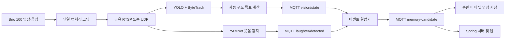

# 홈캠 AI 이벤트 감지 스택

심화 오디오 이벤트의 연속 박수·사용자 지정 호출명 설계와 실행 방법은
[`yamnet/ADVANCED_AUDIO_EVENTS.md`](yamnet/ADVANCED_AUDIO_EVENTS.md)를 참고한다.

앱 온디바이스 STT 모델 선정에 쓴 한국어 STT 비교 벤치마크는
[`stt_benchmark/`](stt_benchmark/)에 있다 — 배경과 결론은
[`stt_benchmark/run_benchmark.py`](stt_benchmark/run_benchmark.py) 머리 주석을 참고한다.

Jetson Orin Nano에서 영상과 음성을 동시에 분석하는 AI 모듈이다. YOLO + ByteTrack은 사람·고양이·강아지를 추적하여 카메라 구도 목표를 계산하고, YAMNet은 웃음소리를 감지한다. 두 결과는 로컬 Mosquitto를 통해 결합되어 추억 영상 저장 후보 이벤트로 전달된다.

현재 디스크 기반 운영 구성은 로컬 RTSP 입력을 사용한다. YOLO가 공유 RTSP를
직접 받아 실제 사람을 탐지·추적하고, 객체 소실 시
`TRACKING → HOLD → HOME`으로 전환하며, RTSP 강제 중단 후 지수 백오프로
자동 재연결하는 것까지 Jetson에서 검증하고 버전 묶음으로 배포했다.
고양이·강아지는 현장에 대상이 없어 아직 시험하지 않았다. YOLO·YAMNet
1시간 통합 시험 전까지 UDP 입력은 fallback으로 유지한다.

공유 RTSP 입력과 H.264/AAC 1분 순환 녹화는 Jetson 스모크 테스트를 통과했다.
30초 이벤트 병합과 최초 웃음 60초 전·마지막 웃음 60초 후 로컬 MP4 생성도
Jetson에서 확인했다. 서버 업로드의 HTTP 409 원인은 사용자 계정에 claim되지
않은 기기였으며, 영구 4xx 차단·파일 보존·서비스 재시작 후 무재시도까지
검증했다. 기기 claim 이후에는 수동 Trigger와 실제 BRIO 100 웃음 모두 서버
업로드·READY 처리와 Flutter 앱 영상·음성 재생까지 종단 검증했다.
SG90 실제 제어는 다음 구현 단계이고, 전체 합의 규격은
`AI_EDGE_INTEGRATION_SPEC.md`를 따른다.

Jetson에서 웃음 감지부터 전후 60초 로컬 MP4 생성과 노트북 다운로드까지
실기 검증할 때는 [`LAUGHTER_EVENT_RECORDING_RUNBOOK.md`](LAUGHTER_EVENT_RECORDING_RUNBOOK.md)를
순서대로 따른다.

2026-07-24 YOLO RTSP 사람 탐지·상태 전이·강제 단절 복구 결과는
[`AI_YOLO_RTSP_VALIDATION_2026-07-24.md`](../이재준/AI_YOLO_RTSP_VALIDATION_2026-07-24.md)에
기록했다.

2026-07-26 야간부터 27일 새벽까지의 업로드 안전성, 웃음 false-negative
분석, 평가 데이터 도구와 다음 작업은
[`AI_DAILY_PROGRESS_2026-07-27.md`](../이재준/AI_DAILY_PROGRESS_2026-07-27.md)에
기록했다.

2026-07-27 실제 웃음 이벤트의 서버 업로드와 Flutter 앱 재생 종단 결과는
[`AI_MVP_EVENT_E2E_2026-07-27.md`](../이재준/AI_MVP_EVENT_E2E_2026-07-27.md)에
기록했다. 같은 절차를 반복할 때는
[`yolo/validate_laughter_event_e2e.sh`](yolo/validate_laughter_event_e2e.sh)를
사용한다.

## 2026-07-27 작업 마감 기록

### 오늘 달성한 단계

오늘은 기존 SSH 터널 기반 라이브 송출을 Jetson의 직접 RTSPS 송출 구조로
전환하고, 기기 등록부터 실제 웃음 이벤트의 서버 업로드와 Flutter 앱 재생까지
최소 MVP의 이벤트 조회 경로를 종단 검증했다.

| 항목 | 결과 |
| --- | --- |
| Jetson → MediaMTX 직접 RTSPS publish | 보안 진단 완료 |
| Jetson 전용 계정 권한 | UUID 경로 publish만 허용, read와 잘못된 경로 publish 거부 확인 |
| MQTT | 최종 `prod/wj/v2/devices/{deviceId}/...` 규격 적용·연결 확인 |
| 앱 기기 등록 | 신규 일회용 코드로 claim 및 ONLINE 확인 |
| 수동 이벤트 업로드 | 서버 업로드와 Flutter 재생 성공 |
| 실제 웃음 이벤트 | YAMNet 감지 → 전후 60초 MP4 → 서버 업로드 → 앱 영상·음성 재생 성공 |
| 이벤트 로컬 정리 | 업로드 성공 후 MP4·Trigger 자동 삭제 확인 |
| 보존 정책 | 업로드 완료 영수증은 유지하고 영구 차단 MP4·Trigger는 조사 근거로 보존 |
| 직접 RTSPS 전환 후 Live View 최종 재확인 | 내일 시작 시 영상·음성을 다시 확인 |
| 앱 비파괴 편집·편집본 다운로드 | 다음 최우선 작업 |

실제 기기 ID, 이벤트 ID, 등록 코드, 계정 비밀번호와 인증 토큰은 문서에
기록하지 않는다.

### RTSPS 전환 방향

기존 구성은 Jetson이 EC2까지 SSH 터널을 열고 로컬
`rtsp://127.0.0.1:18554/...` 주소로 재게시하는 방식이었다. 최종 구성에서는
Jetson의 라이브 relay가 MediaMTX의
`rtsps://<server>:8322/live/{streamId}`로 직접 송출한다.

카메라 캡처와 AI 입력 구조는 바꾸지 않았다. BRIO 100은
`wj-media-source` 하나만 열고, YOLO·YAMNet·라이브·로컬 MediaMTX용 UDP
출력을 각각 분기한다. 직접 RTSPS로 나가는 프로세스는 앱의
`START_STREAM` 명령을 받은 라이브 relay 하나뿐이다. 로컬 AI와 상시 녹화는
외부 라이브 세션 유무와 관계없이 계속 동작한다.

SSH 터널 서비스는 직접 RTSPS 검증 중 장애가 발생할 때 사용할 롤백 수단으로
남겨 두었다. 직접 RTSPS Live View의 영상·음성을 최종 확인하기 전에는 서버의
`rtspEncryption`을 strict로 바꾸거나 롤백 구성을 제거하지 않는다.

### RTSPS 전환 중 발생한 문제와 해결

| 문제 | 원인 | 해결 및 검증 |
| --- | --- | --- |
| 기존 라이브 게시가 `401 Unauthorized`로 실패 | SSH 터널 뒤의 RTSP 주소도 MediaMTX 인증이 필요했지만 기존 Agent 설정이 이를 충족하지 못함 | Jetson 전용 publish-only 계정과 직접 RTSPS 주소를 사용하도록 전환 |
| 최신 Agent를 바로 설치하면 MQTT가 끊길 위험 | Jetson은 v1, 서버 코드와 최종 규격은 v2 `devices` 토픽을 사용했고 Broker에는 과거 `d2c/c2d` ACL도 남아 있었음 | Agent 전환을 보류한 채 실행 중 Broker에 최종 v2 Device·Backend ACL을 적용하고 양방향 권한을 확인한 후 설치 |
| MQTT ACL 마이그레이션 워커 반복 실패 | 서버 워커에서 DB 예외가 발생해 자동 마이그레이션을 신뢰할 수 없었음 | Mosquitto를 먼저 재시작하지 않고 동적 보안 ACL을 백업·수정·검증하여 기존 연결 중단을 피함 |
| CA와 Jetson 자격증명이 처음에는 준비되지 않음 | 서버 인증서 전체 체인만 있고 Jetson용 trust anchor·계정 전달이 끝나지 않았음 | 공개 CA, 별도 채널에서 확인한 SHA-256 지문과 Jetson 전용 계정을 전달받아 설치 |
| GitLab SSH 22번 포트 연결 timeout | Jetson이 현재 네트워크에서 GitLab SSH에 직접 연결하지 못함 | SHA-256을 확인한 오프라인 Git bundle로 저장소와 커밋을 복원하고 Device Agent 테스트 24개를 통과한 뒤 배포 |
| 정상 RTSPS publish가 진단에서 실패로 표시 | 테스트 영상이 실시간보다 빠르게 생성돼 2초 생존 확인 전에 FFmpeg가 정상 종료함 | FFmpeg 테스트 입력에 `-re`를 추가해 실시간 속도로 유지하고 진단 재실행 |
| 설치 후 등록 코드 도구가 Python 모듈을 찾지 못함 | 실행 위치가 설치 디렉터리로 고정되지 않아 `wj_device_agent` import가 실패함 | wrapper가 설치 디렉터리로 이동한 뒤 모듈을 실행하도록 수정하고 등록 성공 확인 |
| 이벤트 업로드가 HTTP 409로 차단 | 임시 기기가 사용자 계정에 claim되지 않음 | 신규 논리 기기를 등록 코드로 앱에 claim한 뒤 업로드 성공 확인 |
| 로그 감시 명령이 실제 웃음을 `NOT_DETECTED`로 표시 | `tail -n 0 -F` 시작 경계에서 이벤트 로그가 먼저 기록되는 race condition | 로그 한 줄 대신 새 Trigger 파일을 감시하는 `validate_laughter_event_e2e.sh` 추가 |

RTSPS 진단의 최종 통과 조건은 다음 세 가지다.

1. 인증된 canonical `live/{UUID}` 경로 publish 성공
2. publish-only 계정의 read 거부
3. UUID가 아닌 경로의 publish 거부

### RTSPS 보안 원칙

- Jetson에는 공개 CA trust anchor만 설치하며 서버 개인키는 전달하지 않는다.
- CA 파일의 SHA-256 지문은 인증서 파일과 다른 신뢰 채널에서 확인한다.
- Jetson 계정은 `live/{UUID}` publish만 허용하고 read 권한을 주지 않는다.
- 자격증명 파일은 `0600`, 운영 환경 파일은 `root:williamjames 0640`으로 유지한다.
- RTSPS Basic 인증정보가 FFmpeg 인자에 포함될 수 있으므로
  `ps aux | grep ffmpeg`나 `pgrep -af ffmpeg`를 사용하지 않는다.
- 프로세스 확인은 인증정보를 출력하지 않는 `pgrep -x -c ffmpeg`만 사용한다.
- 설치·설정 스크립트는 검증 전 Agent를 자동 재시작하지 않는다.

### 이벤트 MVP 결과와 로컬 보관 정책

실제 BRIO 100 웃음에서 YAMNet의 연속 `mean` 점수가 운영 기준을 만족해
Trigger가 생성됐다. 최초 감지 60초 전부터 마지막 감지 60초 후까지의
H.264/AAC MP4가 서버에 올라갔고, Flutter 앱에서 영상·음성·실제 웃음 구간과
약 2분 길이를 확인했다.

`DELETE_EVENT_AFTER_UPLOAD=true`를 적용해 업로드 성공 후 Jetson의 MP4와
Trigger는 자동 삭제한다. 작은 `uploaded.json` 영수증만 남겨 재처리를 막는다.
과거 업로드 완료 파일도 같은 기준으로 정리했다. 병합 완료 Trigger는
`merged.json`을 확인한 뒤 삭제했고, 영구 차단된 이벤트의 MP4·Trigger·
`upload-blocked.json`은 원인 조사와 수동 복구를 위해 보존했다.
사용자가 소장하기로 한 수동 시험 영상은 서버와 앱에 그대로 유지되며,
Jetson의 로컬 중복 파일 정리는 서버 영상을 삭제하지 않는다.

### 내일 재개 우선순위

#### P0-1. 파이프라인 재시작과 직접 RTSPS Live View 재확인

아래 “오늘 종료와 내일 재시작” 절차로 서비스를 올린 뒤 앱에서 기기가
ONLINE인지 확인한다. Live View를 열어 영상과 음성을 확인하고, 화면을 닫은 뒤
idle timeout 이후 라이브 relay FFmpeg 하나만 종료되는지 확인한다.

#### P0-2. 앱 비파괴 편집과 편집본 다운로드 종단 검증

서버에 보관된 이벤트 영상 하나로 다음을 확인한다.

1. 이벤트 상세 화면에서 원본 재생
2. 편집 화면 진입
3. 구간 자르기 등 최소 한 가지 편집 적용
4. 편집본을 앱 저장소에 저장
5. 편집본을 외부 파일로 다운로드 또는 공유
6. 다운로드한 파일의 영상·음성 재생
7. 편집 후에도 서버의 원본 영상이 변경되지 않았는지 재확인

편집 기능에서 코드 수정이 필요하면 현재 Device 브랜치에 섞지 않고
`develop/frontend`에서 `feat/frontend/<기능명>` 브랜치를 새로 만든다.

#### P0-3. Git 작업 마무리

- 현재 기능 브랜치: `feat/device/event-upload-mvp`
- Merge Request 대상: `develop/device`
- MR의 Device CI 결과를 확인하고 성공한 경우에만 병합한다.
- 병합 후 기능 브랜치를 삭제한다.

#### P1 이후

1. 30초 안에 연속 발생한 실제 웃음의 단일 영상 병합 검증
2. 네트워크 단절 중 생성한 이벤트의 복구 후 자동 업로드 검증
3. BRIO 100 조건별 웃음 평가 데이터 확장
4. AI-06 공식 1시간 동시 실행·강제 단절 복구 시험
5. SG90 두 축과 PCA9685 실제 제어

### 오늘 종료와 내일 재시작

오늘은 재부팅 설정을 바꾸지 않고 실행 중인 캡처·라이브·AI·녹화 서비스만
중지한다. 따라서 내일 같은 구성으로 다시 시작할 수 있다.

```bash
sudo systemctl stop \
  wj-edge-ai-recording \
  wj-local-recording \
  wj-recording-prune.timer \
  wj-device-agent \
  wj-media-tunnel \
  wj-mediamtx-local \
  wj-media-source

for service in \
  wj-device-agent \
  wj-media-source \
  wj-media-tunnel \
  wj-mediamtx-local \
  wj-local-recording \
  wj-recording-prune.timer \
  wj-edge-ai-recording
do
  printf '%-28s %s\n' \
    "$service" \
    "$(systemctl is-active "$service" 2>/dev/null || true)"
done

echo "FFMPEG_COUNT=$(pgrep -x -c ffmpeg 2>/dev/null || true)"
```

모든 서비스가 `inactive`, FFmpeg 수가 `0`이면 영상·음성 캡처와 외부 송출이
모두 종료된 상태다. 서버에서 기기는 heartbeat 만료 후 OFFLINE으로 보이는 것이
정상이다.

내일은 물리 장치 연결을 확인한 뒤 다음 순서로 시작한다. 직접 RTSPS 정상
경로에서는 `wj-media-tunnel`을 시작하지 않는다.

```bash
echo "=== DEVICES ==="
lsusb
cat /proc/asound/cards
ls -l /dev/video* 2>/dev/null

sudo systemctl start wj-media-source
sleep 8

sudo systemctl start \
  wj-mediamtx-local \
  wj-local-recording \
  wj-recording-prune.timer
sleep 8

sudo systemctl start \
  wj-edge-ai-recording \
  wj-device-agent
sleep 15

for service in \
  wj-device-agent \
  wj-media-source \
  wj-mediamtx-local \
  wj-local-recording \
  wj-recording-prune.timer \
  wj-edge-ai-recording
do
  printf '%-28s %s\n' \
    "$service" \
    "$(systemctl is-active "$service" 2>/dev/null || true)"
done
```

직접 RTSPS가 실패할 때만 `wj-media-tunnel` 롤백 절차를 사용한다.

## 시스템 구조



YOLO와 YAMNet은 하나의 Python 프로세스로 합치지 않는다. PyTorch·CUDA 기반 YOLO 환경과 TensorFlow 기반 YAMNet 환경을 분리해 패키지 충돌과 단일 장애 지점을 줄인다. `run_ai_stack.sh`가 두 가상환경의 실행 파일을 직접 호출하여 하나의 스택처럼 관리한다.

## 디렉터리 구조

```text
ai/
├── README.md
├── yolo/
│   ├── yolov8n.pt
│   ├── yolov8_detect_jetson.py
│   ├── yolov8_autoframe_jetson.py
│   ├── servo_controller.py
│   ├── stream_capture.py
│   ├── vision_mqtt_publisher.py
│   ├── event_fusion_service.py
│   ├── segment_clip_uploader.py
│   ├── summarize_yolo_validation.py
│   ├── run_ai_stack.sh
│   ├── run_edge_ai_recording.sh
│   ├── run_yolo_rtsp_validation.sh
│   ├── validate_jetson_release.sh
│   ├── requirements-autoframe-jetson.txt
│   ├── requirements-servo-controller.txt
│   ├── test_autoframe_logic.py
│   ├── test_servo_controller.py
│   ├── test_event_fusion.py
│   ├── test_segment_clip_uploader.py
│   ├── test_stream_capture.py
│   └── test_summarize_yolo_validation.py
└── yamnet/
    ├── yamnet_laughter_detect_jetson.py
    ├── ffmpeg_audio_stream.py
    ├── laughter_eval_dataset.py
    ├── laughter_scoring.py
    ├── mqtt_event_publisher.py
    ├── requirements-jetson.txt
    ├── test_ffmpeg_audio_stream.py
    ├── test_laughter_eval_dataset.py
    └── test_laughter_scoring.py
```

## 현재 기능

### YOLO 자동 구도

- COCO 클래스 중 `person`, `cat`, `dog`만 탐지
- ByteTrack으로 프레임 간 객체 ID 유지
- 객체가 한 개이면 해당 객체 중심을 목표점으로 선택
- 여러 객체이면 안전 여백 안에 가장 많은 객체가 들어오는 그룹 선택
- 같은 수의 그룹이면 화면 중심에 가까워 회전량이 적은 그룹 선택
- 새 추적 대상과 새 그룹은 여러 프레임 유지될 때만 반영
- EMA 평활화와 중앙 데드존으로 카메라 떨림 완화
- 객체 유실 시 5초간 `HOLD` 후 `HOME` 명령 생성
- `command_x`, `command_y`와 정규화된 `error_x`, `error_y`를 10Hz로 제공
- MQTT 서보 제어기는 설정된 물리 범위 안에서 속도 제한 이동
- 현재 실물 검증 범위는 PAN `-10°~+10°`, TILT 수평 `0°`~아래 `10°`
- MQTT/AI 메시지가 끊기면 `HOLD`, 대상 유실 5초 후 `HOME`

실제 PCA9685 출력은 별도 5V 전원과 실물 보정이 완료된 뒤에만 명시적으로
활성화한다. 기본 실행은 드라이런이다. 연결·보정·정지 절차는
`SERVO_PCA9685_RUNBOOK.md`를 따르고, 2026-07-29 실물 결과와 인수인계는
`SERVO_OBJECT_TRACKING_HANDOFF_20260729.txt`를 참고한다.

### YAMNet 웃음 감지

- 직접 마이크 또는 공유 RTSP/UDP 오디오를 YAMNet 입력용 16kHz mono 파형으로 변환
- threshold, consecutive, gain, cooldown 설정 지원
- `max`, `mean`, `p90` 시간 패치 점수 집계 방식 비교 지원
- 이벤트를 만들지 않고 점수·RMS·최상위 소리를 JSONL로 기록하는 진단 모드 지원
- 큰 웃음용 MVP 임시 기준선은 `mean / 0.125 / 3회` 사용
- 이 임시 기준선은 작은 웃음을 놓치므로 최종 운영 정확도를 충족하지 않음
- 작은 웃음 개선은 YAMNet 임베딩 기반 커스텀 분류기 Task로 분리
- 웃음 감지 시 MQTT 원본 이벤트 발행

### 웃음 평가 데이터

`yamnet/laughter_eval_dataset.py`는 상시 녹화 세그먼트에서 평가 샘플을
분리하고, 수동 검토 라벨을 확정한 뒤 전체 데이터의 JSON·CSV·Markdown
카탈로그를 생성한다.

- 원본 MPEG-TS 세그먼트와 검토용 H.264/AAC MP4를 함께 보존한다.
- 모델 입력과 같은 PCM 16-bit, 16kHz mono WAV를 만든다.
- 진단 JSONL, 작업자 시간 창, SHA-256과 모델 설정을 `metadata.json`에
  기록한다.
- 라벨은 처음에는 `provisional`, 실제 재생 확인 후에만 `verified`로
  전환한다.
- BRIO 100과 다른 마이크로 수집한 샘플은 환경을 분리하고 최종 BRIO
  정확도 지표에 포함하지 않는다.

```bash
# 수동 재생 검토 후 정답 구간 확정
python yamnet/laughter_eval_dataset.py finalize \
  --sample-dir "$HOME/ai_datasets/laughter_eval/<environment>/<sample>" \
  --start-seconds 4.5 \
  --end-seconds 10.5 \
  --audio-clarity clear

# 파일 크기와 SHA-256을 포함한 샘플 무결성 검사
python yamnet/laughter_eval_dataset.py validate \
  --sample-dir "$HOME/ai_datasets/laughter_eval/<environment>/<sample>"

# 전체 샘플 검사 후 catalog.json, catalog.csv, catalog.md 생성
python yamnet/laughter_eval_dataset.py catalog \
  --dataset-root "$HOME/ai_datasets/laughter_eval"
```

원본 세그먼트 추출에는 `create --help`에 표시되는 `source-segment`,
`segment-started-at`, context offset·duration과 임시 라벨 범위를 사용한다.
메타데이터에는 토큰, 인증정보와 실제 기기 ID를 넣지 않는다.

### 공유 스트림 입력

- YOLO는 `--stream-url`로 RTSP/UDP를 받고 추론 지연이 쌓이지 않도록 최신 프레임 하나만 유지
- YAMNet은 FFmpeg로 공유 스트림의 오디오만 추출하며 최종 녹화용 AAC 품질에는 영향 없음
- 스트림 단절 시 1초부터 지수 백오프로 재연결하고 최대 간격은 10초로 제한
- RTSP는 TCP를 사용하며 현재 FFmpeg 빌드가 지원하는 경우 열기·읽기 타임아웃을 적용
- URL의 사용자 이름과 비밀번호는 로그와 실행 메타데이터에서 마스킹 또는 생략
- 직접 카메라·마이크와 기존 UDP 입력은 전환 검증용 fallback으로 유지

### 디스크 기반 이벤트 클립

- 단일 H.264/AAC 인코딩 결과를 1분 MPEG-TS 세그먼트로 저장하고 7일이 지난 파일만 정리
- YAMNet `--trigger-only` 모드에서는 60초 PCM을 메모리에 보관하지 않고 작은 JSON만 기록
- 30초 안에 이어진 웃음들을 하나의 이벤트 UUID 아래 병합
- 최초 웃음 60초 전부터 마지막 웃음 60초 후까지 완성된 세그먼트만 선택
- 영상·음성을 다시 인코딩하지 않고 MP4로 remux한 뒤 기존 업로드 API 사용
- 업로드 완료 후 임시 이벤트 MP4와 트리거를 지우고 작은 완료 마커만 유지
- 녹화 공백이 있으면 불완전한 영상을 올리지 않고 로그에 보류 상태 기록

### 이벤트 결합

- 웃음 이벤트는 영상 상태와 관계없이 항상 후보 이벤트로 유지
- 2초 이내의 최신 YOLO 상태가 있으면 객체 수, 추적 ID와 카메라 상태 추가
- YOLO 상태가 없거나 오래되면 `vision_context.available=false`로 발행
- YOLO 탐지 실패 때문에 웃음 이벤트를 버리지 않는 Recall 우선 정책

## 검증 환경

- NVIDIA Jetson Orin Nano 8GB
- Jetson Linux R36.4.7
- Python 3.10.12
- Logitech Brio 100 영상·마이크
- 로컬 Mosquitto 브로커
- YOLO 가상환경: `~/venvs/yolo`
- YAMNet 가상환경: `~/venvs/yamnet`

Jetson용 PyTorch와 OpenCV는 JetPack·Jetson Linux 버전에 맞아야 한다. 일반 PC용 `pip install torch`나 `opencv-python`으로 기존 Jetson 패키지를 덮어쓰지 않는다.

## 사전 준비

Mosquitto와 오디오 라이브러리를 설치한다.

```bash
sudo apt-get update
sudo apt-get install -y \
  python3-venv \
  libportaudio2 \
  portaudio19-dev \
  mosquitto \
  mosquitto-clients

sudo systemctl enable --now mosquitto
systemctl is-active mosquitto
```

결과가 `active`인지 확인한다.

## Python 환경 준비

### YOLO 환경

Jetson용 PyTorch, OpenCV와 Ultralytics가 정상 동작하는 기존 환경에서 추가 패키지를 설치한다.

```bash
source ~/venvs/yolo/bin/activate
python -m pip install -r ai/yolo/requirements-autoframe-jetson.txt
python -m pip install -r ai/yolo/requirements-servo-controller.txt

python -c "import cv2, torch, ultralytics, lap, paho.mqtt.client, smbus2; print('CUDA:', torch.cuda.is_available())"
```

`torch.cuda.is_available()`은 `True`가 되어야 한다. `requirements-autoframe-jetson.txt`는 ByteTrack과 MQTT에 추가로 필요한 패키지만 설치하며 Jetson 전용 PyTorch를 교체하지 않는다.

### YAMNet 환경

```bash
python3 -m venv ~/venvs/yamnet
source ~/venvs/yamnet/bin/activate
python -m pip install --upgrade pip
python -m pip install -r ai/yamnet/requirements-jetson.txt
```

YAMNet은 첫 실행 시 TensorFlow Hub에서 모델을 내려받고 이후 `~/.cache/tfhub`에서 재사용한다. 첫 실행에는 인터넷 연결이 필요하다.

## 테스트

YOLO 가상환경에서 하드웨어 독립 로직 테스트를 실행한다.

```bash
source ~/venvs/yolo/bin/activate
python ai/yolo/test_autoframe_logic.py
python ai/yolo/test_servo_controller.py
python ai/yolo/test_event_fusion.py
python ai/yolo/test_laughter_clip_uploader.py
python ai/yolo/test_stream_capture.py
python ai/yolo/test_segment_clip_uploader.py
python ai/yolo/test_summarize_yolo_validation.py
python ai/yamnet/test_ffmpeg_audio_stream.py
python ai/yamnet/test_laughter_scoring.py
```

Jetson에 전체 릴리스를 별도 폴더로 배치한 뒤에는 서비스를 변경하기 전에
다음 명령으로 파일 구성, Bash·Python 문법과 전체 테스트를 한 번에 확인한다.

```bash
chmod +x ai/yolo/validate_jetson_release.sh
ai/yolo/validate_jetson_release.sh
```

기본 객체 탐지만 확인하려면 다음 명령을 사용한다.

```bash
source ~/venvs/yolo/bin/activate
python ai/yolo/yolov8_detect_jetson.py \
  --camera 0 \
  --max-frames 100 \
  --output yolo_smoke_test.mp4
```

## 통합 실행

`run_ai_stack.sh`는 자신의 위치를 YOLO 디렉터리로, 형제 디렉터리인 `../yamnet`을 YAMNet 디렉터리로 사용한다. 팀 레포가 어디에 클론되어 있어도 위 디렉터리 구조를 유지하면 별도 경로 옵션이 필요 없다.

```bash
cd ai/yolo
chmod +x run_ai_stack.sh
bash -n run_ai_stack.sh
```

마이크 목록을 확인한다.

```bash
./run_ai_stack.sh --list-mics
```

10분 동안 자원 로그와 디버그 영상을 저장하는 통합 시험 예시다.

```bash
./run_ai_stack.sh \
  --mic-device <MIC_NUMBER> \
  --duration 600 \
  --record-debug-video
```

시스템 기본 마이크를 사용하면 `--mic-device`를 생략한다. 시간 제한 없이 상시 실행할 때는 저장 공간을 계속 사용하는 `--record-debug-video`도 생략한다.

```bash
./run_ai_stack.sh
```

공유 RTSP 입력을 사용하는 목표 실행 형태는 다음과 같다. 현재 Jetson UDP fallback 주소도 같은 옵션에 전달할 수 있다.

```bash
./run_ai_stack.sh \
  --video-source rtsp://127.0.0.1:8554/homecam/ai \
  --audio-source rtsp://127.0.0.1:8554/homecam/ai \
  --device-id "$DEVICE_ID"
```

URL을 코드에 적지 않으려면 `VIDEO_SOURCE`, `AUDIO_SOURCE`, `DEVICE_ID` 환경변수로 주입한다.

```bash
export VIDEO_SOURCE="udp://127.0.0.1:23000?fifo_size=1000000&overrun_nonfatal=1"
export AUDIO_SOURCE="udp://127.0.0.1:23001?fifo_size=1000000&overrun_nonfatal=1"
export DEVICE_ID="개발용-장치-ID"
./run_ai_stack.sh
```

로컬 RTSP와 순환 녹화 서비스 설치·시험은 다음 순서로 진행한다. 설치 스크립트는 서비스를 자동 시작하지 않으므로 기존 UDP 실행에는 영향을 주지 않는다.

```bash
cd ai/device_agent
chmod +x \
  install-local-media.sh \
  media-source.sh \
  run-local-mediamtx.sh \
  local-recording.sh \
  recording-prune.sh \
  check-local-media.sh
sudo ./install-local-media.sh

sudo systemctl restart wj-media-source
sudo systemctl start wj-mediamtx-local
sleep 5
sudo -u williamjames \
  /opt/william-james/device-agent/check-local-media.sh
```

`main`과 `ai` 경로가 모두 통과한 뒤 녹화를 시작한다.

현재 64GB 젯슨 루트 디스크로 시험하는 동안은 다음 설정을 유지한다.
`RECORDING_MAX_GIB=8`을 넘으면 7일이 지나지 않은 파일도 가장 오래된
완료 세그먼트부터 삭제한다. 현재 비트레이트 기준 약 6~7시간 분량이며,
256GB 저장장치로 옮기기 전에는 이 제한을 제거하지 않는다.

```bash
RECORDING_DIR=/var/lib/william-james/recordings
RECORDING_MAX_GIB=8
```

```bash
sudo systemctl start wj-local-recording wj-recording-prune.timer
sleep 70
sudo -u williamjames \
  /opt/william-james/device-agent/check-local-media.sh
```

1시간 RTSP 단절·복구 시험까지 통과한 뒤에만 5초 MVP를 디스크 기반 AI로 바꾼다.

```bash
sudo systemctl stop wj-edge-ai-mvp
sudo systemctl start wj-edge-ai-recording

# 1시간 시험까지 통과한 뒤 부팅 기본값 전환
sudo systemctl disable wj-edge-ai-mvp
sudo systemctl enable \
  wj-mediamtx-local \
  wj-local-recording \
  wj-recording-prune.timer \
  wj-edge-ai-recording
```

문제가 있으면 녹화·RTSP 서비스만 내리고 기존 UDP AI를 다시 시작한다.

```bash
sudo systemctl disable --now \
  wj-edge-ai-recording \
  wj-local-recording \
  wj-recording-prune.timer \
  wj-mediamtx-local
sudo systemctl enable wj-edge-ai-mvp
sudo systemctl start wj-edge-ai-mvp
```

실행 중 `Ctrl+C`를 한 번 누르면 모든 프로세스에 정상 종료 신호를 전달한다. MP4를 생성 중이었다면 OpenCV `VideoWriter`가 파일을 마무리할 시간을 최대 12초까지 기다린다. 터미널을 닫거나 `kill -9`로 강제 종료하면 MP4가 재생되지 않을 수 있다.

주요 옵션은 다음과 같다.

| 옵션 | 기본값 | 설명 |
|---|---:|---|
| `--camera` | `0` | V4L2 카메라 번호 |
| `--mic-device` | 시스템 기본 | 마이크 번호 또는 장치 이름 |
| `--video-source` | `VIDEO_SOURCE` 또는 없음 | YOLO용 공유 RTSP/UDP 주소; 카메라보다 우선 |
| `--audio-source` | `AUDIO_SOURCE` 또는 없음 | YAMNet용 공유 RTSP/UDP 주소; 마이크보다 우선 |
| `--device-id` | `homecam-001` | MQTT 장치 ID |
| `--duration` | `0` | 자동 종료 시간, 0은 무제한 |
| `--threshold` | `0.20` | YAMNet 웃음 임계값 |
| `--consecutive` | `1` | 이벤트 전 연속 검출 횟수 |
| `--gain` | `1.5` | YAMNet 입력 증폭 배율 |
| `--record-debug-video` | 꺼짐 | 자동 구도 확인 MP4 저장 |
| `--no-tegrastats` | 꺼짐 | Jetson 자원 로그 비활성화 |

전체 옵션은 다음 명령으로 확인한다.

```bash
./run_ai_stack.sh --help
```

## 실행 결과와 로그

각 실행은 `~/ai_runs/YYYYMMDD_HHMMSS/`에 독립적으로 저장된다.

```text
run_metadata.txt
yolo.log
yamnet.log
fusion.log
mqtt_events.log
resources.log
autoframe_commands.jsonl
autoframe.mp4              # --record-debug-video 사용 시
```

최근 실행 폴더를 확인한다.

```bash
cat ~/ai_runs/latest_run.txt
ls -lh ~/ai_runs/latest/
```

실시간 로그를 확인한다.

```bash
tail -F \
  ~/ai_runs/latest/yolo.log \
  ~/ai_runs/latest/yamnet.log \
  ~/ai_runs/latest/fusion.log
```

## MQTT 인터페이스

| 토픽 | QoS | Retain | 발행자 | 용도 |
|---|---:|---|---|---|
| `homecam/v2/{device_id}/ai/vision/state` | 0 | false | YOLO | 최신 객체·자동 구도 상태, 10Hz |
| `homecam/v2/{device_id}/control/framing/target` | 0 | false | YOLO | SG90 제어기가 사용할 두 축 명령과 정규화 오차 목표, 10Hz |
| `homecam/v2/{device_id}/control/framing/status` | 0 | false | 서보 제어기 | 논리 각도·상태·거부 메시지 진단 |
| `homecam/v2/{device_id}/ai/laughter/detected` | 1 | false | YAMNet | 원본 웃음 감지 이벤트 |
| `homecam/v2/{device_id}/events/memory-candidate` | 1 | false | 결합기 | 백엔드·IoT가 사용할 최종 후보 이벤트 |

최종 이벤트 예시는 다음과 같다.

```json
{
  "schema_version": "1.1",
  "event_id": "0a61d047-63ea-4ae0-917e-3787a572ec02",
  "device_id": "homecam-001",
  "event_type": "laughter",
  "detected_at": "2026-07-22T07:30:00.000Z",
  "score": 0.72,
  "class_name": "Laughter",
  "clip": {
    "pre_seconds": 60,
    "post_seconds": 60
  },
  "vision_context": {
    "available": true,
    "age_ms": 83,
    "object_count": 3,
    "track_ids": [1, 3, 4],
    "person_count": 2,
    "cat_count": 0,
    "dog_count": 1,
    "target_ids": [1, 3, 4],
    "camera_state": "TRACKING",
    "camera_direction": "RIGHT",
    "error_x": 0.18,
    "error_y": -0.03
  }
}
```

필수 필드가 빠졌거나 타입이 잘못된 메시지는 처리하지 않는다. 예를 들어 다음 메시지는 `event_id`가 UUID가 아니고 `detected_at`의 UTC 시간대와 `clip`, `vision_context`가 없으므로 잘못된 메시지다.

```json
{
  "schema_version": "1.1",
  "event_id": "123",
  "device_id": "homecam-001",
  "event_type": "laughter",
  "detected_at": "2026-07-23 12:30:00",
  "score": "high"
}
```

로컬 MQTT는 현재 개발용 구성이다. 서버 Broker bridge를 구성할 때 인증정보와 TLS 인증서를 레포에 커밋하지 말고 배포 환경의 비밀정보로 주입한다.

## 자원 사용 평가

비교 가능한 결과를 위해 다음 네 조건을 각각 측정한다.

1. 모델 미실행 1분
2. YOLO만 실행 5분
3. YAMNet만 실행 5분
4. 통합 스택 10분 이상

`resources.log`에서 RAM, SWAP, CPU, `GR3D_FREQ`, 온도와 `VDD_IN`을 비교한다. 시작 직후 모델 로딩 구간과 안정화 이후 구간을 구분하고, RAM이 지속해서 증가하는지 확인한다.

RTSP·녹화·기존 UDP AI를 함께 시험할 때는
`device_agent/integration-soak-test.sh`를 `systemd-run`으로 실행한다.
분 단위 서비스 상태·재시작 횟수·RTSP 응답 시간·프로세스 RSS·녹화
증가량과 tegrastats를 journal에 남기므로 SSH가 끊겨도 시험이 계속된다.

2026-07-23 Jetson 10분 예비 시험에서는 RTSP 실패 없이 약 200MiB가
녹화됐고 온도는 약 50°C, 스왑은 0MB였다. 종료 표본의 CPU 사용률이
높아 1080p 전환 전 최적화가 필요하다. 상세값은
[`AI_RTSP_10MIN_TEST_2026-07-23.md`](../이재준/AI_RTSP_10MIN_TEST_2026-07-23.md)에 기록했다.

## 모델과 생성 파일 관리

- 현재 `yolov8n.pt`는 약 6.5MB의 고정 MVP 모델이므로 재현성을 위해 레포에 포함한다.
- 더 큰 모델이나 직접 학습한 가중치는 Git LFS 또는 모델 아티팩트 저장소를 사용한다.
- TensorRT `*.engine`은 JetPack·TensorRT·GPU 환경에 의존하므로 레포에 커밋하지 않고 대상 Jetson에서 생성한다.
- `ai_runs`, MP4, JSONL과 로그는 `.gitignore`로 제외한다.
- 테스트에 사용한 사람의 음성·영상 원본은 동의 없이 레포에 올리지 않는다.

배포 전에는 Ultralytics YOLO, YAMNet과 포함된 각 의존성의 라이선스가 서비스 형태에 맞는지 별도로 검토한다.

## 파트별 책임 경계

| 파트 | 책임 |
|---|---|
| Edge Media & AI | BRIO 단일 캡처, 공유 스트림, 순환 녹화·클립 추출, 객체 추적, 카메라 목표 좌표, 웃음 감지, 로컬 MQTT, 로컬 서보 각도·PWM 제어 |
| Device Agent/IoT | 클라우드 MQTT 연결, 라이브 명령·상태, 릴레이 수명 관리 |
| Backend | 권한·라이브 세션, 업로드 URL, 영상 보관 정책, 사용자 확인·비파괴 편집 API |

## 현재 한계와 다음 작업

- 웃음 감지는 사람별 차이와 거리·TV 소리에 영향을 받으므로 평가 데이터로 threshold를 계속 조정해야 한다.
- 현재 자동 구도는 화면 좌표와 복수 객체 그룹 중앙 기반이며 PCA9685와
  SG90 PAN/TILT 실물 추적까지 확인했다. 다음 단계에서 카메라 화각과 현재
  각도를 이용한 공간 좌표 추적 및 장시간 내구 시험으로 확장한다.
- YOLO와 YAMNet 동시 실행의 CPU 병목을 장시간 로그로 평가한다.
- 실제 팬·틸트 제어 전에는 데드존, EMA, 최대 속도와 물리적 각도 제한을 확정한다.
- 디스크 기반 녹화·클립 경로를 Jetson에서 검증한 뒤 기존 5초 메모리 버퍼를 기본 경로에서 제거한다.
- 디스크 기반 1분 전·후 클립 코드는 구현됐지만 실제 BRIO 스트림의 타임스탬프·A/V 동기화는 Jetson에서 확인해야 한다.
- YOLO 단독 RTSP 강제 중단·복구는 Jetson에서 확인했다. YOLO·YAMNet 동시
  복구와 최소 1시간 자원 측정 전에는 UDP fallback을 제거하지 않는다.
- 이벤트 업로더는 409 등 영구 4xx를 `.upload-blocked.json`으로 격리하고
  로컬 MP4·Trigger를 보존한다.
- 408·429·5xx와 네트워크 오류는 5초부터 최대 5분까지 지수 백오프로
  재시도하며, 서명 URL의 쿼리는 로그와 오류 마커에 남기지 않는다.
- HTTP 409 원인은 미claim 기기로 확인했으며, claim 이후 수동·실제 웃음
  이벤트의 서버 `READY`·앱 조회와 영상·음성 재생까지 종단 검증했다.
- 업로드 성공 뒤 Jetson 중복 MP4와 Trigger를 자동 삭제하고 작은 완료
  영수증만 유지하는 운영 설정을 신규 이벤트로 확인했다.

## 문제 해결

### Mosquitto가 실행되지 않을 때

```bash
sudo systemctl restart mosquitto
systemctl status mosquitto --no-pager
```

### 카메라를 열 수 없을 때

```bash
ls -l /dev/video*
groups
```

사용자가 `video` 그룹에 없다면 관리자가 그룹을 추가한 뒤 다시 로그인해야 한다.

```bash
sudo usermod -aG video "$USER"
```

### 마이크 번호가 다를 때

```bash
cd ai/yolo
./run_ai_stack.sh --list-mics
```

### 공유 스트림이 연결되지 않을 때

모델은 종료되지 않고 최대 10초 간격으로 계속 재연결한다. 먼저 URL과 로컬 MediaMTX 또는 UDP 송출 상태를 확인한다.

```bash
ffprobe -v error -show_streams \
  rtsp://127.0.0.1:8554/homecam/ai
tail -F ~/ai_runs/latest/yolo.log ~/ai_runs/latest/yamnet.log
```

### 통합 프로세스가 바로 종료될 때

최근 실행 폴더의 로그를 확인한다.

```bash
cat ~/ai_runs/latest/yolo.log
cat ~/ai_runs/latest/yamnet.log
cat ~/ai_runs/latest/fusion.log
```

필요 파일이 하위 폴더에 모두 존재하는지 확인한다.

```bash
ls -l ai/yolo
ls -l ai/yamnet
```
