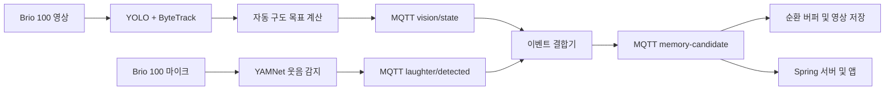

# 홈캠 AI 이벤트 감지 스택

Jetson Orin Nano에서 영상과 음성을 동시에 분석하는 AI 모듈이다. YOLO + ByteTrack은 사람·고양이·강아지를 추적하여 카메라 구도 목표를 계산하고, YAMNet은 웃음소리를 감지한다. 두 결과는 로컬 Mosquitto를 통해 결합되어 추억 영상 저장 후보 이벤트로 전달된다.

현재 구현은 AI 이벤트 생성까지 담당한다. 실제 서보모터 PWM 제어, 1분 전·후 영상 버퍼 저장, 서버 업로드와 앱 편집 기능은 각각 IoT·백엔드 파트의 책임이다.

## 시스템 구조



YOLO와 YAMNet은 하나의 Python 프로세스로 합치지 않는다. PyTorch·CUDA 기반 YOLO 환경과 TensorFlow 기반 YAMNet 환경을 분리해 패키지 충돌과 단일 장애 지점을 줄인다. `run_ai_stack.sh`가 두 가상환경의 실행 파일을 직접 호출하여 하나의 스택처럼 관리한다.

## 디렉터리 구조

```text
ai/
├── README.md
├── yolo/
│   ├── yolov8n.pt
│   ├── yolov8_detect_jetson.py
│   ├── yolov8_autoframe_jetson.py
│   ├── vision_mqtt_publisher.py
│   ├── event_fusion_service.py
│   ├── run_ai_stack.sh
│   ├── requirements-autoframe-jetson.txt
│   ├── test_autoframe_logic.py
│   └── test_event_fusion.py
└── yamnet/
    ├── yamnet_laughter_detect_jetson.py
    ├── mqtt_event_publisher.py
    └── requirements-jetson.txt
```

## 현재 기능

### YOLO 자동 구도

- COCO 클래스 중 `person`, `cat`, `dog`만 탐지
- ByteTrack으로 프레임 간 객체 ID 유지
- 객체가 한 개이면 해당 객체 중심을 목표점으로 선택
- 여러 객체이면 안전 여백 안에 가장 많은 객체가 들어오는 그룹 선택
- 같은 수의 그룹이면 화면 중심에 가까워 회전량이 적은 그룹 선택
- 새 추적 대상과 새 그룹은 여러 프레임 유지될 때만 반영
- EMA 평활화와 중앙 데드존으로 카메라 떨림 완화
- 객체 유실 시 5초간 `HOLD` 후 `HOME` 명령 생성
- `error_x`, `error_y`를 정규화하여 추후 IoT 서보 제어에 제공

현재 `HOME`, `LEFT`, `RIGHT`, `UP`, `DOWN`, `HOLD`는 제어 목표일 뿐 실제 PWM을 발생시키지 않는다.

### YAMNet 웃음 감지

- 마이크 입력을 YAMNet 입력용 16kHz mono 파형으로 변환
- laughter 관련 클래스의 점수 중 최댓값 사용
- threshold, consecutive, gain, cooldown 설정 지원
- 웃음을 놓치지 않는 Recall 우선 설정 사용
- 웃음 감지 시 MQTT 원본 이벤트 발행

### 이벤트 결합

- 웃음 이벤트는 영상 상태와 관계없이 항상 후보 이벤트로 유지
- 2초 이내의 최신 YOLO 상태가 있으면 객체 수, 추적 ID와 카메라 상태 추가
- YOLO 상태가 없거나 오래되면 `vision_context.available=false`로 발행
- YOLO 탐지 실패 때문에 웃음 이벤트를 버리지 않는 Recall 우선 정책

## 검증 환경

- NVIDIA Jetson Orin Nano 8GB
- Jetson Linux R36.4.7
- Python 3.10.12
- Logitech Brio 100 영상·마이크
- 로컬 Mosquitto 브로커
- YOLO 가상환경: `~/venvs/yolo`
- YAMNet 가상환경: `~/venvs/yamnet`

Jetson용 PyTorch와 OpenCV는 JetPack·Jetson Linux 버전에 맞아야 한다. 일반 PC용 `pip install torch`나 `opencv-python`으로 기존 Jetson 패키지를 덮어쓰지 않는다.

## 사전 준비

Mosquitto와 오디오 라이브러리를 설치한다.

```bash
sudo apt-get update
sudo apt-get install -y \
  python3-venv \
  libportaudio2 \
  portaudio19-dev \
  mosquitto \
  mosquitto-clients

sudo systemctl enable --now mosquitto
systemctl is-active mosquitto
```

결과가 `active`인지 확인한다.

## Python 환경 준비

### YOLO 환경

Jetson용 PyTorch, OpenCV와 Ultralytics가 정상 동작하는 기존 환경에서 추가 패키지를 설치한다.

```bash
source ~/venvs/yolo/bin/activate
python -m pip install -r ai/yolo/requirements-autoframe-jetson.txt

python -c "import cv2, torch, ultralytics, lap, paho.mqtt.client; print('CUDA:', torch.cuda.is_available())"
```

`torch.cuda.is_available()`은 `True`가 되어야 한다. `requirements-autoframe-jetson.txt`는 ByteTrack과 MQTT에 추가로 필요한 패키지만 설치하며 Jetson 전용 PyTorch를 교체하지 않는다.

### YAMNet 환경

```bash
python3 -m venv ~/venvs/yamnet
source ~/venvs/yamnet/bin/activate
python -m pip install --upgrade pip
python -m pip install -r ai/yamnet/requirements-jetson.txt
```

YAMNet은 첫 실행 시 TensorFlow Hub에서 모델을 내려받고 이후 `~/.cache/tfhub`에서 재사용한다. 첫 실행에는 인터넷 연결이 필요하다.

## 테스트

YOLO 가상환경에서 하드웨어 독립 로직 테스트를 실행한다.

```bash
source ~/venvs/yolo/bin/activate
python ai/yolo/test_autoframe_logic.py
python ai/yolo/test_event_fusion.py
```

현재 기준 총 9개 테스트가 통과해야 한다.

기본 객체 탐지만 확인하려면 다음 명령을 사용한다.

```bash
source ~/venvs/yolo/bin/activate
python ai/yolo/yolov8_detect_jetson.py \
  --camera 0 \
  --max-frames 100 \
  --output yolo_smoke_test.mp4
```

## 통합 실행

`run_ai_stack.sh`는 자신의 위치를 YOLO 디렉터리로, 형제 디렉터리인 `../yamnet`을 YAMNet 디렉터리로 사용한다. 팀 레포가 어디에 클론되어 있어도 위 디렉터리 구조를 유지하면 별도 경로 옵션이 필요 없다.

```bash
cd ai/yolo
chmod +x run_ai_stack.sh
bash -n run_ai_stack.sh
```

마이크 목록을 확인한다.

```bash
./run_ai_stack.sh --list-mics
```

10분 동안 자원 로그와 디버그 영상을 저장하는 통합 시험 예시다.

```bash
./run_ai_stack.sh \
  --mic-device <MIC_NUMBER> \
  --duration 600 \
  --record-debug-video
```

시스템 기본 마이크를 사용하면 `--mic-device`를 생략한다. 시간 제한 없이 상시 실행할 때는 저장 공간을 계속 사용하는 `--record-debug-video`도 생략한다.

```bash
./run_ai_stack.sh
```

실행 중 `Ctrl+C`를 한 번 누르면 모든 프로세스에 정상 종료 신호를 전달한다. MP4를 생성 중이었다면 OpenCV `VideoWriter`가 파일을 마무리할 시간을 최대 12초까지 기다린다. 터미널을 닫거나 `kill -9`로 강제 종료하면 MP4가 재생되지 않을 수 있다.

주요 옵션은 다음과 같다.

| 옵션 | 기본값 | 설명 |
|---|---:|---|
| `--camera` | `0` | V4L2 카메라 번호 |
| `--mic-device` | 시스템 기본 | 마이크 번호 또는 장치 이름 |
| `--device-id` | `homecam-001` | MQTT 장치 ID |
| `--duration` | `0` | 자동 종료 시간, 0은 무제한 |
| `--threshold` | `0.20` | YAMNet 웃음 임계값 |
| `--consecutive` | `1` | 이벤트 전 연속 검출 횟수 |
| `--gain` | `1.5` | YAMNet 입력 증폭 배율 |
| `--record-debug-video` | 꺼짐 | 자동 구도 확인 MP4 저장 |
| `--no-tegrastats` | 꺼짐 | Jetson 자원 로그 비활성화 |

전체 옵션은 다음 명령으로 확인한다.

```bash
./run_ai_stack.sh --help
```

## 실행 결과와 로그

각 실행은 `~/ai_runs/YYYYMMDD_HHMMSS/`에 독립적으로 저장된다.

```text
run_metadata.txt
yolo.log
yamnet.log
fusion.log
mqtt_events.log
resources.log
autoframe_commands.jsonl
autoframe.mp4              # --record-debug-video 사용 시
```

최근 실행 폴더를 확인한다.

```bash
cat ~/ai_runs/latest_run.txt
ls -lh ~/ai_runs/latest/
```

실시간 로그를 확인한다.

```bash
tail -F \
  ~/ai_runs/latest/yolo.log \
  ~/ai_runs/latest/yamnet.log \
  ~/ai_runs/latest/fusion.log
```

## MQTT 인터페이스

| 토픽 | 발행자 | 용도 |
|---|---|---|
| `homecam/v1/{device_id}/ai/vision/state` | YOLO | 최신 객체·자동 구도 상태, 5Hz |
| `homecam/v1/{device_id}/ai/laughter/detected` | YAMNet | 원본 웃음 감지 이벤트 |
| `homecam/v1/{device_id}/events/memory-candidate` | 결합기 | 백엔드·IoT가 사용할 최종 후보 이벤트 |

최종 이벤트 예시는 다음과 같다.

```json
{
  "schema_version": "1.1",
  "event_id": "0a61d047-63ea-4ae0-917e-3787a572ec02",
  "device_id": "homecam-001",
  "event_type": "LAUGHTER",
  "detected_at": "2026-07-22T07:30:00.000Z",
  "score": 0.72,
  "class_name": "Laughter",
  "clip": {
    "pre_seconds": 60,
    "post_seconds": 60
  },
  "vision_context": {
    "available": true,
    "age_ms": 83,
    "person_count": 2,
    "cat_count": 0,
    "dog_count": 1,
    "target_ids": [1, 3, 4],
    "camera_state": "TRACKING",
    "camera_direction": "RIGHT",
    "error_x": 0.18,
    "error_y": -0.03
  }
}
```

로컬 MQTT는 현재 개발용 구성이다. 서버 Broker bridge를 구성할 때 인증정보와 TLS 인증서를 레포에 커밋하지 말고 배포 환경의 비밀정보로 주입한다.

## 자원 사용 평가

비교 가능한 결과를 위해 다음 네 조건을 각각 측정한다.

1. 모델 미실행 1분
2. YOLO만 실행 5분
3. YAMNet만 실행 5분
4. 통합 스택 10분 이상

`resources.log`에서 RAM, SWAP, CPU, `GR3D_FREQ`, 온도와 `VDD_IN`을 비교한다. 시작 직후 모델 로딩 구간과 안정화 이후 구간을 구분하고, RAM이 지속해서 증가하는지 확인한다.

## 모델과 생성 파일 관리

- 현재 `yolov8n.pt`는 약 6.5MB의 고정 MVP 모델이므로 재현성을 위해 레포에 포함한다.
- 더 큰 모델이나 직접 학습한 가중치는 Git LFS 또는 모델 아티팩트 저장소를 사용한다.
- TensorRT `*.engine`은 JetPack·TensorRT·GPU 환경에 의존하므로 레포에 커밋하지 않고 대상 Jetson에서 생성한다.
- `ai_runs`, MP4, JSONL과 로그는 `.gitignore`로 제외한다.
- 테스트에 사용한 사람의 음성·영상 원본은 동의 없이 레포에 올리지 않는다.

배포 전에는 Ultralytics YOLO, YAMNet과 포함된 각 의존성의 라이선스가 서비스 형태에 맞는지 별도로 검토한다.

## 파트별 책임 경계

| 파트 | 책임 |
|---|---|
| AI | 객체 추적, 카메라 목표 좌표, 웃음 감지, MQTT 후보 이벤트 |
| IoT | 서보 각도·PWM 변환, 24시간 로컬 순환 녹화, 이벤트 전후 영상 추출 |
| Backend | MQTT 수신, 후보 영상 업로드·보관, 사용자 확인·편집 API |

## 현재 한계와 다음 작업

- 웃음 감지는 사람별 차이와 거리·TV 소리에 영향을 받으므로 평가 데이터로 threshold를 계속 조정해야 한다.
- 현재 자동 구도는 화면 좌표 기반이다. 서보 연동 후 카메라 화각과 현재 각도를 이용한 공간 좌표 추적으로 확장한다.
- YOLO와 YAMNet 동시 실행의 CPU 병목을 장시간 로그로 평가한다.
- 실제 팬·틸트 제어 전에는 데드존, EMA, 최대 속도와 물리적 각도 제한을 확정한다.
- 최종 영상의 오디오 녹음과 1분 전·후 버퍼는 별도 녹화 프로세스와 통합한다.

## 문제 해결

### Mosquitto가 실행되지 않을 때

```bash
sudo systemctl restart mosquitto
systemctl status mosquitto --no-pager
```

### 카메라를 열 수 없을 때

```bash
ls -l /dev/video*
groups
```

사용자가 `video` 그룹에 없다면 관리자가 그룹을 추가한 뒤 다시 로그인해야 한다.

```bash
sudo usermod -aG video "$USER"
```

### 마이크 번호가 다를 때

```bash
cd ai/yolo
./run_ai_stack.sh --list-mics
```

### 통합 프로세스가 바로 종료될 때

최근 실행 폴더의 로그를 확인한다.

```bash
cat ~/ai_runs/latest/yolo.log
cat ~/ai_runs/latest/yamnet.log
cat ~/ai_runs/latest/fusion.log
```

필요 파일이 하위 폴더에 모두 존재하는지 확인한다.

```bash
ls -l ai/yolo
ls -l ai/yamnet
```
