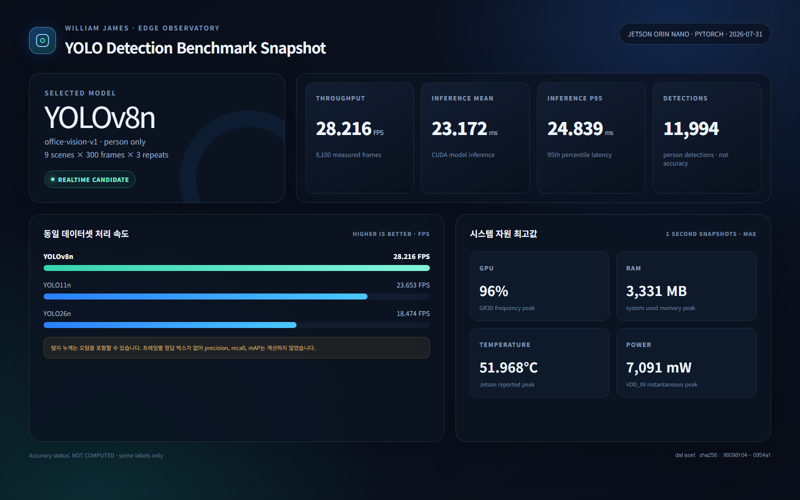
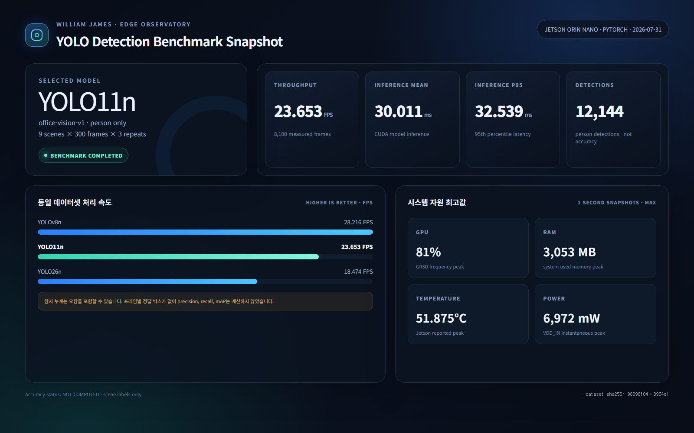
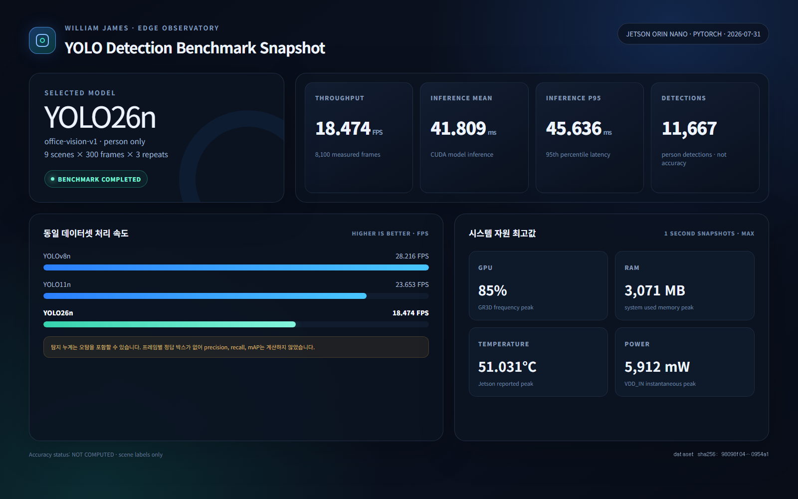

# YOLO 탐지 모델 PyTorch 비교 기록

## 측정 개요

2026년 7월 31일 NVIDIA Jetson Orin Nano에서 YOLOv8n, YOLO11n,
YOLO26n 객체 탐지 모델을 동일한 로컬 영상 데이터셋으로 비교했다.
운영 Edge AI 프로세스는 중복 추론을 피하기 위해 측정 중 일시 정지했으며,
완료 후 다시 시작해 정상 동작을 확인했다.

- 데이터셋: `office-vision-v1` 9개 장면
- 데이터셋 매니페스트 SHA-256:
  `98098f04b473b5b7e0d176574d48e5f4f35313afd2f89827fa8df5809e0954a1`
- 런타임: PyTorch CUDA
- 입력 크기: 640
- confidence: 0.25
- IoU: 0.7
- 대상 클래스: COCO `person`(`classId=0`)
- 장면별 워밍업: 30프레임
- 장면별 측정 상한: 300프레임
- 반복 횟수: 3회
- 모델별 측정 프레임: 8,100

## 결과

| 지표 | YOLOv8n | YOLO11n | YOLO26n |
|---|---:|---:|---:|
| FPS | **28.216** | 23.653 | 18.474 |
| 평균 추론 지연 | **23.172 ms** | 30.011 ms | 41.809 ms |
| P95 추론 지연 | **24.839 ms** | 32.539 ms | 45.636 ms |
| 전체 처리 P95 | **37.917 ms** | 45.804 ms | 58.946 ms |
| 사람 탐지 누계 | 11,994 | **12,144** | 11,667 |
| 최대 GPU | 96% | **81%** | 85% |
| 최대 RAM | 3,331 MB | **3,053 MB** | 3,071 MB |
| 최대 온도 | 51.968°C | 51.875°C | **51.031°C** |
| 최대 전력 | 7,091 mW | 6,972 mW | **5,912 mW** |

YOLOv8n은 YOLO11n보다 FPS가 약 16.2% 높고, YOLO26n보다 약 34.5%
높았다. 평균 추론 지연도 YOLOv8n이 가장 짧았다. 따라서 현재 PyTorch
실시간성 기준의 잠정 후보는 YOLOv8n이다.

탐지 누계는 정확도가 아니다. 오탐도 포함될 수 있으며 이 데이터셋에는
프레임별 정답 박스가 없으므로 precision, recall, mAP는 계산하지 않았다.
최종 모델 선정 전 동일 프레임에 정답 박스를 라벨링해 정확도를 비교해야
한다.

자원 지표는 약 1초 간격 대시보드 스냅샷 중 가장 높은 단일 값을 사용했다.
순간 최대 전력이 낮다고 전체 소비 에너지가 낮다는 의미는 아니며, 실행
순서와 초기화 시점의 영향도 받을 수 있다.

## 모델별 대시보드 이미지

### YOLOv8n

### YOLO11n

### YOLO26n

## 원본과 재현

- 확정 지표: [`benchmark-results.json`](./benchmark-results.json)
- 정적 렌더러: [`dashboard.html`](./dashboard.html)
- Jetson 원본 결과:
  `/home/ssafy/ai_benchmark_results/yolo-pt-comparison-20260731T052344Z`

`dashboard.html?model=YOLOv8n`처럼 모델명을 쿼리로 전달하면 해당 모델의
기록 화면을 다시 렌더링할 수 있다.
