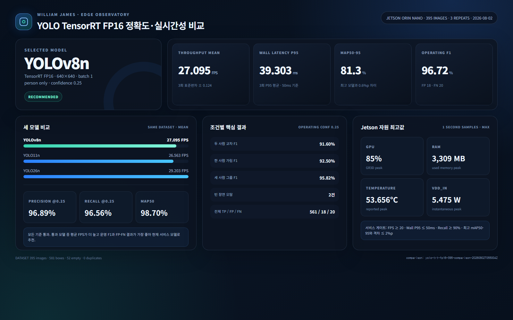
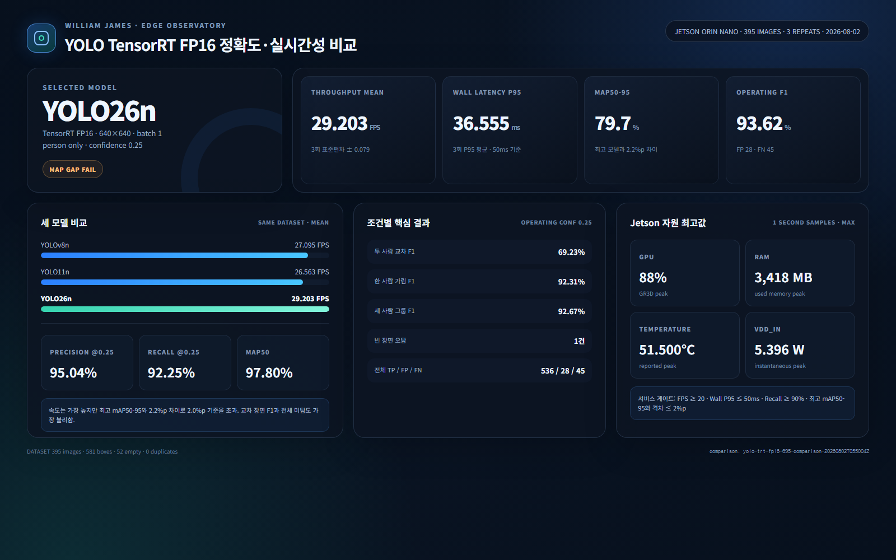

# YOLO TensorRT FP16 정확도·실시간성 비교 보고서

## 1. 결론

이번 평가 범위에서는 **YOLOv8n TensorRT FP16**을 객체 탐지 모델로 유지하는 것이 가장 합리적이다.

YOLO11n은 mAP50-95가 81.9%로 가장 높았지만 YOLOv8n과의 차이는 0.6%p였다. 반면 운영 임계값(confidence 0.25)에서는 YOLOv8n이 F1 96.72%로 가장 높았고, YOLO11n보다 오탐은 12건, 미탐은 3건 적었다. 평균 FPS도 YOLOv8n이 0.532 높았다.

YOLO26n은 평균 29.203 FPS로 가장 빨랐지만 mAP50-95가 최고 모델보다 2.2%p 낮아 사전에 정한 2.0%p 허용 범위를 벗어났다. 특히 두 사람이 교차하는 장면의 F1이 69.23%였고 전체 미탐도 45건으로 가장 많았다.

이 결론은 범용 모델의 절대 우열이 아니라, 현재 홈캠 사무실 데이터셋과 Jetson 실행 조건에 한정한 선택이다.

## 2. 발표 질문에 대한 답

### Q1. 왜 최신 모델이나 가장 높은 공개 정확도의 모델을 선택하지 않았는가?

모델 이름이나 공개 데이터셋 수치만으로 결정하지 않고, 실제 Jetson에서 동일한 입력과 동일한 TensorRT FP16 조건으로 정확도와 지연시간을 함께 측정했다. YOLO11n의 mAP50-95가 가장 높았지만 차이는 0.6%p에 그쳤고, 실제 운영 confidence에서는 YOLOv8n이 더 높은 F1과 더 적은 FP·FN을 보였다. 따라서 현재 서비스에서는 YOLOv8n이 더 균형 잡힌 모델이라고 판단했다.

### Q2. 실제 장치에서 실시간성과 정확도를 동시에 만족하는가?

YOLOv8n은 3회 평균 27.095 FPS, Wall P95 39.303ms, 운영 Recall 96.56%, mAP50-95 81.3%를 기록했다. 임시 서비스 기준인 20 FPS 이상, Wall P95 50ms 이하, Recall 90% 이상, 최고 mAP50-95 대비 2%p 이내를 모두 통과했다. 최대 GPU 85%, RAM 3,309MB, 온도 53.656°C, 입력 전력 5.475W로 측정되어 이번 시험 중 과열이나 메모리 압박도 나타나지 않았다.

## 3. 평가 설계

- 장치: NVIDIA Jetson Orin Nano, 25W 전력 모드
- 런타임: TensorRT FP16, batch 1, 640×640
- 모델: YOLOv8n, YOLO11n, YOLO26n
- 대상 클래스: COCO `person`(`classId=0`)
- 데이터셋: `yolo-person-test-395-dedup`
- 이미지: 395장
- 빈 장면: 52장
- 정답 박스: 581개
- 중복 이미지: 0장
- 반복: 모델별 3회, 총 9회
- 순서: 모델마다 1·2·3번째 실행 위치를 한 번씩 맡도록 회전
- mAP confidence floor: 0.001
- 운영 confidence: 0.25
- NMS IoU: 0.7
- 정답 매칭 IoU: 0.5

데이터셋 SHA-256은 `311e908bde11b3bc69d580bcf94b3701abe9ba5084eecf7fcd419aaca7e2d260`이다.

## 4. 종합 결과

| 모델 | 평균 FPS | Wall P95 평균 | mAP50 | mAP50-95 | 운영 P / R / F1 | FP / FN | 판정 |
|---|---:|---:|---:|---:|---:|---:|---|
| YOLOv8n | 27.095 ± 0.124 | 39.303ms | 98.7% | 81.3% | 96.89% / 96.56% / **96.72%** | **18 / 20** | **추천** |
| YOLO11n | 26.563 ± 0.031 | 40.008ms | **98.8%** | **81.9%** | 94.90% / 96.04% / 95.47% | 30 / 23 | 통과 |
| YOLO26n | **29.203 ± 0.079** | **36.555ms** | 97.8% | 79.7% | 95.04% / 92.25% / 93.62% | 28 / 45 | mAP 격차 탈락 |

FPS와 Wall P95는 세 번 측정한 값의 평균이다. `±` 값은 세 번의 FPS에 대한 모집단 표준편차다. 정확도와 TP·FP·FN은 같은 모델과 같은 데이터셋을 사용했기 때문에 반복 간 동일했다.

## 5. 조건별 차이

| 조건 | YOLOv8n F1 | YOLO11n F1 | YOLO26n F1 | 해석 |
|---|---:|---:|---:|---|
| 두 사람 교차 | **91.60%** | 86.57% | 69.23% | YOLO26n의 가장 큰 약점 |
| 한 사람 가림 | **92.50%** | 89.47% | 92.31% | YOLO11n이 상대적으로 낮음 |
| 세 사람 그룹 | **95.82%** | 93.46% | 92.67% | 인원 증가 시 YOLOv8n 우세 |
| 빈 장면 FP | 2건 | **1건** | **1건** | 모든 모델에 소수 오탐 존재 |

두 사람 교차 장면은 세 모델의 차이를 가장 분명하게 보여 줬다. YOLO26n은 속도는 가장 높았지만 해당 장면에서 FP 21건, FN 19건을 기록했다. 객체 추적 카메라는 사람 수와 그룹 중심을 이용하므로 이런 교차·겹침 상황의 미탐은 단순 정지 이미지 정확도보다 서비스에 더 큰 영향을 줄 수 있다.

## 6. 자원 최고값

| 모델 | GPU | RAM | 온도 | VDD_IN 전력 |
|---|---:|---:|---:|---:|
| YOLOv8n | 85% | 3,309MB | 53.656°C | 5.475W |
| YOLO11n | 88% | 3,352MB | 52.218°C | 5.436W |
| YOLO26n | 88% | 3,418MB | 51.500°C | 5.396W |

자원 값은 약 1초 간격 샘플의 최고값이다. 전력 최고값은 전체 에너지 소비량이 아니며, 실행 순서와 직전 장치 상태의 영향을 받을 수 있다. 이 때문에 자원 차이가 작다는 사실만 확인하고 모델 선택의 단독 기준으로 사용하지 않았다.

## 7. 모델별 대시보드 증거

### YOLOv8n — 추천

### YOLO11n — 서비스 기준 통과

### YOLO26n — 속도 우세, mAP 격차 기준 탈락

## 8. 발표용 1분 설명

> 세 모델을 같은 395장과 581개 사람 박스로 평가했고, Jetson Orin Nano에서 모두 TensorRT FP16으로 세 번씩 실행했습니다. 실행 순서에 따른 영향을 줄이기 위해 모델 순서도 회전했습니다. YOLO26n이 29.2 FPS로 가장 빨랐지만 최고 mAP50-95와의 격차가 2.2%p였고, 두 사람이 교차하는 장면에서 F1이 69.2%로 떨어졌습니다. YOLO11n은 mAP가 0.6%p 높았지만 운영 임계값에서는 YOLOv8n보다 오탐과 미탐이 많았습니다. YOLOv8n은 27.1 FPS, Wall P95 39.3ms, F1 96.7%로 실시간성과 정확도 기준을 모두 만족해 현재 서비스 모델로 유지하기로 했습니다.

## 9. 한계와 다음 검증

- 데이터는 한 사무실 환경에서 수집했으므로 다른 집, 조도, 카메라 높이에 그대로 일반화할 수 없다.
- 수동 라벨의 경계 일관성을 별도 검수자가 다시 확인하지 않았다.
- 이번 결과는 객체 탐지 평가이며 ByteTrack ID 유지율, 그룹 중심 안정성, 서보 진동과 같은 추적 품질은 포함하지 않는다.
- 다음에는 실제 가정 환경 데이터와 교차·가림 장면을 늘리고, 추적 ID 전환 횟수와 카메라 중심 오차까지 측정한다.

## 10. 재현 자료

- 정량 원본: [`benchmark-results.json`](./benchmark-results.json)
- 정적 대시보드: [`dashboard_yolo.html`](./dashboard_yolo.html)
- Jetson 원본 결과: `/home/ssafy/ai_benchmark_results/yolo-trt-fp16-395-comparison-20260802T055004Z`

정적 대시보드는 `dashboard_yolo.html?model=yolov8n`, `dashboard_yolo.html?model=yolo11n`, `dashboard_yolo.html?model=yolo26n` 쿼리로 모델별 화면을 재현한다.
