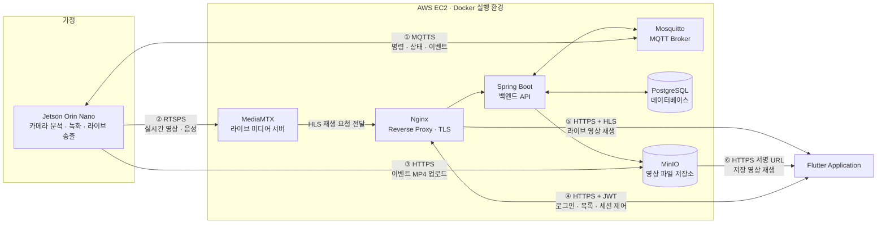
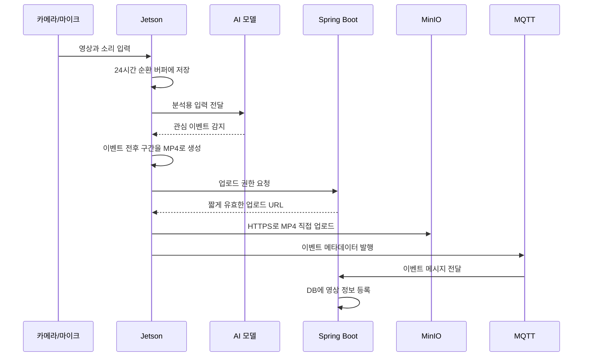
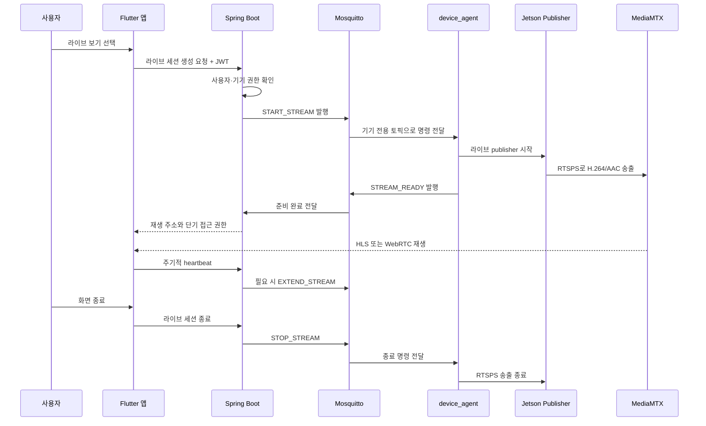

# 초보자용 시스템 아키텍처

> 문서 목적: 홈카메라가 영상을 감지·저장·전송하고, 사용자가 앱에서 저장 영상과 실시간 영상을 보는 전체 과정을 처음 접하는 사람도 이해할 수 있도록 설명한다.
>
> 기준 구조: 운영 환경에서는 SSH 터널을 사용하지 않고, Jetson이 MediaMTX에 **RTSPS**로 직접 라이브 영상을 송출한다.

## 1. 한 문장으로 이해하기

이 시스템은 집 안의 Jetson이 카메라와 마이크를 분석하다가 의미 있는 순간을 영상으로 저장해 서버에 올리고, 사용자가 앱에서 요청할 때만 암호화된 실시간 영상을 서버로 송출하는 홈카메라 시스템이다.

서버는 모든 영상을 계속 받아 분석하지 않는다. AI 분석과 24시간 순환 녹화는 집 안에서 처리하고, 서버에는 보관할 이벤트 영상과 사용자가 요청한 라이브 영상만 전달한다.

## 2. 핵심 연결 구조

처음부터 모든 내부 기능을 한 그림에 넣으면 중요한 연결이 잘 보이지 않는다. 먼저 화이트보드 그림처럼 **Jetson, EC2 서버, Flutter 앱 사이에 무엇이 오가는지**만 보면 다음과 같다.



이 그림에서 화살표는 모두 같은 통신이 아니다.

| 번호 | 연결 | 전달 내용 | 쉽게 말하면 |
| --- | --- | --- | --- |
| ① | Jetson ↔ Mosquitto | 라이브 시작·종료 명령, 기기 상태, AI 이벤트 | 기기와 서버가 주고받는 짧은 제어 메시지 |
| ② | Jetson → MediaMTX | H.264 영상과 AAC 음성 | 지금 촬영 중인 라이브 미디어 |
| ③ | Jetson → MinIO | 이벤트 구간으로 완성된 MP4 파일 | 보관할 녹화 영상 업로드 |
| ④ | 앱 ↔ Spring Boot | 로그인, 영상 목록, 권한 확인, 라이브 요청 | 일반적인 앱 API 통신 |
| ⑤ | MediaMTX/Nginx → 앱 | HLS playlist와 짧은 영상 조각 | 앱에서 보는 실시간 화면 |
| ⑥ | MinIO → 앱 | 저장된 MP4 | 과거 이벤트 영상 재생·다운로드 |

### 2.1 명령 경로와 영상 경로를 분리한다

라이브 기능에는 두 개의 서로 다른 경로가 있다.

```text
[제어 경로]
Flutter → Spring Boot → MQTT Broker → device_agent
                “라이브를 시작해라”

[미디어 경로]
Jetson → RTSPS → MediaMTX → HLS → Flutter
                  실제 영상과 음성
```

MQTT로 영상까지 보내지 않는 이유는 MQTT가 짧은 제어 메시지에 적합하고, 연속적인 대용량 영상에는 미디어 전용 프로토콜이 더 적합하기 때문이다.

### 2.2 EC2와 Docker는 무엇인가?

**EC2(Elastic Compute Cloud)**는 AWS에서 빌려 쓰는 가상 서버다. 실제 컴퓨터 한 대처럼 운영체제, IP 주소, CPU와 메모리를 가진다.

**Docker**는 Spring Boot, Mosquitto, MediaMTX, PostgreSQL 같은 프로그램을 각각 격리된 컨테이너로 실행하는 도구다. EC2 한 대 안에서 여러 프로그램을 실행하더라도 설정과 의존성이 서로 섞이는 문제를 줄인다.

```text
AWS
└─ EC2 가상 서버
   └─ Docker
      ├─ Nginx 컨테이너
      ├─ Spring Boot 컨테이너
      ├─ Mosquitto 컨테이너
      ├─ MediaMTX 컨테이너
      └─ PostgreSQL 컨테이너
```

MinIO도 EC2의 Docker 컨테이너로 실행한다.

### 2.3 Nginx와 Reverse Proxy는 무엇인가?

**Nginx**는 인터넷에서 들어오는 요청을 가장 먼저 받는 서버 프로그램이다. 이 구조에서는 외부 요청을 내부의 적절한 서비스로 전달하는 **Reverse Proxy(리버스 프록시)** 역할을 한다.

```text
앱의 /api 요청  → Nginx → Spring Boot
앱의 /live 요청 → Nginx → MediaMTX 또는 라이브 인증 계층
```

사용자는 Spring Boot나 MediaMTX의 내부 주소를 직접 알 필요가 없다. Nginx가 하나의 공개 주소에서 요청 경로를 보고 목적지를 결정한다. 또한 HTTPS 인증서를 적용하고 외부에 노출할 포트를 줄일 수 있다.

### 2.4 RTSP와 RTSPS는 무엇인가?

**RTSP(Real Time Streaming Protocol)**는 실시간 미디어 스트림을 시작하고, 유지하고, 종료하기 위한 제어 프로토콜이다. 쉽게 말해 “이 카메라 영상을 지금부터 보내라”와 같은 라이브 스트림 세션을 관리한다.

**RTSPS**는 RTSP 통신에 **TLS 암호화**를 적용한 형태다. HTTPS가 HTTP를 TLS로 보호하는 것과 비슷하게 이해할 수 있다.

```text
HTTP  + TLS = HTTPS
RTSP  + TLS = RTSPS
MQTT  + TLS = MQTTS
```

TLS는 통신 내용을 암호화하고, 서버 인증서를 확인해 올바른 서버에 연결했는지 검증하며, 전송 중 데이터가 바뀌지 않았는지 확인한다.

이 시스템에서 Jetson은 다음과 비슷한 주소로 MediaMTX에 접속한다.

```text
rtsps://media.example.com:8322/live/{streamId}
```

- `rtsps://`: TLS로 보호된 RTSP 연결
- `media.example.com`: MediaMTX가 실행되는 서버의 도메인
- `8322`: RTSPS ingest 포트의 예시
- `/live/{streamId}`: 해당 라이브 세션을 구분하는 경로

`ingest`는 미디어 서버가 송출자로부터 영상을 **받아들이는 입력 경로**라는 뜻이다. 여기서는 Jetson이 송출자이고 MediaMTX가 ingest 서버다.

RTSPS를 사용하면 인터넷 구간의 영상과 인증정보를 평문으로 보내는 문제를 줄일 수 있다. 하지만 RTSPS만 켜면 모든 보안이 끝나는 것은 아니다. 반드시 서버 인증서 검증, 기기별 송출 자격증명, 스트림별 권한과 만료 정책을 함께 적용해야 한다.

### 2.5 MediaMTX와 HLS는 무엇인가?

**MediaMTX**는 Jetson이 보낸 라이브 영상을 받아 여러 시청자에게 전달하는 미디어 서버다. 영상 자체를 다시 압축하지 않고 가능한 경우 형식만 바꾸어 전달하면 CPU 사용량과 지연을 줄일 수 있다.

**HLS(HTTP Live Streaming)**는 영상을 짧은 조각으로 나누고, 어떤 조각을 순서대로 재생할지 알려주는 playlist를 HTTPS로 전달하는 방식이다.

```text
Jetson
  └─ RTSPS로 연속 스트림 송출
       └─ MediaMTX
            ├─ playlist.m3u8
            ├─ segment0001
            ├─ segment0002
            └─ segment0003
                 └─ Flutter 앱이 순서대로 재생
```

RTSPS는 주로 **기기에서 미디어 서버로 올리는 구간**, HLS는 **미디어 서버에서 앱으로 보여주는 구간**에서 사용한다. HLS는 HTTP 기반이라 Nginx, CDN, 모바일 환경과 결합하기 쉽지만 몇 초 정도의 지연이 생길 수 있다. 더 낮은 지연이 반드시 필요하면 WebRTC를 별도 검토한다.

### 2.6 MQTT Broker와 MQTTS는 무엇인가?

**MQTT(Message Queuing Telemetry Transport)**는 작은 메시지를 발행하고 구독하는 경량 프로토콜이다. **Broker(브로커)**는 발행자가 보낸 메시지를 받아 해당 토픽을 구독한 대상에게 전달하는 중간 서버다. 이 프로젝트에서는 Mosquitto가 브로커다.

**MQTTS**는 MQTT 연결에 TLS를 적용한 표현이다. 메시지 내용과 인증정보가 네트워크에서 그대로 보이지 않도록 보호한다.

MQTT는 기기가 먼저 클라우드 브로커로 outbound 연결하기 때문에, 가정용 공유기 뒤에 있어도 서버 명령을 받을 수 있다. 서버가 각 가정의 사설 IP로 직접 접속할 필요가 없다.

### 2.7 JWT와 서명 URL은 무엇인가?

**JWT(JSON Web Token)**는 앱에 로그인한 사용자가 누구인지 서버에 증명하는 토큰이다. 앱이 API 요청마다 JWT를 보내면 Spring Boot가 사용자와 권한을 확인한다.

**서명 URL(Presigned URL)**은 MinIO의 특정 파일에 짧은 시간만 접근할 수 있도록 서버가 발급하는 임시 주소다. MinIO를 공개하지 않아도 앱이나 Jetson이 필요한 파일 하나에만 접근할 수 있다.

JWT와 서명 URL은 용도가 다르다.

- JWT: 사용자가 Spring Boot API를 사용할 권한
- 서명 URL: 특정 영상 파일을 제한된 시간 동안 업로드하거나 내려받을 권한

둘 다 로그에 원문을 남기지 않고 짧은 만료시간을 사용해야 한다.

## 3. 장치별 역할

### 3.1 Jetson Orin Nano

Jetson은 집 안의 핵심 영상 처리 장치다.

- 카메라와 마이크 입력을 받는다.
- YOLO와 ByteTrack으로 사람을 감지하고 추적한다.
- YAMNet으로 웃음 등 관심 소리를 감지한다.
- 영상과 소리를 H.264/AAC로 한 번만 인코딩한다.
- 최근 24시간 분량을 순환 버퍼에 보관한다.
- 이벤트가 발생하면 필요한 구간만 MP4로 만든다.
- 사용자가 라이브 보기를 요청하면 MediaMTX로 RTSPS 송출을 시작한다.

한 번 인코딩한 결과를 녹화, AI 처리, 라이브 송출에 나누어 사용하므로 같은 영상을 여러 번 인코딩하는 낭비를 줄일 수 있다.

### 3.2 Raspberry Pi 5

Raspberry Pi는 사용자에게 보이는 하드웨어와 GPIO를 담당한다.

- 터치 입력을 처리한다.
- LCD에 상태를 표시한다.
- LED로 촬영 및 라이브 상태를 알린다.
- 버튼, 센서 등 GPIO 장치를 제어한다.

Raspberry Pi는 라이브 영상의 주 송출 장치가 아니다. 이미 인코딩을 수행하는 Jetson이 MediaMTX로 직접 송출해야 불필요한 중계와 장애 지점을 줄일 수 있다.

### 3.3 device_agent

`device_agent`는 집 안 장치와 클라우드 서버를 연결하는 관리 프로그램이다.

- MQTT 브로커에 연결하고 기기 전용 명령 토픽을 구독한다.
- 서버가 보낸 라이브 시작·연장·종료 명령을 처리한다.
- 기기의 온라인 상태, 처리 결과, 감지 이벤트를 서버로 발행한다.
- Jetson의 live publisher를 시작하거나 종료한다.
- 서버 연결이 끊겨도 만료 시각이 지나면 라이브를 자체 종료한다.

영상 파일이나 라이브 영상 전체를 MQTT로 전달하지는 않는다. MQTT는 제어 메시지에만 사용한다.

### 3.4 클라우드 구성요소

| 구성요소 | 쉬운 설명 | 주요 역할 |
| --- | --- | --- |
| Nginx | 서버의 정문 | TLS 종료, API 및 미디어 요청 전달 |
| Spring Boot | 서비스 관리자 | 로그인, 권한, 기기, 영상 메타데이터, 라이브 세션 관리 |
| Mosquitto | 메시지 우체국 | 서버와 기기 사이의 명령·상태·이벤트 전달 |
| MediaMTX | 라이브 중계소 | Jetson의 RTSPS 영상 수신, 앱 재생 형식으로 배포 |
| PostgreSQL | 장부 | 사용자, 기기, 권한, 영상 위치, 세션 상태 저장 |
| MinIO | 영상 창고 | 이벤트 MP4 같은 큰 바이너리 파일 저장 |
| Flutter 앱 | 사용자 화면 | 저장 영상 조회, 다운로드, 라이브 시작·종료 |

## 4. 통신 방식은 왜 여러 개일까?

데이터의 성격이 서로 다르기 때문이다.

| 통신 방식 | 전달하는 것 | 선택 이유 |
| --- | --- | --- |
| HTTPS | 로그인, API 요청, 이벤트 MP4 업로드 | 요청과 응답, 큰 파일 전달에 적합 |
| MQTTS | 라이브 명령, 기기 상태, 감지 이벤트 | 서버와 기기의 양방향 이벤트 전달에 적합 |
| RTSPS | Jetson에서 MediaMTX로 보내는 라이브 영상 | RTSP 전송을 TLS로 암호화 |
| HLS/WebRTC | MediaMTX에서 앱으로 보내는 라이브 영상 | 모바일 앱과 브라우저에서 재생하기 쉬움 |

MQTT와 RTSPS의 역할은 다르다. MQTT가 “라이브를 시작하라”는 명령을 전달하면 RTSPS가 실제 영상과 음성을 전달한다.

## 5. MQTT를 쉽게 이해하기

MQTT는 이벤트 기반의 경량 Pub/Sub 메시징 프로토콜이다. 브로커는 메시지를 받아 알맞은 구독자에게 전달하는 우체국과 비슷하다.

기기가 브로커 전체를 구독하는 것은 아니다. 각 기기는 자신에게 허용된 토픽만 구독한다.

```text
서버 또는 기기(Publisher)
          │ 특정 토픽에 메시지 발행
          ▼
    Mosquitto Broker
          │ 구독 중인 대상에게 전달
          ▼
서버 또는 기기(Subscriber)
```

### 5.1 서버에서 기기로 보내기

기기 `device-001`은 자신의 명령 토픽을 구독한다.

```text
devices/device-001/commands
```

서버가 이 토픽에 `START_STREAM`을 발행하면 `device-001`만 명령을 받아 라이브를 시작한다. 다른 기기는 해당 토픽을 구독할 권한이 없으므로 작동하지 않는다.

### 5.2 기기에서 서버로 보내기

반대 방향도 같은 방식이다. 기기는 상태나 이벤트를 발행하고 서버가 이를 구독한다.

```text
devices/device-001/status
devices/device-001/events
devices/device-001/stream-events
```

따라서 서버와 기기는 모두 Publisher이면서 Subscriber가 될 수 있다.

권장 메시지 예시는 다음과 같다.

| 방향 | 메시지 | 의미 |
| --- | --- | --- |
| 서버 → 기기 | `START_STREAM` | 라이브 송출 시작 |
| 서버 → 기기 | `EXTEND_STREAM` | 라이브 허용 시간 연장 |
| 서버 → 기기 | `STOP_STREAM` | 라이브 송출 종료 |
| 기기 → 서버 | `STREAM_READY` | 영상 송출 준비 완료 |
| 기기 → 서버 | `STREAM_FAILED` | 송출 실패 |
| 기기 → 서버 | `ONLINE/OFFLINE` | 현재 연결 상태 |
| 기기 → 서버 | 감지 이벤트 | 웃음, 사람 감지 등 AI 결과 |

## 6. 주요 동작 흐름

### 6.1 이벤트 영상을 저장할 때



큰 MP4 파일은 HTTPS로 올리고 MQTT에는 이벤트 ID, 감지 시각, 종류, 신뢰도 같은 작은 정보만 보낸다.

### 6.2 저장 영상을 재생할 때

1. Flutter 앱이 Spring Boot에 영상 목록을 요청한다.
2. Spring Boot는 JWT와 기기 멤버십을 확인한다.
3. 권한이 있으면 짧게 유효한 서명 URL을 발급한다.
4. 앱은 해당 URL로 MinIO에서 영상을 재생하거나 다운로드한다.

영상 바이너리를 Spring Boot가 직접 중계하지 않으므로 서버 부하를 줄일 수 있다.

### 6.3 라이브 영상을 볼 때



앱이 비정상 종료되어 `STOP_STREAM`을 보내지 못할 수 있다. 이를 대비해 서버는 heartbeat 만료 후 송출 종료를 지시하고, Jetson도 `hardExpiresAt`을 넘으면 스스로 송출을 끝낸다.

## 7. SSH 터널을 사용하지 않는 이유

SSH 터널은 포트를 외부에 공개하지 않고 빠르게 연결할 수 있어 개발과 테스트에는 편리하다. 그러나 운영 환경에서 기기 수가 늘면 다음 관리 부담이 생긴다.

- 기기별 SSH 계정과 키 관리
- 장시간 터널 연결과 재연결 관리
- 포트 매핑 충돌과 장애 추적
- 미디어 송출에 비해 과도한 서버 접근 권한

운영 구조에서는 Jetson이 EC2의 MediaMTX RTSPS ingest 주소로 outbound 연결한다. 가정 내부에서 외부 서버로 연결을 시작하므로 일반적으로 공유기 포트포워딩이나 가정의 고정 공인 IP가 필요하지 않다.

```text
개발/테스트: Jetson → SSH 터널 → MediaMTX RTSP
목표 운영:   Jetson → RTSPS(TLS) → MediaMTX
```

RTSPS는 전송 구간을 암호화하지만, 인증과 권한 관리까지 자동으로 해결하지는 않는다. 기기별 송출 자격증명, 접근 제어, 인증서 검증을 함께 적용해야 한다.

## 8. 기기 인증 구조

### 8.1 최초 등록

1. 관리자가 서버에서 짧게 유효한 일회성 등록 토큰을 발급한다.
2. 기기는 내부에서 공개키와 개인키를 생성한다.
3. 기기는 등록 토큰과 공개키 또는 CSR을 서버에 제출한다.
4. 서버는 기기별 인증서를 발급한다.
5. 최초 등록 토큰은 즉시 만료시킨다.

### 8.2 등록 이후

등록 이후에는 영구 Bearer 토큰 대신 기기별 인증서를 사용한다.

- MQTTS 연결은 기기 인증서 기반 mTLS로 인증한다.
- 필요한 HTTPS 기기 API도 mTLS 또는 인증서에 연결된 단기 토큰을 사용한다.
- 인증서는 유효기간을 두고 만료 전에 갱신한다.
- 기기를 분실하거나 침해당하면 해당 기기 인증서만 폐기한다.

개인키는 서버로 전송하지 않고 기기 내부에만 보관한다. 가능하면 TPM이나 보안 저장소를 사용한다.

“RSA로 주기적 인증”보다는 “공개키 기반 기기 인증서와 mTLS, 인증서 갱신·폐기”라고 표현하는 것이 정확하다. RSA는 사용할 수 있는 키 알고리즘 중 하나다.

## 9. 보안 경계와 필수 통제

집 안 장치와 클라우드는 서로 다른 신뢰 경계다. 집 안 장치라고 무조건 신뢰하지 않고, 서버에 접근할 때마다 기기 신원과 권한을 확인한다.

- 앱 ↔ Nginx: HTTPS와 사용자 JWT
- 기기 ↔ Mosquitto: MQTTS와 기기별 mTLS 인증서
- Jetson ↔ MediaMTX: RTSPS와 기기별 ingest 권한
- 기기 ↔ 저장소: 짧게 만료되는 서명 업로드 URL
- 앱 ↔ 저장소: 짧게 만료되는 서명 재생·다운로드 URL
- MQTT: 기기별 Topic ACL 적용
- 라이브: 세션 만료, heartbeat, `hardExpiresAt` 적용
- 로그: 토큰, 개인키, 서명 URL, RTSPS 비밀번호 기록 금지

예를 들어 `device-001` 인증서로 접속한 기기는 자신의 명령만 구독하고 자신의 상태만 발행할 수 있어야 한다.

```text
허용: devices/device-001/commands 구독
허용: devices/device-001/status 발행
거부: devices/device-002/# 접근
```

## 10. 음향 모델 A/B 테스트와 선택

| 모델 | AUPRC | AUROC | 최적 F1 | Precision | Recall | CPU median | CPU p95 |
| --- | ---: | ---: | ---: | ---: | ---: | ---: | ---: |
| YAMNet TFLite | 0.9985 | 0.9997 | 0.9804 | 0.9615 | 1.0000 | 4.85 ms | 10.62 ms |
| EfficientAT MN04 | 1.0000 | 1.0000 | 1.0000 | 1.0000 | 1.0000 | 19.78 ms | 25.35 ms |
| EfficientAT MN10 | 0.2167 | 0.4432 | 0.4717 | 0.3086 | 1.0000 | 26.41 ms | 34.29 ms |

### 결론

기본 운영 모델은 **YAMNet TFLite**가 적합하다.

- Recall이 1.0이므로 평가 데이터에서 관심 소리를 놓치지 않았다.
- EfficientAT MN04보다 CPU 추론 시간이 약 4배 짧다.
- 정확도와 엣지 장치 성능 사이의 균형이 가장 좋다.
- EfficientAT MN10은 정확도와 속도 모두 불리하므로 제외한다.

EfficientAT MN04의 모든 정확도 지표가 1.0인 결과는 매우 좋지만, 데이터 수가 작거나 학습·평가 데이터가 유사했는지 확인해야 한다. 실제 가정의 배경 소음, 거리, 마이크 차이를 포함한 별도 테스트 세트로 재검증한다.

## 11. 장애가 발생하면 어떻게 되는가?

| 장애 상황 | 기대 동작 |
| --- | --- |
| 인터넷 연결 끊김 | 로컬 AI와 순환 버퍼는 계속 동작하고, 업로드는 재연결 후 재시도 |
| MQTT 연결 끊김 | 자동 재연결하며 라이브는 `hardExpiresAt` 이후 자체 종료 |
| 앱 비정상 종료 | heartbeat가 만료되면 서버가 세션과 송출을 종료 |
| Spring Boot 장애 | Jetson이 마지막 만료 시각을 넘긴 라이브를 자체 종료 |
| MediaMTX 연결 실패 | 지수 백오프로 제한적 재시도하고 `STREAM_FAILED` 보고 |
| 저장소 업로드 실패 | 로컬 이벤트 MP4를 보존하고 중복 방지 ID로 재시도 |
| AI 모델 오류 | 녹화·순환 버퍼와 장치 제어는 가능한 한 계속 유지 |

## 12. 현재 구현에서 목표 구조로 바꿀 항목

이 문서는 목표 운영 구조를 설명한다. 저장소의 현재 `device_agent` 배포 문서와 설정에는 테스트용 SSH 터널과 운영 Bearer 토큰 방식이 남아 있으므로 다음 작업이 필요하다.

- MediaMTX에 인증된 RTSPS ingest listener 구성
- EC2 방화벽에서 필요한 RTSPS 포트만 허용
- Jetson publish URL을 `rtsps://...` 형식으로 변경
- SSH media tunnel 서비스와 의존성 제거
- CA 및 서버 인증서 검증 활성화
- 기기별 또는 세션별 ingest 자격증명 적용
- 영구 운영 Bearer 토큰을 기기 인증서 기반 mTLS로 교체
- 인증서 자동 갱신과 폐기 절차 구현
- Mosquitto에 기기 인증서와 기기별 Topic ACL 적용
- 운영 로그에서 모든 인증정보 마스킹

전환이 끝나기 전까지 현재 구현을 목표 운영 구조로 오해하면 안 된다.

## 13. 최종 데이터 흐름 요약

```text
[평상시]
카메라/마이크 → Jetson AI 분석 → 24시간 로컬 순환 버퍼

[이벤트 발생]
Jetson → 이벤트 MP4 생성 → HTTPS → MinIO
Jetson/device_agent → 이벤트 메타데이터 → MQTTS → Spring Boot

[라이브 요청]
Flutter → HTTPS → Spring Boot
Spring Boot → START_STREAM → MQTT Broker → device_agent
Jetson → RTSPS → MediaMTX → HLS/WebRTC → Flutter

[저장 영상 조회]
Flutter → Spring Boot 권한 확인 → 서명 URL → MinIO 영상 재생
```

핵심 원칙은 **AI는 로컬에서, 명령은 MQTT로, 파일은 HTTPS로, 라이브 영상은 RTSPS로 전달한다**는 것이다.
