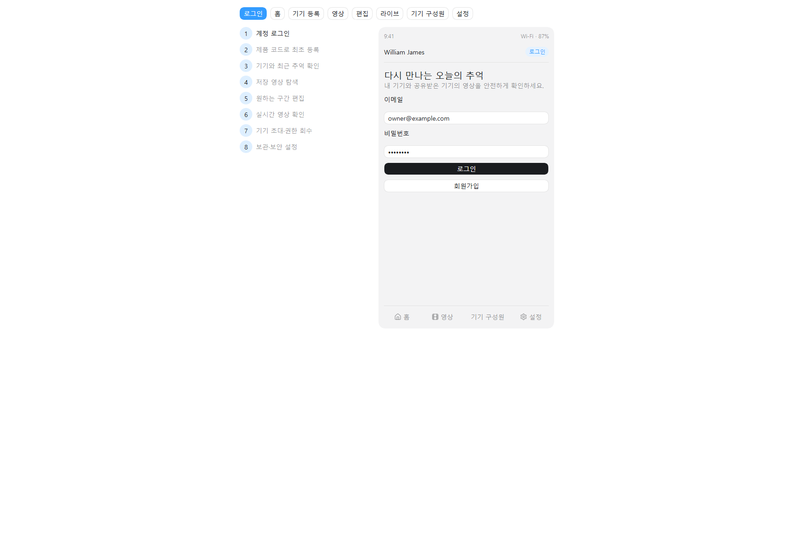

# 빵긋

> 일반 가정의 웃긴 순간을 젯슨(엣지 AI)이 자동 포착하고 폰에서 편집해 추억으로 만드는 서비스.

## 프로젝트 정보

| 항목 | 내용 |
| --- | --- |
| 개발 기간 | 7월 20일 ~ 7월 31일 (예정) |
| 모바일 | Flutter |
| 백엔드 | Java 21, Spring Boot, PostgreSQL |
| IoT·AI | Jetson Orin Nano, Raspberry Pi 5, Python, YAMNet, YOLO |
| 영상 | FFmpeg, H.264/AAC MP4, 라이브는 WebRTC(WHEP) 전용 |
| 저장소 | MinIO (S3 호환) |

## 핵심 MVP (7단계)

1. **회원가입 / 로그인**: 이메일·비밀번호 기반 회원가입/로그인 및 세션 유지.
2. **기기 등록**: 8자리 코드로 홈캠 등록(claim), 권한·영상은 추억 금고(Memory Vault)에 귀속.
3. **홈 라이브 스트리밍 시청**: 명시적 요청 시에만 켜지는 실시간 스트리밍 시청(WHEP/WebRTC 전용).
4. **이벤트(웃음) 감지 영상 확인**: Jetson 엣지에서 YAMNet 웃음 감지 시 자동 클립 생성·업로드 및 앱 재생.
5. **영상 편집**: 폰 자체 로컬 수동 편집(구간 자르기·화면 비율 6종·음량·자막·필터 3종·이모지 스티커) 및 온디바이스 STT 자동 자막.
6. **편집 영상 다운로드**: 원본 서버 다운로드 및 편집 결과 네이티브 MediaStore(`Movies/WilliamJames`) 갤러리 저장 단독 (앱 내 영상 공유 없음).
7. **통계 / 리포트**: 월별 캘린더 일자별 목록, 웃음 통계 및 Flutter 단말 집계 웃음 리포트.
- **가족 공유 & 권한**: 금고별 `OWNER/MEMBER` 역할 권한 및 초대 승인제.

## 산출물 바로가기

### 현행 명세 (`docs/사람이 읽을 문서/`)

MVP 7단계를 뼈대로 재구성한 to-be 기준 문서다. **이쪽이 사람용 최신 문서다.**

- [서비스 기획서](자료/docs/사람이%20읽을%20문서/01-서비스기획.md)
- [요구사항 명세서](자료/docs/사람이%20읽을%20문서/02-요구사항명세서.md)
- [기능 명세서](자료/docs/사람이%20읽을%20문서/03-기능명세서.md)
- [API 명세서](자료/docs/사람이%20읽을%20문서/04-API명세서.md)
- ERD


## Figma 산출물

- [앱 와이어프레임](https://www.figma.com/design/kDAk0NTRltBHJsaIeyyXQd)
- [시스템 아키텍처](https://www.figma.com/board/eQtOYa4DFb7SpEO0E4fPjf)



## 로컬 인프라

```powershell
Copy-Item infra/.env.example infra/.env
# infra/.env의 CHANGE_ME 값을 교체
docker compose --env-file infra/.env -f infra/docker-compose.yml up -d
```

API 문서 페이지는 `http://127.0.0.1:8081`에서 확인할 수 있다.

## 협업

브랜치, 커밋, Pull Request 완료 기준은 [CONTRIBUTING.md](자료/CONTRIBUTING.md)를 따른다. 실제 비밀번호, 등록 코드, 토큰, 기기 인증서와 사용자 영상은 Git에 커밋하지 않는다.
