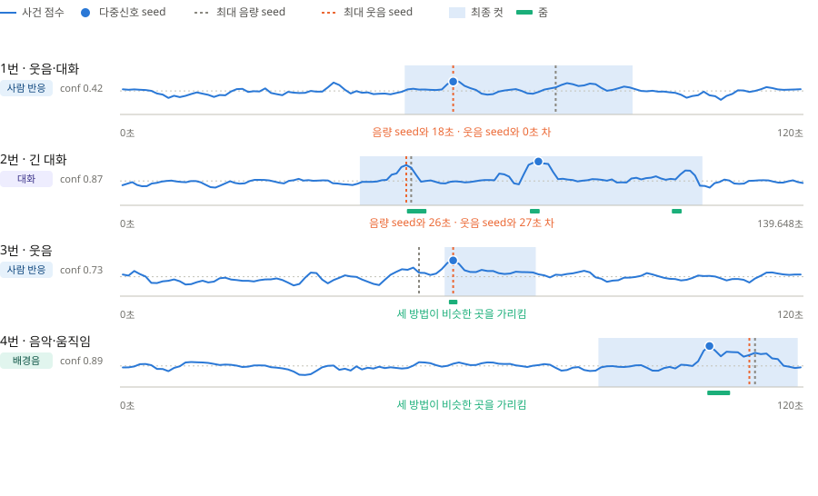
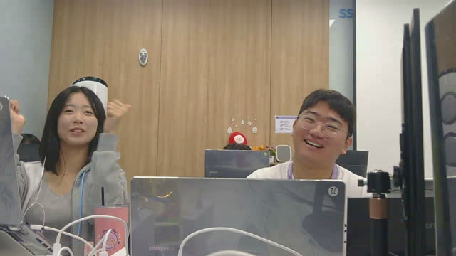
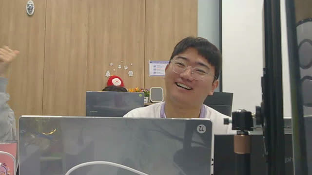
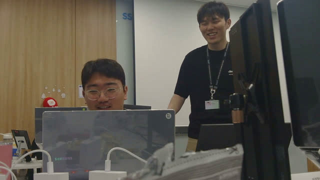
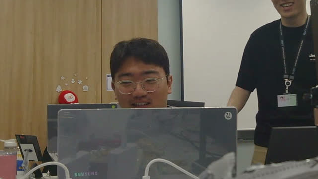
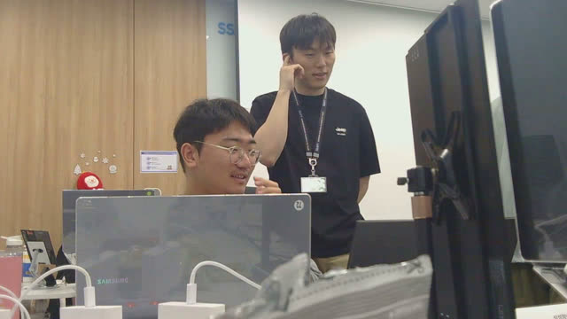
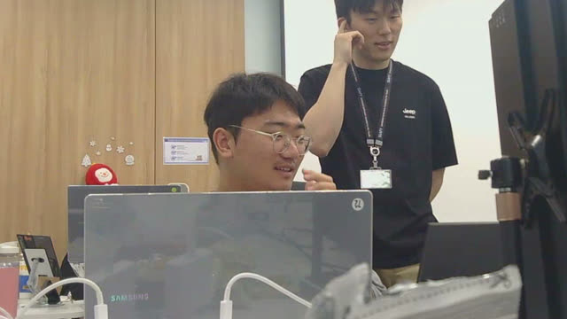
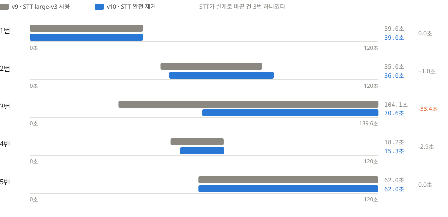
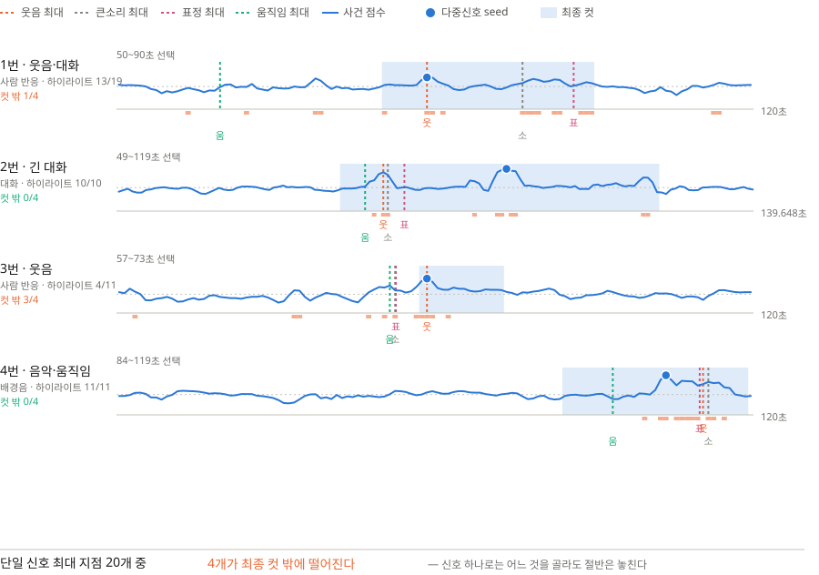

# 자동 하이라이트 편집 — 모델·로직·지표 정리 (발표용)

작성일: 2026-08-07

## 이 문서의 위치

[`20_서버_자동_영상_편집_설계_및_1단계_검증.md`](../자료/docs/20_서버_자동_영상_편집_설계_및_1단계_검증.md)가
v1부터 v10까지의 설계 결정 로그다. 이 문서는 그 최종 상태(v10)를 **발표에 쓸 장표와
지표로 재구성**한 것이다.

모든 수치는 `video_editor/fixtures/analysis/`의 git 추적 분석 JSON 20개로
2026-08-07 재실행해 확인했고, 20번 문서의 v10 표와 밀리초까지 일치했다.
선택기가 결정론적이라는 뜻이다.

재현 스크립트는 §8에 있다.

## 1. 검증 영상과 MinIO 원본

| # | 촬영 시각(KST) | 원본 길이 | 성격 | MinIO 객체 키 |
| --- | --- | ---: | --- | --- |
| 1 | 2026-07-31 17:39:32 | 120.0초 | 웃음·대화 | `private/b0db34c8-…954b/events/cf01116b-f64d-4975-8762-612d123c9d09.mp4` |
| 2 | 2026-07-31 17:09:44 | 120.0초 | 웃음·대화 | `private/b0db34c8-…954b/events/5a8fefbb-a4c1-4948-9048-2a7ee0a0dfc6.mp4` |
| 3 | 2026-07-31 15:33:41 | 139.6초 | 긴 대화 | `private/b0db34c8-…954b/events/35a255f7-9146-462d-bb17-b4b0b6045a3e.mp4` |
| 4 | 2026-07-28 10:43:18 | 120.0초 | 웃음 | `private/83629bcc-…6182/events/0a72b78d-38b1-4d0a-b866-1e301f211daf.mp4` |
| 5 | 2026-07-27 16:25:25 | 120.0초 | 음악·움직임 | `private/83629bcc-…6182/events/29de03c2-5090-44cf-a3ba-78ca23907753.mp4` |

버킷은 `william-james-videos`다. 원본은 객체 키가 UUID이므로 파일명으로는 찾을 수
없고, `videos` 테이블의 `captured_start_at`으로 찾아야 한다.

`service.py`의 fixture 조회는 `captured_at`을 **분 단위로 정확히** 맞춘다
(`_fixture_stem`은 `%Y%m%d_%H%M`을 비교한다). 촬영 시각이 1분이라도 어긋나면
fixture를 못 찾고 임의 영상 경로로 빠진다.

## 2. 쓴 모델

| 역할 | 모델 | 실행 | 간격·해상도 | 출력 |
| --- | --- | --- | --- | --- |
| 오디오 이벤트 | YAMNet TFLite (MediaPipe Audio Classifier) | CPU | — | 웃음·발화·음악·반응 점수, 상위 카테고리 |
| 음향 특징 | 자체 DSP (모델 없음) | CPU | 0.5초 RMS | dBFS, 음량 상승, spectral flux·centroid, ZCR |
| 얼굴 검출 | MediaPipe BlazeFace full-range, 약 1.03MiB | CPU | 0.5초 / 640px | 얼굴 수, 최대 얼굴 면적, 화면 중심도, 면적 변화 |
| 표정 | MediaPipe Face Landmarker, 약 3.58MiB | CPU | 0.25초, 최대 4얼굴 | 478 landmark + blendshape |
| 움직임·장면 | 자체 구현 (Auto-Editor·PySceneDetect 패턴 참조) | CPU | 0.5초 / 320px | 프레임 차분, HSV 내용 변화, 적응형 장면 전환, 밝기·대비·선명도 |

LLM 토큰 API를 쓰지 않는다. GPU를 요구하지 않는다.

2분 영상 로컬 CPU 분석 시간은 YAMNet 약 0.6초, 음향 약 0.2초, 영상 특징 약 4~5초,
표정 약 9~13초다.

## 3. 로직 — 4개 가설 경합

1초 빈마다 네 개 이벤트 가설을 각각 점수화한 뒤 `max`로 경합시킨다
(`video_editor/adaptive_selector.py`).

```
social   = 0.45·웃음 + 0.12·반응 + 0.12·발화 + 0.12·음량상승 + 0.09·flux + 0.10·의미변화
music    = 0.45·음악 + 0.18·음량상승 + 0.12·flux + 0.10·음량 + 0.15·의미변화
dialogue = 0.55·발화 + 0.30·웃음 + 0.15·반응
visual   = 0.40·움직임 + 0.20·내용변화 + 0.15·장면전환 + 0.15·얼굴크기 + 0.10·얼굴변화

eventScore = max(social, music, 0.65·dialogue, 0.25·visual)
```

- `의미변화(semanticNovelty)`는 직전 창과 YAMNet **클래스 분포의 코사인 거리**다.
  볼륨이 아니라 소리의 종류가 바뀐 순간을 잡는다.
- `continuityScore`(발화·음악이 이어지는 정도)를 별도로 둬서 "어디가 두드러지나"와
  "어디서 끊어도 되나"를 분리했다.
- seed에서 양방향으로 확장하고, `baseline + 0.40·(peak − baseline)` 임계 아래로
  3빈 연속 떨어지면 멈춘다.
- 컷 경계는 무음·저활성 구간과 실제 장면 전환 후보로 ±3초 안에서 스냅해
  발화가 중간에 잘리지 않게 한다.

## 4. 장표 ① — 타임라인과 seed 비교



파란 점(다중신호 seed)과 점선 두 개(순진한 기준선)가 어긋난 거리가 이 로직의 값이다.

| # | 최대 음량 seed | 최대 웃음 seed | 다중신호 seed | 음량과 차이 | 웃음과 차이 |
| --- | ---: | ---: | ---: | ---: | ---: |
| 1 | 14초 | **98초** | 12초 | 2초 | **86초** |
| 2 | **76초** | 58초 | 58초 | **18초** | 0초 |
| 3 | **59초** | **58초** | 85초 | **26초** | **27초** |
| 4 | 52초 | 58초 | 58초 | 6초 | 0초 |
| 5 | 111초 | 110초 | 103초 | 8초 | 7초 |

- 음량만 봤으면 5개 중 **2개(2·3번)가 하이라이트 구간 밖**을 골랐다. 3번은
  최종 컷(69.000~139.648초) 밖인 59초라 완전히 다른 장면이 된다.
- 웃음만 봤으면 **1번이 86초 어긋난다.** 12초 지점의 웃음 점수는 0.949로 이미 거의
  최대인데 98초에 더 높은 웃음이 있었다. 12초가 이긴 이유는 웃음·반응·음량상승·flux가
  결합한 social 0.659다.
- **5번은 seed 지점의 웃음 점수가 0.0이다.** 웃음 탐지기만 있으면 이 영상에서는
  아무것도 고르지 못한다.

### 최종 결과 (v10)

| # | 프리셋 | 선택 구간 | 결과 길이 | 유지율 | 사건 유형 | 흐름 확장 | 줌 |
| --- | --- | --- | ---: | ---: | --- | --- | ---: |
| 1 | medium | 0.000~39.000초 | 39.000초 | 32.5% | social | — | 0 |
| 2 | medium | 48.000~84.000초 | 36.000초 | 30.0% | social | — | 0 |
| 3 | long | 69.000~139.648초 | 70.648초 | 50.6% | dialogue | — | 2 |
| 4 | short | 51.675~67.000초 | 15.325초 | 12.8% | social | — | 1 |
| 5 | medium | 58.000~120.000초 | 62.000초 | 51.7% | music | music-motion-episode | 1 |

4번 시작이 `51.675초`인 것은 1초 빈 격자가 아니다. 경계 후보 44개 중 실제 무음
경계로 스냅한 결과다. 경계 후보 수는 1번 3개, 2번 12개, 3번 4개, 4번 44개, 5번 31개다.

### 선택기 판별력 (프리셋 확장 전 원 하이라이트)

| # | 원 하이라이트 | 원본 대비 | 구간내 평균 | 구간외 평균 | lift | peak/baseline | confidence |
| --- | --- | ---: | ---: | ---: | ---: | ---: | ---: |
| 1 | 7.500~22.500초 | 12.5% | 0.4635 | 0.3445 | 1.35× | 1.79 | 0.887 |
| 2 | 52.500~67.500초 | 12.5% | 0.3442 | 0.3126 | 1.10× | 1.40 | 0.420 |
| 3 | 78.000~93.000초 | 10.7% | 0.4371 | 0.3282 | 1.33× | 1.79 | 0.869 |
| 4 | 51.675~67.000초 | 12.8% | 0.3547 | 0.2504 | 1.42× | 1.84 | 0.731 |
| 5 | 58.000~120.000초 | 51.7% | 0.3176 | 0.2700 | 1.18× | 1.95 | 0.894 |

lift가 1.1~1.4에 머무는 것은 **가정집 홈캠을 YAMNet이 거의 전부 speech로 분류해
baseline이 0.25~0.34로 이미 높기 때문**이다. 판별력을 보는 지표는 lift가 아니라
`peak/baseline`(1.40~1.95)과 confidence다. 2번의 confidence 0.420이 가장 낮고,
실제로 2번은 줌 후보도 생성되지 않았다.

## 5. 장표 ② — 가설 경합


| # | social | music | dialogue×0.65 | visual×0.25 | 승자 | 1–2위 격차 | seed 의미변화 |
| --- | ---: | ---: | ---: | ---: | --- | ---: | ---: |
| 1 | **0.659** | 0.333 | 0.385 | 0.105 | social | 0.274 | 0.224 |
| 2 | **0.541** | 0.399 | 0.336 | 0.060 | social | 0.142 | 0.025 |
| 3 | 0.354 | 0.273 | **0.368** | 0.170 | dialogue | **0.014** | 0.422 |
| 4 | **0.519** | 0.399 | 0.258 | 0.106 | social | 0.120 | **0.984** |
| 5 | 0.172 | **0.667** | 0.000 | 0.139 | music | **0.495** | **0.920** |

- 5번은 격차 0.495로 압도적이다. 단일 점수 방식이 놓치는 유형을 경합이 잡았다.
- 3번은 격차 0.014로 social과 dialogue가 사실상 동점이다. **우리 방법의 한계다**(§7).
- 4·5번 seed의 의미변화가 0.984·0.920이다. seed가 소리의 종류가 바뀐 순간에 앉았다.

## 6. 장표 ③ — 줌은 표정만으로 결정되지 않는다


표정과 소리가 **둘 다** 동적 임계값을 넘은 로컬 피크만 줌 후보가 된다.
최종 후보 점수는 표정 65% + 소리 35%다.

표정 최대값 내림차순으로 정렬하면 줌 개수가 1, 2, 0, 0, 1로 어긋난다.
이 비단조성이 표정만 보고 줌하지 않는다는 증거다.

| 표정 순위 | # | 표정 최대 | 표정 중앙값 | 줌 | 사유 |
| ---: | --- | ---: | ---: | ---: | --- |
| 1 | 4번 | 0.933 | 0.311 | 1 | 소리 0.569 동반 |
| 2 | 3번 | 0.905 | 0.105 | 2 | 소리 0.949·0.635 동반 |
| 3 | 2번 | 0.881 | 0.000 | **0** | 같은 시점 소리 반응 없음 |
| 4 | 1번 | 0.879 | 0.000 | **0** | 같은 시점 소리 반응 없음 |
| 5 | 5번 | 0.582 | 0.069 | 1 | 표정 최저인데 소리 0.565로 통과 |

1·2번의 줌 0개는 버그가 아니라 설계다. "줌 on"은 줌을 강제하는 값이 아니라
표정 기반 줌을 **허용**하는 값이다.

### 통과한 줌 4개

| # | 원본 시점 | 길이 | 배율 | 표정 | 소리 | 표정 종류 | 초점 (focusX, focusY) |
| --- | ---: | ---: | ---: | ---: | ---: | --- | --- |
| 3 | 83.750초 | 2.00초 | 1.362배 | 0.724 | 0.949 | smile | 0.355, 0.536 |
| 3 | 112.750초 | 2.00초 | 1.226배 | 0.830 | 0.635 | smile | 0.420, 0.529 |
| 4 | 56.000초 | 3.25초 | 1.317배 | 0.908 | 0.569 | smile | 0.620, 0.569 |
| 5 | 103.125초 | 4.00초 | 1.730배 | 0.478 | 0.565 | **surprise** | 0.139, 0.713 |

### 실제 프레임 — 줌 전/후

원본 1280x720에서 렌더러와 동일한 수식으로 잘랐다.
`cw = W/z`, `ch = H/z`, `x = clamp(focusX·W − cw/2)`, `y = clamp(focusY·H − ch/2)`.

**5번 103.125초 · 1.730배 · surprise** — 크롭 740x416 at (0, 304)

| 줌 전 | 줌 후 |
| --- | --- |
|  |  |

이 구간이 20번 문서 v7에서 고친 그 케이스다. 놀람(raw 0.344)이 미소(0.582)에
동일 절대 임계 0.40으로 밀려 누락됐던 것을, 놀람을 `jawOpen`·`eyeWide`·`browInnerUp`
결합 raw 점수 0.60 기준으로 보정해 0.573으로 끌어올려 되살렸다.
`reason`은 `expression-and-sound-reaction`으로 기록된다.

**4번 56.000초 · 1.317배 · smile** — 크롭 972x547 at (308, 136)

| 줌 전 | 줌 후 |
| --- | --- |
|  |  |

**3번 83.750초 · 1.362배 · smile** — 크롭 940x529 at (0, 122)

| 줌 전 | 줌 후 |
| --- | --- |
|  |  |

**3번 112.750초 · 1.226배 · smile** — 크롭 1044x587 at (16, 88)

| 줌 전 | 줌 후 |
| --- | --- |
|  |  |

줌 전환은 램프 없이 하드 컷이다. v4의 650ms 램프 줌은 화면 전환처럼 보여 폐기했다.

## 7. 장표 ④ — STT 제거 전/후



| # | v9 (STT large-v3) | v10 (STT 제거) | 길이 변화 |
| --- | --- | --- | ---: |
| 1 | 0.000~39.000초 (39.0초) | 0.000~39.000초 (39.0초) | 0.0초 |
| 2 | 45.000~80.000초 (35.0초) | 48.000~84.000초 (36.0초) | +1.0초 |
| 3 | 35.576~139.648초 (104.1초) | 69.000~139.648초 (70.6초) | **−33.4초** |
| 4 | 48.440~66.664초 (18.2초) | 51.675~67.000초 (15.3초) | −2.9초 |
| 5 | 58.000~120.000초 (62.0초) | 58.000~120.000초 (62.0초) | 0.0초 |

**STT가 실제로 바꾼 것은 3번 하나였다.** 그리고 그 대가로 오인식이 자막뿐 아니라
단어 밀도, 문장 경계, 대화 연속성, 이야기 확장 판단까지 오염시켰다. 그래서 제품
범위에서 Whisper·Qwen·faster-whisper 의존성과 자동 자막을 전부 제거했다.

3번이 짧아진 이유는 YAMNet이 1·2·3번 대부분을 speech로 분류하지만 **대화 주제의
연결 여부는 판단하지 못하기 때문**이다. 3번만 특별히 길게 유지할 의미 근거가
사라진 결과다.

### 버린 것 전체

| 버전 | 버린 것 | 근거 |
| --- | --- | --- |
| v1 | 45~65초 고정 길이 | 사용자 평가에서 폐기 |
| v3 | 영상 움직임을 하이라이트 주 점수로 | 2번 seed가 58초 → 81초로 잘못 이동. 약한 fallback으로 격하 |
| v3 | 다국어 MiniLM 문장 임베딩 끝점 결정 | 짧은 감탄사와 STT 오인 문장이 서로 높은 유사도를 보임 |
| v4 | 650ms 램프 줌 인·아웃 | 화면 전환처럼 보임. 하드 컷으로 교체 |
| v5 | 미소·놀람 동일 절대 임계 0.40 | 5번 103.75초 놀람(0.344)이 109.75초 미소(0.582)에 밀림. 놀람 0.60 기준 보정 후 0.573 |
| v7 | 최대 길이 초과 시 앞쪽 4초만 유지 | 실제 피크를 제외하는 버그. 피크 0.75초 전부터 4초 유지로 수정 |
| v10 | STT 전체 (`small` → `large-v3` → 제거) | 오인식이 컷 판단 전체를 오염 |

## 8. 남은 한계

- **정량 사람 평가 기록이 없다.** 20번 문서의 게이트는 "5개 중 4개가 `그대로 사용`
  또는 `5초 이내 수정`"인데 이 점수표를 남기지 않았다. v1·v4 폐기는 정성 판단이었다.
- 검증 영상 5개는 모두 고정 홈캠의 단일 장면이라 **의미 있는 장면 전환이 거의 없다.**
  장면 전환 경계 후보는 사실상 검증되지 않았다.
- 얼굴 검출 프레임 비율은 99.2~100%로 높지만 **최대 얼굴의 프레임 면적 중앙값이
  1.2~2.5%**로 매우 작다. 배율 상한(2.80배)이 이 때문에 자주 걸린다.
- 3번의 가설 격차 0.014는 dialogue가 우연히 이긴 것에 가깝다.
- 사무실에서 촬영한 검증셋이므로 실제 가정집 음향 환경을 대표하지 않는다.

## 9. 재현

### 지표 재생성

```bash
python -m video_editor.adaptive_cli \
  --yamnet video_editor/fixtures/analysis/05_20260727_162525.yamnet.json \
  --audio video_editor/fixtures/analysis/05_20260727_162525.audio.json \
  --video video_editor/fixtures/analysis/05_20260727_162525.video.json \
  --expression video_editor/fixtures/analysis/05_20260727_162525.expression.json \
  --duration-preset medium --zoom on
```

모델 바이너리 없이 표준 라이브러리만으로 동작한다(분석 JSON 재사용).
`scoreTimeline`에 1초 빈별 4개 가설 점수와 15개 특징이 전부 들어 있어
어떤 구간을 왜 골랐는지 숫자로 답할 수 있다.

### 원본 객체 키 조회

```sql
select to_char(captured_start_at at time zone 'Asia/Seoul','YYYYMMDD_HH24MISS') as kst,
       duration_ms, status, storage_key
from videos
where captured_start_at >= '2026-07-26' and captured_start_at < '2026-08-02'
order by captured_start_at;
```

### 줌 프레임 추출

`ffmpeg`으로 `crop=cw:ch:x:y,scale=1280:720`을 적용한다. `cw`·`ch`·`x`·`y`는
§6의 수식으로 계산하며, 이는 `video_editor/render_video.py`의 `zoompan` 표현식과
같은 값이다.

---

# 발표 전용 — 왜 트리거 전후로 자르지 않았나

## 1차원적으로 생각하면

웃음을 감지했으니, 그 시각 전후 몇 초를 잘라내면 될 것 같다. 트리거는 이미 있고,
계산도 필요 없다.

```
하이라이트 = 웃음 트리거 − 7.5초  ~  웃음 트리거 + 7.5초
```

그런데 웃음뿐이 아니다. 큰소리·표정·움직임 중 무엇을 기준으로 삼아도 똑같이
"그 신호가 가장 센 지점"이 하나 나온다. 그 네 지점을 점선으로 세우고, 다중신호
선택 결과와 겹쳐 봤다.



점선은 신호 하나만 봤을 때 고를 지점이고, 파란 점이 다중신호 seed,
파란 음영이 최종 컷이다. 아래 주황 눈금이 하이라이트 구간이다.

| # | 웃음 최대 | 큰소리 최대 | 표정 최대 | 움직임 최대 | 다중신호 seed | 최종 컷 | 컷 밖 |
| --- | ---: | ---: | ---: | ---: | ---: | --- | ---: |
| 1 | 98초 | 14초 | 103초 | 18초 | 12초 | 0.000~39.000초 | **2/4** (웃음·표정) |
| 2 | 58초 | 76초 | 86초 | 20초 | 58초 | 48.000~84.000초 | **2/4** (표정·움직임) |
| 3 | 58초 | 60초 | 63초 | 54초 | 86초 | 69.000~139.648초 | **4/4** (전부) |
| 4 | 58초 | 52초 | 53초 | 52초 | 58초 | 51.675~67.000초 | 1/4 (움직임) |
| 5 | 110초 | 112초 | 110초 | 94초 | 104초 | 58.000~120.000초 | 0/4 |

**단일 신호 최대 지점 20개 중 9개(45%)가 최종 컷 밖에 떨어진다.**
어느 신호를 고르든 절반은 빗나간다.

| 신호 하나만 봤을 때 | 컷 밖 |
| --- | ---: |
| 웃음 | 2/5 |
| 큰소리 | 1/5 |
| 표정 | **3/5** |
| 움직임 | **3/5** |

**3번 영상은 네 신호가 전부 틀렸다.** 웃음 58초, 큰소리 60초, 표정 63초,
움직임 54초 — 모두 앞쪽에 몰려 있는데 실제 하이라이트는 69초 이후였다.
네 신호를 결합했을 때만 86초를 seed로 잡았다.

### 그럼 창을 길게 잡으면 되지 않나 — 놓침과 잉여의 트레이드오프

웃음 트리거를 중심에 놓고 창 길이만 바꿔가며 두 가지를 쟀다.

- **놓친 하이라이트** — 창 밖으로 나간 하이라이트 구간 비율
- **담긴 잉여** — 창 안에서 사건 점수가 영상 중앙값에도 못 미치는(평상시) 구간 비율

길이는 프리셋 정의(`short` 15~30초, `medium` 35~65초, `long` 70~120초)에서 뽑았다.


| 방식 | 평균 길이 | 놓친 하이라이트 | 담긴 잉여 |
| --- | ---: | ---: | ---: |
| 트리거 ±7.5초 (short 하한) | 15.0초 | **61.2%** (41/67) | 20.0% |
| 트리거 ±11.25초 (short 중앙) | 22.5초 | 55.2% (37/67) | 24.9% |
| 트리거 ±25초 (medium 중앙) | 50.0초 | 40.3% (27/67) | 41.6% |
| 트리거 ±47.5초 (long 중앙) | 95.0초 | 17.9% (12/67) | 46.9% |
| 트리거 ±60초 (통째로) | 120.0초 | 0.0% (0/67) | **46.0%** |
| **다중신호 선택** | **44.6초** | **34.3%** (23/67) | **35.0%** |

고정창은 곡선 위를 움직일 뿐이다. **짧게 자르면 하이라이트의 61%를 버리고,
120초를 통째로 주면 놓치진 않지만 결과물의 46%가 아무 일도 없는 구간이다.**
어느 쪽도 "추억"이 아니다.

**다중신호 선택은 그 곡선 위에 있지 않다.** 50초 고정창과 비교하면

- 길이는 44.6초로 **더 짧고**
- 놓침은 40.3% → **34.3%**
- 잉여는 41.6% → **35.0%**

세 축이 동시에 낫다. 트레이드오프를 잘 탄 게 아니라 곡선 자체를 벗어난 것이다.

### 영상별 결과

| # | 프리셋 | 선택 구간 | 길이 | 놓침 | 잉여 |
| --- | --- | --- | ---: | ---: | ---: |
| 1 | medium | 0.000~39.000초 | 39.0초 | 37.5% | 46.2% |
| 2 | medium | 48.000~84.000초 | 36.0초 | 47.4% | 22.2% |
| 3 | long | 69.000~139.648초 | 70.6초 | 30.0% | 35.4% |
| 4 | short | 51.675~67.000초 | 15.3초 | 45.5% | **6.5%** |
| 5 | medium | 58.000~120.000초 | 62.0초 | **0.0%** | 41.9% |

4번은 15.3초에 잉여 6.5%다. 짧게 뽑아도 군더더기가 거의 없다.
5번은 하이라이트를 하나도 놓치지 않았다.

### 길이를 똑같이 맞춘 1:1 대조

우리 선택과 **같은 길이**의 고정창을 트리거 중심에 놓고 비교하면 이렇다.

| # | 길이 | 다중신호 (놓침/잉여) | 같은 길이 고정창 (놓침/잉여) | 판정 |
| --- | ---: | ---: | ---: | --- |
| 1 | 39.0초 | **37.5% / 46.2%** | 68.8% / 48.7% | 우리 우세 |
| 2 | 36.0초 | **47.4% / 22.2%** | 78.9% / 36.1% | 우리 우세 |
| 3 | 70.6초 | 30.0% / **35.4%** | **20.0%** / 39.7% | 혼합 |
| 4 | 15.3초 | 45.5% / 6.5% | 45.5% / 6.5% | 동일 |
| 5 | 62.0초 | 0.0% / 41.9% | 0.0% / 41.9% | 동일 |

2승 2무 1혼합이다. 4·5번은 다중신호 선택이 트리거 근처를 고른 경우라 결과가 같고,
1·2번은 위치 자체가 달라 놓침이 절반 수준으로 줄었다.

**3번은 고정창이 놓침에서 앞선다**(20.0% vs 30.0%). 같은 70.6초를 트리거 중심
23.2~93.8초로 잡으면 하이라이트를 더 담는다. 다만 잉여는 우리가 낮다. 우리 선택은
하이라이트 개수를 최대화한 게 아니라 **끊기지 않는 대화 블록 하나**를 고른 결과이고,
그 판단이 옳았는지는 사람 평가로만 답할 수 있다. 이 문서 §8의 미기록 항목이다.

## 고정창이 놓치는 것 세 가지

### 하나 — 위치 자체가 틀린다

1번 영상의 웃음 최대 지점은 98.5초다. 고정창은 91~106초를 잘라낸다.
그런데 이 영상의 하이라이트 밀집 구간은 앞쪽이고, 다중신호 선택은 0~39초를 골랐다.

12초 지점의 웃음 점수는 0.949로 이미 거의 최대인데, 98초에 더 높은 웃음이 있었다.
**웃음 점수 하나로 줄을 세우면 86초 어긋난 곳을 고른다.** 12초가 이긴 이유는
웃음·반응·음량 상승·spectral flux가 결합한 social 점수 0.659다.

### 둘 — 원인과 결과가 잘린다

5번 영상은 60초 부근에서 지속 움직임이 시작되고, 102초 부근에 음악이 붙고,
118초 부근에 움직임이 안정된다. 하나의 사건이다.

고정창은 103~118초, 즉 **음악 피크만 담고 그것을 일으킨 행동을 잘라낸다.**
다중신호 선택은 `music-motion-episode` 흐름 확장으로 58~120초를 한 사건으로 묶어
하이라이트 11개를 전부 담았다.

그리고 이 영상의 웃음 점수는 seed 지점에서 **0.0이다.** 웃음 탐지기만 있으면
이 영상에서는 트리거 자체가 의미를 갖지 못한다.

### 셋 — 긴 대화가 15초로 토막난다

3번 영상은 70초가 넘는 하나의 대화다. 고정창은 그중 15초만 남기고
하이라이트 10개 중 3개만 담는다.

다중신호 선택은 `continuityScore`(발화·음악·음량이 이어지는 정도)를 사건 점수와
별도로 계산해서, **"어디가 두드러지나"와 "어디까지 이어지나"를 따로 판단한다.**
그 결과 69.000~139.648초, 70.6초를 유지하고 하이라이트 7개를 담았다.
그 안에서 표정과 소리가 동시에 터지는 지점 2곳에 줌도 들어갔다.

## 그래서 무엇을 넣었나

트리거 하나가 아니라 다섯 종류의 신호를 같은 1초 격자에 올렸다.

| 신호 | 무엇을 잡나 |
| --- | --- |
| 오디오 이벤트 (YAMNet) | 웃음·발화·음악·반응, 그리고 **소리의 종류가 바뀐 순간** |
| 음향 특징 | 음량 상승, spectral flux — 웃음으로 분류되지 않는 반응 |
| 얼굴 검출 | 사람이 화면에 있나, 얼마나 크게 있나 |
| 표정 (478 landmark) | 미소·놀람 — 소리 없이 웃는 순간 |
| 움직임·장면 | 음악·웃음의 원인이 된 행동 |

그리고 이 신호들로 네 개 가설(social·music·dialogue·visual)을 **경합**시킨다.
어느 가설이 이기느냐에 따라 확장 규칙이 달라진다. 음악이 이기면 원인 행동까지
거슬러 올라가고, 대화가 이기면 대화 블록 전체를 유지한다.

5번 영상에서 music이 0.667로 social 0.172를 압도한 것, 3번에서 dialogue가 이긴 것이
그래서 결과 길이를 62초와 70.6초로 갈랐다.

## 한 줄로

> 웃음이 난 시각을 아는 것과, 그 웃음이 **왜 났고 언제 끝났는지**를 아는 것은
> 다른 문제다. 전자는 트리거 하나로 되지만 후자는 되지 않는다.

## 정직하게 덧붙일 것

**컷 경계의 매끄러움은 이 데이터셋에서 개선되지 않았다.**

컷 경계를 무음·저활성 구간으로 스냅하는 로직은 구현돼 있지만, 실제로는 10개 경계 중
2개만 후보로 스냅됐다. 경계 지점의 YAMNet 발화 점수 평균은 고정창 0.648,
다중신호 0.626으로 사실상 차이가 없다.

원인은 명확하다. **가정집·사무실 홈캠은 YAMNet이 거의 전 구간을 speech로 분류해서
`speech < 0.20 그리고 laughter < 0.10` 조건을 만족하는 경계 후보가 드물다.**
1번은 후보가 3개, 3번은 4개뿐이었고, 후보가 ±3초 안에 없으면 원 경계를 그대로 쓴다.

따라서 발표에서 주장할 것은 "말이 안 끊긴다"가 아니라 **"대화 블록을 토막내지
않는다"**다. 전자는 경계 처리의 문제이고 후자는 구간 선택의 문제인데, 우리가 실제로
해결한 것은 후자다. 질문받으면 그대로 답하면 된다.
