# 자동 하이라이트 편집 — 발표 패키지

작성일: 2026-08-07

- **1부 발표자 브리핑** — 읽고 이해할 것. 띄우지 않는다.
- **2부 발표자료** — 띄울 장표 4장과 각 장표에서 할 말.
- **부록** — 수치표, 재현 방법, 원본 위치.

수치는 전부 `video_editor/fixtures/analysis/`의 git 추적 분석 JSON으로
2026-08-07 재실행해 확인했다. 설계 결정의 원 로그는
[`20번 문서`](../자료/docs/20_서버_자동_영상_편집_설계_및_1단계_검증.md)에 있다.

검증 영상은 **4개**다. 1번은 앞 이벤트와 클립이 78초 겹쳐 검증에
쓸 수 없다는 것을 확인해 뺐다(§6).

---

# 1부. 발표자 브리핑

## 0. 한 장 요약

**문제** — 웃음이 감지되면 앞뒤 60초로 2분 클립이 만들어진다. 그 2분 중 어디를
남길지 정해야 한다. 사용자는 길이만 고르고 상세 컷 편집은 없다.
**구간을 잘 고르는 것이 기능의 전부다.**

**해법** — 소리·표정·움직임 다섯 신호를 1초 격자에 올려 점수를 만들고, 프리셋
길이 안의 모든 구간을 전수 비교해 가장 점수가 높은 곳을 고른다.

**결과** — 내용 점수가 같은 길이 구간의 **평균값 0.368**, 트리거 앞뒤로 자르면
**0.398**인데 우리는 **0.418**이다. 쓸데없는 구간은 45.3% → 24.5%로 줄었다.

## 1. 문제 — 트리거 앞뒤로 자르면 왜 안 되나

이벤트 클립은 `preSeconds=60, postSeconds=60`으로 만들어진다
([`segment_clip_uploader.py:134`](../ai/yolo/segment_clip_uploader.py)).
**웃음 트리거는 항상 클립의 60초 지점**이다. 거기서 필요한 만큼 잘라내는 것이
가장 단순한 방법이다.

**하나 — 길이를 어떻게 잡아도 손해다.**

| 방식 | 길이 | 중요한 부분을 놓친 비율 | 쓸데없는 구간 비율 |
| --- | ---: | ---: | ---: |
| 트리거 ±7.5초 | 15초 | **78.4%** | 25.0% |
| 트리거 ±25초 | 50초 | 49.0% | 38.0% |
| 트리거 ±60초 (통째로) | 120초 | 0.0% | **45.6%** |
| **점수 기반 선택** | 40.2초 | **25.5%** | **28.6%** |

짧으면 알맹이를 버리고, 길면 절반이 빈 시간이다.

**둘 — 웃음이 난 자리와 볼 만한 구간이 다를 수 있다.**

4번 영상이 그렇다. 웃음은 60초 근처에서 났는데 그 부근에는 정작 아무 일도
없고, 볼 만한 건 84초 이후다 — 일어서다 이어폰이 빠져 스피커로 음악이 터지고
놀라는 장면이다.

## 2. 해법

### 2.1 다섯 신호를 1초 격자에 올린다

| 신호 | 모델 | 무엇을 잡나 |
| --- | --- | --- |
| 오디오 이벤트 | YAMNet TFLite | 웃음·발화·음악·반응, 소리 종류의 변화 |
| 음향 특징 | 자체 DSP | 음량 상승, spectral flux — 웃음으로 분류 안 되는 반응 |
| 얼굴 검출 | BlazeFace full-range (1.03MiB) | 사람이 있나, 얼마나 크게 있나 |
| 표정 | Face Landmarker (3.58MiB) | 미소·놀람 — 소리 없이 웃는 순간 |
| 움직임·장면 | 자체 구현 | 소리의 원인이 된 행동 |

LLM 토큰 API를 쓰지 않는다. GPU를 요구하지 않는다. 2분 영상 CPU 분석 시간은
YAMNet 0.6초, 음향 0.2초, 영상 특징 4~5초, 표정 9~13초다.

### 2.2 네 가지 사건 유형을 경합시킨다

```
사람 반응 = 0.45·웃음 + 0.12·반응 + 0.12·발화 + 0.12·음량상승 + 0.09·flux + 0.10·의미변화
배경음    = 0.45·음악 + 0.18·음량상승 + 0.12·flux + 0.10·음량 + 0.15·의미변화
대화      = 0.55·발화 + 0.30·웃음 + 0.15·반응
영상      = 0.40·움직임 + 0.20·내용변화 + 0.15·장면전환 + 0.15·얼굴크기 + 0.10·얼굴변화

사건 점수 = max(사람 반응, 배경음, 0.65·대화, 0.25·영상)
```

`의미변화`는 직전 창과 **YAMNet 클래스 분포의 코사인 거리**다. 볼륨이 아니라
소리의 *종류*가 바뀐 순간을 잡는다.

### 2.3 길이 — 프리셋은 고정값이 아니라 범위다

| 프리셋 | 허용 범위 |
| --- | --- |
| `short` | 15~30초 |
| `medium` | 35~65초 |
| `long` | 70~120초 |

30초로 못 박으면 대사 중간을 자르거나 없는 내용을 채워야 한다. 범위만 정하고
그 안에서 어디까지 이어질지는 내용이 정하게 했다.

### 2.4 구간은 전수 비교로 고른다

프리셋 범위에 드는 **모든 (시작, 끝) 조합**을 만들어 점수를 매긴다.
영상당 1,576~2,346개다.

- **내용 점수** — 구간이 덮은 1초 빈들의 `0.85 × 사건 점수 + 0.15 × 연속성 점수`
  평균.
- **경계 점수** — 그 시각에서 끊어도 되는 정도. 영상의 맨 처음·맨 끝은 1.00,
  발화·웃음·음악이 모두 약하거나 무음이면 0.65~0.90, 장면 전환이면 0.70~0.95,
  근거가 없으면 기본값 0.35.

**경계는 점수에 섞지 않는다.** 내용 점수가 최고의 99% 이상인 구간만 남긴 뒤,
그 안에서만 경계가 좋은 것을 고른다.

섞으면 안 되는 이유를 실측했다. 경계 차이는 최대 0.65인데 내용 차이는 보통
0.02다. 가중치를 0.14+0.14로 주면 경계가 13배 세져서 **"영상 맨 끝에 붙는
구간"이 무조건 이긴다.** 그렇게 골라 보니 내용 점수가 8.6% 떨어졌고, 4번은
101~120초라는 거의 최악의 구간을 골랐다.

### 2.5 어디를 확대하나 — 줌

표정과 소리가 **둘 다** 임계를 넘은 로컬 피크만 후보가 된다. 최종 점수는
표정 65% + 소리 35%. 램프 없이 하드 컷으로 전환한다.

"줌 켜기"는 줌을 강제하는 값이 아니라 **허용**하는 값이다. 조건을 못 넘으면
하나도 안 걸린다.

**어디를 자르나**는 그 뒤에 정해진다. 초점은 얼굴 중심이고, 그 사람이 움직이면
초점도 따라간다. 배율은 서버가 준 값을 앱이 다시 잡되(얼굴이 화면 높이의 45%),
얼굴이 잘리지 않는 선을 넘지 않는다. 이 세 가지는 2026-08-08~09에 자리를 잡았고
그 과정은 **부록 G**에 있다.

## 3. 결과 — 외울 숫자 세 개

같은 길이의 구간을 1초씩 밀며 전부 만들어 놓고, 그 중 우리 선택이 어디에 있는지
쟀다. 외부 정답 라벨이 필요 없고 상한이 같이 나오는 지표다.

> **1. 내용 점수 평균값 0.368 → 우리 0.418** (+13.6%)
>
> **2. 사건 점수 평균값 0.306 → 우리 0.355** (+16.1%)
>
> **3. 쓸데없는 구간 평균값 45.3% → 우리 24.5%** (−20.8%p)

"최고 대비 100%"는 자랑거리가 아니다. 전수 비교로 내용 점수를 최대화하니
정의상 항상 최고다. **의미 있는 숫자는 평균값·트리거 고정창과의 거리다.**

### 사건 점수로만 보면 3번이 2.7% 낮다 — 이유와 남은 질문

사건 점수만 따로 재면 3번은 최고의 97.3%다. 연속성 항 때문이다.

| 구간 | 사건 점수 | 연속성 | 내용 점수 |
| --- | ---: | ---: | ---: |
| 우리 선택 57~73초 | 0.3523 | **0.7817** | **0.4167** |
| 사건 점수 최고 50~65초 | **0.3634** | 0.5640 | 0.3935 |

50~65초가 사건 점수는 0.011 높은데 **연속성이 0.22 낮다.** 더 자극적이지만 더
끊긴다는 뜻이다.

**남은 질문은 이거고, 데이터로는 답이 안 된다** — 연속성 0.22를 얻으려고 사건
점수 0.011을 내주는 게 맞는 거래인가. 사람이 두 구간을 봐야 안다. 그 기록이
없다는 것이 §5 첫 항목이다.

질문받으면 "목적함수와 지표가 다릅니다"로 답하면 얼버무리는 것처럼 들린다.
**"50~65초가 더 자극적이고 57~73초가 덜 끊깁니다. 어느 쪽이 나은지는 사람
평가로만 답할 수 있는데 저희는 그 기록을 못 남겼습니다"**가 정직하다.

## 4. 버린 것

| 버전 | 버린 것 | 근거 |
| --- | --- | --- |
| v1 | 45~65초 고정 길이 | 사용자 평가에서 폐기 |
| v3 | 영상 움직임을 주 점수로 | 1번 seed가 58초 → 81초로 잘못 이동 |
| v3 | MiniLM 문장 임베딩 끝점 결정 | 짧은 감탄사와 STT 오인 문장이 서로 높은 유사도 |
| v4 | 650ms 램프 줌 | 화면 전환처럼 보임 → 하드 컷으로 교체 |
| v5 | 미소·놀람 동일 임계 0.40 | 4번 놀람(0.344)이 미소(0.582)에 밀림 → 놀람 0.60 기준 보정 |
| v7 | 최대 길이 초과 시 앞 4초 유지 | 실제 피크를 제외하는 버그 |
| v10 | **STT 전체** (`small`→`large-v3`→제거) | 오인식이 컷 판단 전체를 오염 |
| v11 | **seed 중심 확장 + 경계 가중** | 4번에서 58~120초를 골라 앞 26초가 통째로 군더더기였다. 전수 비교로 바꾸니 84~119초가 나왔고 육안 확인 결과 이쪽이 맞았다 |

v11이 이번에 바꾼 것이다. 기존에는 가장 두드러진 1초(seed)에서 양쪽으로 넓히고
경계 점수를 섞어 후보를 골랐는데, 그 방식이 4번에서 아무 일도 없는 앞부분을
26초나 끌고 들어왔다. 전수 비교로 바꾼 뒤 사건 점수가 0.344 → 0.355로 올랐다.

## 5. 한계

- **정량 사람 평가 기록이 없다.** 20번 문서의 게이트는 "5개 중 4개가 `그대로 사용`
  또는 `5초 이내 수정`"인데 점수표를 남기지 않았다. 폐기 판단은 전부 정성이었다.
- **표본이 4개다.** 사무실에서 찍은 고정 홈캠 영상이라 실제 가정집을 대표하지 않는다.
- **1번 영상은 검증에서 뺐다.** 클립이 앞 이벤트와 78초 겹친다(아래).
- **경계 처리는 거의 작동하지 않는다.** 내용으로 거르고 남은 후보들의 경계가
  대부분 기본값 0.35라 동점 처리가 걸릴 일이 드물다. 홈캠은 YAMNet이 거의 전
  구간을 speech로 분류해 무음 후보 자체가 적다. **"말이 안 끊긴다"고 주장하면
  안 된다.**
- 검증 영상은 장면 전환이 거의 없어 **장면 전환 경계는 미검증**이다.

### 1번 영상을 뺀 이유

| 클립 시작 | 트리거 | 클립 끝 |
| --- | --- | --- |
| 17:38:50 | **17:39:50** | 17:40:50 |
| 17:39:32 (=1번) | 17:40:32 | 17:41:32 |

두 클립이 **78초 겹친다.** 1번의 앞부분에 있는 웃음(클립 기준 18초)은 앞
이벤트의 트리거 웃음이고, 이미 별도 영상으로 존재한다. 편집기가 그 구간을
고르면 중복이 된다.

원인은 편집기가 아니다. **트리거 쿨다운(12초)이 클립 길이(120초)보다 훨씬
짧아** 42초 간격 트리거가 겹치는 클립을 만든다. 젯슨 쪽에서 쿨다운을 올리거나
겹치는 클립을 병합해야 한다.

## 6. Q&A

**"TV 소리는 어떻게 거르나요?"**

두 층을 나눠 답한다. 1층 젯슨은 이벤트를 만들지 말지를 정하고, TV를 거르는 건
여기 몫이다. YAMNet 임계값·연속 양성 창·쿨다운으로 처리하며 60분 연속 음성으로
시간당 오탐을 쟀다([32번 문서](../자료/docs/32_웃음_박수_탐지_모델_비교_결과.md)).

2층 서버 편집은 **이미 만들어진 클립 안에서** 어디를 쓸지만 고른다. 배경음
유형에 TV가 잡히긴 하지만, 줌은 표정과 소리가 동시에 임계를 넘어야 걸리므로
사람 반응 없이 TV만 켜진 구간에는 줌이 안 들어간다. 실제로 1번이 표정 0.881로
가장 높은 축인데도 소리 반응이 없어 줌 0개였다.

**"점수가 0.35면 낮은 것 아닌가요?"**

절대값이 아니라 같은 영상 안에서의 상대값이다. 홈캠은 YAMNet이 거의 전 구간을
speech로 분류해 중앙값이 0.25~0.34로 이미 높다. 비교할 것은 평균값 0.306과
상한 0.358이고, 우리는 0.355다.

**"왜 GPU를 안 쓰나요?"**

원본이 이미 MinIO에 있어서 모바일 분석은 다운로드·재업로드를 추가한다. 서버 CPU로
2분 영상을 15초 안에 분석할 수 있어 MVP에는 충분하다. 고사양 모델은 경량 신호로
해결되지 않는 **이야기 의미 판단**에서 개선 증거가 생길 때 붙인다.

**"길이가 왜 영상마다 다르죠?"** → §2.3.
**"사용자 평가는요?"** → §5 첫 항목 그대로.

---

# 2부. 발표자료

## 장표 1 — 트리거 앞뒤로 자르면 어떻게 되나

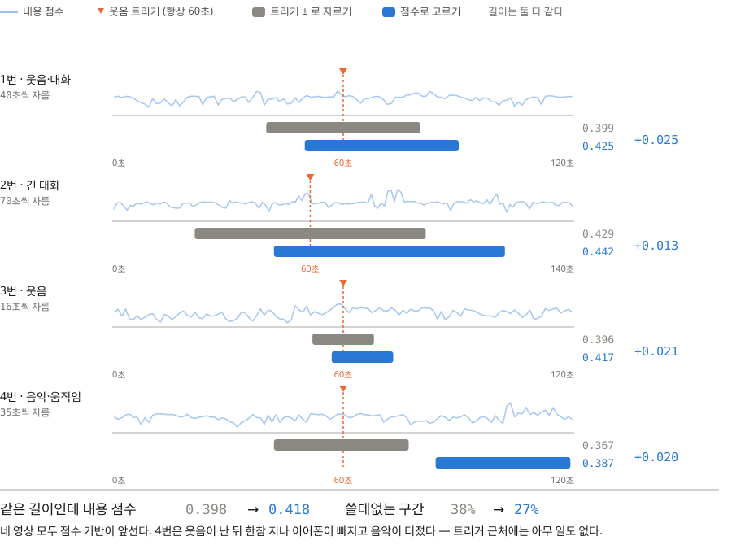

같은 길이로 트리거(60초)를 한가운데 놓고 자른 것(회색)과 점수로 고른 것(파랑)을
나란히 뒀다. 지표는 장표 2와 같은 **내용 점수**다.

| # | 길이 | 트리거 ± | 점수 기반 | 차이 |
| --- | ---: | ---: | ---: | ---: |
| 1 | 40초 | 0.399 | **0.425** | +0.026 |
| 2 | 70초 | 0.429 | **0.442** | +0.013 |
| 3 | 16초 | 0.396 | **0.417** | +0.021 |
| 4 | 35초 | 0.367 | **0.387** | +0.020 |

**평균 내용 점수 0.398 → 0.418, 쓸데없는 구간 37.7% → 27.3%**

**할 말**

> 웃음이 감지되면 그 앞뒤 60초로 클립을 만듭니다. 그러니 트리거는 항상 한가운데,
> 60초 지점입니다. 가장 단순한 방법은 거기서 필요한 길이만큼 잘라내는 것이고,
> 회색이 그 결과입니다.
> 4번을 보시면 트리거 근처에는 아무 일도 없습니다. 웃음이 난 뒤 한참 지나서
> 일어서다 이어폰이 빠지고 스피커로 음악이 터졌거든요. 트리거를 한가운데 놓으면
> 42초부터 자르는데 저희는 84초부터 잡았습니다.

## 장표 2 — 그래서 어떻게 고르나

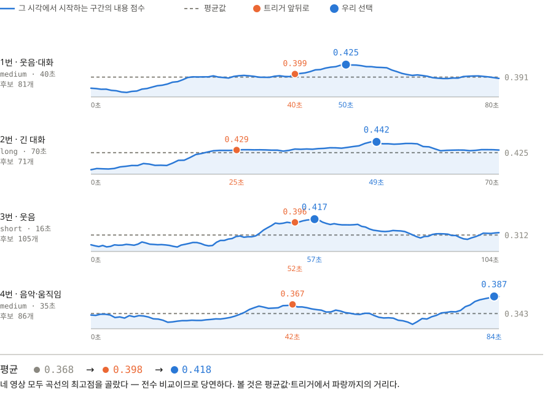

가로축은 구간의 **시작 시각**, 세로축은 거기서 정해진 길이만큼 잘랐을 때의
**내용 점수**(선택기가 실제로 최대화하는 값)다. 장표에는 곡선과 점만 두고
숫자는 아래 표로 뺐다.

| # | 평균값 | 트리거 ± | **우리** | 최고 |
| --- | ---: | ---: | ---: | ---: |
| 1 | 0.391 | 0.399 | **0.425** | 0.425 |
| 2 | 0.425 | 0.429 | **0.442** | 0.442 |
| 3 | 0.312 | 0.396 | **0.417** | 0.417 |
| 4 | 0.343 | 0.367 | **0.387** | 0.387 |

**평균값 0.368 · 트리거 ± 0.398 → 우리 0.418**

네 영상 모두 최고점과 같다. **전수 비교이므로 당연한 결과다** — 이 표에서 볼 것은
"100%"가 아니라 평균값·트리거와 파랑 사이의 거리다.

**할 말**

> 저희가 하는 일은 이 곡선에서 가장 높은 곳을 고르는 것 전부입니다.
> 프리셋 길이에 드는 구간을 영상당 1,600~2,300개 전부 만들어서 비교하니까
> 최고점에 앉는 건 당연합니다.
> 보실 것은 거리입니다. 회색 점선이 모든 구간의 평균값, 주황 점이 트리거
> 앞뒤로 잘랐을 때이고, 그만큼이 이 로직이 만들어낸 값입니다.
> 3번은 평균값이 0.312인데 저희는 0.417입니다.

## 장표 3 — 줌은 표정만으로 결정되지 않는다

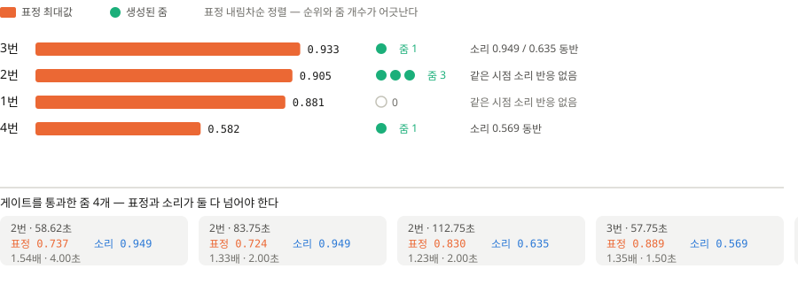

표정 최대값 내림차순으로 정렬했는데 줌 개수가 1, 3, 0, 1로 어긋난다.

| 표정 순위 | # | 표정 최대 | 표정 중앙값 | 줌 | 사유 |
| ---: | --- | ---: | ---: | ---: | --- |
| 1 | 3번 | 0.933 | 0.311 | 1 | 소리 0.569 동반 |
| 2 | 2번 | 0.905 | 0.105 | 3 | 소리 0.949·0.949·0.635 동반 |
| 3 | 1번 | 0.881 | 0.000 | **0** | 같은 시점 소리 반응 없음 |
| 4 | 4번 | 0.582 | 0.069 | 1 | 표정 최저인데 소리 0.565로 통과 |

**할 말**

> 표정이 세 번째로 높은 1번이 줌 0개입니다. 같은 시점에 소리 반응이 없었기
> 때문입니다. 반대로 표정이 가장 낮은 4번은 줌이 들어갔습니다.
> 줌 켜기는 줌을 강제하는 게 아니라 허용하는 값이고, 표정과 소리가 동시에
> 임계를 넘어야만 걸립니다.

## 장표 4 — 실제 결과, 줌 OFF에서 지금까지

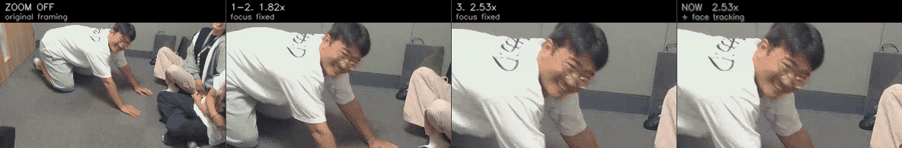

박수 영상 2.6초. **같은 4초를 네 가지로 잘랐다** — 원본 → 1.82배 고정 →
2.53배 고정 → 지금(2.53배 + 얼굴 추적).

| | 배율 | 초점 이동 | 화면에서 보이는 것 |
| --- | ---: | ---: | --- |
| 원본 | 1.00× | — | 얼굴이 화면의 1/3 |
| 1–2단계 | 1.82× | 0.000 | 확대는 됐는데 사람이 왼쪽으로 빠진다 |
| 3단계 | 2.53× | 0.000 | 더 크게 당긴 만큼 **더 크게 놓친다** |
| 지금 | 2.53× | 0.124 | 4초 내내 얼굴이 가운데 있다 |

**할 말**

> 줌은 "어디를 확대할지" 정하고 끝나는 게 아니었습니다. 화면에 실제로 나오는
> 그림은 여섯 단계를 더 거쳤습니다.
> 두 번째가 처음 만든 것입니다. 확대는 됐는데 사람이 움직이니까 왼쪽으로
> 빠집니다. 그래서 얼굴이 화면의 45%가 되도록 배율을 올렸더니 세 번째가 됐는데,
> **더 크게 당긴 만큼 더 크게 놓칩니다.** 배율만 보면 나아진 것처럼 보이지만
> 화면은 더 나빠졌습니다.
> 네 번째가 지금입니다. 배율은 세 번째와 같고 초점이 얼굴을 따라갑니다.
> 저희가 고친 건 배율이 아니라 **초점이 움직이지 않는다는 것**이었고,
> 그걸 알아채는 데 세 단계가 더 걸렸습니다.

**예상 질문 — "왜 세 번째에서 바로 못 잡았나요?"**

> 초점 키프레임은 세 번째 단계에도 17개 있었습니다. 값이 전부 같았을 뿐입니다.
> 추적이 켜져 있는 것으로 보여서 됐다고 판단했고, 실제 기기에서 안 되는 것을
> 사용자가 먼저 찾았습니다. 로컬에서 새로 만든 분석으로 검증한 게 원인이라,
> 이후 두 단계는 운영 서버에 저장된 분석 파일로 확인했습니다.

### 같은 방식으로 본 다른 두 구간

**4번 103.1초 · 놀람** — 장표 3에서 "표정 최저인데 통과했다"고 한 그 줌이다.

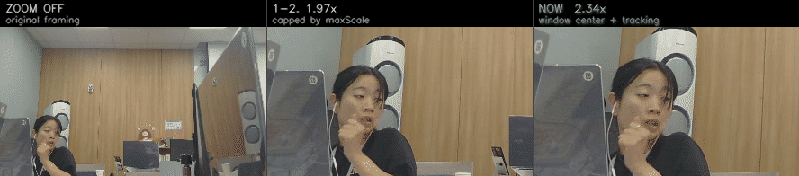

> 이 장면은 저희가 한 번 놓쳤던 곳입니다. 놀람 표정 점수가 0.344였는데
> 근처 미소가 0.582라 미소한테 밀렸습니다. 놀람은 턱과 눈, 눈썹이 같이
> 움직인다는 걸 반영해 별도 기준으로 보정했더니 0.573이 나와 되살아났습니다.
> 지표를 보고 코드를 고쳐서 **줌이 생겼고**, 그 뒤 가운데에서 오른쪽으로
> 가는 데 다시 여섯 단계가 걸렸습니다. 1.97배는 얼굴이 잘리지 않게 두려고
> 상한이 깎은 값입니다.

**웃음 영상 103.75초** — 상한이 줌을 **아예 없앤** 경우다.

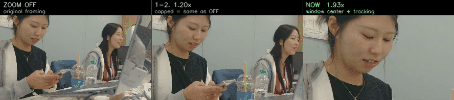

> 가운데는 줌이 켜져 있습니다. 1.20배가 최소값이라 원본과 같은 그림이 나올
> 뿐입니다. 얼굴이 화면 가장자리에 있을수록 "얼굴을 자르지 마라"는 상한이
> 세게 걸려서, 줌을 걸어 놓고도 아무 일이 안 일어났습니다.
> 초점을 화면에 고정할 점이 아니라 **잘라낼 창의 중심**으로 바꾸고 나서
> 오른쪽이 나왔습니다.

단계별 표와 나머지 구간은 **부록 G**에 있다. 정지 프레임이 필요하면 백업 장표에
있다.

---

## 백업 장표

### 줌 전후 정지 프레임 — GIF가 안 도는 환경용

장표 4를 띄울 수 없을 때 이 두 장으로 대신한다. **단, 여기 배율은 서버 계산값이라
장표 4의 숫자와 다르다** — 앱이 45% 기준으로 다시 잡은 값이 장표 4에 있다.

**4번 103.125초 · 서버 1.73배 · 놀람**

| 줌 전 | 줌 후 |
| --- | --- |
| 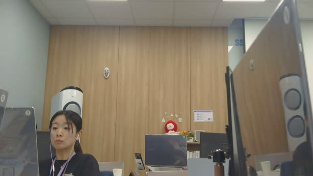 | 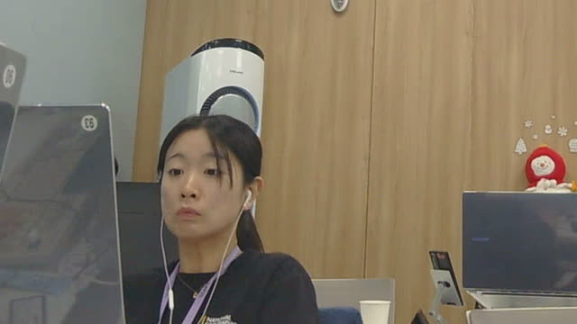 |

**2번 58.625초 · 서버 1.54배 · 미소**

| 줌 전 | 줌 후 |
| --- | --- |
| 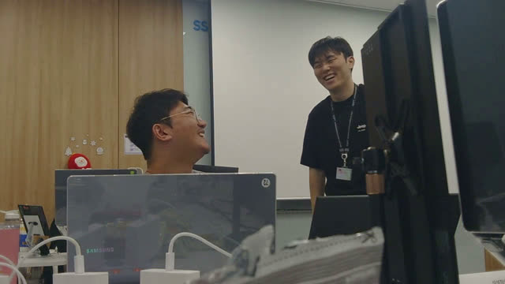 | 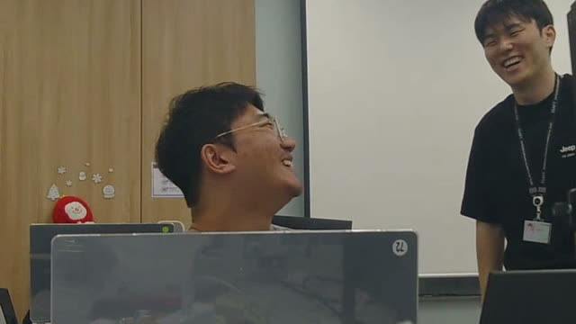 |

표정 0.737 · 소리 0.949로 소리 쪽이 가장 강하게 걸린 줌이다. 서버 배율 1.539배로
네 줌 중 가장 크게 당겼다.

### 사건 유형 경합 상세

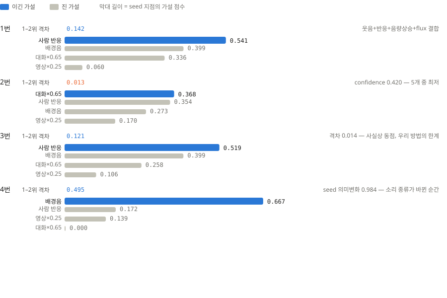

| # | 사람 반응 | 배경음 | 대화×0.65 | 영상×0.25 | 승자 | 1–2위 격차 |
| --- | ---: | ---: | ---: | ---: | --- | ---: |
| 1 | **0.541** | 0.399 | 0.336 | 0.060 | 사람 반응 | 0.142 |
| 2 | **0.711** | 0.437 | 0.319 | 0.156 | 사람 반응 | 0.274 |
| 3 | **0.519** | 0.399 | 0.258 | 0.106 | 사람 반응 | 0.121 |
| 4 | 0.172 | **0.667** | 0.000 | 0.139 | 배경음 | **0.495** |

**4번은 가장 두드러진 지점의 웃음 점수가 0.0이다.** 웃음 탐지기만 있으면 이
영상에서는 아무것도 고르지 못한다.

### 창 길이를 늘리면 되지 않나

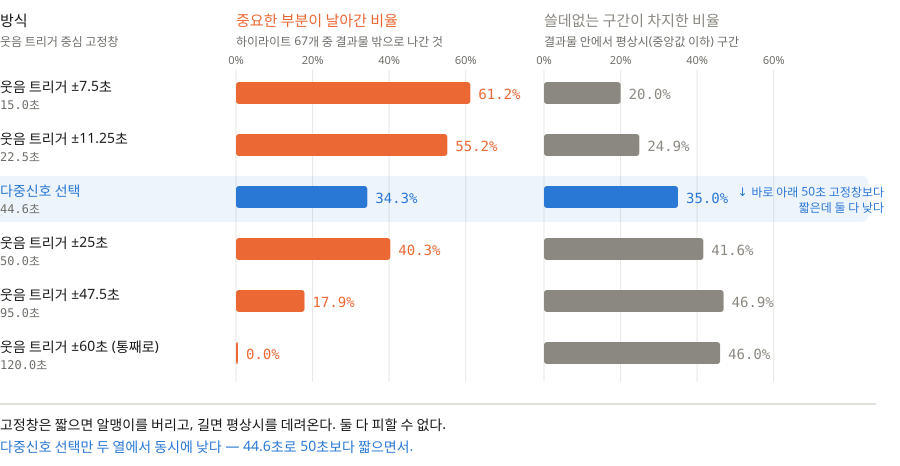

고정창은 곡선 위를 움직일 뿐이다. 점수 기반 선택은 평균 40.2초로 50초
고정창보다 짧으면서 놓침(25.5% vs 49.0%)과 잉여(28.6% vs 38.0%)가 둘 다 낮다.

### 안 쓰는 그림

띄우지 않지만 파일은 남겨 뒀다.

- [`36-fixed-window.svg`](assets/36-fixed-window.svg) — 단일 신호 최대 지점 비교.
  "특징점 찍어놓고 딴 데 잘랐다"로 읽혀 장표 1로 대체했다.
- [`36-vs-random.svg`](assets/36-vs-random.svg) — 장표 2와 같은 내용, 막대 버전.
- [`36-timeline.svg`](assets/36-timeline.svg) — 원본 시간축 위의 점수 곡선.

STT 제거 전후 장표는 지웠다. 비교 대상인 v9 수치가 옛 선택기로 잰 값이라
새 선택기 결과와 나란히 두면 두 변화가 섞여 비교가 성립하지 않는다.

---

# 부록

## A. 최종 선택 결과 (v11)

| # | 프리셋 | 선택 구간 | 길이 | 유지율 | 두드러진 유형 | 후보 수 | 줌 |
| --- | --- | --- | ---: | ---: | --- | ---: | ---: |
| 1 | medium | 50.000~90.000초 | 40.000초 | 33.3% | 사람 반응 | 2,201 | 0 |
| 2 | long | 49.000~119.000초 | 70.000초 | 50.1% | 대화 | 2,346 | 3 |
| 3 | short | 57.000~73.000초 | 16.000초 | 13.3% | 사람 반응 | 1,576 | 1 |
| 4 | medium | 84.000~119.000초 | 35.000초 | 29.2% | 배경음 | 2,201 | 1 |

"두드러진 유형"은 그 영상에서 가장 점수가 높은 1초의 유형이다. v11부터는
구간 선택이 이 값에 좌우되지 않는다 — 전수 비교로 고르기 때문이다.

## B. 통과한 줌 5개

| # | 원본 시점 | 길이 | 배율 | 표정 | 소리 | 표정 종류 | 초점 |
| --- | ---: | ---: | ---: | ---: | ---: | --- | --- |
| 2 | 58.625초 | 4.00초 | 1.539배 | 0.737 | 0.949 | smile | 0.401, 0.473 |
| 2 | 83.750초 | 2.00초 | 1.326배 | 0.724 | 0.949 | smile | 0.355, 0.536 |
| 2 | 112.750초 | 2.00초 | 1.226배 | 0.830 | 0.635 | smile | 0.420, 0.529 |
| 3 | 57.750초 | 1.50초 | 1.349배 | 0.889 | 0.569 | smile | 0.622, 0.556 |
| 4 | 103.125초 | 4.00초 | 1.730배 | 0.478 | 0.565 | **surprise** | 0.139, 0.713 |

여기 배율은 **서버가 계산한 값**이다. 서버는 얼굴 높이를 화면의 28~33%로
맞추는데, 작은 휴대폰 화면에서는 확대한 티가 안 나서 **앱이 45% 기준으로 다시
잡는다**(`EditorProjectExporter`가 아니라 `EditorProjectController.autoZoomFaceHeight`).
그래서 실제로 보이는 배율은 이 표보다 크다 — 부록 G의 표가 최종값이다.

## C. 검증 영상과 원본 위치

버킷은 `william-james-videos`. 객체 키가 UUID라 파일명으로는 못 찾고
`videos` 테이블의 `captured_start_at`으로 찾아야 한다.

| # | 촬영 시각(KST) | 길이 | 성격 | 객체 키 |
| --- | --- | ---: | --- | --- |
| 1 | 2026-07-31 17:09:44 | 120.0초 | 웃음·대화 | `private/b0db34c8-…954b/events/5a8fefbb-a4c1-4948-9048-2a7ee0a0dfc6.mp4` |
| 2 | 2026-07-31 15:33:41 | 139.6초 | 긴 대화 | `private/b0db34c8-…954b/events/35a255f7-9146-462d-bb17-b4b0b6045a3e.mp4` |
| 3 | 2026-07-28 10:43:18 | 120.0초 | 웃음 | `private/83629bcc-…6182/events/0a72b78d-38b1-4d0a-b866-1e301f211daf.mp4` |
| 4 | 2026-07-27 16:25:25 | 120.0초 | 음악·움직임 | `private/83629bcc-…6182/events/29de03c2-5090-44cf-a3ba-78ca23907753.mp4` |

제외한 1번은 `2026-07-31 17:39:32`,
`private/b0db34c8-…954b/events/cf01116b-f64d-4975-8762-612d123c9d09.mp4`다.

`service.py`의 fixture 조회는 `captured_at`을 **분 단위로 정확히** 맞춘다
(`_fixture_stem`이 `%Y%m%d_%H%M`을 비교한다). 1분만 어긋나도 fixture를 못 찾는다.

```sql
select to_char(captured_start_at at time zone 'Asia/Seoul','YYYYMMDD_HH24MISS') as kst,
       duration_ms, status, storage_key
from videos
where captured_start_at >= '2026-07-26' and captured_start_at < '2026-08-02'
order by captured_start_at;
```

## D. 재현

```bash
python -m video_editor.adaptive_cli \
  --yamnet video_editor/fixtures/analysis/05_20260727_162525.yamnet.json \
  --audio video_editor/fixtures/analysis/05_20260727_162525.audio.json \
  --video video_editor/fixtures/analysis/05_20260727_162525.video.json \
  --expression video_editor/fixtures/analysis/05_20260727_162525.expression.json \
  --duration-preset medium --zoom on
```

모델 바이너리 없이 표준 라이브러리만으로 동작한다. `scoreTimeline`에 1초 빈별
4개 유형 점수와 15개 특징이 들어 있어 **어떤 구간을 왜 골랐는지 숫자로 답할 수 있다.**

줌 프레임은 `crop=cw:ch:x:y,scale=1280:720`으로 뽑는다. `cw = W/z`, `ch = H/z`,
`x = clamp(focusX·W − cw/2)`, `y = clamp(focusY·H − ch/2)`이며
`render_video.py`의 `zoompan` 표현식과 같은 값이다.

## E. 지표 정의

- **사건 점수** — 1초 빈의 `max(사람 반응, 배경음, 0.65·대화, 0.25·영상)`.
  구간 점수는 그 구간 빈들의 평균.
- **내용 점수** — 선택이 실제로 최대화하는 값. `0.85 × 사건 점수 + 0.15 × 연속성`.
  사건 점수와 다르므로 §3의 "최고 대비"가 100%가 아닐 수 있다.
- **쓸데없는 구간** — 사건 점수가 그 영상의 중앙값에 못 미치는 빈의 비율.
  정의상 영상 전체로는 약 50%이므로, 평균값 45.3%가 기준선이고 우리 24.5%가
  그보다 낮다는 것이 이 수치의 의미다.
- **평균값** — 같은 길이의 모든 구간을 1초씩 밀며 만든 뒤 그 점수들의 평균.
  구간 하나를 아무렇게나 골랐을 때의 기댓값이다.
- **최고 대비** — `우리 구간 점수 / 같은 길이 구간 중 최고 점수`.

## F. `music` → `ambient` 이름 변경 (2026-08-07)

두 번째 사건 유형의 이름을 바꿨다. **수식과 결과는 한 글자도 바뀌지 않았다.**

| # | 이 유형의 최대값 | 그 지점의 실제 YAMNet 음악 점수 |
| --- | ---: | ---: |
| 1 | 0.399 | 0.000 |
| 2 | 0.437 | 0.001 |
| 3 | 0.509 | 0.019 |
| 4 | 0.667 | 0.498 |

음악 항의 가중치는 0.45뿐이고 나머지 0.55는 음량 상승·flux·음량·의미 변화가
채운다. 넷 중 셋에서 음악 없이 이 유형이 이긴다. "음악 구간을 뽑았습니다"는
사실과 다른 설명이었다.

정확한 설명 — **사람 목소리가 아닌 소리가 갑자기 커지거나 성격이 바뀌는 구간.**

## G. 줌 변천사 (2026-08-08 ~ 09)

부록 B의 줌은 "어느 순간을 확대할지"까지만 정한 것이다. **어디를 얼마나 자를지**는
그 뒤에 여섯 단계에 걸쳐 자리를 잡았다. 각 단계가 무엇을 고쳤고 숫자가 어떻게
움직였는지 남긴다. 기준 영상은 2026-08-07 10:25 촬영본(`65b83210`, 이하 박수 영상)
이고, 그 2.6초 줌 구간을 계속 같은 자로 잰다.

| 단계 | 무엇이 문제였나 | 무엇을 바꿨나 | 배율 | 초점 이동 | 화면 미끄러짐 |
| --- | --- | --- | ---: | ---: | ---: |
| 0. 처음 | 확대해 둔 채로 사람이 움직이면 화면 밖으로 나간다 | — | 1.82× | 0.000 | 0.390 |
| 1. 얼굴 추적 | 초점이 한 점에 고정돼 있었다 | 줌마다 `focusTrack`(초점 키프레임)을 싣는다 | 1.82× | 0.000 | 0.390 |
| 2. 45% + 안전 상한 | 얼굴이 화면의 1/3이라 확대한 티가 안 났다 | 목표를 45%로, 대신 얼굴이 잘리지 않는 `maxScale`을 서버가 계산 | 1.82× | 0.000 | 0.390 |
| 3. 창 중심 기하 | 가장자리 얼굴은 상한이 배율을 깎아 버렸다 | 초점을 "화면에 고정될 점"이 아니라 **잘라낼 창의 중심**으로 | **2.53×** | 0.000 | 0.390 |
| 4. 궤적 메우기 | 표정 분석이 얼굴을 8%만 잡아 추적할 값이 없었다 | 영상 분석(BlazeFace) 얼굴로 궤적의 빈칸을 메운다 | 2.53× | 0.000 | 0.390 |
| 5. 게이트 수정 | 사람이 걸어간 표본을 "다른 사람"으로 버렸다 | 거리 문턱을 간격에 비례해 늘린다(0.06 → 0.09~0.30) | 2.53× | **0.111** | **0.105** |
| 6. 얼굴 전부 저장 | 창마다 가장 큰 얼굴 하나만 저장해 사람이 뒤바뀌었다 | 영상 분석이 얼굴을 전부 남긴다(`video-v2`) | 2.53× | **0.124** | 0.105 |

- **초점 이동** — 구간 동안 초점이 원본 좌표에서 움직인 폭(가로). 0이면 추적이
  꺼져 있는 것과 같다.
- **화면 미끄러짐** — 그 사람의 얼굴이 화면 안에서 이동한 폭. 작을수록 붙어 있다.

3단계에서 배율이 오르고도 5단계까지 초점 이동이 0인 것이 이 작업의 교훈이다.
**키프레임은 17개 있었지만 값이 전부 같았다** — 추적이 켜져 있는데도 한 번도
움직이지 않았고, 그래서 "적용됐다"고 보고했다가 실제 기기에서 안 된다는 것을
사용자가 먼저 발견했다. 원인은 검증을 로컬에서 새로 만든 분석으로 했기 때문이다.
5·6단계는 **운영 서버에 저장된 분석 파일로** 검증했다.

### 눈으로 — 단계별로 무엇이 달라졌나

각 단계의 커밋으로 `video_editor`를 되돌려 레시피를 다시 만들고, **같은 프레임을
단계별 배율·초점으로 각각 잘라** 나란히 놓았다. 오른쪽 끝이 지금이다.

| 박수 영상 2.6초 — 표의 기준 구간. 원본 → 1.82배 고정 → 2.53배 고정 → 지금 |
| --- |
|  |

**세 번째 칸이 이 작업의 함정이다.** 배율만 올리고 초점이 고정이면 3초 뒤 사람이
창 밖으로 나간다 — 3단계는 1단계보다 더 크게 놓친다. 표에서 3단계 배율이 오른
것만 보고 "됐다"고 읽으면 안 되는 이유가 여기 있다. 이 한 장이 **장표 4**다.

4번 영상 103.1초(상한 1.97배 → 창 중심 2.34배)와 웃음 영상 103.75초(상한이 줌을
아예 없애 1.20배 = 원본)도 같은 방식으로 만들어 **장표 4**에 함께 뒀다. 가장자리
얼굴일수록 상한이 세게 걸려, 2단계에는 **줌을 걸어 놓고도 원본과 똑같은 화면이
나오는** 구간이 있었다. 3단계가 고친 것이 이것이다.

아래는 장표에 없는 것 하나다.

| 웃음 영상 81.5초 — 창마다 가장 큰 얼굴만 저장(초점 이동 0.011)과 전부 저장(0.168) |
| --- |
| 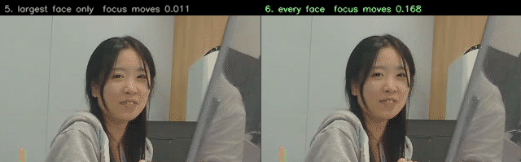 |

**읽을 때 주의할 것.**

- 패널은 각각 `5f924c0`(1–2단계) · `f77b72a`(3단계) · `c75e058`(5단계) ·
  `924da31`(6단계)의 코드로 다시 만든 레시피다. 손으로 맞춘 값이 아니다.
- 6단계 패널만 `video-v2` 분석이고 나머지는 당시의 `video-v1` 분석이다.
- 위 표의 초점 이동은 **운영 서버에 저장된** 분석으로 잰 값이고, 여기 패널은
  로컬 분석이라 4단계 이후 숫자가 다르게 나온다(로컬 분석에서는 4단계에서 이미
  움직인다 — 바로 그것이 "됐다"고 잘못 보고한 경위다). 1~3단계는 `focusTrack`
  자체가 없어 어느 분석을 넣든 고정이므로, 박수 영상 GIF의 앞 두 패널은
  이 차이와 무관하다.

### 지금 동작 — 원본 7편 종단 실행 (`길게` 프리셋)

다운로드해 둔 원본을 서버와 같은 코드로 분석 → 레시피 → 컷·줌 렌더까지 돌렸다.

| 영상 | 컷 | 줌 | 시각 · 길이 · 배율 · 초점 이동(가로/세로) |
| --- | --- | ---: | --- |
| 웃음이_담긴_…642850 | 48~120초 | 3 | 61.6초 4.0초 2.08× 0.103/0.127 · 81.5초 3.5초 1.99× 0.168/0.092 · 103.8초 2.0초 1.93× 0.067/0.029 |
| 웃음이_담긴_…629350 (2번) | 49~119초 | 3 | 58.6초 4.0초 2.08× 0.177/0.042 · 83.8초 2.0초 1.84× 0.075/0.015 · 112.8초 2.0초 1.97× 0.021/0.035 |
| 박수가_시작된_…969356 | 0~97초 | 2 | 2.6초 4.0초 2.53× 0.124/0.098 · 77.0초 2.5초 1.93× 0.052/0.026 |
| 웃음이_감지된_…617266 (4번) | 48~118초 | 1 | 103.1초 4.0초 2.34× 0.104/0.030 |
| 나머지 3편 | — | 0 | 표정·소리 동시 조건을 넘은 구간 없음 |

**줌 9개가 모두 얼굴을 따라간다.** 초점이 안 움직이는 구간은 하나도 없다.
2번·4번은 부록 B와 시각이 정확히 일치한다(58.625·83.750·112.750, 103.125초) —
같은 줌인데 배율만 서버값(1.539·1.326·1.226·1.730배)에서 위 값으로 올라간 것이다.

### 눈으로 — 줌 OFF / ON

왼쪽이 원본 프레이밍, 오른쪽이 자동 줌 + 얼굴 추적이다.

| 박수 영상 2.6초 (2.53×) — 기어가는 사람을 따라간다 |
| --- |
| 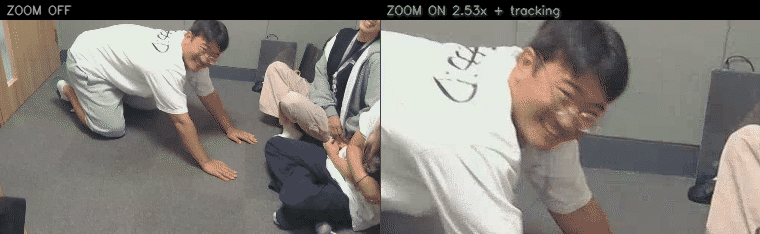 |

| 2번 영상 58.6초 (2.08×) — 초점 이동 0.177로 가장 크다 |
| --- |
| 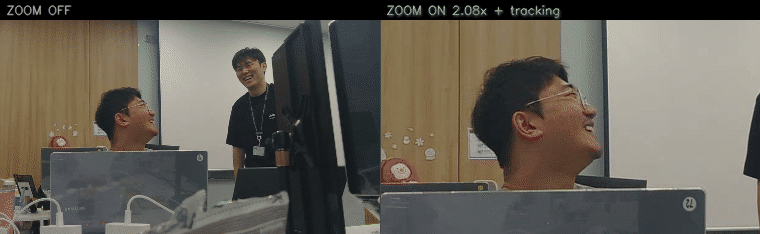 |

| 웃음 영상 81.5초 (1.99×) — 세로로도 0.092 따라간다 |
| --- |
| 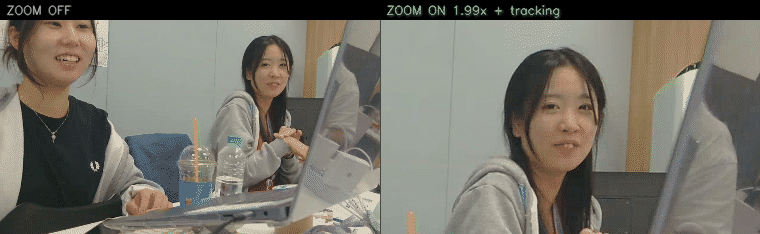 |

| 4번 영상 103.1초 (2.34×) — surprise로 걸린 그 구간 |
| --- |
| 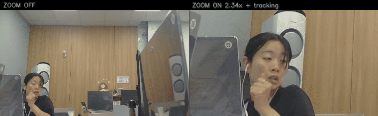 |

### 남은 한계 둘

**1. 얼굴이 화면 끝에 있으면 그 방향으로는 추적이 멈춘다.** 창이 이미 프레임
경계에 밀려 있어 더 갈 데가 없다. 박수 영상 77초 구간이 그렇다 — 세로 초점이
0.17인데 1.93배에서 창 반폭이 0.259라, 세로 이동 0.031이 통째로 잘린다.
배율을 조금 내주고 추적 여유를 남기는 선택지가 있으나 아직 적용하지 않았다.

**2. `auto` 프리셋에서는 줌이 거의 안 생긴다.** 컷이 11~16초로 짧게 잡히면 그
구간 안의 점수 분포로 문턱이 다시 계산돼 후보가 남지 않는다. 같은 영상이
`길게`에서는 줌 2개, `auto`에서는 0개다. 사용자가 프리셋을 누르지 않으면 줌을
거의 못 보는 구조이고, 이는 추적과 별개 문제다.

| 프리셋 | 컷 길이 | 줌 총합 | 줌 있는 영상 |
| --- | --- | ---: | ---: |
| auto | 11~16초 | 3 | 3/7 |
| 길게 | 70~97초 | 9 | 4/7 |

### 재현

```bash
# 분석 4종 → 레시피(길게, 줌 켜기)
python -m video_editor.adaptive_cli \
  --yamnet <stem>.yamnet.json --audio <stem>.audio.json \
  --video <stem>.video.json --expression <stem>.expression.json \
  --duration-preset long --zoom on --output recipe.json
```

단계별 GIF는 `git archive <커밋> video_editor`로 그 시점 코드를 꺼내 같은 명령을
돌린 뒤, 원본에서 같은 프레임을 읽어 단계별 배율·초점으로 각각 잘라 붙인 것이다.

앱이 최종 배율을 다시 잡는다: `min(2.8, max(1.2, scale × 0.45 / targetFaceHeight))`를
구한 뒤 `maxScale`로 자른다. 초점은 `focusX + focusTrack[t].dx`이고, 창 중심은
`clamp(초점, 0.5/배율, 1 − 0.5/배율)`이다. 화면 좌표는 `0.5 + (원본좌표 − 창중심) × 배율`.
