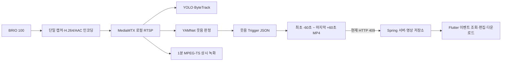

# AI 파트 2026-07-24 개발 진행 및 2026-07-25 Task

> 작성일: 2026-07-24  
> 대상 장치: NVIDIA Jetson Orin Nano 8GB + Logitech BRIO 100  
> 프로젝트 범위: Edge Media, YOLO 자동 구도, YAMNet 웃음 감지, 이벤트 영상 생성·업로드  
> 관련 문서: [전체 규격](../ai/AI_EDGE_INTEGRATION_SPEC.md), [YOLO RTSP 검증](./AI_YOLO_RTSP_VALIDATION_2026-07-24.md), [웃음 이벤트 녹화 절차](../ai/LAUGHTER_EVENT_RECORDING_RUNBOOK.md)

이 문서는 코드에 기능이 존재하는 상태와 실제 Jetson에서 동작을 확인한 상태를
구분한다. 실제 기기 ID, 인증정보와 토큰은 기록하지 않는다.

## 1. 오늘의 한 줄 요약

> 최소 MVP의 이벤트 영상 생성까지 가기 위해 YOLO RTSP 입력·복구, 실제 웃음
> 감지와 전후 60초 MP4 생성을 Jetson에서 검증했고, 웃음 정확도 실험을 통해
> 현재 YAMNet 단일 임계값 방식으로는 말소리 오탐을 막으면서 작은 웃음까지
> 검출할 수 없다는 한계를 확인했다.

## 2. 오늘 작업의 목표

오늘은 다음 단계로 나아가기 위한 작업을 수행했다.

1. AI가 공유 RTSP를 안정적으로 입력받는지 확인한다.
2. 실제 사람 탐지와 자동 구도 상태 전이를 검증한다.
3. 실제 웃음이 감지되면 상시 녹화본에서 전후 60초 MP4를 생성한다.
4. 서버 업로드 전에 로컬 이벤트 영상의 코덱, 길이와 무결성을 확인한다.
5. 말소리 오탐과 작은 웃음 누락을 수치로 측정하여 운영값을 근거 없이 정하지 않는다.

오늘의 최종 목표는 앱 조회까지 완성하는 것이 아니라, Jetson 내부의
`RTSP → AI 감지 → 이벤트 MP4` 경로를 검증하고 서버 업로드 단계의 정확한
시작점을 만드는 것이었다.

## 3. 오늘 수행한 작업

### 3.1 BRIO 100 입력과 로컬 RTSP 복구

- BRIO 100의 실제 ALSA 카드 이름이 `B100`임을 확인했다.
- 오디오 입력을 `plughw:CARD=B100,DEV=0`으로 수정했다.
- 3초 마이크 시험에서 48kHz mono PCM 입력을 확인했다.
- `wj-media-source`를 재시작한 뒤 재시작 횟수 0, `active/running`을 확인했다.
- MediaMTX의 `main`, `ai` 경로에서 H.264 1280×720 영상과 AAC 음성을 확인했다.

```text
rtsp://127.0.0.1:8554/homecam/main
rtsp://127.0.0.1:8554/homecam/ai
```

### 3.2 YOLO RTSP 입력과 장애 복구 검증

운영 경로와 분리한 시험판에서 다음 항목을 검증했다.

| 항목 | 결과 |
| --- | --- |
| RTSP 최초 연결 | PASS |
| 실제 사람 탐지 | PASS |
| 최대 동시 사람 수 | 4명 |
| 사람 탐지 표본 | 424개 |
| ByteTrack ID 생성 | PASS |
| `TRACKING → HOLD → HOME` | PASS |
| RTSP 강제 중단 감지 | PASS |
| 1·2·4·8·10초 재접속 백오프 | PASS |
| 스트림 복구 후 자동 재연결 | PASS |
| JSONL 무결성 | 551줄 중 오류 0줄 |
| 평균 보고 추론 속도 | 약 7.9 FPS |
| 고양이·강아지 | NOT TESTED |

고양이와 강아지는 현장에 실제 대상이 없어 탐지 실패가 아니라
`NOT TESTED`로 분리했다. 상세 증거는
[YOLO RTSP 검증 문서](./AI_YOLO_RTSP_VALIDATION_2026-07-24.md)에 기록했다.

### 3.3 버전 묶음 배포와 검증

- AI 코드를 파일별로 덮어쓰지 않고 하나의 릴리스 묶음으로 배포했다.
- 첫 운영 후보 릴리스는 Jetson에서 Bash·Python 문법과 총 29개 테스트를 통과했다.
- 기존 운영 폴더를 백업하고 `/home/ssafy/ai`가 버전 릴리스를 가리키도록 전환했다.
- 기존 이벤트 파일은 별도 보관 경로로 이동하여 새 시험 결과와 섞이지 않게 했다.
- 진단 기능을 추가한 후 별도의 진단 릴리스를 만들었다.
- 진단 릴리스는 Jetson에서 YOLO 23개와 YAMNet 9개, 총 32개 테스트를 통과했다.
- 진단 릴리스는 운영 릴리스를 교체하지 않고 별도 경로에서만 실행했다.

### 3.4 실제 웃음과 전후 60초 이벤트 영상

실제로 웃은 뒤 YAMNet 이벤트 발생과 상시 녹화 세그먼트 기반 MP4 생성을
확인했다.

| 항목 | 결과 |
| --- | --- |
| 실제 웃음 이벤트 발생 | PASS |
| 이벤트 기준 | 최초 웃음 60초 전부터 마지막 웃음 60초 후 |
| 생성 영상 길이 | 120.017초 |
| 영상 크기 | 약 39.5MB |
| 영상 | H.264, 1280×720 |
| 음성 | AAC, 48kHz mono |
| 로컬 파일 SHA-256 계산 | PASS |
| 서버 업로드 | FAIL: HTTP 409 |
| 앱 이벤트 조회 | NOT TESTED |

생성된 MP4는 AI 박스가 그려진 영상이 아니라 상시 녹화 원본에서 추출한
깨끗한 H.264/AAC 이벤트 영상이다. 서버 업로드 실패 후 동일 요청이 반복되는
것을 막기 위해 AI 이벤트 녹화 서비스를 중지했다.

### 3.5 YAMNet 진단 기능 구현

기존에는 YAMNet 시간 패치에서 웃음 관련 클래스의 최대 점수만 사용했다.
원인을 비교할 수 있도록 다음 진단 기능을 추가했다.

- `max`, `mean`, `p90` 점수 집계 방식
- 추론별 JSONL 진단 기록
- 최상위 클래스와 점수
- 웃음 클래스별 집계 점수
- RMS, 연속 양성 횟수, 가상 이벤트 판정, 추론 시간
- 실제 이벤트 파일과 MQTT를 만들지 않는 `diagnostics-only` 모드
- 점수 집계 모듈 단위 테스트

진단 모드는 운영 이벤트나 서버 데이터를 만들지 않고 판정값만 비교하도록
설계했다.

### 3.6 무음·말소리·큰 웃음·작은 웃음 통제 실험

다음 표본을 BRIO 100과 실제 RTSP 오디오로 수집했다.

| 데이터 | 분석 표본 | 목적 |
| --- | ---: | --- |
| 무음 | 45 | 주변 환경 오탐 확인 |
| 일반 말소리 | 47 | 말소리를 웃음으로 오인하는지 확인 |
| 큰 웃음 구간 | 15 | 명확한 웃음 재현율 확인 |
| 작은 웃음 구간 | 17 | 서비스 핵심인 약한 웃음 재현율 확인 |

기존 설정인 `max / threshold 0.05 / consecutive 2`에서는 다음 문제가 있었다.

- 무음에서 웃음 이벤트 후보가 발생했다.
- 일반 말소리에서 웃음 점수가 최대 16회 연속 임계값을 넘었다.
- 약 4분 동안 11개의 웃음 트리거와 4개의 MP4가 만들어지는 과탐 현상이 있었다.
- YAMNet의 최상위 클래스가 `Speech`인 동안에도 웃음 클래스의 순간 최대값으로
  이벤트가 발생했다.

큰 웃음과 작은 웃음의 점수 차이는 다음과 같았다.

| 구간 | `max` 최고 | `mean` 최고 | `p90` 최고 |
| --- | ---: | ---: | ---: |
| 큰 웃음 | 0.310742 | 0.197556 | 0.280253 |
| 작은 웃음 | 0.077337 | 0.047421 | 0.071354 |
| 일반 말소리 | 0.279431 | 0.207475 | 0.265040 |

점수 집계 방식, 임계값과 연속 횟수를 조합했지만 무음·말소리 오탐 없이
큰 웃음과 작은 웃음을 모두 잡는 조합은 없었다. 웃음 점수를 최상위 소리
점수로 나눈 상대 비율까지 추가해 탐색했지만 유효 조합은 없었다.

따라서 **YAMNet 기본 클래스 점수의 단일 임계값을 계속 조정하는 방식으로는
현재 목표를 달성할 수 없다**고 판단했다. 이는 실패를 숨기는 결론이 아니라,
잘못된 운영값을 확정하지 않기 위한 검증 결과다.

## 4. 현재 시스템 흐름



현재 Jetson 내부의 `RTSP → 웃음 Trigger → 120초 MP4`까지는 실제 검증했고,
서버 업로드 이후는 연결되지 않았다.

## 5. 상태표

| 작업 | 상태 | 근거 또는 남은 일 |
| --- | --- | --- |
| BRIO 100 영상·음성 단일 캡처 | **Jetson 검증 완료** | 영상·오디오 입력 및 서비스 실행 확인 |
| MediaMTX `main`·`ai` RTSP | **Jetson 검증 완료** | H.264/AAC 스트림 확인 |
| YOLO RTSP 사람 탐지·추적 | **Jetson 검증 완료** | 사람 최대 4명, 424개 탐지 표본 |
| YOLO RTSP 자동 재연결 | **Jetson 검증 완료** | 강제 중단 후 백오프·재연결 확인 |
| 고양이·강아지 탐지 | **미검증** | 현장에 실제 대상 없음 |
| 실제 웃음 Trigger 생성 | **Jetson 검증 완료** | 명확한 웃음으로 이벤트 생성 |
| 전후 60초 MP4 생성 | **Jetson 검증 완료** | 120.017초 H.264/AAC 파일 |
| 이벤트 MP4 육안 재생 확인 | **부분 검증** | 코덱·길이·무결성 확인, 최종 육안 검토 필요 |
| YAMNet 진단 모드 | **Jetson 검증 완료** | 4종 통제 데이터 수집 |
| 큰 웃음과 작은 웃음 동시 재현 | **미충족** | 단일 YAMNet 점수로 분리 불가 |
| MVP 운영용 웃음 기준값 | **결정 필요** | 큰 웃음 기준 임시 후보만 존재 |
| 서버 이벤트 업로드 | **미검증/차단** | HTTP 409와 반복 재시도 해결 필요 |
| 서버 `READY`·앱 이벤트 조회 | **미검증** | 업로드 성공 후 종단 검증 |
| AI-06 공식 1시간 시험 | **미검증** | 10분 예비 시험만 완료 |
| SG90 실제 제어 | **미검증** | PCA9685·두 축 연결 및 보정 필요 |

## 6. 오늘 발견한 문제와 결정

### 6.1 현재 운영값을 그대로 사용하면 안 됨

기존 `max / 0.05 / 2회` 설정은 말소리와 무음에서 과탐한다. 이 설정으로
서비스를 장시간 실행하면 불필요한 MP4와 업로드 요청이 계속 생성될 수 있다.

### 6.2 큰 웃음 전용 임시 기준선은 가능하지만 한계 공개가 필요함

짧은 통제 데이터에서 큰 웃음만 대상으로 한 임시 후보는 다음과 같다.

```text
score aggregation: mean
threshold: 0.125
consecutive: 3
```

이 값은 최소 MVP 시연용 후보일 뿐 운영 확정값이 아니다. 작은 웃음을 놓치므로
“웃음을 놓치지 않는다”는 최종 품질 기준을 만족하지 않는다.

### 6.3 최종 정확도 개선 방향

YAMNet이 반환하는 1024차원 임베딩을 입력으로 작은 웃음과 비웃음을 구분하는
소형 커스텀 분류기를 추가하는 방향이 적합하다.

```text
RTSP 오디오
→ YAMNet 임베딩
→ 프로젝트 전용 웃음/비웃음 분류기
→ 시간 누적 판정
→ 이벤트 생성
```

이 작업은 여러 사람과 여러 소음 조건의 라벨 데이터가 필요하므로 서버 업로드
종단 연결과 분리된 정확도 개선 Task로 관리한다.

### 6.4 HTTP 409는 AI 감지와 별도 문제

로컬 MP4는 정상 생성됐지만 서버가 업로드 요청에 HTTP 409를 반환했다.
현재 업로더는 같은 실패를 짧은 간격으로 반복하므로 다음 작업에서 응답 본문과
백엔드 계약을 먼저 확인하고, 재시도 가능한 오류와 종료해야 할 오류를 분리해야 한다.

## 7. 퇴근 시점 주의사항

- 진단 시험은 `diagnostics-only`로 실행하여 이벤트 파일과 MQTT를 만들지 않았다.
- 진단 릴리스는 운영 릴리스와 분리돼 있다.
- 정확도 개선 전에는 기존 `max / 0.05 / 2회` 설정으로 이벤트 서비스를
  장시간 실행하지 않는다.
- 마지막으로 확인한 핵심 미디어 입력 서비스는 실행 중이었지만, 다음 작업 시작
  전에 모든 systemd 상태와 잔여 AI 프로세스를 다시 확인한다.
- 로컬 상시 녹화와 정리 타이머는 오늘 시험 후 중지했으므로 내일 필요한 시험
  직전에 명시적으로 시작한다.
- 실패한 이벤트의 HTTP 409 반복 재시도를 재개하지 않는다.

## 8. 2026-07-25 우선순위 Task

### P0. `[AI][MVP] 웃음 감지 임시 기준선 반영 및 로컬 이벤트 재검증`

**목적**  
최소 MVP 시연을 위해 과탐이 심한 기존 설정을 사용하지 않고, 명확한 큰 웃음에
대해 안정적으로 이벤트 영상을 만드는 임시 기준선을 준비한다.

**작업**

1. 팀에 작은 웃음 미검출 한계를 공유하고 임시 기준선 사용 여부를 결정한다.
2. 승인되면 `run_edge_ai_recording.sh`가 점수 집계 방식을 환경변수로 받도록 수정한다.
3. 임시값 `mean / 0.125 / 3회`를 릴리스 설정에 반영한다.
4. Bash·Python 문법, 단위 테스트와 Jetson 릴리스 검증을 실행한다.
5. 일반 말소리 구간에서 이벤트가 발생하지 않는지 확인한다.
6. 큰 웃음으로 Trigger와 120초 MP4를 한 번 생성한다.
7. MP4의 영상·음성·길이를 확인하고 노트북에서 육안 재생한다.

**완료 조건**

- 실행 로그에 실제 적용된 집계 방식·임계값·연속 횟수가 남는다.
- 일반 말소리 통제 구간에서 이벤트가 발생하지 않는다.
- 큰 웃음에서 이벤트가 발생한다.
- 약 120초 H.264/AAC MP4가 만들어지고 처음·감지 시점·끝 구간을 육안 확인한다.
- 작은 웃음은 지원 완료로 표시하지 않고 별도 정확도 Task로 남긴다.

**권장 SP:** 3

### P0. `[AI·Backend][MVP] 이벤트 영상 HTTP 409 원인 확인 및 READY 종단 연결`

**목적**  
Jetson에서 생성된 이벤트 MP4를 서버 저장소에 올리고 Flutter가 조회할 수 있는
상태까지 연결한다.

**작업**

1. 업로드 URL 요청의 HTTP 상태, 응답 본문과 요청 메타데이터를 비밀정보 없이 기록한다.
2. 백엔드와 이벤트 생성·업로드 URL·업로드 완료 API 계약을 대조한다.
3. 409가 중복 이벤트, 상태 충돌, 기기 등록 또는 요청 스키마 중 무엇인지 확정한다.
4. 4xx 영구 오류와 5xx·네트워크 재시도 오류를 구분한다.
5. 1초 무한 재시도를 제거하고 제한된 지수 백오프 또는 격리 상태를 적용한다.
6. 업로드 URL 발급 → 파일 전송 → 완료 통지 → 로컬 영수증 생성을 검증한다.
7. 서버의 이벤트가 `READY`가 되고 앱 조회 API에 나타나는지 공동 검증한다.

**완료 조건**

- HTTP 409의 정확한 원인과 수정 담당 영역이 기록된다.
- 동일한 영구 실패가 무한 반복되지 않는다.
- 한 개의 이벤트 MP4가 서버 저장소에 업로드된다.
- 완료 API 성공과 로컬 `.uploaded.json` 영수증을 확인한다.
- 서버 이벤트가 `READY` 상태로 앱 조회 결과에 나타난다.
- 업로드 성공 전 로컬 MP4를 삭제하지 않는다.

**권장 SP:** 5  
**협업 필요:** Backend, Flutter

### P1. `[AI][Accuracy] YAMNet 임베딩 기반 커스텀 웃음 분류기 준비`

**목적**  
말소리 오탐을 줄이면서 작은 웃음 재현율을 확보한다.

**작업**

1. YAMNet 1024차원 임베딩과 라벨을 저장하는 수집 규격을 정의한다.
2. 무음, 일반 말소리, 큰 웃음, 작은 웃음, 여러 사람 웃음, TV 웃음,
   기침·재채기·비명, 음악·생활 소음을 세션 단위로 수집한다.
3. 같은 녹음의 인접 프레임이 학습·검증에 동시에 들어가지 않도록 세션 단위로 분할한다.
4. 로지스틱 회귀 또는 작은 Dense head를 기준선으로 학습한다.
5. 재현율, 세션당 오탐 수와 탐지 지연을 기존 YAMNet 점수 방식과 비교한다.
6. 기준을 통과한 모델만 Jetson 런타임에 선택적으로 연결한다.

**완료 조건**

- 데이터·라벨·세션 분할 규칙이 문서화된다.
- 여러 사람과 여러 음향 조건의 평가 데이터가 존재한다.
- 기존 방식 대비 작은 웃음 재현율과 말소리 오탐이 수치로 비교된다.
- 모델 파일과 운영 임계값의 버전을 추적할 수 있다.

**권장 SP:** 8

### P2. 후속 안정화

- `wj-recording-prune.timer`의 다음 실행 시간이 비어 있던 원인을 확인한다.
- YOLO·YAMNet·녹화·업로드가 함께 동작하는 AI-06 공식 1시간 시험을 진행한다.
- CPU·GPU·RAM·온도·FPS·탐지 지연과 RTSP 강제 복구를 기록한다.
- SG90 두 축의 PCA9685 실제 제어와 안전 각도 보정을 별도 Task로 진행한다.

## 9. 내일 시작 전 체크리스트

```bash
systemctl is-active \
  wj-media-source \
  wj-mediamtx-local \
  wj-local-recording \
  wj-edge-ai-recording \
  wj-edge-ai-mvp

pgrep -af \
  '[y]amnet_laughter_detect_jetson.py|[y]olov8_autoframe_jetson.py' ||
echo "No AI detector process"

readlink -f "$HOME/ai"
```

상태를 확인하기 전 서비스를 무작정 재시작하지 않는다. HTTP 409를 발생시킨
기존 Trigger와 MP4도 원인 분석이 끝나기 전에 삭제하지 않는다.

## 10. Jira·팀 메신저 공유용 요약

```text
[AI 파트 2026-07-24 진행]
- BRIO 100 오디오 장치 설정을 복구하고 local RTSP H.264/AAC를 확인했습니다.
- YOLO가 RTSP에서 실제 사람을 최대 4명 탐지하고 TRACKING→HOLD→HOME으로 전환하는 것을 검증했습니다.
- MediaMTX 강제 중단 후 1/2/4/8/10초 백오프와 자동 재연결도 확인했습니다.
- 실제 웃음으로 전후 60초, 총 120.017초 H.264/AAC 이벤트 MP4를 생성했습니다.
- 서버 업로드는 HTTP 409로 실패해 READY·앱 조회는 아직 미검증입니다.
- 무음·말소리·큰 웃음·작은 웃음을 진단한 결과, 기존 max/0.05/2회는 과탐이 심했습니다.
- 단일 YAMNet 점수로는 말소리 오탐 없이 작은 웃음까지 잡는 설정이 없음을 확인했습니다.
- 내일은 큰 웃음용 MVP 임시 기준선 재검증 후 HTTP 409와 서버 READY 종단 연결을 우선 진행합니다.
- 작은 웃음 개선은 YAMNet 임베딩 기반 커스텀 분류기 Task로 분리합니다.
```
