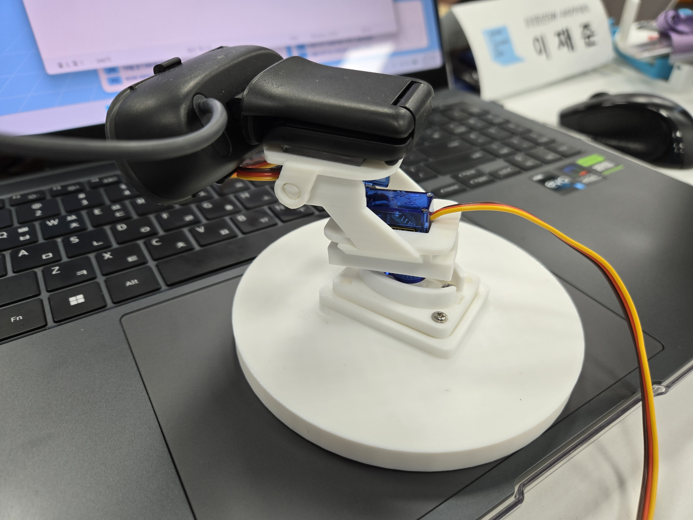
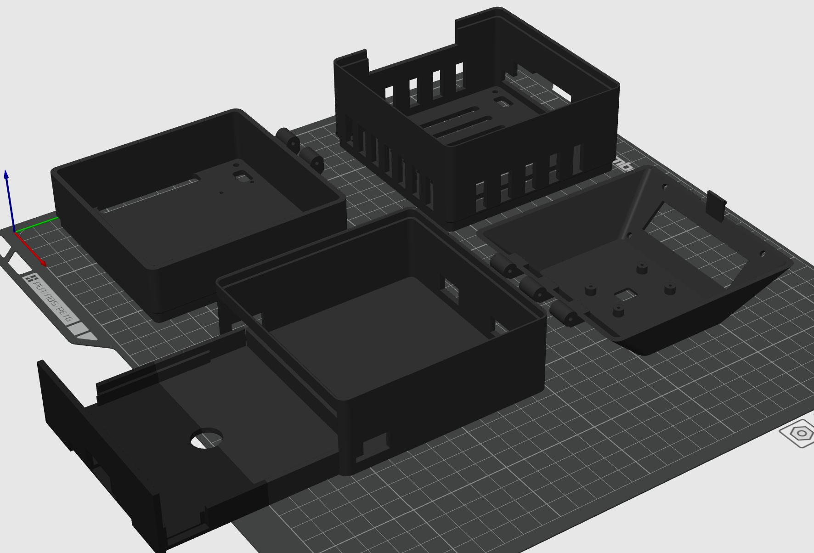
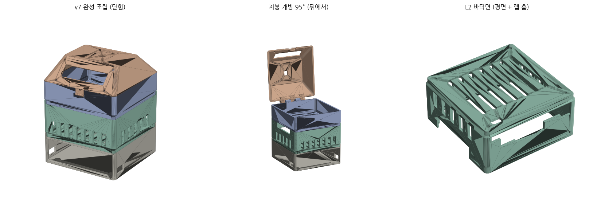

# AI·IoT 파트 2주 회고

> 회고 기간: 2026년 7월 20일~7월 31일

## 1. 지난 2주 한눈에 보기

지난 2주 동안 Jetson Orin Nano와 Logitech BRIO 100을 기반으로 스마트 홈캠의 AI·IoT 기능을 구현했다. YOLOv8n 객체 탐지를 팬·틸트 제어로 연결했고, YAMNet이 웃음을 감지하면 영상을 서버에 업로드해 앱에서 재생하는 흐름도 검증했다. 직접 RTSPS 송출과 MQTT v2 전환, 모델 비교용 실시간 대시보드도 구현했다.

인증 문제로 스트리밍이 막히고 배터리 사고로 부품이 고장 나기도 했다. 원인을 로그와 계측 결과로 좁혀 가며 전원·통신·기구 설계가 모두 맞물려야 기능이 완성된다는 사실을 배웠다.

## 2. 프로젝트와 CS 학습의 연결

Mattermost의 CS 개념을 하루에 하나씩 공부한 경험은 팀의 서비스 구조를 이해하는 데 도움이 됐다. JWT, WebRTC, Redis를 직접 구현한 것은 아니지만, JWT는 사용자 인증, WebRTC는 저지연 영상, Redis는 로그인·기기 등록 공격 방지와 온라인 상태·Heartbeat 관리에 사용된다는 점을 코드와 구조에서 확인했다. 분리된 용어로 외우던 지식을 “왜 필요한가”와 연결하니 이해와 기억이 오래갔고 팀원과 기술적인 대화를 나누기도 수월해졌다.

## 3. IoT 파트에서 수행한 작업

### 3.1 객체 추적용 팬·틸트 짐벌 제작

고정된 카메라의 시야를 넓히기 위해 SG90 서보모터 2개와 3D 프린터로 팬·틸트 짐벌을 제작했다. 팬 축은 실제 약 180도이며 틸트 축은 구조상 약 130도로 예상했다. 처음에는 팬 축을 360도라고 생각했지만, 자동차 바퀴용 SG90과 일반 180도 SG90의 동작 방식이 다르다는 점을 확인해 내용을 바로잡았다.

YOLOv8n과 ByteTrack으로 사람을 탐지하고, 두 명 이상이면 그룹 중심을 계산했다. 방향 명령을 MQTT로 전달하고 PCA9685의 PWM으로 두 축을 제어해 실제 사람을 따라가는 것까지 확인했다. 이 과정에서 좌표계, 축과 PWM 방향, 제한 각도, 복귀 위치를 함께 고려해야 했다.

### 3.2 외부 전원 구성과 배터리 연결 사고

서보모터 2개를 구동하기 위해 V9 배터리 실드와 18650 배터리 4개로 외부 전원을 구성하고 Jetson과 GND를 공유했다.

배터리 극성을 반대로 연결한 채 전원을 켜 연기와 타는 냄새가 발생했다. 바로 껐지만 이후 서보모터 하나가 동작하지 않았다. 정확한 원인을 단정할 수는 없지만 사고로 손상됐을 가능성이 컸다. 이를 통해 전원을 켜기 전 극성·배선·공통 GND를 확인하고 멀티미터로 측정하는 절차의 중요성을 배웠다.

그 뒤부터는 전원을 끄고 배선한 뒤 한 축씩 작은 각도로 시험했으며, 전압 강하·이상 소리·발열도 확인했다.

### 3.3 3D 모델링과 하드웨어 프로토타이핑

AI 도구로 스마트 홈캠 외형과 내부 구조물을 3D 모델링하고 Bambu Lab H2S로 출력했다. 출력물을 조립하며 케이블 통로, 부품 간 간섭, 힌지와 체결 방식처럼 화면에서 놓친 문제를 확인했다.

기구 설계와 조립 편의성도 제품 완성도에 영향을 줬다. 빠르게 출력하고 조립하며 수정하는 방식이 현실적이고 재미있었다.

### 3.4 장치 통신과 스트리밍 안정화

SSH 터널 기반 송출을 직접 RTSPS로 전환하고 MQTT 통신을 v2 토픽으로 정리했다. 초기에는 MediaMTX 인증, CA 인증서·지문, 계정 권한과 MQTT ACL 불일치 때문에 통신이 막혔다.

Jetson 전용 publish-only 계정과 CA 검증을 적용하고 MQTT ACL을 `prod/wj/v2/devices/...` 구조로 맞췄다. 기존 터널은 롤백용으로 유지하다가 앱의 영상·음성을 확인한 뒤 비활성화했다. Live View 종료 후 송출만 정리되고 YOLO와 YAMNet은 유지되는 것도 확인했다.

## 4. AI 파트에서 수행한 작업

### 4.1 실시간 AI 모델 비교 대시보드 구현

모델을 공개 정확도만 보고 선택하지 않기 위해 Jetson 실측 대시보드를 구현했다. 임의의 예시값을 제거하고 데이터 상태를 `LIVE`, `PARTIAL`, `OFFLINE`, `NO DATA`로 구분했다.

측정 스냅샷의 최고값은 다음과 같다. 표준화된 모델 비교 결과가 아닌 현재 YOLOv8n 운영 상태의 기준값이다.

| 항목 | 확인된 최고값 |
|---|---:|
| Vision FPS | 18.9 FPS |
| GPU 사용률 | 57% |
| RAM 사용량 | 3,217 / 7,620 MB |
| 온도 | 약 48.3℃ |
| 보드 입력 전력(VDD_IN) | 5,753 mW |

탐지 인원 수, 추적 상태와 제어 명령도 확인했다. 앞으로 동일한 평가 영상을 YOLOv8n, YOLO11n, YOLO26n에 입력해 이 기준과 비교할 예정이다.

YAMNet은 실제 웃음 Trigger와 전후 약 2분 영상 업로드, 앱의 영상·음성 재생까지 검증했다. EfficientAT MN10과 PANNs CNN10은 아직 비교 전이다.

### 4.2 모델 선택 기준에 대한 배움

최신이거나 공개 정확도가 높은 모델이 실시간 홈캠에도 적합하다고 단정할 수 없었다. Jetson에서는 FPS, 지연, 메모리, GPU, 전력과 안정성도 함께 봐야 한다.

최종 모델은 아직 선정하지 않았다. 같은 영상·해상도·반복 횟수로 비교하고, 정확도 평가를 위해 프레임별 바운딩 박스와 정답 구간도 마련할 예정이다.

## 5. AI 파트에서 배운 점

모델 선택은 이름이나 표가 아니라 서비스 환경에서 반복 측정하는 과정이었다. 카메라 제어에는 오탐에 따른 흔들림을 줄일 추적 유지, 중앙 오차, 명령 제한과 복귀 정책도 필요했다.

대시보드에 실제 값과 신선도를 표시하며 고정된 비교 기준과 모니터링 도구의 중요성도 배웠다.

## 6. IoT 파트에서 배운 점

서보 전원은 전압만 맞는다고 끝나지 않았다. 전류 공급, 순간적인 전압 변화, 공통 GND와 배선이 모두 안정적이어야 했다. 작은 극성 실수도 고장으로 이어질 수 있었다.

카메라 추적은 AI, MQTT, PWM, 전원과 3D 구조물이 함께 정상이어야 동작했다. 여러 영역을 연결해 실제 움직임을 만든 경험은 IoT 프로토타이핑의 재미를 느끼게 했다.

## 7. 시행착오가 바꾼 작업 방식

배터리 사고 이후에는 전원 OFF, 극성 확인, 멀티미터 측정, 단일 부품, 작은 범위, 전체 결합 순서로 점검했다. 스트리밍 전환에서도 롤백 경로를 유지했다.

AI 측정에서는 한 번 본 숫자를 일반 성능으로 표현하지 않고, 데이터가 없으면 `N/A`로 표시했다. 동일한 입력을 반복 사용하는 비교 절차도 마련했다.

## 8. 다음 2주 계획

- 동일한 평가 데이터로 YOLOv8n·YOLO11n·YOLO26n 비교
- YAMNet·EfficientAT MN10·PANNs CNN10 비교 후 모델 선정
- 여러 사람 추적과 팬·틸트 움직임 안정화
- 전원·배선 안전성 및 짐벌 구조 개선
- 연속 박수 이벤트 감지 추가
- 앱에서 텍스트와 음성 샘플로 사용자 지정 호출명 등록
- 객체가 없을 때 소리 방향을 탐색하는 정찰 기능 연구
- 이벤트 영상의 상황을 설명하는 제목 생성

## 9. 마무리

이번 2주는 CS 이론, AI, 네트워크와 임베디드 하드웨어가 하나의 서비스로 연결되는 과정을 경험한 시간이었다. 각 영역의 경계에서 발생한 문제를 해결하며 기술 선택 기준도 구체적으로 바뀌었다.

가장 큰 배움은 실패 원인 확인이었다. 다음에는 반복 가능한 기준 위에서 모델과 하드웨어를 개선하고 싶다.
