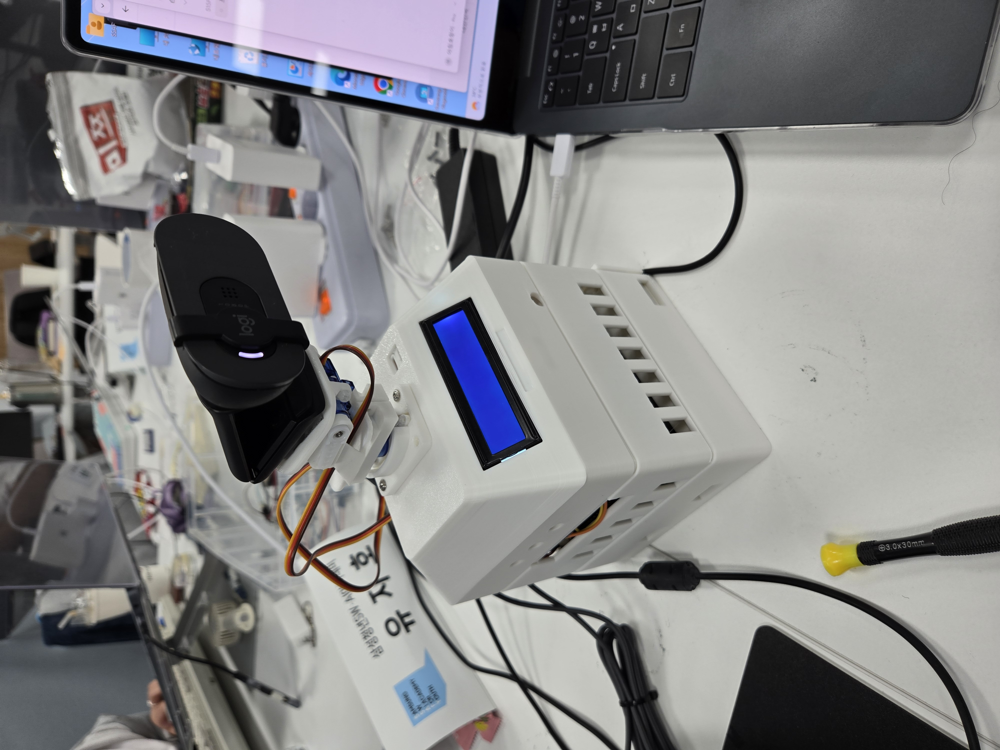

# AI·IoT 파트 작업 정리

> 작업 기간: 2026년 7월 22일 ~ 8월 7일
> 담당: AI · 디바이스(Jetson Orin Nano 엣지)
> 커밋 73개(머지 제외), 머지 20개, 약 `+52,000` / `-1,900` 줄, 테스트 파일 39개

이 문서는 [`AI_IoT_2주_회고.md`](./AI_IoT_2주_회고.md)가 다루는 7월 20일~31일 이후까지
포함해, 프로젝트 전체 기간에 담당 파트에서 만든 것을 한곳에 정리한다. 회고가
"무엇을 배웠는가"를 적었다면 이 문서는 "무엇을 남겼는가"를 적는다.

3D 출력 케이스 위에 팬·틸트 짐벌과 Logitech BRIO 100을 올리고, 전면 LCD로 상태를
표시한다. 내부에 Jetson Orin Nano가 들어가며 이 문서의 모든 소프트웨어가 이 기기
위에서 돈다.

## 1. 엣지 AI 스택 구축 (7/22 ~ 7/27)

빈 저장소에서 시작해 젯슨에서 돌아가는 AI 파이프라인 전체를 세웠다.

| 커밋 | 내용 |
| --- | --- |
| `db6c4f7` | YOLOv8n 오토프레이밍, YAMNet 웃음 탐지, MQTT 이벤트 퍼블리셔, 이벤트 퓨전 서비스 (3,055줄) |
| `8c3427e` | MediaMTX 로컬 미디어 파이프라인, 상시 녹화, 녹화 프루닝, systemd 유닛, 통합 소크 테스트 |
| `1dd29be` | 웃음 스코어링 분리, 젯슨 릴리스 검증기 `validate_jetson_release.sh` 신설 |
| `54c324f` | 웃음 평가 데이터셋 도구 (630줄), 세그먼트 클립 업로더 |
| `01d5a1a` | 웃음 이벤트 종단 검증 스크립트 — 마이크 입력에서 앱 재생까지 한 번에 확인 |
| `9834a95` | `AGENTS.md`와 브랜치 규칙 문서 — 팀 전체가 쓰는 워크플로 |

RTSPS 마이그레이션 핸드오프(`ef8c031`), 업로드 클립 정리 검증(`01030a7`),
등록 헬퍼·진단 퍼블리셔 수정(`a3c6f7d`, `0e4c8a2`)도 이 구간에서 했다.

## 2. 서보 짐벌 자동 추적 (7/29 ~ 8/6)

사람을 따라 카메라가 움직이는 하드웨어 추적을 붙였다.

- `0a7facb` — PCA9685 서보 컨트롤러 942줄, 테스트 354줄, 런북, systemd 유닛,
  웹 대시보드를 한 번에 추가했다.
- `49f140c` — 전원을 인가할 때 서보가 튀는 문제를 `PARK` 기동을 기본값으로 삼아
  해결했다.
- `42f4867` — 서보 전원이 들어올 때까지 추적을 미루는 `SERVO_START_ARMED`를
  넣었다. 기본값이 `false`라 신호를 주기 전에는 추적하지 않는다.
- `c380582`, `ee59cf0` — 문서와 코드에 어긋나 있던 값을 맞추고, 눈대중으로 잡았던
  영점과 가동 범위를 실측값으로 교체했다.
- `f2e3854` — 서보를 교체할 때 무엇을 다시 잡아야 하는지 런북에 남겼다.

전원 인가 순간의 거동과 실측 보정은 하드웨어를 직접 만지지 않으면 나올 수 없는
수정이다.

## 3. 모델 벤치마크 인프라

이 프로젝트에서 가장 큰 덩어리이며, 정량적 판단 근거를 만드는 작업이었다.

### 3.1 관측 체계와 대시보드

`dba6969`에서 벤치마크 러너, 로그 콜렉터, Next.js 대시보드를 한 번에 세웠다
(약 10,000줄). 젯슨 실기에서 FPS, 지연, 온도, 전력을 실시간으로 본다.
이어서 실시간 관측성 개선(`3f32933`), 콜렉터 라우트 방어(`9b67321`),
반복 측정과 추론 조건 정정(`ff54dfb`, `93c7e0c`, `a9556a8`)을 붙였다.

### 3.2 비전 모델 비교와 TensorRT 전환

YOLOv8n, YOLO11n, YOLO26n을 같은 조건에서 비교했다.

| 조건 | 값 |
| --- | --- |
| 장치 | Jetson Orin Nano, 25W |
| 평가 이미지 | 395장 (빈 장면 52장, 정답 박스 581개, 중복 0장) |
| 반복 | 모델별 3회, 총 9회 |
| 순서 | 각 모델이 1·2·3번째 실행을 한 번씩 맡도록 회전 |

발열과 직전 실행 상태가 특정 모델에만 유리하게 작용하지 않도록 실행 순서를
회전한 것이 이 비교의 핵심이다. 결과는 `4ece876`, `cbadbe3`에 보고서로 남겼다.

결론은 **모델은 YOLOv8n을 유지하고 런타임만 TensorRT FP16으로 전환**하는
것이었다(`b481212`). 모델 선택과 런타임 선택을 분리해 판단했고, 변환 성공만
확인하지 않고 수동 라벨 데이터셋으로 정확도를 다시 측정했다.

### 3.3 오디오 모델 비교

YAMNet TFLite, EfficientAT MN10, PANNs CNN10을 재현 가능한 하네스로 비교했다
(`861bca3` 3,269줄 → `0ef5b9f` 4,774줄로 확장). 모델 SHA-256을 고정하고,
ESC-50 준비 절차와 예측 스키마, 의존성 핀을 함께 넣어 재현성을 확보했다.

결과(`af6f9f0`, `c74328a`)는 EfficientAT MN10이 웃음 F1 `0.855`, 박수 F1
`0.966`으로 가장 높았다. 그러나 **F1 1등을 그대로 채택하지 않았다.**

- 사전에 정의한 서비스 기준을 그대로 적용하면 PANNs만 통과했다.
- 그러나 PANNs는 외부 음성에서 웃음 거짓 이벤트가 시간당 `12.86`건,
  GPU 평균 `76.0%`, 최대 전력 `14.8W`로 부담이 가장 컸다.
- EfficientAT은 종합 정확도가 가장 높고 자원 사용량이 PANNs보다 낮아
  첫 섀도 검증 후보로 정했다.

"사전 게이트의 승자"와 "운영에 넣을 후보"를 구분한 것이 이 비교의 결론이다.

### 3.4 섀도 검증과 권한 이양

이벤트를 업로드하지 않고 운영 음성에서 다시 재는 섀도 체계를 만들었다
(`e2adf9c`, 대화형 리뷰 도구 `2150d55` 639줄). Recall 우선 임계값 튜닝기도
함께 넣었다(`50fa923`, 912줄).

검증을 마친 뒤 `26de5a4`에서 오디오 이벤트 권한을 YAMNet에서 EfficientAT MN10으로
이양했다.

### 3.5 임계값을 관찰값에서 분포로

`bcb5741`이 이 파트에서 가장 의미 있는 작업이다. 그 전까지 임계값은 눈으로 본
점수 몇 개에 맞춘 값이었고 `0.0169`와 `0.15` 사이를 오갔다.

진단 로그 `112,724`창을 전수 분석했다.

| 구분 | 창 수 | 중앙값 | 상위 10% | 최대 |
| --- | ---: | ---: | ---: | ---: |
| 말소리가 지배한 창 | `79,624` | `0.0009` | `0.0126` | `0.4463` |
| 웃음이 지배한 창 | `81` | `0.3380` | `0.5870` | `0.7739` |

`0.08`에서 나간 발화 `471`건 중 `98.7%`가 말소리였다. 표본 몇 개로는 대화 분포의
꼬리를 막을 수 없다는 뜻이다. 이를 근거로 감도를 3단계로 다시 잡았다.

| 단계 | 웃음 임계값 | 말소리 창 | 웃음 창 |
| --- | --- | ---: | ---: |
| `sensitive` | `0.12` | `0.97%` | `96%` |
| `default` | `0.15` | `0.70%` | `90%` |
| `insensitive` | `0.30` | `0.07%` | `63%` |

임계값만으로 막지 못하는 구간도 확인했다. 오발화한 말소리 창의 우세 비율
중앙값이 `0.057`이었다 — 1등 소리의 `6%`짜리 근거로 이벤트가 나가고 있었다.
`AUDIO_SHADOW_LAUGHTER_DOMINANCE`로 하한을 걸 수 있게 하되, 실측 근거가 아직
없어 기본값은 `0.0`으로 두고 진단 JSON에 `laughterDominance`를 남겨 다음
재보정 때 사후 스윕으로 정하도록 했다.

근거가 없는 값을 임의로 고정하지 않고 측정 수단을 먼저 남긴 것이 이 커밋의
판단이다.

## 4. 파트 경계를 넘은 기능 (8/2)

웃음과 박수가 함께 발생한 복합 이벤트 하나를 디바이스에서 앱까지 관통해서 구현했다.

| 계층 | 커밋 | 내용 |
| --- | --- | --- |
| 디바이스 | `2fee337` | 연속 박수·웃음 이벤트 병합 |
| 백엔드 | `361846b` | 다중 타입 이벤트, Flyway `V33` 마이그레이션, `VideoEventTypes` 도메인, OpenAPI 갱신 |
| 프론트 | `97acdff` | Flutter 혼합 이벤트 배지 |

`c4e71d6`에서는 MQTT ACL 마이그레이션의 디바이스 ID 매핑 버그를 백엔드에서 직접
고쳤다.

## 5. 운영 신뢰성 (8/6 ~ 8/7)

- `4482e27` — 트리거 하나가 깨져도 업로드 전체가 멈추지 않도록 부분 장애를
  격리했다.
- `5a555ca` — 젯슨 엣지 AI 릴리스 스크립트와 배포 절차 문서를 만들어, 손으로
  하던 배포를 절차로 바꿨다.
- `9698634` — 대시보드에서 원하는 순간을 직접 웃음 영상으로 담는 수동 클립 기능을
  넣었다.

### 5.1 부팅 후 시계 점프로 라이브가 열리지 않던 문제

`36f6cba`는 이 기간에서 가장 오래 남을 디버깅이다.

증상은 "재부팅할 때마다 앱에서 라이브가 열리지 않는다"였고, 그때까지는 웹캠 USB를
뽑았다 꽂고 에이전트를 재시작하는 수동 절차로 버텼다.

원인은 다음과 같다. 이 보드에는 RTC 배터리가 없다. 부팅하면 커널 시계가 1970년에서
시작하고 `systemd-timesyncd`가 마지막으로 기록한 시각으로 되돌린다. 그 값은 지난
종료 시각이지 현재 시각이 아니다. 미디어 서비스가 그 틀린 시계 위에서 올라온 뒤
실제 NTP가 붙으면서 시계가 두세 시간을 한 번에 건너뛰고, 점프한 그 초에 소스
ffmpeg가 프레임 중복을 쏟아내면서 이후 라이브 시도가 전부 실패했다.

쉬운 해법인 `systemd-time-wait-sync`는 쓰지 않았다. 그 유닛은 `sysinit.target`을
붙잡기 때문에 인터넷 없이 부팅하면 미디어가 영영 올라오지 않는다. 홈캠에서는 그쪽이
더 나쁜 고장이다. 대신 서비스를 곧바로 띄우고 동기화가 확인되면 체인을 다시 세우는
`wj-media-clock-guard`를 넣었다. 15분 안에 동기화가 없으면 아무것도 재시작하지
않는다.

함께 고친 것이 두 가지 있다. `media-source.sh`가 카메라 노드만 기다리고 마이크는
기다리지 않아, ffmpeg가 두 장치를 한 프로세스에서 여는 구조상 마이크가 busy이면
영상까지 죽었다. 그리고 `StreamManager`가 송출 ffmpeg의 stderr를 버리고 있어
실패해도 저널에 `return_code` 숫자 하나만 남았다. 둘 다 고쳤다.

## 6. 남긴 문서

작업과 함께 판단 근거를 문서로 남겼다.

- `자료/docs/29_YOLOv8n_TensorRT_FP16_운영_전환_보고서.md`
- `자료/docs/31_웃음_박수_탐지_모델_비교_설계.md`, `32_..._결과.md`
- `자료/docs/33_오디오_이벤트_요구사항과_튜닝_결정.md`
- `자료/docs/34_YAMNet_EfficientAT_섀도_검증.md`
- `자료/docs/37_젯슨_엣지_AI_릴리스_절차.md`
- `ai/SERVO_PCA9685_RUNBOOK.md`, `ai/yamnet/ADVANCED_AUDIO_EVENTS.md`
- `AGENTS.md`, `ai/GIT_BRANCH_RULES.txt`

## 7. 돌아보며

이 기간의 작업을 관통하는 원칙이 세 가지였다.

**측정하지 않은 값으로 결정하지 않는다.** 벤치마크는 모델별 3회 반복하고 실행
순서를 회전했다. 모델 파일은 SHA-256으로 고정했다. 임계값은 관찰한 점수 몇 개가
아니라 `112,724`창의 분포로 잡았다.

**정확도 1등이 곧 채택은 아니다.** EfficientAT이 F1 1등이어도 섀도 모드부터
돌렸고, PANNs가 사전 게이트를 통과했어도 전력 `14.8W`와 시간당 `12.86`건의 거짓
이벤트를 이유로 후보에서 뺐다. 벤치마크 숫자를 서비스 판단으로 옮기는 과정을
문서에 남겼다.

**하드웨어 코드에도 테스트를 붙인다.** 서보 컨트롤러 354줄, 오디오 섀도 러너
423줄, 클립 업로더 112줄처럼 실기기가 있어야 도는 코드도 테스트를 함께 썼다.
테스트 파일은 39개다.

가장 크게 배운 것은 증상과 원인 사이의 거리다. "라이브가 안 열린다"의 원인이
RTC 배터리 부재였고, "웃음 오탐이 많다"의 원인이 임계값이 아니라 우세 비율이었다.
로그와 계측으로 좁히지 않으면 어느 쪽도 눈으로는 보이지 않았다.
