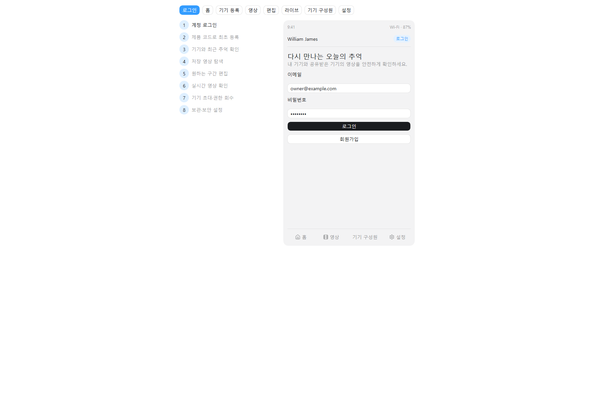

# 윌리엄 제임스

> 웃음과 호출의 순간을 놓치지 않고, 그 직전 장면부터 자동으로 기록해 주는 IoT 추억 카메라.

## 프로젝트 정보

| 항목 | 내용 |
| --- | --- |
| 개발 기간 | 7월 20일 ~ 7월 31일 |
| 모바일 | Flutter |
| 백엔드 | Java 21, Spring Boot, PostgreSQL |
| IoT·AI | Jetson Orin Nano, Raspberry Pi 5, Python, YAMNet, YOLO |
| 영상 | FFmpeg, H.264/AAC MP4, 라이브는 WebRTC(WHEP) 전용 |
| 저장소 | MinIO (S3 호환) |

## 핵심 MVP

1. 웃음 감지 시 감지 전후 1분 영상을 저장한다.
2. 호출어 또는 터치 시 직전 2분 영상을 저장한다.
3. 반복 웃음을 하나의 이벤트 영상으로 병합한다.
4. 앱에서 영상 조회·구간 편집·다운로드와 시청 세션이 있을 때만 켜지는 실시간 보기를 제공한다.
5. 가족 권한·구독·영상은 추억 금고(Memory Vault)에 귀속되고, 금고별 `OWNER/MEMBER` 역할로 영상 접근을 제한한다. 기기는 금고에 연결된 촬영 장치다.

## 산출물 바로가기

### 현행 명세 (`docs/사람이 읽을 문서/`)

MVP 7단계를 뼈대로 재구성한 to-be 기준 문서다. **이쪽이 최신이다.**

- [서비스 기획서](docs/사람이%20읽을%20문서/01-서비스기획.md)
- [요구사항 명세서](docs/사람이%20읽을%20문서/02-요구사항명세서.md)
- [기능 명세서](docs/사람이%20읽을%20문서/03-기능명세서.md)
- [API 명세서](docs/사람이%20읽을%20문서/04-API명세서.md)
- [ERD](docs/사람이%20읽을%20문서/빵긋%20ERD.png)
- [서보 비전 진단 대시보드](docs/사람이%20읽을%20문서/05-서보비전진단대시보드.md)
- [STT 모델 가이드](docs/사람이%20읽을%20문서/06-STT모델가이드.md)
- [OpenAPI 명세](api/openapi.yaml)
- [프로젝트 기획서](윌리엄_제임스_프로젝트_기획서.md)
- [제출양식 최종본](outputs/019f6394-d326-70f0-9c57-b1b14071b407/윌리엄_제임스_제출양식_최종본.xlsx)

### 초기 산출물 (`docs/old/`)

현행 명세로 대체되지 않은 것과, 이력으로 남긴 초기 문서다.

- [전체 산출물 인덱스](docs/old/00_산출물_인덱스.md)
- [사용자 스토리·유스케이스](docs/old/02_사용자_스토리_및_유스케이스.md)
- [테스트 계획서](docs/old/08_테스트_계획서.md)
- [CI/CD 구성](docs/old/12_CI_CD_구성.md)
- [클릭형 앱 와이어프레임](docs/old/wireframes/index.html)
- [API 문서 웹 페이지](docs/old/api/index.html)

## Figma 산출물

- [앱 와이어프레임](https://www.figma.com/design/kDAk0NTRltBHJsaIeyyXQd)
- [시스템 아키텍처](https://www.figma.com/board/eQtOYa4DFb7SpEO0E4fPjf)



## 로컬 인프라

```powershell
Copy-Item infra/.env.example infra/.env
# infra/.env의 CHANGE_ME 값을 교체
docker compose --env-file infra/.env -f infra/docker-compose.yml up -d
```

API 문서 페이지는 `http://127.0.0.1:8081`에서 확인할 수 있다.

## 협업

브랜치, 커밋, Pull Request 완료 기준은 [CONTRIBUTING.md](CONTRIBUTING.md)를 따른다. 실제 비밀번호, 등록 코드, 토큰, 기기 인증서와 사용자 영상은 Git에 커밋하지 않는다.
