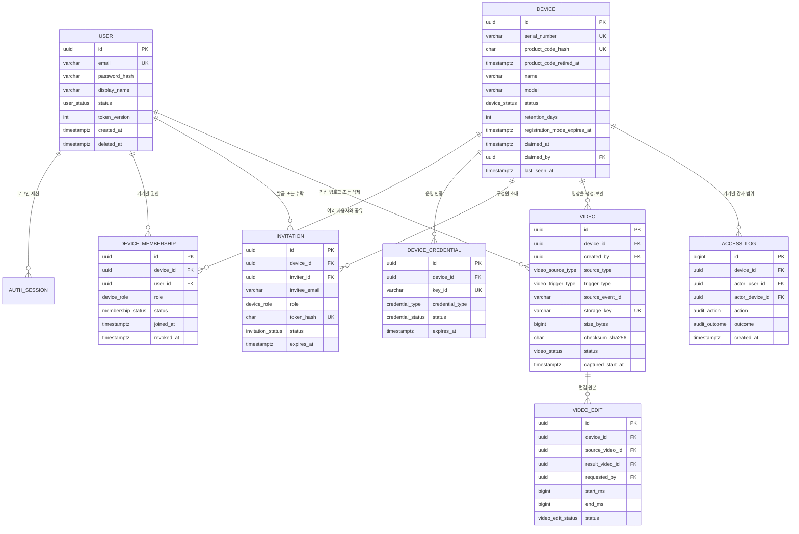

# 윌리엄 제임스 ERD 및 데이터 사전

> 문서 상태: `[기본]` MVP 설계 기준  
> DBMS: PostgreSQL 15+  
> 물리 스키마: [`../database/schema.sql`](../database/schema.sql)  
> 권한 경계: **기기(Device)**

## 1. 핵심 설계 원칙

1. **사용자와 기기는 다대다 관계다.** 한 사용자는 여러 기기에 접근할 수 있고, 한 기기도 여러 사용자가 공유할 수 있다.
2. **접근 권한은 `device_memberships`로 판단한다.** 로그인 사용자가 대상 기기의 `ACTIVE` 멤버십을 가져야 영상·상태·스트림에 접근할 수 있다.
3. **기기마다 활성 OWNER는 정확히 한 명이다.** 최초 등록자가 OWNER가 되고, 초대받은 사용자는 MEMBER가 된다.
4. **영상·초대·감사 로그의 격리 키는 `device_id`다.** 클라이언트가 전달한 소유 관계를 신뢰하지 않고 서버가 인증 주체와 멤버십을 대조한다.
5. **다른 기기의 정보는 숨긴다.** 존재하는 UUID라도 로그인 사용자에게 활성 멤버십이 없으면 `403`이 아닌 `404`를 반환한다.
6. **사용자 인증과 기기 인증은 분리한다.** Flutter 앱은 사용자 JWT, IoT 기기는 별도의 기기 자격 증명을 사용한다.
7. **객체 저장소는 비공개다.** DB에는 객체 키만 저장하며, 서버가 권한 확인 후 짧은 유효시간의 서명 URL을 발급한다.
8. **실시간 보기 시청자 세션은 TTL 기반 운영 상태다.** 영구 업무 데이터가 아니므로 별도 ERD 테이블을 필수로 두지 않으며, 인메모리 또는 DB 중 구현 환경에 맞게 저장한다. Redis는 MVP 필수 구성 요소가 아니다.

## 2. 관계 요약



## 3. 권한 모델

### 3.1 사용자·기기 다대다 관계

`device_memberships`의 한 행은 “사용자 U가 기기 D에 어떤 역할로 접근할 수 있는가”를 뜻한다.

| 사용자 | 기기 | 역할 | 가능한 예 |
| --- | --- | --- | --- |
| 사용자 A | 거실 카메라 | OWNER | 구성원 초대·회수, 설정 변경, 모든 영상 관리 |
| 사용자 A | 부모님 댁 카메라 | MEMBER | 영상 조회·재생·다운로드 |
| 사용자 B | 거실 카메라 | MEMBER | 사용자 A가 공유한 기기만 사용 |

같은 사용자가 기기마다 다른 역할을 가질 수 있다. 어떤 기기의 MEMBER라는 사실은 다른 기기의 접근 권한을 주지 않는다.

### 3.2 역할별 기본 권한

| 기능 | OWNER | MEMBER |
| --- | :---: | :---: |
| 기기 목록·상태 조회 | O | O |
| 영상 조회·재생 | O | O |
| 영상 다운로드 | O | O `[정책으로 제한 가능]` |
| 영상 구간 편집 | O | O `[정책으로 제한 가능]` |
| 영상 삭제 | O | X `[기본값]` |
| 구성원 목록 조회 | O | O |
| 구성원 초대·권한 회수 | O | X |
| 기기 이름·보관 기간 변경 | O | X |
| 기기 등록 해제 | O | X |

### 3.3 서버의 리소스 권한 검사

영상 조회·편집·삭제 요청은 URL이나 요청 본문의 `deviceId`만 믿지 않는다.

```text
JWT 사용자 식별
  → 대상 video.id 조회
  → video.device_id 확인
  → device_memberships에서 (device_id, user_id, ACTIVE) 확인
  → 작업별 role 확인
  → 멤버십 없음은 404, 같은 기기의 역할 부족은 403, 허용 시 처리
```

영상 편집 권한도 편집 요청 행의 값이 아니라 **원본 영상의 `device_id`**를 기준으로 검사한다. 편집 결과 영상은 원본과 같은 기기에 속해야 하며, 복합 외래 키가 이를 보장한다.

## 4. 무결성 규칙

| 규칙 | DB 보장 | 애플리케이션 보장 |
| --- | --- | --- |
| 한 사용자는 같은 기기에 한 번만 연결 | `UNIQUE(device_id, user_id)` | 재초대 수락 시 기존 `REVOKED` 행 재활성화 |
| 기기당 활성 OWNER 최대 1명 | 부분 유일 인덱스 | 소유권 이전 트랜잭션 사용 |
| 등록 기기당 활성 OWNER 정확히 1명 | 지연 제약 트리거 | claim과 OWNER 멤버십 생성을 한 트랜잭션으로 수행 |
| 초대는 MEMBER 역할만 허용 | CHECK 제약 | 초대 발급자는 해당 기기의 활성 OWNER여야 함 |
| 같은 기기·이메일의 대기 초대는 1개 | 부분 유일 인덱스 | 만료 상태를 먼저 정리한 뒤 재초대 |
| IoT 이벤트 재시도 시 영상 중복 금지 | `UNIQUE(device_id, source_event_id)` | 기존 video ID를 멱등 응답으로 반환 |
| 영상 파일은 MVP 최대 500 MiB | CHECK 제약 | 서명 URL 발급 전 `sizeBytes` 검증 |
| 편집 결과는 원본과 같은 기기 | 복합 FK `(video_id, device_id)` | 작업 시작 전 원본 멤버십·역할 재검사 |
| 타 기기 리소스 존재 은닉 | 직접 보장 불가 | 모든 조회에 멤버십 조건을 결합하고 실패 시 404 |

## 5. 데이터 사전

### 5.1 `users` — 사용자 계정

| 컬럼 | 타입 | NULL | 설명 |
| --- | --- | :---: | --- |
| `id` | `uuid` | N | 내부 사용자 ID |
| `email` | `varchar(320)` | N | 소문자·trim 정규화, 탈퇴 전 계정에서 유일 |
| `password_hash` | `varchar(255)` | N | Argon2id 또는 BCrypt 해시만 저장 |
| `display_name` | `varchar(60)` | N | 화면 표시 이름 |
| `status` | `user_status` | N | `ACTIVE`, `LOCKED`, `WITHDRAWN` |
| `token_version` | `integer` | N | 전체 JWT 강제 만료용 버전 |
| `last_login_at` | `timestamptz` | Y | 마지막 로그인 |
| `created_at`, `updated_at` | `timestamptz` | N | 생성·수정 시각 |
| `deleted_at` | `timestamptz` | Y | 소프트 삭제 시각 |

### 5.2 `auth_sessions` — Refresh Token 세션

| 컬럼 | 타입 | NULL | 설명 |
| --- | --- | :---: | --- |
| `id` | `uuid` | N | 세션 ID |
| `user_id` | `uuid` | N | 사용자 FK |
| `refresh_token_hash` | `char(64)` | N | 원문이 아닌 SHA-256 해시 |
| `client_name` | `varchar(120)` | Y | 앱·기기 식별용 표시값 |
| `user_agent`, `ip_address` | 텍스트·`inet` | Y | 보안 감사 보조 정보 |
| `expires_at` | `timestamptz` | N | 만료 시각 |
| `last_used_at`, `revoked_at` | `timestamptz` | Y | 회전·폐기 추적 |

### 5.3 `devices` — IoT 기기

`devices`에는 사용자 그룹 ID를 두지 않는다. 접근 사용자는 `device_memberships`로만 연결한다.

| 컬럼 | 타입 | NULL | 설명 |
| --- | --- | :---: | --- |
| `id` | `uuid` | N | 서버 발급 기기 ID |
| `serial_number` | `varchar(80)` | N | 제조 시 부여, 유일 |
| `product_code_hash` | `char(64)` | N | 최초 등록용 제품 코드의 SHA-256 해시 |
| `product_code_retired_at` | `timestamptz` | Y | 최초 등록 성공 시 같은 트랜잭션에서 기록. 값이 있으면 정적 제품 코드는 재사용 불가 |
| `name` | `varchar(80)` | N | 앱 표시 이름 |
| `model` | `varchar(80)` | N | 기기 모델 |
| `firmware_version` | `varchar(40)` | Y | 보고된 펌웨어 버전 |
| `status` | `device_status` | N | `UNCLAIMED`, `ONLINE`, `OFFLINE`, `REVOKED` |
| `retention_days` | `integer` | N | 이 기기 영상 기본 보관 일수, 1~3650 |
| `registration_mode_expires_at` | `timestamptz` | Y | 물리적 등록 모드 만료 시각 |
| `claimed_at`, `claimed_by` | 시각·`uuid` | Y | 최초 등록 시각과 최초 OWNER |
| `last_seen_at` | `timestamptz` | Y | heartbeat 기준 마지막 접속 |
| `revoked_at` | `timestamptz` | Y | 등록 해제 시각 |

### 5.4 `device_memberships` — 기기별 사용자 권한

| 컬럼 | 타입 | NULL | 설명 |
| --- | --- | :---: | --- |
| `id` | `uuid` | N | 멤버십 ID |
| `device_id` | `uuid` | N | 기기 FK |
| `user_id` | `uuid` | N | 사용자 FK |
| `role` | `device_role` | N | `OWNER` 또는 `MEMBER` |
| `status` | `membership_status` | N | `ACTIVE` 또는 `REVOKED` |
| `joined_at` | `timestamptz` | N | 가입·초대 수락 시각 |
| `revoked_at`, `revoked_by` | 시각·`uuid` | Y | 권한 회수 추적 |

`(device_id, user_id)`는 유일하고 두 식별자는 생성 후 변경할 수 없다. 과거 권한 회수 기록을 보존하면서 다시 초대할 때는 새 행을 만들지 않고 기존 행을 `ACTIVE`로 재활성화한다.

### 5.5 `device_credentials` — IoT 운영 인증

| 컬럼 | 타입 | NULL | 설명 |
| --- | --- | :---: | --- |
| `device_id` | `uuid` | N | 인증 대상 기기 |
| `key_id` | `varchar(100)` | N | 인증 키 식별자, 유일 |
| `credential_type` | enum | N | `CERTIFICATE` 또는 `TOKEN_HASH` |
| `public_key_pem` | `text` | Y | 인증서 방식 공개 키 |
| `secret_hash` | `char(64)` | Y | 토큰 방식 해시; 원문 저장 금지 |
| `status` | enum | N | `ACTIVE`, `REVOKED`, `EXPIRED` |
| `issued_at`, `expires_at`, `revoked_at` | 시각 | 조건부 | 수명 주기 |

기기당 활성 운영 자격 증명은 하나만 허용한다. Flutter 사용자의 JWT와 혼용하지 않는다.

### 5.6 `invitations` — 기기 구성원 초대

| 컬럼 | 타입 | NULL | 설명 |
| --- | --- | :---: | --- |
| `id` | `uuid` | N | 초대 ID |
| `device_id` | `uuid` | N | 공유할 기기 |
| `inviter_id` | `uuid` | N | 초대를 발급한 OWNER |
| `invitee_email` | `varchar(320)` | N | 초대 대상 이메일 |
| `role` | `device_role` | N | MVP에서는 `MEMBER`만 허용 |
| `token_hash` | `char(64)` | N | 초대 토큰 SHA-256 해시 |
| `status` | enum | N | `PENDING`, `ACCEPTED`, `EXPIRED`, `REVOKED` |
| `expires_at` | `timestamptz` | N | 만료 시각 |
| `accepted_by`, `accepted_at` | 사용자·시각 | Y | 수락 기록 |
| `revoked_at` | `timestamptz` | Y | 초대 철회 시각 |

초대 토큰은 URL이나 이메일로 한 번 전달하되 DB에는 해시만 저장한다. 수락 시 로그인 이메일과 `invitee_email`이 일치해야 한다.

### 5.7 `videos` — 영상 메타데이터

모든 영상은 하나의 기기에 반드시 속한다. 사용자 업로드도 업로드 화면에서 대상 기기를 선택하며, 그 사용자의 활성 멤버십을 확인한다.

| 컬럼 | 타입 | NULL | 설명 |
| --- | --- | :---: | --- |
| `id` | `uuid` | N | 영상 ID |
| `device_id` | `uuid` | N | 영상 접근 경계이자 생성 기기 |
| `created_by` | `uuid` | Y | 사용자 업로드·작업 주체 |
| `source_type` | enum | N | `IOT_CAPTURE`, `USER_UPLOAD`, `EDIT_OUTPUT` |
| `trigger_type` | enum | N | `LAUGHTER`, `WAKE_WORD`, `TOUCH`, `MANUAL`, `USER_UPLOAD`, `EDIT` |
| `source_event_id` | `varchar(100)` | Y | IoT 이벤트 멱등 키 |
| `title`, `description` | 문자열 | 조건부 | 제목과 설명 |
| `storage_key` | `varchar(1024)` | N | 비공개 객체 키; URL 저장 금지 |
| `thumbnail_storage_key` | `varchar(1024)` | Y | 썸네일 객체 키 |
| `content_type` | `varchar(100)` | N | MVP `video/mp4` |
| `size_bytes` | `bigint` | Y | 1~524,288,000 bytes(500 MiB) |
| `checksum_sha256` | `char(64)` | Y | 업로드 파일 SHA-256 hex digest |
| `duration_ms` | `bigint` | Y | 영상 길이 |
| `captured_start_at`, `captured_end_at` | 시각 | Y | 촬영 구간 |
| `status` | enum | N | 업로드·처리·삭제 상태 |
| `retention_until` | `timestamptz` | Y | 자동 삭제 기준 |
| `deleted_at`, `deleted_by` | 시각·사용자 | Y | 삭제 감사 정보 |

`READY` 전환 전에 객체 저장소 `HEAD`로 크기와 SHA-256 체크섬 헤더 또는 객체 메타데이터를 검증한다. S3 `ETag`는 멀티파트 업로드에서 파일 SHA-256이 아니므로 무결성 값으로 사용하지 않는다.

영상 최신 목록은 `(device_id, captured_start_at DESC, id DESC)` 키셋 커서를 사용한다.

### 5.8 `video_edits` — 영상 구간 편집 작업

| 컬럼 | 타입 | NULL | 설명 |
| --- | --- | :---: | --- |
| `device_id` | `uuid` | N | 원본 영상에서 확정한 기기 ID |
| `source_video_id` | `uuid` | N | 원본 영상 |
| `result_video_id` | `uuid` | Y | 완료된 결과 영상 |
| `requested_by` | `uuid` | N | 요청 사용자 |
| `start_ms`, `end_ms` | `bigint` | N | 편집 구간 |
| `status` | enum | N | `PENDING`, `PROCESSING`, `COMPLETED`, `FAILED`, `CANCELLED` |
| `error_code` | `varchar(80)` | Y | 실패 사유 코드 |

요청 시 `source_video_id`로 원본을 먼저 찾고 그 영상의 `device_id`에 대한 활성 멤버십을 확인한다. 요청 본문에서 `deviceId`를 받지 않는다.

### 5.9 `access_logs` — 기기별 접근 감사 로그

| 컬럼 | 타입 | NULL | 설명 |
| --- | --- | :---: | --- |
| `id` | `bigint identity` | N | 증가형 로그 ID |
| `device_id` | `uuid` | N | 감사 대상 기기 |
| `actor_user_id` | `uuid` | Y | 사용자 행위자 |
| `actor_device_id` | `uuid` | Y | IoT 행위자; 있을 경우 `device_id`와 동일 |
| `action` | enum | N | 조회·재생·다운로드·편집·삭제·초대 등 |
| `target_type`, `target_id` | 문자열·UUID | 조건부 | 대상 종류와 ID |
| `outcome` | enum | N | `SUCCESS`, `DENIED`, `FAILED` |
| `reason_code` | `varchar(80)` | Y | 실패·거부 코드 |
| `ip_address`, `user_agent`, `request_id` | 조건부 | Y | 요청 추적 정보 |
| `metadata` | `jsonb` | N | 토큰·서명 URL·원본 개인정보를 제외한 부가 정보 |
| `created_at` | `timestamptz` | N | 발생 시각 |

감사 로그 조회도 해당 기기의 OWNER만 가능하다. 보안 분석용 거부 기록은 일반 앱 응답과 분리해 남기되, 응답에서는 대상 존재 여부를 드러내지 않는다.

## 6. 주요 조회와 인덱스

| 사용 사례 | 인덱스·조회 키 |
| --- | --- |
| 사용자의 기기 목록 | `device_memberships(user_id, device_id) WHERE status='ACTIVE'` |
| 기기의 구성원 목록 | `device_memberships(device_id, role, joined_at) WHERE status='ACTIVE'` |
| 기기 상태 대시보드 | 사용자 멤버십 조인 후 `devices.last_seen_at` |
| 최신 영상 피드 | `videos(device_id, captured_start_at DESC, id DESC) WHERE status<>'DELETED'` |
| 트리거별 영상 필터 | `videos(device_id, trigger_type, status, captured_start_at DESC, id DESC)` |
| IoT 업로드 멱등성 | `videos(device_id, source_event_id)` 유일 인덱스 |
| 편집 작업 큐 | `video_edits(status, requested_at) WHERE PENDING/PROCESSING` |
| 보관 만료 삭제 | `videos(retention_until) WHERE status='READY'` |
| 기기 감사 로그 | `access_logs(device_id, created_at DESC, id DESC)` |

## 7. 주요 트랜잭션

### 7.1 최초 기기 등록

1. `devices` 행을 `FOR UPDATE`로 잠근다.
2. 기기 상태가 `UNCLAIMED`인지, 제품 코드 해시가 일치하는지, 물리적 등록 모드가 만료되지 않았는지 확인한다.
3. 기기 상태·`claimed_at`·`claimed_by`를 갱신한다.
4. 요청 사용자의 `OWNER / ACTIVE device_memberships`를 생성한다.
5. `product_code_retired_at`을 기록해 정적 제품 코드를 논리적으로 폐기하고 운영용 기기 자격 증명을 발급한다.
6. 같은 트랜잭션을 커밋한다. 지연 제약 트리거가 활성 OWNER가 정확히 한 명인지 확인한다.

### 7.2 초대 수락

1. 초대 토큰 원문을 SHA-256으로 해시해 `PENDING` 초대를 잠근다.
2. 만료 시각·로그인 이메일·대상 기기 상태를 확인한다.
3. `(device_id, user_id)` 멤버십을 `MEMBER / ACTIVE`로 생성하거나 재활성화한다.
4. 초대를 `ACCEPTED`로 변경한다.

### 7.3 영상 업로드 완료

1. `DeviceBearer` 인증으로 기기 ID를 서버가 결정한다.
2. `(device_id, source_event_id)`로 멱등성을 확인한다.
3. 기기가 제공한 예상 크기·SHA-256을 저장하고 15분 이내의 단기 업로드 URL을 발급한다.
4. 기기는 `PUT` 요청에 저장소가 요구하는 SHA-256 체크섬 헤더 또는 메타데이터를 포함한다.
5. 완료 요청을 받으면 서버가 객체 `HEAD`로 크기와 저장된 체크섬을 확인한다.
6. 일치할 때만 `PROCESSING` 또는 `READY`로 전환한다. `ETag`만으로 무결성을 판정하지 않는다.

### 7.4 구성원 권한 회수

1. 요청자가 해당 기기의 활성 OWNER인지 확인한다.
2. 대상 멤버십을 잠그고 OWNER 자신을 회수하려는 요청은 거부한다.
3. MEMBER를 `REVOKED`로 전환하고 refresh token의 기기별 권한 캐시를 즉시 무효화한다.
4. 이미 발급된 재생 URL은 만료 전까지 유효할 수 있으므로 만료 시간을 짧게 유지한다.

## 8. 보안·개인정보 체크리스트

- [ ] 모든 기기·영상 repository 조회에 로그인 사용자의 `ACTIVE device_memberships` 조건을 결합한다.
- [ ] OWNER 전용 API는 URL의 `deviceId`와 `OWNER / ACTIVE` 멤버십을 함께 검사한다.
- [ ] 대상 기기의 활성 멤버십이 없는 기기·영상·멤버십·초대 ID는 동일한 `404 RESOURCE_NOT_FOUND`로 응답한다.
- [ ] 같은 기기의 활성 구성원이 OWNER 전용 작업을 요청하면 `403 OWNER_ROLE_REQUIRED`로 응답한다.
- [ ] 사용자 JWT와 `DeviceBearer` 자격 증명을 서로 대체해 사용할 수 없게 한다.
- [ ] 제품 코드·초대 토큰·refresh token·기기 토큰은 원문으로 저장하거나 로그에 남기지 않는다.
- [ ] 객체 저장소 버킷은 비공개이며 DB에는 객체 키만 저장한다.
- [ ] 재생·다운로드·업로드 URL은 단기 URL로 발급하고 로그·분석 도구에 기록하지 않는다.
- [ ] 업로드 완료 시 `HEAD` 크기와 SHA-256 체크섬 헤더/메타데이터를 검증한다.
- [ ] S3 `ETag`를 파일 SHA-256으로 간주하지 않는다.
- [ ] 감사 로그는 애플리케이션에서 수정하지 않고 보존 기간 작업으로만 삭제한다.

## 9. 실시간 보기 세션 상태 `[비영구·구현 선택]`

실시간 보기는 `DeviceMembership` 권한을 그대로 사용하지만 시청 세션 자체는 영구 엔터티로 취급하지 않는다.

| 상태 값 | 설명 |
| --- | --- |
| `sessionId` | 앱 시청자 한 명의 세션 ID |
| `streamId` | 같은 기기의 여러 시청자가 공유하는 edge 송출 ID |
| `deviceId`, `userId` | 매 요청의 활성 멤버십 재검사용 |
| `status` | `PENDING`, `READY`, `CLOSED`, `EXPIRED`, `FAILED` |
| `createdAt`, `lastActivityAt` | 생성 시 두 값을 같게 두고 유효 heartbeat 또는 정상 종료 활동으로 갱신 |
| `lastHeartbeatAt` | 앱이 권장 15초마다 갱신 |
| `viewerExpiresAt` | 생성 시 `createdAt+45초`, 이후 `lastActivityAt+45초`. 첫 heartbeat 없는 세션도 회수 |
| `edgeHardExpiresAt` | MQTT payload의 `hardExpiresAt`과 같은 edge 강제 종료 시각. 기본 lease는 120초이며 활성 시청 중 만료 전에 연장 |

세션 생성 시 `createdAt`을 초기 `lastActivityAt`으로 사용한다. 첫 heartbeat가 한 번도 없으면 `createdAt+45초`에 `EXPIRED`, 마지막 시청자라면 `createdAt+60초`에 MQTT `STOP_STREAM`을 보낸다. 이후에는 마지막 유효 `lastActivityAt` 또는 정상 `DELETE`로부터 최대 60초가 되는 시점까지 새 시청자가 없을 때 중지한다. heartbeat 세션을 45초에 만료한 뒤 60초를 다시 더하지 않으며, 정상 `DELETE`는 `CLOSED`, 시작·송출 실패는 `FAILED`다. STOP 전에 새 시청자가 들어오면 예약을 취소하고 기기당 송출 하나를 재사용한다. 활성 시청 중에는 `EXTEND_STREAM`으로 `hardExpiresAt`을 약 120초 뒤로 주기적으로 연장한다. 서버·MQTT 장애가 생기면 기기는 마지막 연장부터 최대 약 120초 안에 자체 종료한다. 상태 저장소는 인메모리 또는 PostgreSQL 중 구현 선택이다. 라이브 playlist·segment의 새 요청은 세션 소유자·`READY`·`viewerExpiresAt`·활성 기기 멤버십을 요청 시점에 검증하며 `CLOSED/EXPIRED` 또는 권한 회수 후 거부한다.
