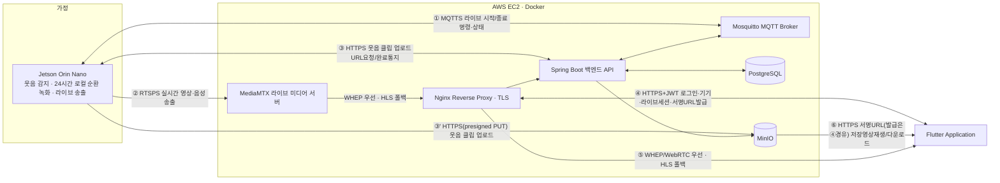

# 서비스 개요 (AI/코딩 에이전트용)

> 기준: to-be 기획(MVP 2026-07-27 확정) · 코드 현황 참조 커밋 5979279
> 사람용 원본: [../사람이 읽을 문서/01-서비스기획.md](../사람이%20읽을%20문서/01-서비스기획.md)

산문 설명을 제거하고 표/리스트만으로 구성한 파생 문서다. ID·사실·MVP 7단계 구조는 사람용 원본과 동일하다.

---

## 1. 정의

- 한 줄 정의: 기본은 실시간 스트리밍 홈캠이지만, 일반 가정의 웃긴 순간을 젯슨(엣지 AI)이 자동 포착하고 폰에서 편집해 추억으로 만드는 서비스.
- 타겟: **일반 가정** (반려동물·노인·영유아 특화 아님 — 과거 서술이 남아있다면 오류)
- 이벤트 판단 = **웃음소리(오디오 YAMNet) 감지만**. 영상 기반 상황 판단(YOLO/이벤트 퓨전)은 범위 외(부록 A).
- 24시간 순환 녹화: Jetson 로컬 전용(서버 미전송).
- 서버 전송 대상: (a) 웃음 감지 트리거 클립(mp4), (b) 사용자가 명시적으로 요청한 라이브 세션.
- 역할 분담: **젯슨**=감지·클립생성·업로드·라이브송출 / **폰**=수동 편집(Banuba)·공유(AI 자동 하이라이트 없음) / **서버**=인증·기기·클립저장전달·라이브중계·통계집계.

## 2. 배경 (피봇 이력)

| 항목 | 내용 |
|---|---|
| 원래 서비스 | "웃음 다이어리" |
| 피봇 일자 | 2026-07-21 (홈캠으로 전환) |
| MVP 확정 일자 | 2026-07-27, 시연 기준 7단계 확정 |
| 재사용 도메인 | auth, device, invitation, video, stream, subscription |
| 리포트 구현 경계(7단계) | FN-A38 Flutter 화면은 기존 `LAUGHTER` 영상 단말 집계로 구현. FN-S26/API-51 서버 집계는 **[제안·미구현]** |
| 서버 계약 제외 범위 | 인물 탐지·중심 계산·자동 추적(팬틸트) — AIoT/엣지 전용, REQ-F-38(부록 A) |

## 3. MVP 7단계 (코드 경로 참조, 상세는 02·03·04 각 절)

| # | 단계 | 핵심 REQ | 핵심 FN | 핵심 API/MQTT | 비고 |
|---|---|---|---|---|---|
| 1 | 회원가입/로그인 | REQ-F-01,02(,03,04,05) | FN-A02,A03,S01(,A32,A33,S02) | API-01,02(,03,04,05) | 이메일+비밀번호만. 소셜로그인·비밀번호찾기는 부록 A(스텁) |
| 2 | 기기 등록 | REQ-F-10(,12,13) | FN-A07,S04,S20,S21,E01,E02(,A27,S05) | API-08,43(,44,45,07,10,11) | QR/8자리 코드 claim. 코드 TTL 120초 |
| 3 | 홈 라이브 스트리밍 시청 | REQ-F-18(,41) | FN-A10,A11,A37,S16,S17,S25,E04,E05(,A06) | API-34~38, MQTT-01,04 | WHEP/WebRTC 우선, 실패 시 HLS 폴백 |
| 4 | 이벤트(웃음) 감지 영상 확인 | REQ-F-37,21,22 | FN-E06,E07,S11,A15,S12,A17,A37,S14 | API-25,26,27,31 | YAMNet 임계값 0.25·연속 2윈도우 → presigned 업로드 |
| 5 | 영상 편집 | REQ-F-27 | FN-A21,A39 | API-32(원본 다운로드 재사용) | 로컬 편집·온디바이스 자동 자막, 서버 API 불요 |
| 6 | 편집 영상 다운로드 | REQ-F-26,27 | FN-A20,S14,A21 | API-32 | 편집본은 로컬 저장+공유(SNS/메신저), 원본만 서버 다운로드 |
| 7 | 통계/리포트 | REQ-F-19,36,42 | FN-A13,S12,A36,S15,S22+**FN-A38(구현), FN-S26(제안)** | API-27,33+**API-51 [제안]** | Flutter 리포트 단말 집계 구현. 서버 집계는 미구현 |
| 가족공유(본문 유지) | REQ-F-28,29,30,31,11 | FN-A08,A22~A25,S07~S10 | API-14~24 | 초대 승인제만 유효, 링크는 멤버십 미생성 |

### 3.1 Memory Vault 수명주기와 앱 진입 불변식

- 영속 콘텐츠와 권한의 루트는 물리 기기가 아니라 `memory_vaults`다. `vault_memberships`가 사용자 권한, `device_bindings`가 시점별 물리 기기 연결, `videos.vault_id`가 영상 소속을 나타낸다.
- claim에서 `vaultId`를 생략하면 새 금고와 OWNER 멤버십을 만들고, 전달하면 해당 금고의 OWNER 권한을 검증한 뒤 새 binding generation을 만든다.
- 기기 해제는 활성 binding만 닫는다. 금고·영상·구독·금고 멤버십은 삭제하지 않는다. 재판매된 동일 물리 기기는 새 금고에 새로운 generation으로 연결되어 이전 금고 데이터에 접근할 수 없다.
- Flutter 최상위 선택 상태는 `selectedVault`다. 로그인 후 `GET /api/vaults`로 금고를 복원하고, 활성 기기가 있으면 5탭 화면, 기기 없는 금고면 `VaultArchiveScreen`, 금고가 전혀 없으면 기기 등록 화면으로 이동한다.
- `VaultArchiveScreen`은 `GET /api/videos?vaultId=...`로 과거 영상을 계속 보여준다. 기기 해제 후에도 선택 금고와 영상 목록을 유지하고, 새 기기 연결 시 claim에 `vaultId`를 포함한다.
- 상세 근거: `../23_Memory_Vault_기기_수명주기.md`, `../24_Flutter_Memory_Vault_UI.md`.

## 4. 핵심 가치(제약 조건 — 에이전트가 어길 수 없는 불변식)

| 제약 | 값 |
|---|---|
| 서버는 상시 영상/오디오 미수신 | AI 분석은 엣지 전용(REQ-NF-06) |
| 24h 순환 녹화 | 로컬(Jetson) 전용 |
| 라이브 송출 | 요청 기반만, 세션 종료/유휴/하드만료 시 자동 차단(REQ-NF-07) |
| 등록 코드 TTL | 120초, 1회용, sha256 해시 저장만 |
| 라이브 토큰 TTL | 30초 (20초 주기 재조회) |
| 업로드 URL TTL | 15분 |
| 재생/다운로드 URL TTL | 5분 |
| 명령·미디어 경로 분리 | MQTT=제어만, RTSPS(기기→미디어서버)/WHEP·WebRTC 우선+HLS 폴백(미디어서버→앱)=영상 |

## 5. 시스템 아키텍처

| 통신 경로 | 프로토콜 | 코드 경로(대표) |
|---|---|---|
| Jetson↔MQTT | MQTTS | `ai/device_agent/wj_device_agent/agent.py`, `backend/server/.../iot/mqtt/PahoMqttGateway.java` |
| Jetson→MediaMTX | RTSPS | `ai/device_agent/wj_device_agent/stream.py`, `configure_media.py` |
| Jetson↔Spring(업로드) | HTTPS | `ai/yolo/laughter_clip_uploader.py`, `backend/.../video/api/IotVideoController.java` |
| Jetson→MinIO | HTTPS PUT(presigned) | `backend/.../storage/ObjectStorageService.java` |
| App↔Nginx→Spring | HTTPS+JWT | `frontend/lib/core/api_client.dart`, 각 `backend/.../*/api/*Controller.java` |
| Nginx/MediaMTX→App | HTTPS WHEP signaling + WebRTC, HLS 폴백 | `frontend/lib/core/whep_player_controller.dart`, `frontend/lib/ui/live_screen.dart` |
| MinIO→App(서명URL 발급은 Spring 경유) | HTTPS | `backend/.../video/application/VideoQueryService.java` |

- **명령과 미디어 분리**: MQTT는 짧은 제어 메시지(시작/종료 명령, 상태)만, 실제 영상은 라이브(RTSPS→WHEP/WebRTC 우선·HLS 폴백)와 클립(HTTPS presigned)로만 흐른다.
- 인물 탐지·팬틸트 자동 추적 등 영상 기반 AI 기능은 아키텍처 범위 밖(부록 A). 이벤트 판단은 웃음소리(오디오) 감지 하나로 단순화.
- ⚠️ MQTT `events`(MQTT-07)는 서버 핸들러가 존재하나 기기가 발행하지 않는 죽은 구독 — 이벤트 통지는 전부 HTTP(API-25/26)로만 동작.

## 6. 가족 공유 (역할 모델)

기기 단위로 **OWNER / EDITOR / VIEWER** 3개 역할. 가입은 초대 승인제로만 이루어지며, 링크만으로 자동 가입되는 경로는 없다.

| 역할 | 부여 시점 | 권한(대표 FN/API) | 제약 |
|---|---|---|---|
| OWNER | claim 성공 시 자동(FN-S04) | 기기설정변경(FN-A27/API-10), 초대(FN-A22/API-14), 추방(FN-A24/API-24), 영상삭제(부록A, FN-A16/API-30) | 기기당 활성 OWNER 정확히 1명(DB 트리거), 자기 자신 추방 불가(409 `OWNER_CANNOT_BE_REVOKED`) |
| EDITOR | 초대 시 지정(REQ-F-28) | 영상 메타데이터 수정(부록A, FN-A18/API-29), 즐겨찾기 토글(부록A, FN-A19/API-29) | - |
| VIEWER | 초대 시 지정 | 조회 전용(영상목록/재생/실시간시청) | 메타수정·삭제·기기설정 불가 |

- 가입 경로: 초대 승인제만 유효(`API-14`→`API-20~22`, 유효기간 7일).
- 멤버십 요청 링크(`API-15/16/17`)는 미리보기·자동 채움만 하고 그 자체로 멤버십을 생성하지 않음 — OWNER가 정식 초대(API-14)를 별도로 진행해야 한다.
- 역할 enum 변천(참고): DB 원래 OWNER/MEMBER → V21 `MEMBER`→`EDITOR` rename → V22 `VIEWER` 추가 → V23 기본값/제약 정리.

## 7. 부록 A: 향후 확장 (MVP 범위 밖, 기능·문서는 유지)

| 항목 | 관련 REQ | 비고 |
|---|---|---|
| 구독(보관 플랜) | REQ-F-33 | 기기별 구독 관리(등록/변경/해지) |
| 소유권 이전 | REQ-F-14 | OWNER→다른 활성 구성원 |
| 접근 기록 | REQ-F-34 | 감사 로그 조회 |
| 알림 | REQ-F-32,35 | 수신 설정·알림함 |
| 기념일 | REQ-F-20 | 캘린더 기념일 등록/배너 |
| 소셜 로그인/비밀번호 찾기·변경 | REQ-F-07,08,09 | Apple/Google/카카오, 재설정/변경 — 프런트 스텁(로컬 스낵바만) |
| YOLO 인물감지·이벤트 퓨전·팬틸트 자동추적 | REQ-F-38,39 | 영상 기반 AI, 서보 구동 코드 없음(부록 하드웨어 CAD만) |
| 라즈베리파이 프로토타입 | REQ-F-40 | 초기 검증 단계 대체 하드웨어 실험 |
| 기기 이름/보관기간 변경, 기기 목록/상태, 기기 해제 | REQ-F-12,13,15 | 운영 필수지만 본문 2단계에 간략 포함(REQ-F-12,13), 완전 해제(F15)는 확장 |
| 프로필 이름 수정 | REQ-F-06 | 프런트가 `API-06` 호출하나 서버 매핑 없음(부재) |

## 8. 참조

- `02-requirements.md` — REQ-F-01~42, REQ-NF-01~12
- `03-features.md` — FN-A/S/E/H 79개(FN-A39 온디바이스 자막 포함) + 경로 매핑 총람
- `04-api-spec.md` — API-01~51(06 제외), MQTT-01~15 + JSON 스키마

## 9. 부록 B: 현재 구현 현황 요약

MVP 7단계 기준. FN-A38 Flutter 리포트 화면은 구현됐고 FN-S26/API-51 서버 집계는 제안·미구현이다.

| # | MVP 단계 | 상태 | 비고 |
|---|---|---|---|
| 1 | 회원가입/로그인 | 구현됨 | 세션 유지 포함 |
| 2 | 기기 등록 | 구현됨 | QR/8자리 코드 claim |
| 3 | 홈 라이브 스트리밍 시청 | 구현됨 | 홈 카드 + 전체화면, WHEP/WebRTC 우선·HLS 폴백 |
| 4 | 이벤트(웃음) 감지 영상 확인 | 구현됨 | 감지→자동업로드→목록/재생 |
| 5 | 영상 편집 | 구현됨 | 로컬 편집과 온디바이스 자동 자막(FN-A39), 갤러리 저장 동작 |
| 6 | 편집 영상 다운로드 | 구현됨 | 편집본 로컬 저장, 원본 서버 다운로드 |
| 7 | 통계/리포트 | 부분 구현 | 캘린더·웃음통계와 **FN-A38 Flutter 화면 구현**. **FN-S26/API-51 서버 집계 미구현** |
