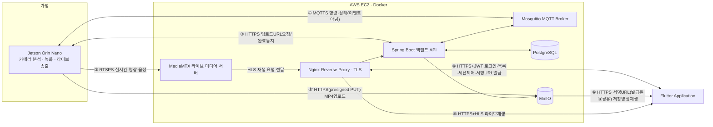

# 서비스 개요 (AI/코딩 에이전트용)

> 기준: 5979279 / 2026-07-27 / as-built
> 사람용 원본: [docs/human/01-서비스기획.md](../human/01-서비스기획.md)

이 문서는 산문 설명을 제거하고 표/리스트만으로 구성한 파생 문서다. ID·사실은 사람용 원본과 동일하다.

---

## 1. 정의

- 한 줄 정의: 엣지 AI가 분석·트리거 판단을 수행하고, 서버는 트리거 클립과 요청 시 라이브 스트림만 중계하는 프라이버시 우선 홈캠 서비스.
- 24시간 순환 녹화: Jetson 로컬 전용(서버 미전송).
- 서버 전송 대상: (a) 이벤트 트리거 클립(mp4), (b) 사용자가 명시적으로 요청한 라이브 세션.

## 2. 피봇 이력 (요약)

| 항목 | 내용 |
|---|---|
| 원래 서비스 | "웃음 다이어리" |
| 피봇 일자 | 2026-07-21 (홈캠으로 전환) |
| 재사용 도메인 | auth, device, invitation, video, stream, subscription |
| 신규 추가 | `personCount`(기기 상태), `GET /api/devices/{deviceId}/home-summary`(API-42, FN-S19) |
| 서버 계약 제외 범위 | 인물 탐지·중심 계산·자동 추적(팬틸트) — AIoT/엣지 전용, REQ-F-38 |
| 문서 기준일 불일치 주의 | `backend/BACKEND_STATUS.md`(2026-07-20)는 "가입요청→OWNER 승인" 서술이나, as-built(2026-07-27) 구현은 "OWNER 정식 초대→수락"(6절 역할 모델) — 후자가 정답 |

## 3. 핵심 시나리오 (ID 참조만)

### 3.1 기기 등록
`API-43`(등록코드 발급, FN-S20/FN-E02) → 화면 표시(⚠️ 물리 LCD 아님, `print()`만) → `API-08`(claim, FN-A07/FN-S04) → OWNER 멤버십 자동 생성(DB 트리거: 활성 OWNER 정확히 1명) → `API-11`/`API-42`(상태 노출).
레이트리밋: claim 5회/10분(계정·IP, REQ-NF-05).

### 3.2 실시간 보기
`API-35`(세션 생성, 오프라인 시 409 `DEVICE_OFFLINE`) → MQTT-01 `START_STREAM` → 기기 ACK+RTSPS 송출(FN-E04/E05) → `API-36` 2초 폴링 → `READY` 시 HLS 재생(`playUrl`) → 재생 토큰 TTL 30초, 20초 주기 선제 재조회 → `API-38` 하트비트(15초 기본) → 유휴 60초/뷰어 만료 45초/엣지 하드만료 120초 초과 시 자동 종료 → `API-37` 종료 시 MQTT-01 `STOP_STREAM`.
실사용 경로: `EmbeddedLivePlayer`(FN-A10). `LiveScreen`(FN-A12)은 동일 로직이나 도달 불가 코드(미사용).

### 3.3 이벤트 알림/다시보기
YAMNet 임계값 0.25·연속 2윈도우(FN-E06) → mp4 클립 생성(FN-E07) → `API-25`(업로드 URL, `Idempotency-Key`=sourceEventId) → MinIO 직접 PUT → `API-26`(완료 통지) → `API-27`(캘린더/추억 목록, FN-A13/A15) → `API-31`(재생 URL TTL 5분, FN-A17).

> ⚠️ MQTT `events`(MQTT-07)는 서버 핸들러 존재하나 기기가 발행하지 않는 죽은 구독 — 이벤트 통지는 전부 HTTP(API-25/26)로만 동작.

## 4. 핵심 가치(제약 조건 — 에이전트가 어길 수 없는 불변식)

| 제약 | 값 |
|---|---|
| 서버는 상시 영상/오디오 미수신 | AI 분석은 엣지 전용(REQ-NF-06) |
| 24h 순환 녹화 | 로컬(Jetson) 전용 |
| 라이브 송출 | 요청 기반만, 세션 종료/유휴/하드만료 시 자동 차단(REQ-NF-07) |
| 등록 코드 TTL | 120초, 1회용, sha256 해시 저장만 |
| 라이브 토큰 TTL | 30초 (20초 주기 재조회) |
| 업로드 URL TTL | 15분 |
| 재생/다운로드 URL TTL | 5분 |
| 명령·미디어 경로 분리 | MQTT=제어만, RTSPS(기기→미디어서버)/HLS(미디어서버→앱)=영상 |

## 5. 시스템 아키텍처

| 통신 경로 | 프로토콜 | 코드 경로(대표) |
|---|---|---|
| Jetson↔MQTT | MQTTS | `ai/device_agent/wj_device_agent/agent.py`, `backend/server/.../iot/mqtt/PahoMqttGateway.java` |
| Jetson→MediaMTX | RTSPS | `ai/device_agent/wj_device_agent/stream.py`, `configure_media.py` |
| Jetson↔Spring(업로드) | HTTPS | `ai/yolo/laughter_clip_uploader.py`, `backend/.../video/api/IotVideoController.java` |
| Jetson→MinIO | HTTPS PUT(presigned) | `backend/.../storage/ObjectStorageService.java` |
| App↔Nginx→Spring | HTTPS+JWT | `frontend/lib/core/api_client.dart`, 각 `backend/.../*/api/*Controller.java` |
| Nginx→App | HTTPS+HLS | `frontend/lib/ui/live_screen.dart` |
| MinIO→App(서명URL 발급은 Spring 경유) | HTTPS | `backend/.../video/application/VideoQueryService.java` |

각주(원본 대비 수정): MQTT 라벨에서 "이벤트" 제외(MQTT-06/07 죽은 구독), 업로드는 3단계(발급→PUT→완료통지), 재생/다운로드는 반드시 Spring 경유 서명 URL 발급 후 접근(앱이 MinIO 직접 접근 불가).

## 6. 역할 모델

| 역할 | 부여 시점 | 권한(대표 FN/API) | 제약 |
|---|---|---|---|
| OWNER | claim 성공 시 자동(FN-S04) | 기기설정변경(FN-A27/API-10), 초대(FN-A22/API-14), 추방(FN-A24/API-24), 소유권이전(FN-A24/API-12), 영상삭제(FN-A16/API-30), 구독관리(FN-A30/API-39~41), 접근기록(FN-A31/API-50), 기기해제(FN-A34/API-13) | 기기당 활성 OWNER 정확히 1명(DB 트리거), 자기 자신 추방 불가(409 `OWNER_CANNOT_BE_REVOKED`) |
| EDITOR | 초대 시 지정(REQ-F-28) | 영상 메타데이터 수정(FN-A18/API-29), 즐겨찾기 토글(FN-A19/API-29) | - |
| VIEWER | 초대 시 지정 | 조회 전용(영상목록/재생/실시간시청) | 메타수정·삭제·기기설정 불가 |

가입 경로: 초대 승인제만 유효(`API-14`→`API-20~22`, 7일 만료). 멤버십 요청 링크(`API-15/16`)는 미리보기·자동 채움만 하고 그 자체로 멤버십을 생성하지 않음.

역할 enum 변천: DB 원래 OWNER/MEMBER → V21 `MEMBER`→`EDITOR` rename → V22 `VIEWER` 추가 → V23 기본값/제약 정리.

## 7. 구현 상태 요약 (REQ-F 영역별, 42건)

| 영역 | ✅ | 🔶 | ❌ | 완성도 |
|---|---:|---:|---:|---|
| 인증 | 6 | 0 | 4 | 부분 |
| 기기 등록/관리 | 7 | 0 | 0 | 완료 |
| 홈/실시간 시청 | 2 | 0 | 0 | 완료 |
| 캘린더 | 1 | 0 | 1 | 부분 |
| 영상 관리 | 6 | 1 | 0 | 대부분 완료 |
| 가족 구성원 | 4 | 0 | 0 | 완료 |
| 설정 | 2 | 1 | 0 | 대부분 완료 |
| 알림/통계 | 1 | 1 | 0 | 대부분 완료 |
| 이벤트 자동 저장 | 1 | 0 | 0 | 완료 |
| 하드웨어/엣지 실험 | 0 | 2 | 1 | 실험 단계 |
| **합계** | **30** | **5** | **7** | 총 42건(REQ-F-01~42 일치, ❌에 신규계획 F42 포함) |

REQ-NF-01~12(12건)는 전부 코드·설정에서 확인됨(상세는 `02-requirements.md` 2절).

## 8. 미구현/불일치 상태 — 반드시 그대로 유지 (에이전트가 "있다"고 가정하면 안 되는 것들)

| 항목 | 상태 | 근거 |
|---|---|---|
| `PATCH /api/auth/me`(API-06, 프로필 수정) | 🔴 클라이언트 호출·서버 부재 | `AuthController.java` 전수 확인, 매핑 없음 |
| API-09/17/34/46/47/48/49 | 🔶 서버 구현·클라이언트 미사용 (7건) | cross-check.md |
| `homecam/v2` MQTT 파이프라인(MQTT-10~15, FN-E08/E09) | 🔴 실험 단계 — 코드 완성, 운영 배포에서 `MQTT_HOST=`(빈값)로 비활성화 | `run_edge_ai_mvp.sh`/`run_edge_ai_recording.sh` |
| 팬틸트(FN-H02/H03/H04) | 🔴 미구현 — 서보 구동 코드 없음, 발행부(MQTT-11)만 존재·구독자 전무 | `hardware/camera-pan-tilt/` (CAD만), `ai/yolo/yolov8_autoframe_jetson.py:964` "Motor output is disabled" |
| 프런트 스텁 4기능(소셜로그인/비번찾기/비번변경/기념일저장) + 알림읽음 로컬전용 | ❌/🔶 미구현 — 로컬 스낵바만, 서버 대응 코드 0건 | `auth_screen.dart`, `settings_screen.dart`, `extra_screens.dart` |
| `LiveScreen`(FN-A12) | 도달 불가 코드(미사용) — 실사용은 `EmbeddedLivePlayer`(FN-A10) | 코드 전체 `LiveScreen(` push 호출 0건 |
| 물리 LCD 표시(FN-E02) | ⚠️ 미확인 — 실제로는 `print()` 표준출력만 | `ai/device_agent/registration_button.py` |
| 라즈베리파이 프로토타입(FN-E10) | 🔴 실험 단계, 운영 무관 | `ai/pi_homecam_dev/` |
| 기기 상태 `recording`/`uploadQueueDepth`(API-11) | ⚠️ 항상 스텁(`false`/`0`) | MQTT-05 하트비트, `agent.py:211-225` |

## 9. 참조

- `docs/ai/02-requirements.md` — REQ-F-01~42, REQ-NF-01~12
- `docs/ai/03-features.md` — FN-A/S/E/H 76개 + 경로 매핑
- `docs/ai/04-api-spec.md` — API-01~50, MQTT-01~15 + JSON 스키마

## 10. MVP (2026-07-27 확정, 시연 기준)

우선순위 3단계: **MVP / MVP(전제) / 확장** (`02-requirements.md` 우선순위 열).

| # | 항목 | REQ | 상태 |
|---|---|---|---|
| 1 | 가입/로그인 | F01, F02 | ✅ |
| 2 | 기기 등록 | F10 | ✅ |
| 3 | 홈 라이브 | F18 | ✅ |
| 4 | 이벤트 영상 확인 | F37, F21, F22 | ✅ |
| 5 | 영상 편집 | F27 | 🔶(로컬 편집+기기 저장 기준 충족) |
| 6 | 편집본 다운로드 | F26, F27 | ✅(로컬 저장 기준) |
| 7 | 통계/리포트 | F19, F36(현행 충족) + **F42(신규 개발, ❌)** | ✅+❌ |

- MVP(전제): F03, F12, F41. 확장: 나머지 전부(초대/구독/소유권이전/팬틸트 등).
- 판정 기준: ⑤⑥ 서버 재업로드 불요. ⑦ F42는 신규 계획 항목 — as-built 아님, 구현 시 이 문서 갱신 필요.
