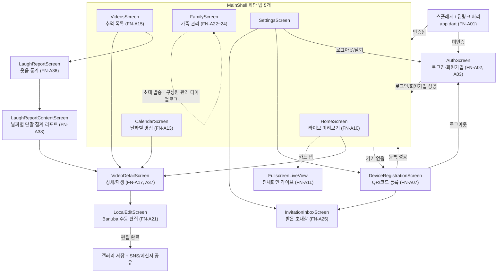

# 기능 명세서 (AI/코딩 에이전트용)

> 기준: to-be 기획(MVP 2026-07-27 확정) · 코드 현황 참조 커밋 5979279
> 사람용 원본: [../사람이 읽을 문서/03-기능명세서.md](../사람이%20읽을%20문서/03-기능명세서.md)

ID 체계: `FN-` + 영역(A=앱/S=서버/E=엣지/H=하드웨어) + 연속번호. 앱38(A01~A38) + 서버26(S01~S26) + 엣지10(E01~10) + 하드웨어4(H01~04) = **78개**(기존 76 + 신규 FN-A38, FN-S26). 배치는 MVP 7단계 순서(사람용 원본과 동일 구조).

**FN-A38 Flutter 리포트 화면은 구현됐다. FN-S26 서버 집계만 `[제안·미구현]`이다. 코드 경로가 없는 FN-S26/API-51을 존재하는 코드로 가정하지 말 것.**

---

## 0. 경로 매핑 총람 (에이전트 필수 참조)

### 0.1 도메인 → 패키지 경로 (서버, `backend/server/src/main/java/com/wj/server/`)

| 도메인 | FN 범위 | API 범위 | 패키지 경로 |
|---|---|---|---|
| auth | FN-S01~S02 | API-01~06 | `auth/api/`, `auth/application/` |
| device | FN-S03~S06 | API-07~13 | `device/api/`, `device/application/` |
| invitation | FN-S07~S10 | API-14~24 | `invitation/api/`, `invitation/application/` |
| video | FN-S11~S15 | API-25~33 | `video/api/`, `video/application/` |
| stream·live | FN-S16~S17 | API-34~38 | `stream/api/`, `stream/application/` |
| subscription | FN-S18 | API-39~41 | `subscription/api/`, `subscription/application/` |
| home | FN-S19 | API-42 | `home/api/`, `home/application/` |
| iot | FN-S20~S22 | API-43~46 | `iot/auth/`, `iot/event/`, `device/api/IotRegistrationController.java` |
| provisioning | FN-S23 | API-47~49 | `provisioning/api/`, `provisioning/application/` |
| audit | FN-S24 | API-50 | `audit/api/`, `audit/application/` |
| MQTT 공통 | FN-S25 | MQTT-01~09 | `iot/mqtt/`, `iot/telemetry/`, `stream/application/StreamCommandPublisher.java`, `stream/application/StreamEventService.java`, `iot/event/DeviceEventService.java` |
| **report(제안)** | **FN-S26** | **API-51 [제안]** | **코드 없음 — 기존 `video/api/VideoStatsController.java`(API-33)·`iot/event/EventStatsController.java`(API-46) 확장 검토 대상** |
| 공통 | - | - | `common/api/`, `common/web/`, `config/` |

### 0.2 화면 → dart 파일 경로 (`frontend/lib/`)

| 화면 파일 | FN 범위 |
|---|---|
| `app/app.dart` | FN-A01 |
| `ui/auth_screen.dart` | FN-A02~A05 |
| `ui/main_shell.dart` | FN-A06 |
| `ui/device_registration_screen.dart` | FN-A07~A08 |
| `ui/home_screen.dart`, `ui/live_screen.dart` | FN-A09~A12 |
| `ui/calendar_screen.dart`, `ui/extra_screens.dart`(AnniversaryEditorScreen) | FN-A13~A14 |
| `ui/videos_screen.dart` | FN-A15~A16 |
| `ui/video_detail_screen.dart`, `ui/local_edit_screen.dart` | FN-A17~A21 |
| `ui/family_screen.dart` | FN-A22~A24 |
| `ui/invitation_inbox_screen.dart` | FN-A25 |
| `ui/settings_screen.dart` | FN-A26~A34 |
| `ui/extra_screens.dart`(NotificationsScreen, LaughReportScreen) | FN-A35~A36 |
| `ui/media_player_surface.dart` | FN-A37 |
| `ui/laugh_report_content_screen.dart`(`LaughReportContentScreen`) | **FN-A38 [구현]** |
| `core/api_client.dart` | (전 화면 공용 API 호출 지점) |
| `core/banuba_video_editor.dart`, `core/portrait_video_canvas.dart` | FN-A21 보조 |
| `features/stt/`(pcm_wav, speech_analysis, android_audio, whisper_model, whisper_transcriber, caption_line, transcript_store, caption_controller, caption_auto_section) | FN-A39 |

### 0.3 엣지/하드웨어 경로

| 영역 | 경로 | FN 범위 |
|---|---|---|
| 기기 에이전트 | `ai/device_agent/wj_device_agent/` (agent.py, config.py, provision.py, stream.py, configure_media.py) | FN-E01~E05 |
| 등록 버튼(패키지 밖) | `ai/device_agent/registration_button.py`, `registration-button.sh` | FN-E02 |
| YAMNet 웃음감지 | `ai/yamnet/yamnet_laughter_detect_jetson.py`, `laughter_scoring.py`, `mqtt_event_publisher.py` | FN-E06 |
| 이벤트 업로드 | `ai/yolo/laughter_clip_uploader.py`, `ai/yolo/segment_clip_uploader.py` | FN-E07 |
| YOLO 추적(실험) | `ai/yolo/yolov8_autoframe_jetson.py`, `ai/yolo/vision_mqtt_publisher.py` | FN-E08 |
| 이벤트 퓨전(실험) | `ai/yolo/event_fusion_service.py` | FN-E09 |
| 라즈베리파이 프로토타입(실험) | `ai/pi_homecam_dev/homecam-publisher.sh`, `mediamtx.yml` | FN-E10 |
| 팬틸트 CAD | `hardware/camera-pan-tilt/pan_tilt.scad`, `README.md`, `STL/*` | FN-H01 |
| 팬틸트 제어(미구현) | (코드 없음, 참고문서만: `hardware/camera-pan-tilt/README.md` §2~5, `ai/AI_EDGE_INTEGRATION_SPEC.md` §4.1) | FN-H02~H04 |

---

## 1. 화면 흐름도

- 탭 순서(인덱스 0~4): 홈 / 캘린더 / 추억 / 가족 / 설정.
- 미사용 `LiveScreen`(FN-A12, 부록A)은 실제 진입 경로가 없어 다이어그램에서 제외(항목 자체는 부록A 유지). 기념일 편집(`AnniversaryEditorScreen`), 알림 목록(`NotificationsScreen`) 등 MVP·가족공유 밖 보조 화면도 생략(부록A 참고).
- **`LaughReportContentScreen`(FN-A38)은 구현됐다** — `AppController.videos`의 `LAUGHTER` 항목을 날짜별로 단말 집계한다. 주간/월간 서버 집계는 FN-S26/API-51 범위다.

| ID | 기능 | 사용 API | 소스 파일(`frontend/lib/`) | 비고/에러코드 |
|---|---|---|---|---|
| FN-A01 | 앱진입/스플래시/딥링크 | (직접호출없음) | `app/app.dart`, `app/app_controller.dart` | `bbanggeut://membership-request/{token}` |
| FN-A02 | 로그인 | API-02 | `ui/auth_screen.dart` | 401 INVALID_CREDENTIALS, 429 LOGIN_RATE_LIMITED |
| FN-A03 | 회원가입 | API-01 | `ui/auth_screen.dart` | 409 EMAIL_ALREADY_EXISTS |
| FN-A04 | 소셜로그인 버튼(Apple/Google/카카오) | 없음 ❌ | `ui/auth_screen.dart:284-298` | 스낵바만, 양쪽 다 미구현 |
| FN-A05 | 비밀번호 찾기 | 없음 ❌ | `ui/auth_screen.dart:249-256` | 스낵바만, 양쪽 다 미구현 |
| FN-A06 | 하단 탭 내비/새로고침 | (하위 위임) | `ui/main_shell.dart` | `IndexedStack`+`RefreshIndicator` |
| FN-A07 | QR/코드 기기 등록 | API-08 | `ui/device_registration_screen.dart` | 429 CLAIM_RATE_LIMITED, 409 DEVICE_CLAIM_REJECTED |
| FN-A08 | 멤버십 요청 링크 생성/공유 | API-15, API-16 | `ui/device_registration_screen.dart`, `app/app_controller.dart` | 403 OWNER_MEMBERSHIP_REQUIRED, 404 MEMBERSHIP_REQUEST_NOT_FOUND |
| FN-A09 | 홈 요약 카드 | API-11, API-33, API-42, API-27(간접) | `ui/home_screen.dart` | homeSummary 실패는 best-effort 무시 |
| FN-A10 | 임베디드 라이브 미리보기(실사용) | API-35~38 | `ui/live_screen.dart`(EmbeddedLivePlayer), `ui/home_screen.dart` | 2초폴링, 20초 토큰재조회, 15초 하트비트 |
| FN-A11 | 전체화면 라이브 | (재사용, 신규호출없음) | `ui/live_screen.dart`(FullscreenLiveView) | 3초 후 컨트롤 자동숨김 |
| FN-A12 | 독립형 라이브 화면(미사용) | API-35~38(코드상) | `ui/live_screen.dart`(LiveScreen) | **도달 불가 코드** — 어디서도 push 안 됨 |
| FN-A13 | 월별 캘린더 영상조회 | API-27 | `ui/calendar_screen.dart` | - |
| FN-A14 | 기념일 배너/편집(미구현) | 없음 ❌ | `ui/calendar_screen.dart`, `ui/extra_screens.dart:193,296` | backend "anniversary" grep 0건 |
| FN-A15 | 영상 목록/필터/정렬/검색 | API-27(간접, 로컬필터) | `ui/videos_screen.dart` | - |
| FN-A16 | 영상 삭제 | API-30 | `ui/videos_screen.dart` | 403 FORBIDDEN_ROLE, 404 |
| FN-A17 | 영상 상세/재생 | API-31 | `ui/video_detail_screen.dart` | 409 VIDEO_NOT_READY, 503 |
| FN-A18 | 메타데이터(제목/메모) 편집 | API-29, API-28 | `ui/video_detail_screen.dart` | 403, 422 VALIDATION_FAILED |
| FN-A19 | 즐겨찾기 토글 | API-29 | `ui/video_detail_screen.dart`, `app/app_controller.dart` | - |
| FN-A20 | 영상 다운로드 | API-32 | `ui/video_detail_screen.dart` | 409, 503 |
| FN-A21 | 로컬 영상 편집 | API-32 | `ui/local_edit_screen.dart`, `core/video_exporter.dart`, `core/video_edit_state.dart`, `MainActivity.kt`(exportWithTrim) | ⚠️ 서버 재업로드 API 호출 미발견 |
| FN-A39 | 온디바이스 자동 자막 | 없음 | `features/stt/*`, `ui/local_edit_screen.dart`, `core/video_exporter.dart`, `SttChannel.kt`, `SubtitleOverlay.kt` | 오디오·전사문이 기기 밖으로 나가지 않음. 모델은 `assets/models/ggml-small-ko-q5_1.bin`(약 181MiB) — 앱이 첫 실행 때 파일로 복사. 자르기·자막·효과는 인코딩 1회에 함께 처리 |
| FN-A22 | 가족 목록/초대 | API-23, API-14, API-18 | `ui/family_screen.dart` | 403, 409(ALREADY_DEVICE_MEMBER/INVITATION_PENDING/EMAIL_MISMATCH) |
| FN-A23 | 보낸 초대 취소 | API-19 | `ui/family_screen.dart` | 403, 409 INVITATION_NOT_PENDING |
| FN-A24 | 소유권 이전/구성원 내보내기 | API-12, API-24 | `ui/family_screen.dart` | transfer는 `controller.api` 직접호출(래퍼 미사용); 409 ALREADY_OWNER/TRANSFER_TARGET_NOT_ACTIVE_MEMBER/OWNER_CANNOT_BE_REVOKED |
| FN-A25 | 받은 초대 수락/거절 | API-20, API-21, API-22 | `ui/invitation_inbox_screen.dart` | 404, 409 INVITATION_EXPIRED/NOT_PENDING |
| FN-A26 | 프로필 이름 수정(동작 불가) | API-06 🔴 | `ui/settings_screen.dart`, `core/api_client.dart:152-158` | 서버 매핑 없음(추정 404) |
| FN-A27 | 기기 이름/보관기간 변경 | API-10 | `ui/settings_screen.dart` | 422, 403 |
| FN-A28 | 알림 설정(로컬 전용) | 없음 | `ui/settings_screen.dart` | `flutter_secure_storage`만, 서버 미반영 |
| FN-A29 | 비밀번호 변경(미구현) | 없음 ❌ | `ui/settings_screen.dart:271-274` | 스낵바만 |
| FN-A30 | 구독(보관 플랜) 관리 | API-39, API-40, API-41 | `ui/settings_screen.dart` | 403, 409 SUBSCRIPTION_NOT_ACTIVE |
| FN-A31 | 접근 기록 조회 | API-50 | `ui/settings_screen.dart` | 422, 403 |
| FN-A32 | 로그아웃 | API-04 | `ui/settings_screen.dart`, `ui/device_registration_screen.dart` | - |
| FN-A33 | 회원 탈퇴 | API-05 | `ui/settings_screen.dart` | 409 OWNER_MEMBERSHIP_EXISTS |
| FN-A34 | 기기 해제 | API-13 | `ui/settings_screen.dart` | 403, 404 |
| FN-A35 | 알림 목록/읽음처리(로컬만) | 없음 | `ui/extra_screens.dart:46`(NotificationsScreen) | 서버 notification 테이블 없음 |
| FN-A36 | 웃음 리포트/웃음 잔디 | API-33, API-27(간접) | `ui/extra_screens.dart`(LaughReportScreen) | - |
| FN-A37 | 재생 공용 컴포넌트 | 없음(순수 UI) | `ui/media_player_surface.dart` | isLive 여부로 컨트롤 분기 |

검증: 화면 파일 13개(`auth_screen`,`calendar_screen`,`device_registration_screen`,`extra_screens`,`family_screen`,`home_screen`,`invitation_inbox_screen`,`live_screen`,`local_edit_screen`,`media_player_surface`,`settings_screen`,`videos_screen`,`video_detail_screen`) 전부 등장 + `main_shell.dart` 별도.

---

## 2. MVP ① 회원가입 / 로그인

| FN ID | 기능 | 담당 | 동작 규칙 | 관련 REQ·API | 코드 경로 |
|---|---|---|---|---|---|
| FN-A01 | 앱 진입/세션 확인/딥링크 처리 | 폰 | 로컬 세션 토큰 유무로 `AuthScreen`/`MainShell` 분기. `bbanggeut://membership-request/{token}` 딥링크는 대기열 저장 후 처리 | REQ-F-03 | `app/app.dart`, `app/app_controller.dart` |
| FN-A02 | 로그인 | 폰+서버 | 이메일/비밀번호 검증 후 로그인. 실패 5회/10분 초과 시 일시 차단 | REQ-F-02 / API-02 | `ui/auth_screen.dart` — 401 `INVALID_CREDENTIALS`, 429 `LOGIN_RATE_LIMITED` |
| FN-A03 | 회원가입 | 폰+서버 | 이메일/비밀번호/표시 이름으로 계정 생성, 성공 시 즉시 토큰 발급 | REQ-F-01 / API-01 | `ui/auth_screen.dart` — 409 `EMAIL_ALREADY_EXISTS` |
| FN-S01 | 회원가입/로그인/토큰 갱신 | 서버 | 액세스15분/리프레시14일(rotate-on-use), 해시 저장, 로그인 5회/10분 레이트리밋 | REQ-F-01,02 / API-01,02,03 | `auth/api/AuthController.java`, `auth/application/AuthService.java`, `LoginAttemptService.java` |
| FN-A32 | 로그아웃 | 폰+서버 | 세션 종료 후 로컬 세션 삭제, 로그인 화면 이동 | REQ-F-04 / API-04 | `ui/settings_screen.dart`, `ui/device_registration_screen.dart` |
| FN-A33 | 회원 탈퇴 | 폰+서버 | 소유 기기가 있으면 탈퇴 불가 | REQ-F-05 / API-05 | `ui/settings_screen.dart` — 409 `OWNER_MEMBERSHIP_EXISTS` |
| FN-S02 | 로그아웃/회원 탈퇴 처리 | 서버 | 로그아웃=세션 단위 무효화, 탈퇴는 소유 기기 있으면 거부 | REQ-F-04,05 / API-04,05 | `auth/api/AuthController.java`, `auth/application/AuthService.java` |

---

## 3. MVP ② 기기 등록

| FN ID | 기능 | 담당 | 동작 규칙 | 관련 REQ·API | 코드 경로 |
|---|---|---|---|---|---|
| FN-E02 | 등록 코드 발급 요청/표시 | 젯슨 | 등록 버튼 입력 시 서버에 등록 코드 요청해 화면(⚠️ 물리 LCD 아님, `print()`만) 표시 | REQ-F-10 / API-43 | `ai/device_agent/registration_button.py`, `registration-button.sh`, `wj_device_agent/provision.py` |
| FN-S20 | 등록 코드 발급 | 서버 | TTL 120초, 해시 저장, 이미 claim된 기기는 재발급 거부, 코드 중복 시 최대 5회 재생성 | REQ-F-10 / API-43 | `device/api/IotRegistrationController.java`, `RegistrationCodeService.java` |
| FN-A07 | QR/코드 기기 등록 | 폰+서버 | QR 스캔 또는 8자리 코드 입력으로 claim 요청 | REQ-F-10 / API-08 | `ui/device_registration_screen.dart` — 429 `CLAIM_RATE_LIMITED`, 409 `DEVICE_CLAIM_REJECTED` |
| FN-S04 | 기기 등록(claim) | 서버 | claim 실패 5회/10분 초과 시 429, 활성 OWNER 정확히 1명 보장 | REQ-F-10 / API-08 | `device/api/DeviceController.java`, `ClaimAttemptService.java` |
| FN-E01 | 기기 프로비저닝(자격증명 발급/회전) | 젯슨+서버 | BOOTSTRAP(TTL15분) 토큰을 OPERATING(TTL30일) 자격증명으로 교환·회전 | REQ-F-10 / API-44,45 | `ai/device_agent/wj_device_agent/provision.py`(`DeviceApi.enroll`/`rotate`) |
| FN-S21 | 기기 자격증명 발급/회전 | 서버 | BOOTSTRAP15분/OPERATING30일, 기기당 활성 자격증명 1개 | REQ-F-10 / API-44,45 | `iot/auth/DeviceCredentialController.java`, `provisioning/application/ProvisioningService.java` |
| FN-E03 | 상태·하트비트 보고 | 젯슨 | 연결/종료 시 상태 발행(LWT 포함), 30초 주기 하트비트 | REQ-F-12 / MQTT-02,05 | `ai/device_agent/wj_device_agent/agent.py:71-76,92,104,211-225`(⚠️ 일부 필드 스텁) |
| FN-S03 | 기기 목록/단건 조회 | 서버 | 호출자의 활성 멤버십 기준으로 접근 가능한 기기만 필터링 | REQ-F-12 / API-07 | `device/api/DeviceController.java`, `DeviceService.java` — API-09는 클라이언트 미사용(죽은 경로) |
| FN-S05 | 기기 설정 변경/상태 조회 | 서버 | 이름·보관기간(1~3650일) 변경은 OWNER만, `recording`/`uploadQueueDepth`는 MQTT-05 스텁값 그대로 노출 | REQ-F-12,13 / API-10,11 | `device/api/DeviceController.java` |
| FN-A27 | 기기 이름/보관기간 변경 | 폰+서버 | OWNER가 기기 표시 이름과 영상 보관 기간(일)을 변경 | REQ-F-13 / API-10 | `ui/settings_screen.dart` — 422, 403 |

---

## 4. MVP ③ 홈에서 라이브 스트리밍 시청

| FN ID | 기능 | 담당 | 동작 규칙 | 관련 REQ·API | 코드 경로 |
|---|---|---|---|---|---|
| FN-A06 | 하단 탭 내비게이션 및 새로고침 | 폰 | 5개 탭 전환, 당겨서 새로고침 | REQ-F-41 | `ui/main_shell.dart`(`IndexedStack`+`RefreshIndicator`) |
| FN-A10 | 임베디드 라이브 미리보기 | 폰+서버+젯슨 | 세션생성→상태폴링→WHEP/WebRTC 우선→실패 시 HLS 폴백→하트비트→종료 | REQ-F-18 / API-35~38 | `core/whep_player_controller.dart`, `ui/live_screen.dart`, `ui/home_screen.dart` |
| FN-A11 | 전체화면 라이브 보기 | 폰 | 가로 모드 전체화면 재생, 일정 시간 후 컨트롤 자동 숨김 | REQ-F-18 | `ui/live_screen.dart`(`FullscreenLiveView`) — 3초 후 컨트롤 자동숨김 |
| FN-A37 | 재생 컨트롤(공용) | 폰 | 저장 영상/라이브 겸용 재생 UI | REQ-F-18,22 | `ui/media_player_surface.dart` — isLive 여부로 컨트롤 분기 |
| FN-S16 | 라이브 재생 인가 확인 | 서버 | 재생 토큰 서명 검증해 재생 허용 여부 응답 | REQ-F-18 / API-34 | `stream/api/LiveIntrospectionController.java`, `LiveTokenService.java` — 공개(permitAll), 호출주체 ⚠️미확인(MediaMTX 추정) |
| FN-S17 | 라이브 세션 생성/조회/종료/하트비트 | 서버 | READY 응답에 토큰 포함 `whepUrl`+`playUrl`, 오프라인 거부, 뷰어TTL45s/유휴60s/엣지lease120s/하트비트15s/토큰30s | REQ-F-18 / API-35~38 | `StreamSessionResponse.java`, `StreamService.java`, `StreamProperties` |
| FN-S25 | 기기 상태/명령/이벤트 MQTT 채널 | 서버+젯슨 | 스트림 시작/연장/종료 명령(15초 만료) 전달, 상태·하트비트 수신 | REQ-F-12,18 / MQTT-01~05 | `iot/mqtt/PahoMqttGateway.java`, `iot/telemetry/MqttInboundHandler.java`, `stream/application/StreamCommandPublisher.java`, `StreamEventService.java`, `iot/event/DeviceEventService.java` — 상세는 10절 |
| FN-E04 | 원격 명령 수신/ACK | 젯슨 | `START_STREAM`/`EXTEND_STREAM`/`STOP_STREAM` 처리 후 ACK 발행 | REQ-F-18 / MQTT-01,03 | `agent.py:103,133,237-262` — PING 분기는 죽은 코드 |
| FN-E05 | 라이브 스트림 송출(RTSPS) | 젯슨 | ffmpeg로 RTSPS 송출, 하드 만료 검사로 자동 종료, 기기당 스트림 1개 | REQ-F-18 / MQTT-04 | `ai/device_agent/wj_device_agent/stream.py`, `configure_media.py`, `config.py` |

---

## 5. MVP ④ 이벤트(웃음) 감지 영상 확인

| FN ID | 기능 | 담당 | 동작 규칙 | 관련 REQ·API | 코드 경로 |
|---|---|---|---|---|---|
| FN-E06 | 웃음(오디오) 감지 | 젯슨 | YAMNet 임계값 0.25 이상 연속 2윈도우 유지 시 트리거(쿨다운 2초) | REQ-F-37 | `ai/yamnet/yamnet_laughter_detect_jetson.py`, `laughter_scoring.py` |
| FN-E07 | 이벤트 클립 업로드 | 젯슨+서버 | 트리거 전후 구간 클립 생성해 서버 업로드 흐름으로 전달 | REQ-F-37 / API-25,26 | `ai/yolo/laughter_clip_uploader.py`, `segment_clip_uploader.py`(systemd Restart=always) |
| FN-S11 | 영상 업로드(기기측, presigned URL) | 서버 | `Idempotency-Key`로 중복 방지, 500MiB 초과 거부, 업로드URL TTL15분 | REQ-F-37 / API-25,26 | `video/api/IotVideoController.java`, `IotVideoService.java` |
| FN-A15 | 영상 목록/필터/정렬/검색 | 폰 | 홈캠/웃음감지/편집완료 세그먼트 필터링, 검색·정렬 | REQ-F-21 | `ui/videos_screen.dart` |
| FN-S12 | 영상 목록/상세 조회 | 서버 | 커서 페이지네이션(size 1~100) | REQ-F-19,21 / API-27,28 | `video/api/VideoController.java`, `VideoQueryService.java` — ⚠️ `thumbnailUrl` 항상 null |
| FN-A17 | 영상 상세/재생 | 폰+서버 | READY 상태일 때만 서명 재생 URL 발급받아 재생 | REQ-F-22 / API-31 | `ui/video_detail_screen.dart` — 409 `VIDEO_NOT_READY`, 503 |
| FN-S14 | 영상 재생/다운로드 URL 발급 | 서버 | READY 아니면 거부, 재생/다운로드 URL TTL5분(`attachment` 옵션만 다름) | REQ-F-22,26 / API-31,32 | `video/application/VideoQueryService.java` |

---

## 6. MVP ⑤ 영상 편집

| FN ID | 기능 | 담당 | 동작 규칙 | 관련 REQ·API | 코드 경로 |
|---|---|---|---|---|---|
| FN-A21 | 로컬 영상 편집(Banuba) | 폰 | 서명 다운로드 URL로 원본을 내려받아 Banuba 편집기(9:16 변환 등, Android 전용)로 수동 편집, 결과는 로컬 저장 | REQ-F-27 / API-32(재사용) | `ui/local_edit_screen.dart`, `core/banuba_video_editor.dart`, `core/portrait_video_canvas.dart` — ⚠️ 서버 재업로드 API 호출 코드 미발견 |

별도 서버 API는 필요하지 않다 — 편집은 전적으로 폰에서 이루어지고, 원본 다운로드는 6절과 같은 API-32를 재사용한다.

---

## 7. MVP ⑥ 편집 영상 다운로드

| FN ID | 기능 | 담당 | 동작 규칙 | 관련 REQ·API | 코드 경로 |
|---|---|---|---|---|---|
| FN-A21 | 편집 결과 로컬 저장 + 공유 | 폰 | 편집 결과를 앱 문서 디렉터리(`edited_videos/`)에 저장 후 공유 시트로 SNS/메신저 전달 | REQ-F-27(로컬 저장·공유 측면) | `ui/local_edit_screen.dart` |
| FN-A20 | 원본 영상 다운로드 | 폰+서버 | 서명 다운로드 URL을 받아 외부 브라우저/앱으로 실행(앱이 직접 저장하지 않음) | REQ-F-26 / API-32 | `ui/video_detail_screen.dart` — 409, 503 |
| FN-S14 | 다운로드 URL 발급 | 서버 | 재생 URL과 동일 TTL5분, `response-content-disposition=attachment` 쿼리만 추가 | REQ-F-26 / API-32 | `video/application/VideoQueryService.java` |

---

## 8. MVP ⑦ 통계 / 리포트

| FN ID | 기능 | 담당 | 동작 규칙 | 관련 REQ·API | 코드 경로 |
|---|---|---|---|---|---|
| FN-A13 | 월별 캘린더 영상 조회 | 폰+서버 | 월 이동 시 해당 월 범위 재조회, 날짜 선택 시 해당일 목록 표시 | REQ-F-19 / API-27 | `ui/calendar_screen.dart` |
| FN-S12 | 영상 목록 조회(캘린더 집계 재사용) | 서버 | 5절 표 참고(커서 페이지네이션) | REQ-F-19 / API-27 | `video/api/VideoController.java` |
| FN-A36 | 웃음 리포트/웃음 잔디 | 폰 | 월평균·전체포착수·주간추이 막대, 연간 히트맵을 탭으로 전환 | REQ-F-36 / API-33 | `ui/extra_screens.dart`(`LaughReportScreen`) |
| FN-S15 | 영상 통계 | 서버 | 기간별 트리거타입/일별 집계, 최다 요일·시간대 통계 | REQ-F-36 / API-33 | `video/api/VideoStatsController.java`, `VideoStatsService.java` |
| FN-S22 | 이벤트 통계 | 서버 | 기간별 감지 이벤트/업로드 영상 수 집계. FN-A38/FN-S26 확장 시 기반 로직 후보 | REQ-F-36 / API-46 | `iot/event/EventStatsController.java`, `EventStatsService.java` — 서버 정교히 구현되었으나 `LaughReportScreen`은 API-33만 사용 |
| **FN-A38** `[구현]` | 웃음 리포트 화면 | 폰 | 로드된 `LAUGHTER` 영상을 날짜별 단말 집계. 전체 횟수·웃음 날짜 수·최근 날짜별 횟수·연간 잔디·선택 날짜 영상 제공 | REQ-F-42 / 기존 영상 목록 | `ui/laugh_report_content_screen.dart` |
| **FN-S26** `[제안·미구현]` | 리포트 집계 API | 서버 | 기간(주간/월간) 파라미터로 웃음 횟수 합계·시간대별 분포·베스트 클립 목록 집계. FN-S15/FN-S22 로직·`device_events` 데이터를 확장 기반으로 검토 가능(정렬 기준·개수는 상세 설계 시 확정) | REQ-F-42 / API-51 [제안] | **경로 없음 — 미구현, 신규 개발 필요** |

---

## 9. 가족 공유

기기 단위 **OWNER / EDITOR / VIEWER** 3역할. 가입은 초대 승인제로만 이루어진다.

| FN ID | 기능 | 담당 | 동작 규칙 | 관련 REQ·API | 코드 경로 |
|---|---|---|---|---|---|
| FN-A08 | 멤버십 요청 링크 생성/공유 | 폰+서버 | 요청 링크 생성해 공유, OWNER가 열면 요청자 정보 미리보기+초대 폼 자동채움 | REQ-F-11 / API-15,16 | `ui/device_registration_screen.dart`, `app/app_controller.dart` — 403, 404 |
| FN-S08 | 멤버십 요청 링크 | 서버 | 요청자당 활성 링크 1개, 링크 자체는 멤버십 미생성(정식 초대 FN-S07 별도 필요) | REQ-F-11 / API-15,16,17 | `invitation/api/InvitationController.java`, `MembershipRequestService.java` — `/open`은 302 리다이렉트(앱 미호출) |
| FN-A22 | 가족 구성원 목록/초대 | 폰+서버 | 이메일+역할(EDITOR/VIEWER)로 초대, 구성원/보낸초대 목록 조회 | REQ-F-28 / API-14,18,23 | `ui/family_screen.dart` — 403, 409(ALREADY_DEVICE_MEMBER/INVITATION_PENDING/EMAIL_MISMATCH) |
| FN-S07 | 초대 발송/보낸 초대 조회/취소 | 서버 | 유효기간 7일, 이미 구성원/동일대상 PENDING 있으면 거부 | REQ-F-28,29 / API-14,18,19 | `invitation/api/InvitationController.java`, `InvitationService.java` |
| FN-S10 | 구성원 목록/추방 | 서버 | OWNER 추방 불가, 비활성 멤버십 재추방 불가 | REQ-F-28,30 / API-23,24 | `invitation/api/InvitationController.java` — 409 `OWNER_CANNOT_BE_REVOKED` |
| FN-A23 | 보낸 초대 취소 | 폰+서버 | PENDING 상태만 취소 가능 | REQ-F-29 / API-19 | `ui/family_screen.dart` — 403, 409 `INVITATION_NOT_PENDING` |
| FN-A24 | 구성원 소유권 이전/내보내기 | 폰+서버 | ACTIVE 구성원 대상 소유권 이전(부록A REQ-F-14) 또는 강제 탈퇴 | REQ-F-30(,확장 REQ-F-14) / API-12,24 | `ui/family_screen.dart` — transfer는 `controller.api` 직접호출(래퍼 미사용); 409 `ALREADY_OWNER`/`TRANSFER_TARGET_NOT_ACTIVE_MEMBER`/`OWNER_CANNOT_BE_REVOKED` |
| FN-A25 | 받은 초대 수락/거절 | 폰+서버 | 목록 조회 후 수락(멤버십 생성) 또는 거절 | REQ-F-31 / API-20,21,22 | `ui/invitation_inbox_screen.dart` — 404, 409 `INVITATION_EXPIRED`/`NOT_PENDING` |
| FN-S09 | 받은 초대 조회/수락/거절 | 서버 | 만료 시 수락 거부, 수락/거절 모두 PENDING만 처리 | REQ-F-31 / API-20,21,22 | `invitation/api/InvitationController.java` |

---

## 10. MQTT 토픽 ↔ 양쪽 처리 코드 경로 (필수 매핑, 15개)

토픽 베이스: `${app.mqtt.environment}/wj/v2`(예: `local/wj/v2`, `prod/wj/v2`), 브로커: Mosquitto + `dynamic-security`. MQTT-01(commands)·MQTT-04(stream/events)는 4절(라이브 스트리밍)에서 다뤘으므로 여기서는 나머지 `wj/v2` 토픽 + 실험 단계(`homecam/v2`) 6개를 정리한다.

> **v2 마이그레이션**: 토픽 루트 `wj/v1`→`wj/v2`, `schemaVersion` `1.0`→`2.0`. 백엔드는 `2.0`이 아닌 payload를 조용히 폐기한다.

| ID | 토픽(접미사) | 백엔드 처리 코드 | 엣지/AI 처리 코드 | 비고 |
|---|---|---|---|---|
| MQTT-01 | `.../commands` | 발행: `stream/application/StreamCommandPublisher.java`, `StreamService.java`, `iot/mqtt/PahoMqttGateway.java` | 구독: `agent.py:103` | 기기측 PING 분기는 죽은 코드 |
| MQTT-02 | `.../status` | 구독: `iot/telemetry/MqttInboundHandler.java:105-111` | 발행: `agent.py:71-76,92,104` | ⚠️ reason/occurredAt 무시 |
| MQTT-03 | `.../commands/ack` | 구독: `MqttInboundHandler.java`(commandAck()) | 발행: `agent.py:133,237-262` | ⚠️ errorCode 등 미사용 |
| MQTT-04 | `.../stream/events` | 구독: `MqttInboundHandler.java`(streamEvent()), `StreamEventService.java` | 발행: `agent.py:264-285` | ⚠️ STREAM_STARTING 무시 |
| MQTT-05 | `.../heartbeat` | 구독: `MqttInboundHandler.java`(heartbeat()) | 발행: `agent.py:211-225` | ⚠️ recording/uploadQueueDepth 항상 스텁 |
| MQTT-06 | `.../registration` | 구독만: `MqttInboundHandler.java:90-103` | 발행 없음 | 등록코드 발급은 실제로 API-43(HTTP)로만 동작 |
| MQTT-07 | `.../events` | 구독만: `MqttInboundHandler.java`(detectionEvent()), `iot/event/DeviceEventService.java` | 발행 없음 | 웃음감지→업로드는 실제로 API-25/26(HTTP)로만 동작 |
| MQTT-08 | `$CONTROL/dynamic-security/v1` | 발행: `PahoMqttGateway.java` | (브로커 대상) | 기기별 MQTT 계정/ACL 관리 채널 |
| MQTT-09 | `$CONTROL/dynamic-security/v1/response` | 구독: `PahoMqttGateway.java` | (브로커 응답) | MQTT-08 응답 |
| MQTT-10 | `homecam/v2/{id}/ai/vision/state` | 미구독 | 발행: `ai/yolo/vision_mqtt_publisher.py:31`, `yolov8_autoframe_jetson.py:82-97` | 부록A — 실험단계 |
| MQTT-11 | `homecam/v2/{id}/control/framing/target` | 미구독 | 발행: `vision_mqtt_publisher.py:126-131`, 구독자 전무 | 부록A — 실험단계 |
| MQTT-12 | `homecam/v2/{id}/ai/vision/status` | 미구독 | 발행: `vision_mqtt_publisher.py:35,47-54,92-99` | 부록A — 실험단계 |
| MQTT-13 | `homecam/v2/{id}/ai/laughter/detected` | 미구독 | 발행: `ai/yamnet/mqtt_event_publisher.py:36,113-154` | 부록A — 실험단계 |
| MQTT-14 | `homecam/v2/{id}/ai/status` | 미구독 | 발행: `mqtt_event_publisher.py:38` | 부록A — 실험단계 |
| MQTT-15 | `homecam/v2/{id}/events/memory-candidate` | 미구독 | 발행: `ai/yolo/event_fusion_service.py:67-120,170-243` | 부록A — 실험단계 |

MQTT-10~15는 운영 배포 스크립트(`ai/yolo/run_edge_ai_mvp.sh`, `run_edge_ai_recording.sh`)가 `MQTT_HOST=`(빈 값)로 넘겨 코드 경로 자체가 비활성화됨(`ai/yolo/run_ai_stack.sh`=로컬 수동검증에서만 동작).

---

## 11. 부록 A: 확장 기능

MVP 7단계·가족 공유 밖이지만 기능·문서는 유지하는 항목이다. 실험 단계 기능(젯슨 E08~E10, 하드웨어 H01~H04)을 포함한다.

### 앱(App)

| FN ID | 기능(한 줄) | 비고(코드 경로) |
|---|---|---|
| FN-A04 | 소셜 로그인 버튼(Apple/Google/카카오) | 미구현(스텁) — REQ-F-07 · `ui/auth_screen.dart:284-298` |
| FN-A05 | 비밀번호 찾기 | 미구현(스텁) — REQ-F-08 · `ui/auth_screen.dart:249-256` |
| FN-A09 | 홈 요약 카드(오늘의 촬영·저장·메모 통계, 최근 하이라이트) | 확장 — REQ-F-17 · `ui/home_screen.dart`(homeSummary 실패는 best-effort 무시) |
| FN-A12 | 독립형 라이브 화면(`LiveScreen`) | 코드는 존재하나 도달 불가 — `ui/live_screen.dart`(LiveScreen), push 호출 0건 |
| FN-A14 | 기념일 배너/편집 | 미구현(스텁) — REQ-F-20 · `ui/calendar_screen.dart`, `ui/extra_screens.dart:193,296` |
| FN-A16 | 영상 삭제(OWNER 전용) | 확장 — REQ-F-25 · `ui/videos_screen.dart` |
| FN-A18 | 영상 메타데이터(제목/메모) 편집 | 확장 — REQ-F-23 · `ui/video_detail_screen.dart` |
| FN-A19 | 즐겨찾기 토글 | 확장 — REQ-F-24 · `ui/video_detail_screen.dart`, `app/app_controller.dart` |
| FN-A26 | 프로필 이름 수정 | 미구현(서버 API 부재) — REQ-F-06 · `ui/settings_screen.dart`, `core/api_client.dart:152-158` |
| FN-A28 | 알림 설정(로컬 저장, 서버 미연동) | 확장 — REQ-F-32 · `ui/settings_screen.dart`(`flutter_secure_storage`) |
| FN-A29 | 비밀번호 변경 | 미구현(스텁) — REQ-F-09 · `ui/settings_screen.dart:271-274` |
| FN-A30 | 구독(보관 플랜) 관리 | 확장 — REQ-F-33 · `ui/settings_screen.dart` |
| FN-A31 | 접근 기록 조회 | 확장 — REQ-F-34 · `ui/settings_screen.dart` |
| FN-A34 | 기기 해제 | 확장 — REQ-F-15 · `ui/settings_screen.dart` |
| FN-A35 | 알림 목록/읽음 처리(읽음 처리는 로컬만) | 미구현(스텁) — REQ-F-35 · `ui/extra_screens.dart:46`(NotificationsScreen) |

### 서버(Server)

| FN ID | 기능(한 줄) | 비고(코드 경로) |
|---|---|---|
| FN-S06 | 기기 소유권 이전/해제 | 확장 — REQ-F-14,15 · `device/api/DeviceController.java` |
| FN-S13 | 영상 메타데이터 수정/삭제 | 확장 — REQ-F-23,24,25 · `video/application/VideoCommandService.java` |
| FN-S18 | 구독(보관 플랜) 조회/활성화/해지 | 확장 — REQ-F-33 · `subscription/api/SubscriptionController.java` |
| FN-S19 | 홈 요약 집계 | 확장 — REQ-F-17 · `home/api/HomeSummaryController.java` |
| FN-S23 | 내부 관리자 기기 프로비저닝 | 확장 — REQ-F-16 · `provisioning/api/ProvisioningController.java` |
| FN-S24 | 접근 로그 조회 | 확장 — REQ-F-34 · `audit/api/AccessLogController.java` |

### 엣지(Edge) — 실험 기능

| FN ID | 기능(한 줄) | 비고(코드 경로) |
|---|---|---|
| FN-E08 | YOLO 사람/반려동물 추적·프레이밍 계산 | 실험 단계, 운영 배포 비활성 — REQ-F-38 · `ai/yolo/yolov8_autoframe_jetson.py`, `vision_mqtt_publisher.py` |
| FN-E09 | 이벤트 퓨전(웃음+비전 컨텍스트) | 실험 단계, 운영 배포 비활성 — REQ-F-39 · `ai/yolo/event_fusion_service.py` |
| FN-E10 | 라즈베리파이 프로토타입 RTSP 송출 | 실험 단계, 초기 검증용 — REQ-F-40 · `ai/pi_homecam_dev/homecam-publisher.sh`, `mediamtx.yml` |

### 하드웨어(Hardware) — 실험 기능

| FN ID | 기능(한 줄) | 비고(코드 경로) |
|---|---|---|
| FN-H01 | 팬/틸트 기구 프레임(CAD) | 설계 완료(3D 프린트 산출물) — REQ-F-38 · `hardware/camera-pan-tilt/pan_tilt.scad`, `README.md` |
| FN-H02 | 서보 구동/PWM 제어 | 미구현(설계 문서만 존재) — REQ-F-38 · (코드 없음, `README.md` §2~3) |
| FN-H03 | YOLO→서보 목표값 전달 경로 | 발행부만 존재, 소비 미연동 — REQ-F-38 · `ai/yolo/vision_mqtt_publisher.py:126-131` |
| FN-H04 | 소프트 리밋/부팅 초기화 | 설계 의도만 존재 — REQ-F-38 · (코드 없음, `README.md` §5, `drawing.html`) |

---

## 12. 부록 B: 현재 구현 현황

MVP 7단계 기준. FN-A38 Flutter 화면은 구현됐고 FN-S26/API-51 서버 집계는 제안·미구현이다.

| # | MVP 단계 | 상태 | 비고 |
|---|---|---|---|
| 1 | 회원가입 / 로그인 | 구현됨 | FN-A01~03, A32, A33, S01, S02 전체 동작 |
| 2 | 기기 등록 | 구현됨 | QR/8자리 코드 claim, 자격증명 발급/회전 포함 전체 동작 |
| 3 | 홈에서 라이브 스트리밍 시청 | 구현됨 | 홈 카드 + 전체화면, WHEP/WebRTC 우선·HLS 폴백 |
| 4 | 이벤트(웃음) 감지 영상 확인 | 구현됨 | 감지 → 자동 업로드 → 목록/재생 전체 동작 |
| 5 | 영상 편집 | 구현됨 | 폰 내 수동 편집(Banuba) 동작 |
| 6 | 편집 영상 다운로드 | 구현됨 | 편집본 로컬 저장+공유, 원본 서버 다운로드 동작 |
| 7 | 통계 / 리포트 | 부분 구현 | 캘린더·웃음 통계와 **FN-A38 Flutter 리포트 구현**. **FN-S26/API-51 서버 집계는 제안·미구현** |

**ID 검증**: 본문(2~9절) 고유 FN 개수 = 앱23(A01,A02,A03,A06,A07,A08,A10,A11,A13,A15,A17,A20,A21,A22,A23,A24,A25,A27,A32,A33,A36,A37,A38) + 서버20(S01,S02,S03,S04,S05,S07,S08,S09,S10,S11,S12,S14,S15,S16,S17,S20,S21,S22,S25,S26) + 엣지7(E01~E07) = 50. 부록A 고유 FN 개수 = 앱15(A04,A05,A09,A12,A14,A16,A18,A19,A26,A28,A29,A30,A31,A34,A35) + 서버6(S06,S13,S18,S19,S23,S24) + 엣지3(E08,E09,E10) + 하드웨어4(H01~H04) = 28. 50+28=78, FN-A01~38·FN-S01~26·FN-E01~10·FN-H01~04 전수 반영(결번·중복 없음, FN-A21/FN-S12/FN-S14는 6·7절 또는 5·8절에서 의도적 재사용 표기). MQTT-01~15 전수는 10절에서 확인(4절 2개 + 10절 13개).
