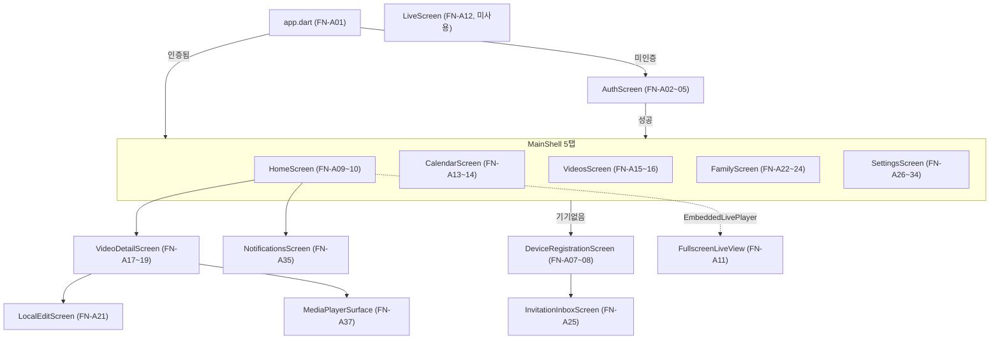

# 기능 명세서 (AI/코딩 에이전트용)

> 기준: 5979279 / 2026-07-27 / as-built
> 사람용 원본: [docs/human/03-기능명세서.md](../human/03-기능명세서.md)

ID 체계: `FN-` + 영역(A=앱/S=서버/E=엣지/H=하드웨어) + 연속번호. 앱37 + 서버25 + 엣지10 + 하드웨어4 = **76개**.

---

## 0. 경로 매핑 총람 (에이전트 필수 참조)

### 0.1 도메인 → 패키지 경로 (서버, `backend/server/src/main/java/com/wj/server/`)

| 도메인 | FN 범위 | API 범위 | 패키지 경로 |
|---|---|---|---|
| auth | FN-S01~S02 | API-01~06 | `auth/api/`, `auth/application/` |
| device | FN-S03~S06 | API-07~13 | `device/api/`, `device/application/` |
| invitation | FN-S07~S10 | API-14~24 | `invitation/api/`, `invitation/application/` |
| video | FN-S11~S15 | API-25~33 | `video/api/`, `video/application/` |
| stream·live | FN-S16~S17 | API-34~38 | `stream/api/`, `stream/application/` |
| subscription | FN-S18 | API-39~41 | `subscription/api/`, `subscription/application/` |
| home | FN-S19 | API-42 | `home/api/`, `home/application/` |
| iot | FN-S20~S22 | API-43~46 | `iot/auth/`, `iot/event/`, `device/api/IotRegistrationController.java` |
| provisioning | FN-S23 | API-47~49 | `provisioning/api/`, `provisioning/application/` |
| audit | FN-S24 | API-50 | `audit/api/`, `audit/application/` |
| MQTT 공통 | FN-S25 | MQTT-01~09 | `iot/mqtt/`, `iot/telemetry/`, `stream/application/StreamCommandPublisher.java`, `stream/application/StreamEventService.java`, `iot/event/DeviceEventService.java` |
| 공통 | - | - | `common/api/`, `common/web/`, `config/` |

### 0.2 화면 → dart 파일 경로 (`frontend/lib/`)

| 화면 파일 | FN 범위 |
|---|---|
| `app/app.dart` | FN-A01 |
| `ui/auth_screen.dart` | FN-A02~A05 |
| `ui/main_shell.dart` | FN-A06 |
| `ui/device_registration_screen.dart` | FN-A07~A08 |
| `ui/home_screen.dart`, `ui/live_screen.dart` | FN-A09~A12 |
| `ui/calendar_screen.dart`, `ui/extra_screens.dart`(AnniversaryEditorScreen) | FN-A13~A14 |
| `ui/videos_screen.dart` | FN-A15~A16 |
| `ui/video_detail_screen.dart`, `ui/local_edit_screen.dart` | FN-A17~A21 |
| `ui/family_screen.dart` | FN-A22~A24 |
| `ui/invitation_inbox_screen.dart` | FN-A25 |
| `ui/settings_screen.dart` | FN-A26~A34 |
| `ui/extra_screens.dart`(NotificationsScreen, LaughReportScreen) | FN-A35~A36 |
| `ui/media_player_surface.dart` | FN-A37 |
| `core/api_client.dart` | (전 화면 공용 API 호출 지점, 42개 메서드) |
| `core/banuba_video_editor.dart`, `core/portrait_video_canvas.dart` | FN-A21 보조 |
| `features/stt/`(pcm_wav, speech_analysis, android_audio, whisper_model, whisper_transcriber, caption_line, transcript_store, caption_controller, caption_auto_section) | FN-A39 |

### 0.3 엣지/하드웨어 경로

| 영역 | 경로 | FN 범위 |
|---|---|---|
| 기기 에이전트 | `ai/device_agent/wj_device_agent/` (agent.py, config.py, provision.py, stream.py, configure_media.py) | FN-E01~E05 |
| 등록 버튼(패키지 밖) | `ai/device_agent/registration_button.py`, `registration-button.sh` | FN-E02 |
| YAMNet 웃음감지 | `ai/yamnet/yamnet_laughter_detect_jetson.py`, `laughter_scoring.py`, `mqtt_event_publisher.py` | FN-E06 |
| 이벤트 업로드 | `ai/yolo/laughter_clip_uploader.py`, `ai/yolo/segment_clip_uploader.py` | FN-E07 |
| YOLO 추적 | `ai/yolo/yolov8_autoframe_jetson.py`, `ai/yolo/vision_mqtt_publisher.py` | FN-E08 |
| 이벤트 퓨전 | `ai/yolo/event_fusion_service.py` | FN-E09 |
| 라즈베리파이 프로토타입 | `ai/pi_homecam_dev/homecam-publisher.sh`, `mediamtx.yml` | FN-E10 |
| 팬틸트 CAD | `hardware/camera-pan-tilt/pan_tilt.scad`, `README.md`, `STL/*` | FN-H01 |
| 팬틸트 제어(미구현) | (코드 없음, 참고문서만: `hardware/camera-pan-tilt/README.md` §2~5, `ai/AI_EDGE_INTEGRATION_SPEC.md` §4.1) | FN-H02~H04 |

---

## 1. 앱 기능 (FN-A01~A37)

| ID | 기능 | 사용 API | 소스 파일(`frontend/lib/`) | 비고/에러코드 |
|---|---|---|---|---|
| FN-A01 | 앱진입/스플래시/딥링크 | (직접호출없음) | `app/app.dart`, `app/app_controller.dart` | `bbanggeut://membership-request/{token}` |
| FN-A02 | 로그인 | API-02 | `ui/auth_screen.dart` | 401 INVALID_CREDENTIALS, 429 LOGIN_RATE_LIMITED |
| FN-A03 | 회원가입 | API-01 | `ui/auth_screen.dart` | 409 EMAIL_ALREADY_EXISTS |
| FN-A04 | 소셜로그인 버튼(Apple/Google/카카오) | 없음 ❌ | `ui/auth_screen.dart:284-298` | 스낵바만, 양쪽 다 미구현 |
| FN-A05 | 비밀번호 찾기 | 없음 ❌ | `ui/auth_screen.dart:249-256` | 스낵바만, 양쪽 다 미구현 |
| FN-A06 | 하단 탭 내비/새로고침 | (하위 위임) | `ui/main_shell.dart` | `IndexedStack`+`RefreshIndicator` |
| FN-A07 | QR/코드 기기 등록 | API-08 | `ui/device_registration_screen.dart` | 429 CLAIM_RATE_LIMITED, 409 DEVICE_CLAIM_REJECTED |
| FN-A08 | 멤버십 요청 링크 생성/공유 | API-15, API-16 | `ui/device_registration_screen.dart`, `app/app_controller.dart` | 403 OWNER_MEMBERSHIP_REQUIRED, 404 MEMBERSHIP_REQUEST_NOT_FOUND |
| FN-A09 | 홈 요약 카드 | API-11, API-33, API-42, API-27(간접) | `ui/home_screen.dart` | homeSummary 실패는 best-effort 무시 |
| FN-A10 | 임베디드 라이브 미리보기(실사용) | API-35~38 | `ui/live_screen.dart`(EmbeddedLivePlayer), `ui/home_screen.dart` | 2초폴링, 20초 토큰재조회, 15초 하트비트 |
| FN-A11 | 전체화면 라이브 | (재사용, 신규호출없음) | `ui/live_screen.dart`(FullscreenLiveView) | 3초 후 컨트롤 자동숨김 |
| FN-A12 | 독립형 라이브 화면(미사용) | API-35~38(코드상) | `ui/live_screen.dart`(LiveScreen) | **도달 불가 코드** — 어디서도 push 안 됨 |
| FN-A13 | 월별 캘린더 영상조회 | API-27 | `ui/calendar_screen.dart` | - |
| FN-A14 | 기념일 배너/편집(미구현) | 없음 ❌ | `ui/calendar_screen.dart`, `ui/extra_screens.dart:193,296` | backend "anniversary" grep 0건 |
| FN-A15 | 영상 목록/필터/정렬/검색 | API-27(간접, 로컬필터) | `ui/videos_screen.dart` | - |
| FN-A16 | 영상 삭제 | API-30 | `ui/videos_screen.dart` | 403 FORBIDDEN_ROLE, 404 |
| FN-A17 | 영상 상세/재생 | API-31 | `ui/video_detail_screen.dart` | 409 VIDEO_NOT_READY, 503 |
| FN-A18 | 메타데이터(제목/메모) 편집 | API-29, API-28 | `ui/video_detail_screen.dart` | 403, 422 VALIDATION_FAILED |
| FN-A19 | 즐겨찾기 토글 | API-29 | `ui/video_detail_screen.dart`, `app/app_controller.dart` | - |
| FN-A20 | 영상 다운로드 | API-32 | `ui/video_detail_screen.dart` | 409, 503 |
| FN-A21 | 로컬 영상 편집 | API-32 | `ui/local_edit_screen.dart`, `core/video_exporter.dart`, `core/video_edit_state.dart`, `MainActivity.kt`(exportWithTrim) | ⚠️ 서버 재업로드 API 호출 미발견 |
| FN-A39 | 온디바이스 자동 자막 | 없음 | `features/stt/*`, `ui/local_edit_screen.dart`, `core/video_exporter.dart`, `SttChannel.kt`, `SubtitleOverlay.kt` | 오디오·전사문이 기기 밖으로 나가지 않음. 모델은 `assets/models/ggml-small-ko-q5_0.bin`(약 167MiB) — 앱이 첫 실행 때 파일로 복사. 자르기·자막·효과는 인코딩 1회에 함께 처리 |
| FN-A22 | 가족 목록/초대 | API-23, API-14, API-18 | `ui/family_screen.dart` | 403, 409(ALREADY_DEVICE_MEMBER/INVITATION_PENDING/EMAIL_MISMATCH) |
| FN-A23 | 보낸 초대 취소 | API-19 | `ui/family_screen.dart` | 403, 409 INVITATION_NOT_PENDING |
| FN-A24 | 소유권 이전/구성원 내보내기 | API-12, API-24 | `ui/family_screen.dart` | transfer는 `controller.api` 직접호출(래퍼 미사용); 409 ALREADY_OWNER/TRANSFER_TARGET_NOT_ACTIVE_MEMBER/OWNER_CANNOT_BE_REVOKED |
| FN-A25 | 받은 초대 수락/거절 | API-20, API-21, API-22 | `ui/invitation_inbox_screen.dart` | 404, 409 INVITATION_EXPIRED/NOT_PENDING |
| FN-A26 | 프로필 이름 수정(동작 불가) | API-06 🔴 | `ui/settings_screen.dart`, `core/api_client.dart:152-158` | 서버 매핑 없음(추정 404) |
| FN-A27 | 기기 이름/보관기간 변경 | API-10 | `ui/settings_screen.dart` | 422, 403 |
| FN-A28 | 알림 설정(로컬 전용) | 없음 | `ui/settings_screen.dart` | `flutter_secure_storage`만, 서버 미반영 |
| FN-A29 | 비밀번호 변경(미구현) | 없음 ❌ | `ui/settings_screen.dart:271-274` | 스낵바만 |
| FN-A30 | 구독(보관 플랜) 관리 | API-39, API-40, API-41 | `ui/settings_screen.dart` | 403, 409 SUBSCRIPTION_NOT_ACTIVE |
| FN-A31 | 접근 기록 조회 | API-50 | `ui/settings_screen.dart` | 422, 403 |
| FN-A32 | 로그아웃 | API-04 | `ui/settings_screen.dart`, `ui/device_registration_screen.dart` | - |
| FN-A33 | 회원 탈퇴 | API-05 | `ui/settings_screen.dart` | 409 OWNER_MEMBERSHIP_EXISTS |
| FN-A34 | 기기 해제 | API-13 | `ui/settings_screen.dart` | 403, 404 |
| FN-A35 | 알림 목록/읽음처리(로컬만) | 없음 | `ui/extra_screens.dart:46`(NotificationsScreen) | 서버 notification 테이블 없음 |
| FN-A36 | 웃음 리포트/웃음 잔디 | API-33, API-27(간접) | `ui/extra_screens.dart`(LaughReportScreen) | - |
| FN-A37 | 재생 공용 컴포넌트 | 없음(순수 UI) | `ui/media_player_surface.dart` | isLive 여부로 컨트롤 분기 |

검증: 화면 파일 13개(`auth_screen`,`calendar_screen`,`device_registration_screen`,`extra_screens`,`family_screen`,`home_screen`,`invitation_inbox_screen`,`live_screen`,`local_edit_screen`,`media_player_surface`,`settings_screen`,`videos_screen`,`video_detail_screen`) 전부 등장 + `main_shell.dart` 별도.

---

## 2. 서버 기능 (FN-S01~S25)

인증 3종(공통): ① 내부관리자키(`/internal/admin/**`) ② 기기credential Bearer(`/api/iot/**`) ③ 사용자JWT(그 외 전부) — 상세는 `04-api-spec.md` 1.2절.

| ID | 기능 | 관련 API/MQTT | 소스 파일(`backend/server/src/main/java/com/wj/server/`) | 규칙 요약 |
|---|---|---|---|---|
| FN-S01 | 회원가입/로그인/토큰갱신 | API-01,02,03 | `auth/api/AuthController.java`, `auth/application/AuthService.java`, `auth/application/LoginAttemptService.java` | 액세스15분/리프레시14일(rotate-on-use), sha256 저장, 로그인 5회/10분 레이트리밋 |
| FN-S02 | 로그아웃/탈퇴/프로필수정(부재) | API-04,05,06🔴 | `auth/api/AuthController.java`, `auth/application/AuthService.java` | 로그아웃=세션폐기(jwt.sid), 탈퇴 시 OWNER 기기 있으면 409; PATCH /me 매핑 자체 없음 |
| FN-S03 | 기기목록/단건조회 | API-07, API-09🔶 | `device/api/DeviceController.java`, `device/application/DeviceService.java` | API-09는 서버 구현·클라이언트 미사용(죽은 경로) |
| FN-S04 | 기기등록(claim) | API-08 | `device/api/DeviceController.java`, `device/application/ClaimAttemptService.java` | claim 5회/10분, DB 트리거로 활성 OWNER 1명 강제 |
| FN-S05 | 기기설정변경/상태조회 | API-10, API-11 | `device/api/DeviceController.java` | OWNER만 갱신, `recording`/`uploadQueueDepth`는 MQTT-05 스텁값 그대로 노출 |
| FN-S06 | 소유권이전/해제 | API-12, API-13 | `device/api/DeviceController.java` | 이전대상 ACTIVE 멤버 필요(409 ALREADY_OWNER), 해제 OWNER만 |
| FN-S07 | 초대발송/조회/취소 | API-14, API-18, API-19 | `invitation/api/InvitationController.java`, `invitation/application/InvitationService.java` | 유효기간 7일, 409 ALREADY_DEVICE_MEMBER/INVITATION_PENDING, 취소는 PENDING만 |
| FN-S08 | 멤버십 요청 링크 | API-15, API-16, API-17🔶 | `invitation/api/InvitationController.java`, `invitation/application/MembershipRequestService.java` | 요청자당 활성 1개, `/open`은 302 딥링크 리다이렉트(앱 미호출) |
| FN-S09 | 받은초대 조회/수락/거절 | API-20, API-21, API-22 | `invitation/api/InvitationController.java` | 만료 시 409 INVITATION_EXPIRED |
| FN-S10 | 구성원목록/추방 | API-23, API-24 | `invitation/api/InvitationController.java` | OWNER 추방불가(409 OWNER_CANNOT_BE_REVOKED) |
| FN-S11 | 영상업로드(기기측 presigned) | API-25, API-26 | `video/api/IotVideoController.java`, `video/application/IotVideoService.java` | `Idempotency-Key`=sourceEventId 필수 일치, 500MiB 초과 413, 업로드URL TTL 15분 |
| FN-S12 | 영상목록/상세조회 | API-27, API-28 | `video/api/VideoController.java`, `video/application/VideoQueryService.java` | size 1~100, `thumbnailUrl` 항상 null(⚠️ 미확인) |
| FN-S13 | 메타데이터수정/삭제 | API-29, API-30 | `video/application/VideoCommandService.java` | 수정 OWNER/EDITOR, 삭제 OWNER만(202 비동기) |
| FN-S14 | 재생/다운로드 URL발급 | API-31, API-32 | `video/application/VideoQueryService.java` | `READY` 아니면 409 VIDEO_NOT_READY, 읽기URL TTL 5분 |
| FN-S15 | 영상 통계 | API-33 | `video/api/VideoStatsController.java`, `video/application/VideoStatsService.java` | timeZone 검증 |
| FN-S16 | 라이브 재생 인가확인 | API-34🔶 | `stream/api/LiveIntrospectionController.java`, `stream/application/LiveTokenService.java` | 공개(permitAll), 호출주체 ⚠️미확인(MediaMTX 추정) |
| FN-S17 | 라이브 세션 생성/조회/종료/하트비트 | API-35,36,37,38 | `stream/api/StreamController.java`, `stream/application/StreamService.java`, `config/StreamProperties` | 오프라인 409 DEVICE_OFFLINE, 뷰어TTL45s/유휴60s/엣지lease120s/하트비트15s/토큰30s, MQTT-01 발행 |
| FN-S18 | 구독 조회/활성화/해지 | API-39,40,41 | `subscription/api/SubscriptionController.java`, `subscription/application/SubscriptionService.java` | 보관 365일, 해지유예 30일, OWNER만 |
| FN-S19 | 홈 요약 | API-42 | `home/api/HomeSummaryController.java`, `home/application/HomeSummaryService.java` | timeZone 검증 |
| FN-S20 | 등록코드 발급 | API-43 | `device/api/IotRegistrationController.java`, `device/application/RegistrationCodeService.java` | TTL 120초, sha256 해시만 저장, 재생성 최대 5회 |
| FN-S21 | 기기 자격증명 발급/회전 | API-44,45 | `iot/auth/DeviceCredentialController.java`, `provisioning/application/ProvisioningService.java` | BOOTSTRAP 15분/OPERATING 30일, 기기당 ACTIVE 1개 |
| FN-S22 | 이벤트 통계(미사용) | API-46🔶 | `iot/event/EventStatsController.java`, `iot/event/EventStatsService.java` | 서버는 정교히 구현, `LaughReportScreen`은 API-33만 사용 |
| FN-S23 | 내부관리자 기기 프로비저닝 | API-47,48,49🔶 | `provisioning/api/ProvisioningController.java`, `provisioning/application/ProvisioningService.java` | 인증실패 시 404로 위장, API-49 호출부 없음(운영자 직접) |
| FN-S24 | 접근 로그 조회 | API-50 | `audit/api/AccessLogController.java`, `audit/application/AccessLogQueryService.java` | OWNER만, size 1~100, 커서손상 422 INVALID_CURSOR |
| FN-S25 | MQTT 상태/명령/이벤트 채널(공통) | MQTT-01~09 | `iot/mqtt/PahoMqttGateway.java`, `iot/telemetry/MqttInboundHandler.java`, `stream/application/StreamCommandPublisher.java`, `stream/application/StreamEventService.java`, `iot/event/DeviceEventService.java` | 상세는 3절 MQTT 매핑표 참고 |

---

## 3. MQTT 토픽 ↔ 양쪽 처리 코드 경로 (필수 매핑, 15개)

| ID | 토픽(접미사) | 백엔드 처리 코드 | 엣지/AI 처리 코드 | 상태 |
|---|---|---|---|---|
| MQTT-01 | `.../commands` | 발행: `stream/application/StreamCommandPublisher.java`, `stream/application/StreamService.java`, `iot/mqtt/PahoMqttGateway.java` | 구독: `ai/device_agent/wj_device_agent/agent.py:103` | ✅(기기측 PING분기는 죽은코드) |
| MQTT-02 | `.../status` | 구독: `iot/telemetry/MqttInboundHandler.java:105-111` | 발행: `agent.py:71-76,92,104` | ⚠️ reason/occurredAt 무시 |
| MQTT-03 | `.../commands/ack` | 구독: `iot/telemetry/MqttInboundHandler.java`(commandAck()) | 발행: `agent.py:133,237-262` | ⚠️ errorCode 등 미사용 |
| MQTT-04 | `.../stream/events` | 구독: `iot/telemetry/MqttInboundHandler.java`(streamEvent()), `stream/application/StreamEventService.java` | 발행: `agent.py:264-285` | ⚠️ STREAM_STARTING 무시 |
| MQTT-05 | `.../heartbeat` | 구독: `iot/telemetry/MqttInboundHandler.java`(heartbeat()) | 발행: `agent.py:211-225` | ⚠️ recording/uploadQueueDepth 항상 스텁 |
| MQTT-06 | `.../registration` | 구독만: `iot/telemetry/MqttInboundHandler.java:90-103` | 발행 없음 | 🔶 HTTP(API-43)로 대체 |
| MQTT-07 | `.../events` | 구독만: `iot/telemetry/MqttInboundHandler.java`(detectionEvent()), `iot/event/DeviceEventService.java` | 발행 없음 | 🔶 HTTP(API-25/26)로 대체 |
| MQTT-08 | `$CONTROL/dynamic-security/v1` | 발행: `iot/mqtt/PahoMqttGateway.java` | (브로커 대상, 기기 무관) | 해당없음 |
| MQTT-09 | `$CONTROL/dynamic-security/v1/response` | 구독: `iot/mqtt/PahoMqttGateway.java` | (브로커 응답) | 해당없음 |
| MQTT-10 | `homecam/v2/{id}/ai/vision/state` | 미구독(grep 0건) | 발행: `ai/yolo/vision_mqtt_publisher.py:31`, `yolov8_autoframe_jetson.py:82-97` / 내부구독: `event_fusion_service.py` | 🔴 실험단계 |
| MQTT-11 | `homecam/v2/{id}/control/framing/target` | 미구독 | 발행: `ai/yolo/vision_mqtt_publisher.py:126-131` / 구독자 전무 | 🔴 실험단계·구독자 없음 |
| MQTT-12 | `homecam/v2/{id}/ai/vision/status` | 미구독 | 발행: `vision_mqtt_publisher.py:35,47-54,92-99` | 🔴 실험단계 |
| MQTT-13 | `homecam/v2/{id}/ai/laughter/detected` | 미구독 | 발행: `ai/yamnet/mqtt_event_publisher.py:36,113-154` / 내부구독: `event_fusion_service.py` | 🔴 실험단계 |
| MQTT-14 | `homecam/v2/{id}/ai/status` | 미구독 | 발행: `mqtt_event_publisher.py:38` | 🔴 실험단계 |
| MQTT-15 | `homecam/v2/{id}/events/memory-candidate` | 미구독 | 발행: `ai/yolo/event_fusion_service.py:67-120,170-243` | 🔴 실험단계 |

MQTT-10~15는 운영 배포 스크립트(`ai/yolo/run_edge_ai_mvp.sh`, `run_edge_ai_recording.sh`)가 `MQTT_HOST=`(빈 값)로 넘겨 코드 경로 자체가 비활성화됨 — `ai/yolo/run_ai_stack.sh`(로컬 수동검증)에서만 동작 확인.

---

## 4. 엣지 기능 (FN-E01~E10)

| ID | 기능 | 상태 | 관련 API/MQTT | 소스 파일 |
|---|---|---|---|---|
| FN-E01 | 기기 프로비저닝(enrollment/자격증명회전) | ✅ 운영 | API-44, API-45 | `ai/device_agent/wj_device_agent/provision.py`(`DeviceApi.enroll`/`rotate`) |
| FN-E02 | 등록코드 발급요청/표시 | ✅ 운영(⚠️ 물리LCD 아님, `print()`만) | API-43 | `ai/device_agent/registration_button.py`, `registration-button.sh`, `wj_device_agent/provision.py` |
| FN-E03 | 상태·하트비트 보고 | ⚠️ 일부 스텁 | MQTT-02, MQTT-05 | `ai/device_agent/wj_device_agent/agent.py:71-76,92,104,211-225` |
| FN-E04 | 원격 명령 수신/ACK | ✅ 운영(PING분기는 죽은코드) | MQTT-01, MQTT-03 | `agent.py:103,133,237-262` |
| FN-E05 | 라이브 스트림 송출(RTSPS) | ✅ 운영 | MQTT-04 | `ai/device_agent/wj_device_agent/stream.py`, `configure_media.py`, `config.py` |
| FN-E06 | 웃음(오디오) 감지 | ✅ 운영(임계값0.25/연속2윈도우) | (트리거→FN-E07) | `ai/yamnet/yamnet_laughter_detect_jetson.py`, `laughter_scoring.py` |
| FN-E07 | 이벤트 클립 업로드 | ✅ 운영(systemd Restart=always) | API-25, API-26 | `ai/yolo/laughter_clip_uploader.py`, `ai/yolo/segment_clip_uploader.py` |
| FN-E08 | YOLO 사람/반려동물 추적·프레이밍 계산 | 🔴 실험단계(운영 비활성) | MQTT-10, MQTT-11, MQTT-12 | `ai/yolo/yolov8_autoframe_jetson.py`, `ai/yolo/vision_mqtt_publisher.py` |
| FN-E09 | 이벤트 퓨전(웃음+비전) | 🔴 실험단계(운영 비활성) | MQTT-13, MQTT-14, MQTT-15 | `ai/yolo/event_fusion_service.py` |
| FN-E10 | 라즈베리파이 프로토타입 송출 | 🔴 실험단계(초기검증용) | 없음 | `ai/pi_homecam_dev/homecam-publisher.sh`, `mediamtx.yml` |

## 5. 하드웨어 기능 (FN-H01~H04)

| ID | 기능 | 연동 상태 | 관련 MQTT | 소스 |
|---|---|---|---|---|
| FN-H01 | 팬/틸트 기구 프레임(CAD) | ✅ 설계완료(3D프린트 산출물) | 없음 | `hardware/camera-pan-tilt/pan_tilt.scad`, `README.md` |
| FN-H02 | 서보 구동/PWM 제어 | 🔴 미구현 | 없음 | (구현 없음, 참고: `README.md` §2~3, `ai/AI_EDGE_INTEGRATION_SPEC.md` §4.1) |
| FN-H03 | YOLO→서보 목표값 전달 경로 | 🔴 발행만 존재, 구독자 전무 | MQTT-11 | `ai/yolo/vision_mqtt_publisher.py:126-131` |
| FN-H04 | 소프트 리밋/부팅 초기화 | 🔴 설계 의도만, 코드 미구현 | 없음 | (구현 없음, 참고: `README.md` §5, `drawing.html`) |

---

## 6. 검증

- 화면 13개 + `main_shell.dart` 전부 1절 표에 등장 확인.
- 서버 도메인 10개(auth/device/invitation/video/stream·live/subscription/home/iot/provisioning/audit) 전부 2절 표에 등장 확인.
- FN 총합: 앱37 + 서버25 + 엣지10 + 하드웨어4 = **76개**, 사람용 원본과 정확히 일치.

## 7. MVP 대상 FN (2026-07-27 확정, 시연 기준 — 상세는 `02-requirements.md` 우선순위 열)

- ①가입/로그인: A02,A03,S01 · ②기기등록: A07,S04,S20,S21,E01,E02 · ③라이브: A10,A11,A37,S16,S17,S25,E04,E05 · ④이벤트영상: E06,E07,S11(감지·업로드)+A15,S12(목록)+A17,A37,S14(재생) · ⑤편집: A21(로컬 기준) · ⑥다운로드: A20,S14,A21 · ⑦통계: A13,S12,A36,S15,S22(현행)+REQ-F-42 신규(FN 미정)
- 전제: A01,A06,S03,S05,E03. **여기 없는 FN은 전부 MVP 외(확장).**
