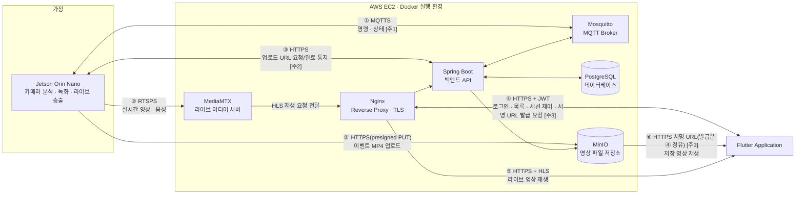

# 서비스 기획서

> 기준: 5979279 / 2026-07-27 / 구현 코드 기준(as-built)

본 문서는 추측 없이 코드와 설정에서 직접 확인된 사실만을 근거로 작성했다. 확인 불가 항목은 `⚠️ 미확인`으로 표시한다. 근거 문서: `docs/human/02-요구사항명세서.md`(REQ-F-01~42, REQ-NF-01~12), `docs/human/03-기능명세서.md`(FN-A/S/E/H 76개), `docs/human/04-API명세서.md`(API-01~50, MQTT-01~15), `ai/시스템_아키텍쳐.md`, `backend/BACKEND_STATUS.md`, `docs/superpowers/plans/2026-07-27-inventory/cross-check.md`.

---

## 1. 한 줄 정의

**엣지 AI가 분석하고, 필요할 때만 송출하는 프라이버시 우선 홈캠 서비스.**

집 안의 Jetson이 카메라·마이크를 상시 분석해 24시간 분량을 로컬에만 순환 녹화하고, 웃음처럼 의미 있는 순간만 서버에 클립으로 올리며, 실시간 영상은 사용자가 앱에서 명시적으로 요청한 경우에만 짧은 시간 동안만 송출된다.

---

## 2. 배경과 피봇 이력

이 저장소는 원래 "웃음 다이어리" 서비스로 시작했으나, **2026-07-21 홈캠으로 주제를 전환**했다(`backend/BACKEND_STATUS.md` 상단 공지). 전환 시점에 실시간 보기가 서비스의 주축이 되었고, 웃음·호출·터치 이벤트 자동 저장은 부가 기능으로 재배치됐다.

피봇 과정에서 인증·기기·영상·라이브·구독 등 기존 백엔드 도메인은 그대로 재사용됐고, 홈캠 대시보드를 위해 다음 두 가지만 신규 추가됐다.

- 기기 상태에 감지 인원 `personCount` 추가(edge heartbeat → `GET /api/devices/{deviceId}/status`)
- 홈 화면 "오늘의 순간 요약"을 위한 `GET /api/devices/{deviceId}/home-summary`(API-42, FN-S19)

인물 탐지·중심 계산·자동 추적(팬틸트)은 피봇 이전과 마찬가지로 AIoT/엣지 범위로 분리되어 있으며, 서버 계약에는 포함되지 않는다(`backend/BACKEND_STATUS.md` 상단 공지, REQ-F-38 참고). `BACKEND_STATUS.md`는 2026-07-20 작성 기준 문서로, 초대 흐름을 "가입 요청 제출 → OWNER 승인" 방식으로 서술하고 있으나, 이후 확정된 as-built 구현(`03/04-*.md`, 2026-07-27 기준)은 "OWNER의 정식 초대 발송 → 초대받은 사용자의 수락"으로 동작한다(6절 역할 모델 참고). 본 문서는 후자를 기준으로 기술한다.

---

## 3. 타겟 사용자와 핵심 시나리오

**타겟 사용자**: 집에 아이나 반려동물, 노인 등 지켜볼 대상이 있어 홈캠을 두되, 영상이 서버에 상시 전송·저장되는 것은 원치 않는 가족 단위 사용자. 여러 명(OWNER·가족 구성원)이 하나의 기기를 함께 보되 권한은 나누어 갖고 싶은 경우를 상정한다.

### 시나리오 ① 기기 등록

1. 기기가 등록 버튼 입력(또는 등록 모드 진입) 시 서버에 등록 코드 발급을 요청한다(API-43, FN-S20, FN-E02). 서버는 Crockford 32자셋 8자리 코드를 생성해 **SHA-256 해시로만 DB에 저장**하고 평문은 응답에만 담아 즉시 폐기하며, TTL 120초·1회용으로 관리한다(FN-S20, REQ-NF-03).
2. 기기는 발급받은 코드를 화면에 표시한다(FN-E02). ⚠️ **미확인**: README는 "LCD 표시"라고 안내하지만, 저장소에서 확인되는 실제 동작은 표준출력(`print()`)뿐이며 물리 LCD 디스플레이를 구동하는 코드는 어디에도 없다.
3. 사용자는 앱에서 QR 코드를 스캔하거나 8자리 코드를 직접 입력한다(FN-A07).
4. 앱이 코드를 서버에 제출하면(API-08, FN-S04) 서버는 해시 역조회로 대상 기기를 특정해 claim을 처리한다. claim 시도는 계정·IP당 **5회/10분** 레이트리밋이 적용된다(REQ-F-10, REQ-NF-05).
5. claim이 성공하면 해당 사용자에게 **OWNER 멤버십**이 생성된다(FN-S04). DB 트리거가 "claim된 기기는 활성 OWNER 정확히 1명"을 강제한다.
6. 등록된 기기는 홈 화면 요약과 기기 목록에 온라인/오프라인 상태와 함께 노출된다(FN-A09, API-11, API-42).

### 시나리오 ② 실시간 보기

1. 사용자가 홈 화면의 라이브 카드(또는 전체화면)를 연다(FN-A10/FN-A11).
2. 앱이 서버에 뷰어 세션 생성을 요청한다(API-35, FN-S17). 기기가 오프라인이면 409 `DEVICE_OFFLINE`으로 거부된다.
3. 서버는 사용자·기기 권한을 확인한 뒤 MQTT `commands` 토픽으로 `START_STREAM` 명령을 발행한다(MQTT-01, FN-S25).
4. 기기(device_agent)가 명령을 수신·ACK하고(FN-E04), ffmpeg로 카메라 입력을 RTSPS로 MediaMTX에 송출을 시작한다(FN-E05).
5. 앱은 2초 간격으로 세션 상태를 폴링한다(API-36, FN-A10). 상태가 `READY`가 되면 서버가 발급한 HLS 재생 주소(`playUrl`)로 재생을 시작한다.
6. 재생 토큰(live JWT)은 **TTL 30초**이며, 앱은 만료 전 **20초 주기**로 선제적으로 재조회해 갱신한다(FN-A10, REQ-NF-12).
7. 앱은 하트비트를 주기 호출해 세션을 유지한다(API-38, 기본 15초 주기). 유휴 60초, 뷰어 세션 만료 45초, 기기측 하드 만료(edge lease) 120초를 넘기면 서버 또는 기기가 자동으로 송출을 종료한다(REQ-NF-07).
8. 사용자가 화면을 벗어나면 앱이 세션 종료를 요청하고(API-37), 서버는 MQTT `commands`로 `STOP_STREAM`을 발행해 기기 송출을 중단시킨다(FN-S17).

> 참고: 동일 로직을 가진 독립형 화면 `LiveScreen`(FN-A12)이 코드상 존재하지만 실제로는 어디서도 호출되지 않는 도달 불가 코드이며, 실사용 경로는 `EmbeddedLivePlayer`(FN-A10)다.

### 시나리오 ③ 이벤트 알림·다시보기

1. Jetson이 YAMNet(TFLite)으로 오디오를 상시 분석하다가 웃음 관련 점수가 임계값(0.25) 이상으로 연속 2윈도우 유지되면 트리거한다(FN-E06).
2. 트리거 시점 전후 구간을 mp4 클립으로 생성한다(FN-E07).
3. 기기가 기기 credential로 서버에 업로드 URL 발급을 요청하고(API-25, FN-S11), 발급받은 presigned URL로 MinIO에 **직접 PUT** 업로드한 뒤, 업로드 완료를 서버에 통지한다(API-26). 이 왕복에는 `Idempotency-Key`(sourceEventId와 일치) 검증이 적용된다.
4. 사용자는 앱의 캘린더 또는 추억(영상) 목록에서 날짜별·트리거 타입별로 저장된 클립을 확인한다(FN-A13/FN-A15, API-27, FN-S12).
5. 영상 상세 화면에 진입해 상태가 `READY`인 영상을 재생한다 — 서버가 발급한 재생용 서명 URL(TTL 5분)로 재생하며(API-31, FN-A17, FN-S14), 실제 재생 UI는 공용 컴포넌트(FN-A37)를 사용한다.

> **주의(운영 vs 실험)**: 위 흐름은 전부 HTTP 기반이며, MQTT로 감지 이벤트를 전달하는 경로(`events`, MQTT-07)는 서버 핸들러가 구현돼 있음에도 기기가 발행하지 않는 죽은 구독이다(FN-S25). YOLO 기반 인물/반려동물 인식과 웃음+비전 컨텍스트 퓨전을 묶는 `homecam/v2` MQTT 파이프라인(FN-E08·FN-E09, MQTT-10~15)은 코드는 완성되어 있으나 운영 배포 스크립트가 MQTT 연결 자체를 비활성화(`MQTT_HOST=` 빈 값)해 두어 **실험 단계**이며 as-built 운영 경로에는 포함되지 않는다.

---

## 4. 핵심 가치 & 차별점

- **서버가 상시 영상·오디오를 수신하지 않는다.** AI 분석(웃음 감지, YAMNet)은 기기(엣지) 내부에서 수행되고, 트리거를 넘긴 순간의 클립만 서버로 올라간다(REQ-NF-06).
- **24시간 순환 녹화는 전적으로 로컬(Jetson)에서만 이루어진다.** 서버에는 보관 대상 이벤트 클립과 사용자가 요청한 라이브 영상만 전달된다.
- **실시간 영상은 요청 기반으로만 송출된다.** 사용자가 명시적으로 뷰어 세션을 생성해야 송출이 시작되고, 세션 종료·유휴 타임아웃·하드 만료 중 어느 하나라도 도달하면 자동으로 끊긴다(REQ-NF-07).
- **모든 파일 접근은 짧은 만료의 서명 URL/토큰으로 제한된다.** 등록 코드(120초), 라이브 토큰(30초), 업로드 URL(15분), 재생 URL(5분) 등 전 구간에서 장기 유효 자격을 두지 않는다.
- **명령과 미디어 경로를 분리한다.** MQTT는 짧은 제어 메시지(시작/종료 명령, 상태)만 전달하고, 실제 영상은 RTSPS(기기→미디어서버)와 HLS(미디어서버→앱)로만 흐른다.

---

## 5. 시스템 아키텍처 개요

아래는 `ai/시스템_아키텍쳐.md` 2절의 mermaid 원본을 as-built 기준으로 인용한 것이다. 원본과 다르게 수정한 부분은 각주로 표시했다.

**수정 각주**

- **[주1]** 원본 라벨은 "명령·상태·이벤트"였으나 "이벤트"를 제외했다. MQTT `events`/`registration` 토픽(MQTT-06/07)은 서버 핸들러가 완비되어 있지만 기기가 이 토픽으로 발행하는 코드가 저장소 어디에도 없는 **죽은 구독**이다(FN-S25, `cross-check.md` 2.1절 #6~7). 감지 이벤트 통지는 이 MQTT 경로가 아니라 아래 [주2] HTTP 업로드 흐름으로만 이루어진다.
- **[주2]** 원본은 "Jetson → MinIO, HTTPS, 이벤트 MP4 업로드" 화살표 하나였다. 실제로는 3단계다 — ⓐ 기기가 Spring Boot에 업로드 URL 발급을 요청(API-25)하고, ⓑ 발급받은 presigned URL로 MinIO에 직접 PUT하며, ⓒ 업로드 완료를 다시 Spring Boot에 통지(API-26)한다(FN-S11). "MinIO 직접 업로드"처럼 보이는 실제 파일 전송(ⓑ)은 그대로 유지하되, 백엔드를 경유하는 발급/완료 통지 왕복(ⓐⓒ)을 별도 화살표(③)로 추가했다.
- **[주3]** 원본은 "MinIO → 앱, HTTPS 서명 URL, 저장 영상 재생" 화살표 하나였다. 실제로는 앱이 먼저 Spring Boot에 재생/다운로드 서명 URL 발급을 요청해야 한다(재생 API-31/FN-S14, 다운로드 API-32/FN-S14). 이 요청은 이미 존재하는 ④(앱↔Spring Boot) 화살표에 포함되는 것이라 별도 화살표를 추가하지 않고 라벨에만 명시했다 — 앱이 인증 없이 MinIO에 직접 접근하는 경로는 없다.
- **참고(변경 없음)**: 문서 12절은 "현재 device_agent 배포 문서와 설정에는 테스트용 SSH 터널과 운영 Bearer 토큰 방식이 남아 있다"고 서술하지만, 이는 2026-07-20 시점 배포 문서 기준이다. as-built 코드 확인(FN-E05, `ai/device_agent/wj_device_agent/stream.py`) 결과 RTSPS 직접 송출은 실제로 구현·운영 중임이 확인되어 위 그림을 그대로 유지했다.
- **참고(하드웨어)**: 문서 3.2절 "Raspberry Pi가 LCD에 상태를 표시한다"는 서술은 등록 코드 화면 표시(FN-E02)에 대응하나, 실제 구현은 표준출력(`print()`)뿐이고 물리 LCD 구동 코드는 확인되지 않는다(⚠️ 미확인).

---

## 6. 역할 모델

기기 단위로 3개 역할이 존재한다. DB에는 원래 OWNER/MEMBER 2단계였으나, Flyway 마이그레이션으로 **MEMBER가 EDITOR로 이름이 바뀌고(V21 `ALTER TYPE device_role RENAME VALUE 'MEMBER' TO 'EDITOR'`) VIEWER가 추가됐다(V22 `ADD VALUE 'VIEWER'`, V23에서 기본값·제약조건 정리)**. 현재 유효한 역할은 **OWNER / EDITOR / VIEWER** 3종이다(`docs/human/03-기능명세서.md`, `docs/human/04-API명세서.md` 확인).

- **OWNER**: 기기를 최초로 claim한 사용자에게 자동 부여된다(FN-S04). 기기당 활성 OWNER는 정확히 1명으로 DB 트리거가 강제한다. 기기 설정 변경(FN-A27), 구성원 초대(FN-A22)·추방(FN-A24)·소유권 이전(FN-A24), 영상 삭제(FN-A16), 구독 관리(FN-A30), 접근 기록 조회(FN-A31), 기기 해제(FN-A34)는 OWNER만 가능하다.
- **EDITOR**: 영상 메타데이터(제목/메모) 수정과 즐겨찾기 토글이 가능하다(FN-A18/FN-A19, REQ-F-23/24). 초대 시 역할로 지정 가능(REQ-F-28).
- **VIEWER**: 조회 중심 권한(영상 목록/재생, 실시간 시청 등)만 가지며, 메타데이터 수정·삭제·기기 설정 변경은 불가하다.

**가입은 초대 승인제로만 이루어진다** — 링크만으로 자동 가입되는 경로는 없다.

1. OWNER가 이메일과 역할(EDITOR/VIEWER)을 지정해 정식 초대를 발송한다(FN-A22, API-14). 이미 구성원이면 409 `ALREADY_DEVICE_MEMBER`, 동일 대상 PENDING 초대가 있으면 409 `INVITATION_PENDING`.
2. 초대받은 사용자는 받은 초대함에서 목록을 확인하고 수락 또는 거절한다(FN-A25, API-20~22). 초대 유효기간은 7일이며, 만료 후 수락 시도는 409 `INVITATION_EXPIRED`.
3. 수락 시점에만 실제 멤버십(가족 구성원)이 생성된다.
4. 외부인이 "내 계정으로 초대해달라"는 멤버십 요청 링크를 만들어 공유할 수도 있다(FN-A08, API-15/16). 다만 이 링크는 요청자 정보를 OWNER에게 미리보기로 보여주고 초대 폼에 이메일을 자동으로 채워줄 뿐, **그 자체로 멤버십을 생성하지 않는다** — OWNER가 위 1~2단계의 정식 초대 절차를 별도로 밟아야 한다.

소유권 이전은 OWNER가 같은 기기의 활성(ACTIVE) 구성원 1명을 지정해 수행하며, 강등(전 OWNER→EDITOR 등)과 승격을 한 트랜잭션으로 처리한다(FN-A24, API-12, FN-S06). 영상·구성원·구독 데이터는 그대로 유지된다. OWNER는 구성원을 강제로 내보낼 수 있으나 자기 자신은 추방 대상에서 제외된다(FN-A24, API-24, 409 `OWNER_CANNOT_BE_REVOKED`).

---

## 7. 현재 구현 상태 요약

`docs/human/02-요구사항명세서.md`의 REQ-F 판정을 영역별로 집계했다(REQ-F-01~42 총 42건 — REQ-F-42는 MVP 확정에 따른 신규 계획 항목).

| 영역 | 완료(✅) | 부분(🔶) | 미구현(❌) | 완성도 | 비고 |
|---|---:|---:|---:|---|---|
| 인증 | 6 | 0 | 4 | 부분 | 소셜 로그인·비밀번호 찾기/변경·프로필 수정 4개는 프런트·백엔드 모두(또는 백엔드만) 없음 |
| 기기 등록/관리 | 7 | 0 | 0 | 완료 | 등록 코드 claim, 소유권 이전/해제 전부 구현. 단 기기 상태의 `recording`/`uploadQueueDepth`는 항상 스텁 값 |
| 홈/실시간 시청 | 2 | 0 | 0 | 완료 | 세션 생성부터 RTSPS→HLS 재생, heartbeat/만료까지 전 구간 구현 확인 |
| 캘린더 | 1 | 0 | 1 | 부분 | 월별 영상 조회는 구현, 기념일 등록/수정은 서버 부재로 미구현 |
| 영상 관리 | 6 | 1 | 0 | 대부분 완료 | 목록/재생/메타편집/삭제/다운로드 구현. 로컬 편집(Banuba) 결과의 서버 재업로드 여부만 미확인 |
| 가족 구성원 | 4 | 0 | 0 | 완료 | 초대 발송/수락/취소, 구성원 추방 전부 구현 |
| 설정 | 2 | 1 | 0 | 대부분 완료 | 구독·접근기록 구현, 알림 설정은 로컬 저장만 되고 서버 미반영 |
| 알림/통계 | 1 | 1 | 0 | 대부분 완료 | 웃음 통계(API-33)는 구현, 알림 "모두 읽음"은 로컬 상태만 변경 |
| 이벤트 자동 저장 | 1 | 0 | 0 | 완료 | YAMNet 트리거→HTTP 업로드까지 운영 중 |
| 하드웨어/엣지 실험 | 0 | 2 | 1 | 실험 단계 | 팬틸트 자동 추적 미구현, YOLO/이벤트 퓨전 코드는 완성됐으나 운영 비활성, 라즈베리파이 프로토타입은 초기 검증용 |

**합계**: 완료 30건, 부분 5건, 미구현 7건 (총 42건, REQ-F-01~42와 일치 — 미구현 7건에는 신규 계획 REQ-F-42 포함).

비기능(REQ-NF-01~12) 12건은 전부 코드·설정에서 직접 확인됐다 — 전 구간 TLS, JWT/리프레시 로테이션, 해시 저장, 기기 credential 2단계 분리, 로그인/claim 레이트리밋, 엣지 전용 웃음 감지, 요청 기반 라이브 송출, 일일 백업·헬스체크·CI/CD, H.264/AAC+HLS 미디어 스펙까지 전부 운영 중임을 확인했다(`docs/human/02-요구사항명세서.md` 2절).

## 8. MVP 정의 (2026-07-27 확정, 시연 기준)

시연을 기준으로 아래 7항목을 MVP로 확정했다. 요구사항 우선순위 체계(`02-요구사항명세서.md`)도 이 기준으로 재정의되어 있다(**MVP / MVP(전제) / 확장**).

| # | MVP 항목 | 관련 요구사항 | 현재 상태 | 시연 관점 비고 |
|---|---|---|---|---|
| 1 | 회원가입 / 로그인 | REQ-F-01, REQ-F-02 | ✅ 구현 | 세션 유지(REQ-F-03)가 전제 |
| 2 | 기기 등록 | REQ-F-10 | ✅ 구현 | QR/8자리 코드 claim. 기기 목록·상태(REQ-F-12)가 전제 |
| 3 | 홈에서 라이브 스트리밍 시청 | REQ-F-18 | ✅ 구현 | `EmbeddedLivePlayer` 카드 + 전체화면 |
| 4 | 이벤트 감지 영상 확인 | REQ-F-37(감지·자동 저장), REQ-F-21(목록), REQ-F-22(재생) | ✅ 구현 | YAMNet 웃음 감지 → 자동 업로드 → 목록/재생 |
| 5 | 4의 영상 편집 | REQ-F-27 | 🔶 부분(MVP 기준 충족) | **판정 기준: 로컬 편집 + 기기 저장이면 충족** — Banuba 편집(Android)이 이를 만족. 서버 재업로드는 MVP 불요 |
| 6 | 편집된 영상 다운로드 | REQ-F-26, REQ-F-27(로컬 저장) | ✅ 구현 | 편집본은 기기 저장으로 충족, 원본은 API-32 다운로드 |
| 7 | 4 기반 통계 / 리포트 | REQ-F-19(캘린더 집계), REQ-F-36(웃음 통계) + **REQ-F-42(신규)** | ✅ 현행 충족 + ❌ 신규 개발 | **판정 기준: 현행 캘린더 집계·웃음 통계로 시연 충족.** 이벤트 영상 기반 전용 리포트 화면(REQ-F-42)은 신규 개발 항목 |

- **MVP(전제)**: REQ-F-03(세션 유지), REQ-F-12(기기 목록/상태), REQ-F-41(탭 셸) — 7항목에 직접 명시되진 않았지만 시연 동선에 필수.
- **MVP 외(확장)**: 초대/구성원 관리, 구독, 소유권 이전·기기 해제, 접근 기록, 알림, 기념일, 팬틸트·엣지 실험 기능 등 나머지 전부 — 기능·문서는 유지하되 시연 범위에서 제외.
- **시연 리스크**: ⑤ Banuba 편집은 Android 전용이며 라이선스 토큰 필요. ⑦ REQ-F-42는 미구현이므로 시연 시점까지 미완성이면 캘린더·통계 화면으로 대체 설명.
