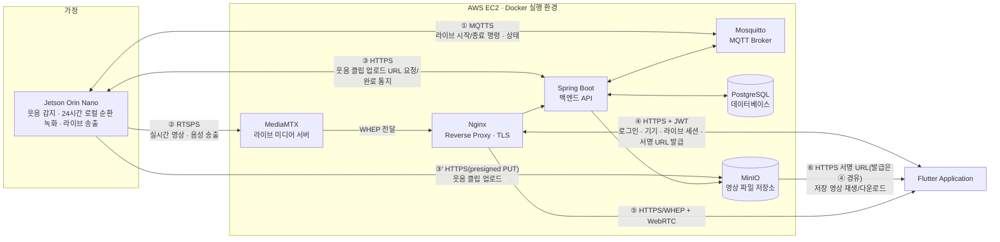

# 서비스 기획서

> 기준: to-be 기획(MVP 2026-07-27 확정) · 코드 현황 참조 커밋 cb65eff

---

## 1. 서비스 한 줄 정의

**기본은 실시간 스트리밍이 가능한 홈캠이지만, 일반 가정의 웃긴 순간을 젯슨(엣지 AI)이 자동 포착하고, 폰에서 편집해 추억으로 만드는 홈캠.**

집 안의 Jetson이 카메라·마이크를 상시 분석하지만 영상을 서버로 흘려보내지 않는다. 24시간 분량은 로컬에서만 순환 녹화되고, 웃음소리가 감지된 순간만 짧은 클립으로 서버에 올라간다. 실시간 영상은 사용자가 앱에서 명시적으로 요청했을 때만, 그 요청이 유지되는 동안만 송출된다.

---

## 2. 배경

이 저장소는 원래 "웃음 다이어리" 서비스로 시작했으나, **2026-07-21 홈캠으로 주제를 전환**했다. 전환 이후 실시간 보기가 서비스의 축 하나가 되었고, 웃음 감지 자동 저장이 다른 한 축으로 자리잡았다.

**2026-07-27, 시연을 기준으로 MVP 7단계를 확정**했다. 인증·기기·영상·라이브 등 기존 도메인은 그대로 활용하고, 여기에 이벤트(웃음) 감지 영상을 토대로 한 전용 리포트 화면을 신규 기획 항목으로 추가한다. 이 문서는 확정된 MVP 7단계를 뼈대로 서비스 전체를 다시 정리한 목표(to-be) 기획서다.

---

## 3. 타겟 사용자

**일반 가정**을 대상으로 한다. 반려동물, 노인, 영유아 등 특정 돌봄 대상에 특화된 서비스가 아니다 — 집을 비운 사이의 상황을 확인하고, 그 사이 있었던 웃긴 순간을 놓치지 않고 싶은 가정이면 누구나 대상이다.

**페르소나 ① 맞벌이 2인 가구**
낮 시간 집을 비우는 직장인 부부. 퇴근 후 저녁에 그날 있었던 재미있는 순간(웃음 클립)만 골라서 훑어보고, 필요할 때만 라이브로 집 안을 확인한다. 마음에 드는 클립은 간단히 편집해 가족 채팅방에 공유한다.

**페르소나 ② 다인 가구**
부모와 자녀 등 여러 명이 한 집에 사는 가정. 기기를 등록한 사람(OWNER)이 나머지 가족을 구성원(MEMBER)으로 초대해, 다 같이 같은 홈캠을 본다.

---

## 4. 핵심 가치 & 차별점

- **서버가 영상·오디오를 상시 수신하지 않는다.** 웃음 감지 분석은 Jetson(엣지)에서 수행되고, 감지된 순간의 클립만 서버로 올라간다.
- **24시간 순환 녹화는 전적으로 로컬(Jetson)에서만 이루어진다.** 서버에는 보관 대상 이벤트 클립과 사용자가 요청한 라이브 영상만 전달된다.
- **실시간 영상은 요청 기반으로만 송출된다.** 사용자가 명시적으로 시청을 시작해야 송출되고, 화면을 벗어나거나 일정 시간 응답이 없으면 자동으로 끊긴다.
- **자동 포착 → 폰에서 편집 → 추억으로 남기는 루프가 핵심 경험이다.** 엣지가 순간을 놓치지 않고 잡아내면, 사람은 폰에서 다듬어 공유하는 부분만 담당한다.
- **명령과 영상 경로를 분리한다.** 기기 제어(시작/종료 명령, 상태 보고)는 MQTT로만 짧게 오가고, 실제 영상은 라이브(RTSPS→WebRTC/WHEP)와 클립 업로드(HTTPS presigned) 경로로만 흐른다.

---

## 5. MVP 7단계

시연을 기준으로 확정된 7단계다. 각 단계는 젯슨(엣지)·서버·폰(앱) 세 축의 역할 분담으로 이루어진다: **젯슨**은 감지·클립 생성·업로드·라이브 송출, **서버**는 인증·기기·클립 저장/전달·라이브 중계, **폰**은 시청과 앱 자체 수동 편집·갤러리 저장을 담당한다.

### ① 회원가입 / 로그인

사용자는 이메일과 비밀번호만으로 계정을 만들고 로그인한다.

- 폰에서 이메일/비밀번호를 입력하면 서버가 계정을 생성하거나 인증하고 JWT(액세스+리프레시)를 발급한다. 젯슨은 관여하지 않는다.
- 로그인 세션은 앱 재실행 시에도 유지되며, 사용자는 언제든 로그아웃하거나(소유 기기가 없을 때) 회원 탈퇴할 수 있다.
- 관련 ID: REQ-F-01, REQ-F-02(, 전제 REQ-F-03 세션 유지, REQ-F-04 로그아웃, REQ-F-05 회원 탈퇴) / FN-A02, FN-A03, FN-S01(, FN-A32/FN-A33/FN-S02) / API-01, API-02(, API-04, API-05)

### ② 기기 등록

사용자는 새 Jetson 기기를 8자리 코드로 자신의 계정에 등록한다.

- 젯슨이 서버에 등록 코드 발급을 요청해 화면에 표시한다.
- 폰이 8자리 코드를 직접 입력해 서버에 제출하면, 서버가 코드를 검증해 해당 기기를 사용자 계정에 연결(claim)한다. 이때 사용자에게 OWNER 권한이 부여된다.
- 등록된 기기는 이후 이름 변경 등을 OWNER가 관리할 수 있다.
- 관련 ID: REQ-F-10(, 전제 REQ-F-12 기기 목록/상태, REQ-F-13 기기 이름·보관기간 변경) / FN-A07, FN-S04, FN-S20, FN-S21, FN-E01, FN-E02(, FN-A27, FN-S05) / API-08(claim), API-43(코드 발급)(, API-10)

### ③ 홈에서 라이브 스트리밍 시청

사용자는 홈 화면의 라이브 카드를 탭해 재생을 시작하고, 필요하면 전체화면으로 전환한다.

- 폰에서 라이브 카드를 탭하면 서버에 시청 세션 생성을 요청하고, 서버가 젯슨에 MQTT로 송출 시작 명령을 보낸다.
- 젯슨이 명령을 수신·응답하고 카메라 영상을 실시간으로 송출하기 시작한다.
- 서버가 중계한 영상을 폰이 홈 화면 카드에서 재생하고, 연결 후 컨트롤바의 전체화면 버튼으로 전환한다. 시청을 마치면 폰이 종료를 요청하고, 서버가 젯슨에 송출 종료 명령을 보낸다.
- 관련 ID: REQ-F-18 / FN-A10, FN-A11, FN-A37, FN-S16, FN-S17, FN-S25, FN-E04, FN-E05 / API-35~38, MQTT-01(명령), MQTT-04(상태)

### ④ 이벤트(웃음) 감지 영상 확인

사용자는 집에 없는 사이 감지된 웃음 순간을 앱에서 목록으로 확인하고 재생한다.

- 젯슨이 오디오를 분석해 웃음소리를 감지하면 전후 구간을 클립으로 만들고, 서버를 거쳐 저장소에 자동 업로드한다.
- 사용자는 폰의 캘린더 또는 추억(영상) 목록에서 날짜별로 저장된 클립을 확인한다.
- 상세 화면에서 클립을 재생한다.
- 관련 ID: REQ-F-37(감지·저장), REQ-F-21(목록), REQ-F-22(재생) / FN-E06, FN-E07, FN-S11(감지·업로드), FN-A15, FN-S12(목록), FN-A17, FN-A37, FN-S14(재생) / API-25, API-26(업로드), API-27(목록), API-31(재생)

### ⑤ 영상 편집

사용자는 확인한 웃음 클립을 폰에서 직접 편집한다.

- 폰이 저장된 원본을 내려받아, 앱 자체 편집 화면에서 자르기·화면 비율·음량·자막·필터·이모지 스티커 수동 편집을 진행한다. 자동 하이라이트나 AI 보정 없이 사용자가 직접 편집하는 방식이다.
- 자동 자막은 폰 안에서 ML Kit 음성 인식이 만든다 — 오디오도 전사문도 기기를 떠나지 않는다(2분 영상 실측 약 18초). 사용자는 줄마다 고칠 수 있다.
- 같은 화면에서 그 전사문으로 4컷 만화도 만든다. 폰이 올리는 것은 전사한 글뿐이고, 서버가 저장해 둔 원본에서 프레임 4~6장을 뽑아 Gemini(구글)로 보낸다.
- 편집 결과는 폰에 로컬로 저장된다.
- 관련 ID: REQ-F-27 / FN-A21, FN-A39, FN-A40 / 편집·자막은 폰 완결·서버 API 불요(원본 다운로드는 API-32 활용). 4컷 만화만 서버 AI를 쓴다 — 전사문(글)을 보내고 서버가 원본에서 프레임을 뽑아 Gemini(구글)에 전달한다(API-71·API-72, 제안·미구현). **개인정보 고지 대상**

### ⑥ 편집 영상 다운로드

사용자는 편집된 영상을 갤러리에 저장한다.

- 폰이 편집 결과를 기기 갤러리(로컬)에 저장한다.
- 갤러리에 저장된 영상은 폰의 다른 앱에서 공유할 수 있다(앱 안에 별도 공유 기능은 없다). 원본 클립이 필요하면 서버에서 별도로 다운로드한다.
- 관련 ID: REQ-F-26, REQ-F-27(로컬 저장) / FN-A20, FN-S14, FN-A21 / API-32(원본 다운로드), 편집본은 로컬 저장+공유

### ⑦ 통계 / 리포트

사용자는 웃음 감지 데이터를 기반으로 한 통계와 리포트를 확인한다.

- 현행: 캘린더에서 날짜별 영상 개수를 확인하고, 웃음 리포트에서 이번 주 웃음 복주머니와 요일별 웃음 횟수를 본다.
- 구현: Flutter 웃음 리포트 화면은 기존 영상 목록에서 `triggerType=LAUGHTER` 영상을 골라 이번 주와 지난주의 횟수를 단말에서 집계한다.
- 구현: 웃음 리포트는 가장 많이 웃은 요일, 가족 공유 수, 요일별 웃음복과 한 줄 요약을 표시한다.
- 확장 목표: 월간 웃음 횟수, 시간대별 분포, 베스트 클립을 서버에서 집계하는 API-62은 제안·미구현 상태다.
- 관련 ID: REQ-F-19(캘린더), REQ-F-36(웃음 통계), REQ-F-42(리포트) / FN-A13, FN-S12(캘린더), FN-A36, FN-S15, FN-S22(웃음 통계), FN-A38(Flutter 리포트 화면), FN-S26(서버 집계 제안) / API-27(캘린더 집계), API-33(웃음 통계), API-62(제안·미구현)

### 추억 금고와 기기 교체

서비스에서 추억의 주인은 홈캠 기기가 아니라 **추억 금고(Memory Vault)**다. 가족 권한, 구독, 저장 영상은 금고에 남고 홈캠은 그 금고에 현재 연결된 촬영 장치로 취급한다.

- 처음 기기를 등록하면 서버가 새 금고를 만들고 등록한 사람을 OWNER로 지정한다.
- 기존 금고에 새 기기를 연결할 때는 해당 금고를 선택한다. OWNER만 연결할 수 있다.
- 기기를 해제해도 금고, 가족 구성원, 구독, 과거 영상은 그대로 남는다. 기기만 연결 목록에서 사라진다.
- 중고로 넘긴 같은 기기가 다른 계정에 등록되면 새로운 연결 이력이 생긴다. 새 사용자는 예전 금고와 영상을 볼 수 없다.
- 앱은 로그인 후 항상 5개 탭 홈으로 진입한다. 금고에 활성 기기가 없으면 홈의 라이브 카드가 기기 연결 안내로 바뀌고 가족·설정 탭도 기기 없음 화면으로 대체되며, 기기 등록 화면은 그 안내의 버튼으로 연다. 과거 영상은 기기가 없어도 그대로 조회할 수 있다.
- 기기 없는 금고에서 새 기기를 연결하면 기존 금고 ID를 함께 보내 과거 추억과 새 촬영을 이어 붙인다.

세부 데이터 규칙은 `../23_Memory_Vault_기기_수명주기.md`, 화면 전환은 `../24_Flutter_Memory_Vault_UI.md`에 정리되어 있다.

---

## 6. 시스템 아키텍처 개요

Jetson(엣지)에서의 웃음 클립 파이프라인과 실시간 시청(라이브) 경로를 중심으로 단순화한 구조다.

- **명령과 미디어를 분리한다**: MQTT는 짧은 제어 메시지(시작/종료 명령, 상태)만 담당하고, 실제 영상은 라이브의 경우 RTSPS(젯슨→미디어서버)와 WebRTC/WHEP(미디어서버→앱), 클립의 경우 HTTPS presigned URL로만 흐른다.
- **모든 파일 접근은 짧은 만료의 서명 URL/토큰으로 제한된다.** 등록 코드, 라이브 토큰, 업로드 URL, 재생 URL 모두 장기 유효 자격을 두지 않는다.
- **인물 탐지·팬틸트 자동 추적 등 영상 기반 AI 기능은 이 아키텍처의 범위 밖이다** (부록 A 참고). 이벤트 판단은 웃음소리(오디오) 감지 하나로 단순화한다.

---

## 7. 가족 공유

추억 금고 단위로 **OWNER / MEMBER** 2개 역할이 존재한다. 멤버십·초대·권한 판정은 기기가 아니라 금고에 귀속되며, 기기 경로 API는 해당 기기가 속한 금고의 멤버십을 다룬다.

- **OWNER**: 금고를 만든 사용자(첫 기기 등록자). 금고당 정확히 1명이며, 구성원 초대·추방, 기기 설정 변경, 영상 삭제 등 관리 권한을 가진다.
- **MEMBER**: 영상 목록/재생, 실시간 시청 등 조회 중심 권한과 영상 메타데이터(제목/메모) 수정, 즐겨찾기 토글이 가능하다.

**가입은 초대 승인제로 이루어진다** — 링크만으로 자동 가입되는 경로는 없다.

1. OWNER가 이메일을 지정해 초대를 발송한다. 초대로 만들어지는 역할은 항상 MEMBER다.
2. 초대받은 사용자는 받은 초대함에서 목록을 확인하고 수락 또는 거절한다.
3. 수락 시점에 실제 멤버십(가족 구성원)이 생성된다.

외부인이 "내 계정으로 초대해달라"는 요청 링크를 만들어 공유할 수도 있지만, 이 링크 자체는 멤버십을 만들지 않으며 OWNER가 위 1~2단계의 정식 초대를 별도로 진행해야 한다.

---

## 부록 A: 향후 확장

MVP 범위 밖이지만 기능·문서는 유지하는 확장 항목이다.

- **구독**: 금고별 구독 플랜 관리(등록/변경/해지).
- **소유권 이전**: OWNER가 같은 금고의 다른 활성 구성원에게 소유권을 넘기는 기능.
- **접근 기록**: 금고·기기·영상 접근에 대한 감사 로그 조회.
- **알림**: 알림함 조회·읽음 처리는 **서버·앱 모두 구현** — 초대 수신·웃음 영상 준비 완료 시점에 서버가 알림을 만들고 FCM 푸시로 전달하며, 알림함에서 해당 화면으로 이동한다. 설정의 알림 수신 토글은 로컬 저장 스텁이다.
- **기념일**: 캘린더에 기념일을 등록하고 배너로 보여주는 기능.
- **비밀번호 재설정·변경**: 이메일 링크 기반 재설정과 로그인 상태 변경. **서버·앱 모두 구현 완료** — 로그인 화면의 비밀번호 찾기와 설정의 비밀번호 변경 화면이 실제 API를 호출한다.
- **소셜 로그인**: Apple·Google·카카오 간편 로그인.
- **YOLO 인물 감지·이벤트 퓨전·팬틸트 자동 추적**: 영상 기반으로 사람/반려동물을 인식하고 웃음 감지와 결합해 카메라를 자동으로 움직이는 기능.
- **라즈베리파이 프로토타입**: 초기 검증 단계의 대체 하드웨어 실험.

---

## 부록 B: 현재 구현 현황 요약

MVP 7단계 기준 구현 현황이다. 리포트 화면은 구현됐고, 서버 전용 집계 API-62는 아직 제안·미구현 상태다. 자동 자막(FN-A39)은 ML Kit 온디바이스로 완결됐고, 4컷 만화(FN-A40)만 앱 화면 구현·서버(API-71·API-72) 미구현이다.

| # | MVP 단계 | 상태 | 비고 |
|---|---|---|---|
| 1 | 회원가입 / 로그인 | 구현됨 | 세션 유지 포함 |
| 2 | 기기 등록 | 구현됨 | 8자리 코드 claim |
| 3 | 홈에서 라이브 스트리밍 시청 | 구현됨 | 홈 카드 + 전체화면, WebRTC/WHEP 전용 |
| 4 | 이벤트(웃음) 감지 영상 확인 | 구현됨 | 감지 → 자동 업로드 → 목록/재생 |
| 5 | 영상 편집 | 부분 구현 | 앱 자체 편집 화면·ML Kit 자동 자막·갤러리 저장 동작. **4컷 만화(FN-A40)만 앱 구현 — API-71·API-72 서버 미구현**(견본 응답) |
| 6 | 편집 영상 다운로드 | 구현됨 | 편집본은 기기 로컬 저장, 원본은 서버 다운로드 |
| 7 | 통계 / 리포트 | 부분 구현 | 캘린더·웃음 통계와 Flutter 리포트 화면은 구현. **FN-S26/API-62 서버 집계는 제안·미구현** |
