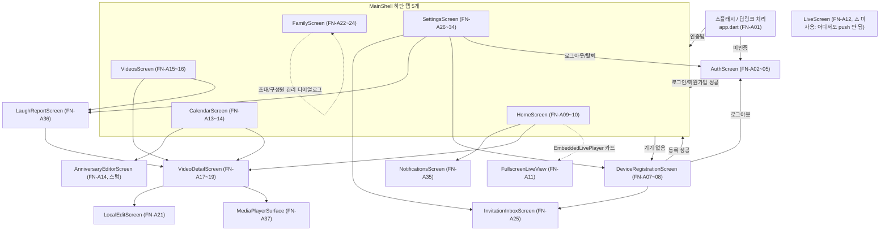

# 기능 명세서

> 기준: 5979279 / 2026-07-27 / 구현 코드 기준(as-built)

본 문서는 다음 산출물을 근거로 작성되었으며, 추측 없이 코드에서 직접 확인된 사실만 기재한다. 확인 불가 항목은 `⚠️ 미확인`으로 표시한다.

- `docs/human/04-API명세서.md` — 확정된 API ID 체계(API-01~50, MQTT-01~15). 본 문서의 모든 API/MQTT 참조는 이 ID를 그대로 사용한다.
- `docs/superpowers/plans/2026-07-27-inventory/backend.md`, `frontend.md`, `ai-edge.md`, `hardware.md`, `cross-check.md`

기능 ID는 `FN-` 접두사 + 영역 문자(A=앱, S=서버, E=엣지, H=하드웨어) + 영역별 연속 번호로 부여한다(예: `FN-A01`, `FN-S01`, `FN-E01`, `FN-H01`). Task 8(운영/장애 대응 문서 등)이 이 ID 체계를 참조한다.

---

## 1. 기능 맵 (영역 × 기능 그룹)

### 1.1 앱(App) 영역 — Flutter, `frontend/lib/**`

화면 파일 13개(`frontend/lib/ui/*.dart`) + `main_shell.dart` + 진입점 `app/app.dart` 전수가 아래 표에 나타난다.

| # | 기능 그룹 | FN 범위 | 관련 API | 소스 파일(화면) |
|---|---|---|---|---|
| 1 | 앱 진입/스플래시/딥링크 | FN-A01 | - | `app/app.dart` |
| 2 | 인증(로그인/회원가입/소셜·비번찾기 스텁) | FN-A02~FN-A05 | API-01~03 | `ui/auth_screen.dart` |
| 3 | 메인 셸(하단 탭 내비게이션) | FN-A06 | - | `ui/main_shell.dart` |
| 4 | 기기 등록(QR/코드) 및 멤버십 요청 공유 | FN-A07~FN-A08 | API-08, API-15, API-16 | `ui/device_registration_screen.dart` |
| 5 | 홈 요약/라이브 미리보기 | FN-A09~FN-A12 | API-42, API-35~38 | `ui/home_screen.dart`, `ui/live_screen.dart` |
| 6 | 캘린더/기념일 | FN-A13~FN-A14 | API-27 | `ui/calendar_screen.dart`, `ui/extra_screens.dart`(AnniversaryEditorScreen) |
| 7 | 추억(영상) 목록/필터/삭제 | FN-A15~FN-A16 | API-27, API-30 | `ui/videos_screen.dart` |
| 8 | 영상 상세/재생/편집/다운로드 | FN-A17~FN-A21 | API-28, API-29, API-31, API-32 | `ui/video_detail_screen.dart`, `ui/local_edit_screen.dart` |
| 9 | 가족 구성원/초대/소유권 이전 | FN-A22~FN-A24 | API-12, API-14, API-18, API-19 | `ui/family_screen.dart` |
| 10 | 받은 초대함 | FN-A25 | API-20~22 | `ui/invitation_inbox_screen.dart` |
| 11 | 설정(프로필/기기/알림/구독/로그/탈퇴) | FN-A26~FN-A34 | API-06, API-10, API-37~41, API-50, API-04, API-05, API-13 | `ui/settings_screen.dart` |
| 12 | 알림/웃음 리포트 | FN-A35~FN-A36 | API-33 | `ui/extra_screens.dart`(NotificationsScreen, LaughReportScreen) |
| 13 | 재생 공용 컴포넌트 | FN-A37 | - | `ui/media_player_surface.dart` |

검증용 파일 목록 대조: `auth_screen.dart`✅ `calendar_screen.dart`✅ `device_registration_screen.dart`✅ `extra_screens.dart`✅(#6,#12) `family_screen.dart`✅ `home_screen.dart`✅ `invitation_inbox_screen.dart`✅ `live_screen.dart`✅(#5) `local_edit_screen.dart`✅(#8) `media_player_surface.dart`✅ `settings_screen.dart`✅ `videos_screen.dart`✅ `video_detail_screen.dart`✅(#8) = **13개 전부 등장**, `main_shell.dart`✅(#3) 별도 등장.

### 1.2 서버(Server) 영역 — Spring, `backend/server/**`, 컨트롤러 15개 / API 도메인 10개

| # | 기능 그룹(도메인) | FN 범위 | 관련 API/MQTT |
|---|---|---|---|
| 1 | auth | FN-S01~FN-S02 | API-01~06 |
| 2 | device | FN-S03~FN-S06 | API-07~13 |
| 3 | invitation | FN-S07~FN-S10 | API-14~24 |
| 4 | video | FN-S11~FN-S15 | API-25~33 |
| 5 | stream·live | FN-S16~FN-S17 | API-34~38 |
| 6 | subscription | FN-S18 | API-39~41 |
| 7 | home | FN-S19 | API-42 |
| 8 | iot | FN-S20~FN-S22 | API-43~46 |
| 9 | provisioning | FN-S23 | API-47~49 |
| 10 | audit | FN-S24 | API-50 |
| 11 | (도메인 공통) MQTT 기기 통신 채널 | FN-S25 | MQTT-01~09 |

검증용 도메인 대조: auth✅ device✅ invitation✅ video✅ stream·live✅ subscription✅ home✅ iot✅ provisioning✅ audit✅ = **10개 전부 등장**.

### 1.3 엣지(Edge) 영역 — `ai/device_agent/`, `ai/yolo/`, `ai/yamnet/`, `ai/pi_homecam_dev/`

| # | 기능 그룹 | FN 범위 | 관련 API/MQTT | 구현 상태 |
|---|---|---|---|---|
| 1 | 기기 프로비저닝(enrollment/자격증명 회전) | FN-E01 | API-44, API-45 | ✅ 운영 |
| 2 | 등록 코드 발급/표시 | FN-E02 | API-43 | ✅ 운영(단, 물리 LCD 아님) |
| 3 | 상태·하트비트 보고 | FN-E03 | MQTT-02, MQTT-05 | ⚠️ 일부 스텁 |
| 4 | 원격 명령 수신/ACK | FN-E04 | MQTT-01, MQTT-03 | ✅ 운영(일부 죽은 분기) |
| 5 | 라이브 스트림 송출(RTSPS) | FN-E05 | MQTT-04 | ✅ 운영 |
| 6 | 웃음(오디오) 감지 | FN-E06 | - | ✅ 운영 |
| 7 | 이벤트 클립 업로드 | FN-E07 | API-25, API-26 | ✅ 운영 |
| 8 | YOLO 사람/반려동물 추적·프레이밍 계산 | FN-E08 | MQTT-10~12 | 🔴 실험 단계(운영 비활성) |
| 9 | 이벤트 퓨전(웃음+비전 컨텍스트) | FN-E09 | MQTT-13~15 | 🔴 실험 단계(운영 비활성) |
| 10 | 라즈베리파이 프로토타입 송출 | FN-E10 | - | 🔴 실험 단계(초기 검증용) |

### 1.4 하드웨어(Hardware) 영역 — `hardware/camera-pan-tilt/`

| # | 기능 그룹 | FN 범위 | 관련 API/MQTT | 연동 상태 |
|---|---|---|---|---|
| 1 | 팬/틸트 기구 프레임(CAD) | FN-H01 | - | ✅ 설계 완료(3D 프린트 산출물) |
| 2 | 서보 구동/PWM 제어 | FN-H02 | - | 🔴 미구현 |
| 3 | YOLO→서보 목표값 전달 경로 | FN-H03 | MQTT-11 | 🔴 발행만 존재, 구독자 전무 |
| 4 | 소프트 리밋/부팅 초기화 | FN-H04 | - | 🔴 설계 의도만, 코드 미구현 |

---

### 1.5 MVP 대상 기능 (2026-07-27 확정, 시연 기준)

시연 MVP 7항목(`01-서비스기획.md` 8절, `02-요구사항명세서.md` 우선순위 열)에 해당하는 기능은 다음과 같다. 여기 없는 FN은 전부 **MVP 외(확장)**.

| MVP 항목 | 관련 기능(FN) |
|---|---|
| ① 회원가입/로그인 | FN-A02, FN-A03, FN-S01 |
| ② 기기 등록 | FN-A07, FN-S04, FN-S20, FN-S21, FN-E01, FN-E02 |
| ③ 홈 라이브 스트리밍 | FN-A10, FN-A11, FN-A37, FN-S16, FN-S17, FN-S25, FN-E04, FN-E05 (FN-A12는 도달 불가 코드) |
| ④ 이벤트 감지 영상 확인 | 감지·업로드: FN-E06, FN-E07, FN-S11 / 목록: FN-A15, FN-S12 / 재생: FN-A17, FN-A37, FN-S14 |
| ⑤ 영상 편집 (로컬 기준 충족) | FN-A21 |
| ⑥ 편집 영상 다운로드 (로컬 저장 기준) | FN-A20, FN-S14, FN-A21 |
| ⑦ 통계/리포트 | 현행: FN-A13, FN-S12(캘린더), FN-A36, FN-S15, FN-S22(웃음 통계) / 신규 리포트 화면(REQ-F-42): 대응 FN 미정(개발 예정) |
| (전제) 시연 동선 기반 | FN-A01(세션), FN-A06(탭 셸), FN-S03, FN-S05, FN-E03(기기 목록/상태) |

## 2. 앱 기능 (화면별)

### 2.0 화면 흐름도

출처: `frontend/lib/app/app.dart`, `frontend/lib/ui/main_shell.dart` 및 각 화면 파일. 탭 순서(인덱스 0~4): 홈/캘린더/추억/가족/설정.

---

### 2.1 앱 진입 — `app/app.dart`

#### FN-A01 앱 진입/스플래시/딥링크 처리
- 설명: 앱 시작 시 세션 존재 여부(`ApiClient.hasSession`)로 `AuthScreen`/`MainShell`을 분기하고, `app_links` 패키지로 `bbanggeut://membership-request/{token}` 딥링크를 수신해 `AppController.setMembershipRequestLink`를 호출한다.
- 사전 조건: 없음(앱 최초 실행).
- 동작: 로컬 저장된 토큰 유무 확인 → 있으면 `MainShell`, 없으면 `AuthScreen`으로 이동. 딥링크 수신 시 대기 큐에 저장 후 로그인/기기 보유 상태에 따라 처리.
- 예외 처리: 세션 확인 실패 시 `clearSession` 후 `AuthScreen`으로 이동(401 처리 경로와 동일).
- 사용 API: (직접 호출 없음, 로컬 세션 조회)
- 소스 파일: `frontend/lib/app/app.dart`, `frontend/lib/app/app_controller.dart`(`initialize`)

---

### 2.2 인증 — `ui/auth_screen.dart`

#### FN-A02 로그인
- 설명: 이메일/비밀번호로 로그인.
- 사전 조건: 미인증 상태.
- 동작: 입력 검증 후 `AppController.login` → API-02 호출, 성공 시 토큰 저장 후 기기 보유 여부에 따라 `MainShell`/`DeviceRegistrationScreen`으로 이동.
- 예외 처리: 401 `INVALID_CREDENTIALS`, 429 `LOGIN_RATE_LIMITED`을 `ApiFailure`로 받아 스낵바 표시(코드는 API-02 참고).
- 사용 API: API-02
- 소스 파일: `frontend/lib/ui/auth_screen.dart`, `frontend/lib/app/app_controller.dart`

#### FN-A03 회원가입
- 설명: 이름/이메일/비밀번호로 신규 계정 생성.
- 사전 조건: 미인증 상태.
- 동작: `AppController.signUp` → API-01 호출, 성공 시 즉시 로그인 상태(토큰 발급)로 전환.
- 예외 처리: 409 `EMAIL_ALREADY_EXISTS`.
- 사용 API: API-01
- 소스 파일: `frontend/lib/ui/auth_screen.dart`

#### FN-A04 소셜 로그인 버튼(Apple/Google/카카오)
- 설명: 3개 버튼 모두 존재하나 `onTap: () => unavailable(...)`로 로컬 스낵바("아직 지원하지 않습니다" 류)만 표시.
- 사전 조건: -
- 동작: 버튼 탭 → 스낵바 표시 후 종료.
- 예외 처리: 해당 없음(실행되는 로직 자체가 없음).
- 사용 API: 없음 — 양쪽 다 미구현(프런트 호출 없음, 백엔드에 소셜 로그인 발급 엔드포인트 없음).
- 소스 파일: `frontend/lib/ui/auth_screen.dart:284-298`

#### FN-A05 비밀번호 찾기
- 설명: 버튼 탭 시 "비밀번호 찾기 API가 아직 백엔드에 없어요" 스낵바만 표시.
- 사전 조건: -
- 동작: 탭 → 스낵바 → 종료(실제 재설정 플로우 없음).
- 예외 처리: 해당 없음.
- 사용 API: 없음 — 양쪽 다 미구현.
- 소스 파일: `frontend/lib/ui/auth_screen.dart:249-256`

---

### 2.3 메인 셸 — `ui/main_shell.dart`

#### FN-A06 하단 탭 내비게이션 및 새로고침
- 설명: 홈/캘린더/추억/가족/설정 5개 탭을 `IndexedStack`으로 전환하고, `RefreshIndicator`로 당겨서 `AppController.refreshDeviceData` 호출.
- 사전 조건: 인증됨, 기기 1개 이상 보유(없으면 `DeviceRegistrationScreen`으로 대체).
- 동작: 대기 중인 멤버십 요청이 도착하면 자동으로 가족 탭(인덱스 3)으로 전환.
- 예외 처리: 새로고침 실패는 각 하위 화면의 개별 에러 처리에 위임(공통 처리 없음).
- 사용 API: (직접 호출 없음, 하위 화면에 위임)
- 소스 파일: `frontend/lib/ui/main_shell.dart`

---

### 2.4 기기 등록 — `ui/device_registration_screen.dart`

#### FN-A07 QR/코드 기기 등록
- 설명: `mobile_scanner`로 QR 코드를 스캔하거나 8자리 등록 코드를 직접 입력해 기기를 계정에 연결(claim).
- 사전 조건: 로그인됨. 기기가 등록 모드(등록 코드 발급 후 120초 이내, FN-S04 참고)여야 함.
- 동작: `AppController.claimDevice` → API-08 호출 → 성공 시 기기 목록 갱신 후 이전 화면으로 pop 또는 `MainShell`로 자연 전환.
- 예외 처리: 429 `CLAIM_RATE_LIMITED`, 409 `DEVICE_CLAIM_REJECTED`(코드 만료/불일치 등).
- 사용 API: API-08
- 소스 파일: `frontend/lib/ui/device_registration_screen.dart`

#### FN-A08 멤버십 요청 링크 생성/공유
- 설명: "내 계정으로 초대해달라" 요청 링크를 생성해 `share_plus`로 공유하고, 소유자가 해당 링크를 열면 요청자 정보를 미리보기.
- 사전 조건: 로그인됨.
- 동작: `AppController.createMembershipRequestLink` → API-15 호출 → 링크 공유. 소유자가 딥링크로 진입 시 API-16으로 미리보기 후 `FamilyScreen` 초대 폼에 이메일 자동 채움.
- 예외 처리: 403 `OWNER_MEMBERSHIP_REQUIRED`, 404 `MEMBERSHIP_REQUEST_NOT_FOUND`(API-16 기준).
- 사용 API: API-15, API-16 (외부 브라우저가 여는 API-17 `/open`은 앱이 직접 호출하지 않음)
- 소스 파일: `frontend/lib/ui/device_registration_screen.dart`(`_shareMembershipRequest`), `frontend/lib/app/app_controller.dart`(`resolvePendingMembershipRequest`)

---

### 2.5 홈 — `ui/home_screen.dart`, `ui/live_screen.dart`

#### FN-A09 홈 요약 카드
- 설명: 기기 온라인 상태, 오늘의 웃음/저장/메모 통계, 최근 저장 영상 미리보기를 표시.
- 사전 조건: 기기 보유.
- 동작: `AppController`가 이미 로드해둔 `deviceStatus`(API-11)/`videoStats`(API-33)/`homeSummary`(API-42)/`videos`(API-27) 값을 그대로 사용(화면 자체는 직접 API 호출 없음, best-effort 로드 — 실패해도 화면 렌더링은 계속됨).
- 예외 처리: `homeSummary` 로드 실패는 무시(best-effort), 나머지 값은 null/빈 상태로 표시.
- 사용 API: API-11, API-33, API-42, API-27(간접)
- 소스 파일: `frontend/lib/ui/home_screen.dart`

#### FN-A10 임베디드 라이브 미리보기
- 설명: `HomeScreen`에 삽입되는 실사용 라이브 카드(`EmbeddedLivePlayer`). 기기 오프라인이면 오류 메시지, 온라인 전환 시 자동 재시작.
- 사전 조건: 기기 상태 `ONLINE`(오프라인이면 `DEVICE_OFFLINE` 에러로 세션 생성 실패).
- 동작: `createStream`(API-35) → 2초 간격 `getStream`(API-36) 폴링 → `READY`시 재생 시작 → `heartbeatIntervalSeconds`(서버값, 기본 15초) 간격으로 `heartbeatStream`(API-38) 호출 → `READY` 진입 20초마다 `getStream` 재호출+플레이어 재생성(재생 토큰 30초 만료에 선제 대응) → 화면 이탈/백그라운드 전환 시 `closeStream`(API-37).
- 예외 처리: `FAILED/CLOSED/EXPIRED` 상태 진입 시 모든 타이머 취소 후 에러 표시. 개발 모드(`DEV_HOME_CAM=true`)에서는 `createStream` 없이 고정 HLS URL 재생.
- 사용 API: API-35, API-36, API-37, API-38
- 소스 파일: `frontend/lib/ui/live_screen.dart`(`EmbeddedLivePlayer`), `frontend/lib/ui/home_screen.dart`

#### FN-A11 전체화면 라이브 보기
- 설명: 가로 모드 전체화면 라이브 재생, 3초 후 컨트롤 자동 숨김.
- 사전 조건: `EmbeddedLivePlayer`에서 전체화면 아이콘 탭.
- 동작: 이미 연결된 `VideoPlayerController`를 재사용(신규 API 호출 없음).
- 예외 처리: 없음(뒤로가기로 복귀).
- 사용 API: (재사용, 신규 호출 없음)
- 소스 파일: `frontend/lib/ui/live_screen.dart`(`FullscreenLiveView`)

#### FN-A12 독립형 라이브 화면(미사용)
- 설명: `EmbeddedLivePlayer`와 동일한 세션 생성→heartbeat→폴링→재생 로직을 가진 전체 화면 카드형 라이브 시청 화면.
- 사전 조건: 해당 없음.
- 동작: 코드는 완전히 구현되어 있으나, 저장소 전체에서 `LiveScreen(` 생성자를 호출해 `Navigator.push`하는 곳이 클래스 정의 자신 외에는 없어 **실제로 도달 불가능**.
- 예외 처리: 해당 없음(도달 불가).
- 사용 API: API-35~38(코드상 존재하나 실행 경로 없음)
- 소스 파일: `frontend/lib/ui/live_screen.dart`(`LiveScreen`)

---

### 2.6 캘린더/기념일 — `ui/calendar_screen.dart`, `ui/extra_screens.dart`

#### FN-A13 월별 캘린더 영상 조회
- 설명: 월별 캘린더에 일자별 영상 개수를 표시하고, 날짜 선택 시 해당일 영상 목록을 보여준다.
- 사전 조건: 기기 보유.
- 동작: 월 이동 시 `controller.api.listAllVideos`(`from`/`to` = 월 범위)를 직접 호출해 재조회.
- 예외 처리: 조회 실패 시 빈 목록 처리(코드상 `_getList` 방어 로직).
- 사용 API: API-27
- 소스 파일: `frontend/lib/ui/calendar_screen.dart`

#### FN-A14 기념일 배너/편집(미구현)
- 설명: 캘린더에 하드코딩된 기념일(7/13) 배너를 표시하고, `AnniversaryEditorScreen`에서 이름/날짜/반복/알림시간을 입력할 수 있다.
- 사전 조건: -
- 동작: 저장 버튼을 누르면 "백엔드 기념일 저장 API가 필요해요" 스낵바만 표시하고 종료.
- 예외 처리: 해당 없음(실제 저장 로직이 없음).
- 사용 API: 없음 — 양쪽 다 미구현(backend 전체 "anniversary" 키워드 매치 0건).
- 소스 파일: `frontend/lib/ui/calendar_screen.dart`, `frontend/lib/ui/extra_screens.dart:193,296`(AnniversaryEditorScreen)

---

### 2.7 추억(영상) 목록 — `ui/videos_screen.dart`

#### FN-A15 영상 목록/필터/정렬/검색
- 설명: 전체 추억 목록을 홈캠/웃음 감지/편집 완료 세그먼트로 필터링하고, 검색 다이얼로그와 최신/오래된순 정렬을 제공한다.
- 사전 조건: 기기 보유.
- 동작: `AppController.videos`(이미 로드된 API-27 결과)를 로컬에서 필터링/정렬만 수행(별도 API 재호출 없음).
- 예외 처리: 없음(로컬 연산).
- 사용 API: API-27(간접, 이미 로드된 값 사용)
- 소스 파일: `frontend/lib/ui/videos_screen.dart`

#### FN-A16 영상 삭제
- 설명: 소유자(OWNER)만 영상을 삭제할 수 있다.
- 사전 조건: 호출자 역할 OWNER.
- 동작: 삭제 확인 다이얼로그 → `AppController.removeVideo` → API-30 호출(202 Accepted, 비동기 삭제 큐 등록).
- 예외 처리: 403 `FORBIDDEN_ROLE`("OWNER만 영상을 삭제할 수 있습니다"), 404 `RESOURCE_NOT_FOUND`.
- 사용 API: API-30
- 소스 파일: `frontend/lib/ui/videos_screen.dart`(`_confirmDelete`)

---

### 2.8 영상 상세/편집 — `ui/video_detail_screen.dart`, `ui/local_edit_screen.dart`

#### FN-A17 영상 상세/재생
- 설명: 영상 상태가 `READY`일 때만 서명 URL로 재생을 시도한다.
- 사전 조건: 영상 상태 `READY`(그 외 상태는 "영상 처리가 완료되면 재생할 수 있어요" 안내만 표시).
- 동작: `createPlayUrl`(API-31) → 반환된 서명 URL을 `MediaPlayerSurface`(FN-A37)로 재생.
- 예외 처리: 409 `VIDEO_NOT_READY`, 503 `OBJECT_STORAGE_UNAVAILABLE`. 재생 중 URL 만료 시 자동 재발급 로직 없음(⚠️ 사용자가 화면을 재진입해야 할 것으로 보임, 실제 만료 정책은 서버 값에 의존 — 미확인).
- 사용 API: API-31
- 소스 파일: `frontend/lib/ui/video_detail_screen.dart`(`_load`)

#### FN-A18 영상 메타데이터(제목/메모) 편집
- 설명: 영상 제목과 메모(description)를 수정한다.
- 사전 조건: 호출자 역할 OWNER 또는 EDITOR.
- 동작: `updateVideo`(API-29, `{title?, description?}`) → 저장 후 `getVideo`(API-28)로 재조회.
- 예외 처리: 403 `FORBIDDEN_ROLE`("OWNER 또는 EDITOR 권한이 필요합니다"), 422 `VALIDATION_FAILED`.
- 사용 API: API-29, API-28
- 소스 파일: `frontend/lib/ui/video_detail_screen.dart`(`_editMetadata`)

#### FN-A19 즐겨찾기 토글
- 설명: 영상을 즐겨찾기로 표시/해제한다.
- 사전 조건: 호출자 역할 OWNER 또는 EDITOR.
- 동작: `AppController.toggleFavorite` → API-29(`{isFavorite}`) 호출.
- 예외 처리: API-18과 동일(403/422/404).
- 사용 API: API-29
- 소스 파일: `frontend/lib/ui/video_detail_screen.dart`, `frontend/lib/app/app_controller.dart`

#### FN-A20 영상 다운로드
- 설명: 서명 다운로드 URL을 받아 외부 브라우저/앱으로 실행한다(앱이 직접 파일을 저장하지 않음).
- 사전 조건: 영상 상태 `READY`.
- 동작: `createDownloadUrl`(API-32) → `url_launcher`의 `launchUrl(mode: externalApplication)`로 위임.
- 예외 처리: 409 `VIDEO_NOT_READY`, 503 `OBJECT_STORAGE_UNAVAILABLE`.
- 사용 API: API-32
- 소스 파일: `frontend/lib/ui/video_detail_screen.dart`(`_download`)

#### FN-A21 로컬 영상 편집(Banuba)
- 설명: 서명 다운로드 URL로 원본 mp4를 임시 디렉터리에 내려받아 Banuba 편집기(`ve_sdk_flutter`)로 편집(9:16 캔버스 변환 포함, Android 전용) 후 결과를 앱 문서 디렉터리(`edited_videos/`)에 로컬 저장하고 `share_plus`로 공유한다.
- 사전 조건: 원본 영상 상태 `READY`.
- 동작: `createDownloadUrl`(API-32) → `Dio().download`로 원본 다운로드 → `BanubaVideoEditor.edit/aiEdit/aiClip/openDrafts` 실행 → 편집 결과 로컬 저장.
- 예외 처리: `PortraitVideoCanvasException`(Android 외 플랫폼에서 9:16 변환 시도 시). ⚠️ 편집본을 서버에 재업로드하는 API 호출은 코드 전체에서 발견되지 않음 — 편집 결과가 서버 `sourceType=EDIT_OUTPUT`으로 어떻게 반영되는지는 프런트 코드만으로 확인 불가(미확인).
- 사용 API: API-32
- 소스 파일: `frontend/lib/ui/local_edit_screen.dart`, `frontend/lib/core/banuba_video_editor.dart`, `frontend/lib/core/portrait_video_canvas.dart`

---

### 2.9 가족 관리 — `ui/family_screen.dart`

#### FN-A22 가족 구성원 목록/초대
- 설명: 기기의 가족 구성원 목록을 조회하고, 이메일+역할(EDITOR/VIEWER)로 신규 구성원을 초대한다.
- 사전 조건: 초대는 호출자 역할 OWNER 필요.
- 동작: `listMembers`(API-23) → 목록 표시. `createInvitation`(API-14, 대기 중인 멤버십 요청이 있으면 이메일 자동 채움) → 성공 시 `listDeviceInvitations`(API-18)로 보낸 초대 목록 갱신.
- 예외 처리: 403 `FORBIDDEN_ROLE`, 409 `ALREADY_DEVICE_MEMBER`, 409 `INVITATION_PENDING`, 409 `MEMBERSHIP_REQUEST_EMAIL_MISMATCH`.
- 사용 API: API-23, API-14, API-18
- 소스 파일: `frontend/lib/ui/family_screen.dart`

#### FN-A23 보낸 초대 취소
- 설명: PENDING 상태의 보낸 초대를 취소한다.
- 사전 조건: 호출자 역할 OWNER, 초대 상태 PENDING.
- 동작: `revokeInvitation`(API-19) 호출.
- 예외 처리: 403 `FORBIDDEN_ROLE`, 409 `INVITATION_NOT_PENDING`.
- 사용 API: API-19
- 소스 파일: `frontend/lib/ui/family_screen.dart`(`_SentInvitationCard`)

#### FN-A24 구성원 소유권 이전/내보내기
- 설명: 소유권을 다른 활성 구성원에게 이전하거나, 구성원을 강제 탈퇴시킨다.
- 사전 조건: 호출자 역할 OWNER; 이전 대상은 활성(ACTIVE) 구성원이어야 함.
- 동작: 소유권 이전은 `FamilyScreen._MemberTile._transfer`가 `controller.api.transferOwnership`(API-12)을 **직접 호출**(`AppController.transferOwnership` 래퍼는 정의만 되어 있고 미사용). 내보내기는 `AppController.revokeMemberAccess` → API-24.
- 예외 처리: 이전 — 403 `FORBIDDEN_ROLE`, 409 `ALREADY_OWNER`, 409 `TRANSFER_TARGET_NOT_ACTIVE_MEMBER`. 내보내기 — 409 `OWNER_CANNOT_BE_REVOKED`, 409 `MEMBERSHIP_NOT_ACTIVE`.
- 사용 API: API-12, API-24
- 소스 파일: `frontend/lib/ui/family_screen.dart`(`_MemberTile._transfer`, `_revoke`)

---

### 2.10 받은 초대함 — `ui/invitation_inbox_screen.dart`

#### FN-A25 받은 초대 수락/거절
- 설명: 내가 받은 초대 목록을 보고 수락 또는 거절한다.
- 사전 조건: 로그인됨.
- 동작: `listMyInvitations`(API-20) → 목록 표시(당겨서 새로고침). 수락 시 `acceptInvitation`(API-21) → 성공 후 `Navigator.pop`. 거절 시 `declineInvitation`(API-22).
- 예외 처리: 404 `RESOURCE_NOT_FOUND`, 409 `INVITATION_EXPIRED`, 409 `INVITATION_NOT_PENDING`.
- 사용 API: API-20, API-21, API-22
- 소스 파일: `frontend/lib/ui/invitation_inbox_screen.dart`

---

### 2.11 설정 — `ui/settings_screen.dart`

#### FN-A26 프로필 이름 수정(동작 불가)
- 설명: 프로필 표시 이름을 수정하는 폼.
- 사전 조건: 로그인됨.
- 동작: `updateProfile` → `PATCH /api/auth/me`(API-06) 호출을 시도한다.
- 예외 처리: **서버에 `@PatchMapping("/me")` 매핑이 존재하지 않아(`AuthController.java` 전수 확인, 저장소 전체 grep 0건) 실패할 것으로 판단됨**(⚠️ 실제 런타임 응답 코드는 미확인, 스프링 기본 404 추정).
- 사용 API: API-06 (🔴 클라이언트 호출·서버 부재)
- 소스 파일: `frontend/lib/ui/settings_screen.dart`(`_editProfile`), `frontend/lib/core/api_client.dart:152-158`

#### FN-A27 기기 이름/보관기간 변경
- 설명: 기기 표시 이름과 영상 보관 기간(일)을 변경한다.
- 사전 조건: 호출자 역할 OWNER.
- 동작: `updateDevice`(API-10, `{name?, retentionDays?}`) 호출.
- 예외 처리: 422 `VALIDATION_FAILED`(필드 0개/name 공백·80자 초과/retentionDays 1~3650 범위 아님), 403 `FORBIDDEN_ROLE`.
- 사용 API: API-10
- 소스 파일: `frontend/lib/ui/settings_screen.dart`(`_editDevice`, `_editRetention`)

#### FN-A28 알림 설정(로컬 저장, 서버 미연동)
- 설명: 알림 On/Off 등 설정값을 `flutter_secure_storage`에 로컬 저장한다.
- 사전 조건: -
- 동작: 토글 시 로컬 저장소에만 값 기록.
- 예외 처리: 해당 없음(서버 연동 자체가 없음, ⚠️ 서버 반영 없음).
- 사용 API: 없음
- 소스 파일: `frontend/lib/ui/settings_screen.dart`

#### FN-A29 비밀번호 변경(미구현)
- 설명: 버튼 탭 시 "비밀번호 변경 API가 아직 백엔드에 없어요" 스낵바만 표시.
- 사전 조건: -
- 동작: 탭 → 스낵바 → 종료.
- 예외 처리: 해당 없음.
- 사용 API: 없음 — 양쪽 다 미구현.
- 소스 파일: `frontend/lib/ui/settings_screen.dart:271-274`

#### FN-A30 구독(보관 플랜) 관리
- 설명: 구독 상태 조회, 활성화, 취소를 다이얼로그에서 처리한다.
- 사전 조건: 활성화/취소는 호출자 역할 OWNER.
- 동작: `getSubscription`(API-39) 조회 → 다이얼로그 내 버튼으로 `activateSubscription`(API-40)/`cancelSubscription`(API-41) 호출.
- 예외 처리: 403 `FORBIDDEN_ROLE`, 409 `SUBSCRIPTION_NOT_ACTIVE`(취소 시).
- 사용 API: API-39, API-40, API-41
- 소스 파일: `frontend/lib/ui/settings_screen.dart`(`_subscription`)

#### FN-A31 접근 기록 조회
- 설명: 기기에 대한 접근/조작 로그를 커서 페이지네이션으로 전체 수집해 표시한다.
- 사전 조건: 호출자 역할 OWNER.
- 동작: `listAccessLogPage`(API-50)를 커서가 끝날 때까지 반복 호출(`listAccessLogs`).
- 예외 처리: 422 `VALIDATION_FAILED`(size 범위), 403 `FORBIDDEN_ROLE`, 422 `INVALID_CURSOR`.
- 사용 API: API-50
- 소스 파일: `frontend/lib/ui/settings_screen.dart`(`_logs`)

#### FN-A32 로그아웃
- 설명: 현재 세션을 종료한다.
- 사전 조건: 로그인됨.
- 동작: `logout` → API-04 호출(204) → 로컬 세션 삭제 → `AuthScreen`으로 이동.
- 예외 처리: 401 `AUTHENTICATION_REQUIRED`(필터 레벨)이어도 로컬 세션은 삭제 처리.
- 사용 API: API-04
- 소스 파일: `frontend/lib/ui/settings_screen.dart`, `frontend/lib/ui/device_registration_screen.dart`(`_exitToLogin`)

#### FN-A33 회원 탈퇴
- 설명: 계정을 삭제(탈퇴)한다.
- 사전 조건: 소유 중인 기기가 없어야 함.
- 동작: `withdraw` → API-05 호출(204) → 로컬 세션 삭제.
- 예외 처리: 409 `OWNER_MEMBERSHIP_EXISTS`(소유 기기가 있으면 탈퇴 불가).
- 사용 API: API-05
- 소스 파일: `frontend/lib/ui/settings_screen.dart`(`_withdraw`)

#### FN-A34 기기 해제
- 설명: 현재 연결된 기기를 계정에서 완전히 해제(release)한다.
- 사전 조건: 호출자 역할 OWNER.
- 동작: `releaseSelectedDevice` → API-13 호출(204).
- 예외 처리: 403 `FORBIDDEN_ROLE`, 404 `RESOURCE_NOT_FOUND`.
- 사용 API: API-13
- 소스 파일: `frontend/lib/ui/settings_screen.dart`(`_releaseDevice`)

---

### 2.12 알림/웃음 리포트 — `ui/extra_screens.dart`

#### FN-A35 알림 목록/읽음 처리(읽음 처리는 로컬만)
- 설명: 기념일/받은 초대/최근 영상을 필터 탭으로 묶어 알림 목록으로 표시한다.
- 사전 조건: -
- 동작: 이미 로드된 `AppController` 상태만 재사용(자체 API 호출 없음). "모두 읽음" 버튼은 로컬 상태만 변경.
- 예외 처리: 해당 없음 — 서버에 notification 테이블/엔드포인트 자체가 없어 읽음 상태가 서버에 반영되지 않음(⚠️ 서버 미반영).
- 사용 API: 없음
- 소스 파일: `frontend/lib/ui/extra_screens.dart:46`(NotificationsScreen)

#### FN-A36 웃음 리포트/웃음 잔디
- 설명: 월 평균, 전체 포착 수, 주간 추이 막대(웃음 리포트) 및 연간 히트맵(웃음 잔디)을 탭으로 전환해 보여준다.
- 사전 조건: -
- 동작: 이미 로드된 `videoStats`(API-33)와 `videos`(API-27) 값을 사용(자체 API 호출 없음).
- 예외 처리: 없음(로컬 집계 연산).
- 사용 API: API-33, API-27(간접)
- 소스 파일: `frontend/lib/ui/extra_screens.dart`(LaughReportScreen)

---

### 2.13 재생 공용 컴포넌트 — `ui/media_player_surface.dart`

#### FN-A37 재생 컨트롤(저장 영상/라이브 겸용)
- 설명: 재생/일시정지/10초 앞뒤 이동/음소거/전체화면 컨트롤을 제공하는 공용 위젯. `isLive=false`일 때만 되감기/진행바(`_RecordedControls`) 노출, `isLive=true`면 LIVE 배지+음소거/전체화면만(`_LiveControls`).
- 사전 조건: 이미 초기화된 `VideoPlayerController`가 상위 화면에서 주입됨.
- 동작: 상위 화면(영상 상세/라이브)에서 전달받은 컨트롤러로 재생 UI만 렌더링.
- 예외 처리: 없음(API 호출 자체가 없는 순수 UI 컴포넌트).
- 사용 API: 없음
- 소스 파일: `frontend/lib/ui/media_player_surface.dart`

---

## 3. 서버 기능 (도메인별)

인증 체계(공통): `SecurityConfig`가 3개 필터 체인으로 분리 — ① 내부 관리자 키(`/internal/admin/**`, provisioning 도메인 전용) ② 기기 credential Bearer(`/api/iot/**`) ③ 사용자 JWT(그 외 전부). 상세는 `docs/human/04-API명세서.md` 1.2절 참고.

### 3.1 auth 도메인

#### FN-S01 회원가입/로그인/토큰 갱신
- 설명: 이메일+비밀번호 회원가입/로그인, 리프레시 토큰 기반 액세스 토큰 재발급.
- 동작 규칙: 액세스 토큰 TTL 15분(`access-token-ttl`), 리프레시 토큰은 TTL 14일(`refresh-token-ttl`)이며 DB에는 평문이 아닌 sha256 해시로 저장(`auth_sessions.refresh_token_hash`, unique). 리프레시는 rotate-on-use(사용 시마다 갱신). 로그인 시도는 이메일+IP 지문 기반 rate limit — 실패 5회(`login-max-failures`)/10분 윈도우(`login-failure-window`) 초과 시 429 `LOGIN_RATE_LIMITED`(`auth_login_attempts` 테이블, `LoginAttemptService`).
- 관련 API: API-01, API-02, API-03
- 소스 파일: `auth/api/AuthController.java`, `auth/application/AuthService.java`, `auth/application/LoginAttemptService.java`

#### FN-S02 로그아웃/회원 탈퇴/프로필 수정(부재)
- 설명: 로그아웃(세션 무효화), 회원 탈퇴(계정 삭제), 프로필 이름 수정.
- 동작 규칙: 로그아웃은 JWT의 `sid`(세션 UUID)로 해당 `auth_sessions` 행을 폐기. 탈퇴는 소유 중인 기기(OWNER 멤버십)가 있으면 409 `OWNER_MEMBERSHIP_EXISTS`로 거부. **프로필 수정(`PATCH /api/auth/me`)은 서버에 매핑 자체가 없음** — `AuthController.java` 전수 확인, 저장소 전체 grep 결과 0건.
- 관련 API: API-04, API-05, API-06(🔴 부재)
- 소스 파일: `auth/api/AuthController.java`, `auth/application/AuthService.java`

### 3.2 device 도메인

#### FN-S03 기기 목록/단건 조회
- 설명: 사용자가 접근 가능한 기기 목록 및 단건 상세를 조회.
- 동작 규칙: 목록은 호출자의 활성 멤버십 기준으로 필터링. 단건 조회(API-09)는 서버 구현은 되어 있으나 프런트/엣지 어디서도 호출하지 않는 죽은 경로.
- 관련 API: API-07, API-09(🔶 미사용)
- 소스 파일: `device/api/DeviceController.java`, `device/application/DeviceService.java`

#### FN-S04 기기 등록(claim)
- 설명: 등록 코드로 기기를 계정에 연결.
- 동작 규칙: claim 시도도 rate limit 적용 — 실패 5회(`device-claim.max-failures`)/10분 윈도우(`device-claim.failure-window`) 초과 시 429 `CLAIM_RATE_LIMITED`(`device_claim_attempts` 테이블, `ClaimAttemptService`). 등록 코드 자체는 iot 도메인(FN-S20)에서 발급되며 120초 TTL·1회성·해시 저장 규칙을 공유한다. DB 트리거로 "claim된 기기는 활성 OWNER 정확히 1명"을 강제.
- 관련 API: API-08
- 소스 파일: `device/api/DeviceController.java`, `device/application/ClaimAttemptService.java`

#### FN-S05 기기 설정 변경/상태 조회
- 설명: 기기 이름·보관 기간(1~3650일) 부분 갱신, 기기 상태(온라인 여부/녹화중/업로드 큐 등) 조회.
- 동작 규칙: 갱신은 OWNER만 가능, 필드 0개 전송 시 422 `VALIDATION_FAILED`. 상태 조회의 `recording`/`uploadQueueDepth`는 MQTT 하트비트(MQTT-05) 값을 그대로 노출하는데, 기기 측이 항상 스텁 값(`false`/`0`)을 보내므로 **실제 녹화/업로드 상태를 반영하지 못함**(FN-S25 참고).
- 관련 API: API-10, API-11
- 소스 파일: `device/api/DeviceController.java`

#### FN-S06 기기 소유권 이전/해제
- 설명: 소유권을 다른 활성 멤버에게 이전하거나 기기를 계정에서 완전히 제거.
- 동작 규칙: 이전 대상은 활성(ACTIVE) 멤버여야 하며 이미 OWNER면 409 `ALREADY_OWNER`. 해제는 OWNER만 가능.
- 관련 API: API-12, API-13
- 소스 파일: `device/api/DeviceController.java`

### 3.3 invitation 도메인

#### FN-S07 초대 발송/보낸 초대 조회/취소
- 설명: 이메일+역할(EDITOR/VIEWER)로 신규 구성원을 초대하고, 보낸 초대를 조회·취소.
- 동작 규칙: 초대 유효기간 7일(`invitation.ttl`). 이미 구성원이면 409 `ALREADY_DEVICE_MEMBER`, 동일 대상 PENDING 초대가 있으면 409 `INVITATION_PENDING`. 취소는 PENDING 상태만 가능(409 `INVITATION_NOT_PENDING`).
- 관련 API: API-14, API-18, API-19
- 소스 파일: `invitation/api/InvitationController.java`, `invitation/application/InvitationService.java`

#### FN-S08 멤버십 요청 링크
- 설명: "내 계정으로 초대해달라" 요청 링크 생성/미리보기/외부 오픈(딥링크 리다이렉트).
- 동작 규칙: 요청자당 활성 링크 1개만 유지(`membership_request_links`, requester 유니크). `/open`(API-17)은 토큰 형식(`[A-Za-z0-9_-]{43}`) 검증 후 302로 `bbanggeut://membership-request/{token}` 딥링크로 리다이렉트 — 앱이 아니라 외부 브라우저/이메일 클라이언트가 여는 용도.
- 관련 API: API-15, API-16, API-17(🔶 앱 미호출, 설계된 동작)
- 소스 파일: `invitation/api/InvitationController.java`, `invitation/application/MembershipRequestService.java`

#### FN-S09 받은 초대 조회/수락/거절
- 설명: 내가 받은 초대 목록 조회, 수락(멤버십 생성) 또는 거절.
- 동작 규칙: 수락 시 초대가 만료(`expiresAt` 경과)면 409 `INVITATION_EXPIRED`. 수락/거절 모두 PENDING 상태만 가능.
- 관련 API: API-20, API-21, API-22
- 소스 파일: `invitation/api/InvitationController.java`

#### FN-S10 구성원 목록/추방
- 설명: 기기 구성원 목록 조회, 구성원 강제 탈퇴.
- 동작 규칙: OWNER는 추방 불가(409 `OWNER_CANNOT_BE_REVOKED`), 이미 비활성 멤버십은 409 `MEMBERSHIP_NOT_ACTIVE`.
- 관련 API: API-23, API-24
- 소스 파일: `invitation/api/InvitationController.java`

### 3.4 video 도메인

#### FN-S11 영상 업로드(기기측, presigned URL)
- 설명: 기기가 이벤트 클립(웃음 등)을 MinIO에 업로드하기 위한 presigned PUT URL을 발급받고, 업로드 완료를 통지한다.
- 동작 규칙: `Idempotency-Key` 헤더가 `sourceEventId`와 반드시 일치해야 함(idempotent 재시도 지원, 불일치 시 409 `IDEMPOTENCY_KEY_MISMATCH`). 파일 크기 500MiB 초과 시 413 `VIDEO_TOO_LARGE`. presigned 업로드 URL TTL 15분(`upload-url-ttl`). 완료 통지 시 객체 미존재면 409 `UPLOAD_OBJECT_NOT_FOUND`, 체크섬 불일치는 409 `UPLOAD_INTEGRITY_MISMATCH`.
- 관련 API: API-25, API-26
- 소스 파일: `video/api/IotVideoController.java`, `video/application/IotVideoService.java`

#### FN-S12 영상 목록/상세 조회
- 설명: 사용자가 커서 페이지네이션으로 영상 목록을 조회하거나 단건 상세를 조회.
- 동작 규칙: `size` 1~100 범위, 벗어나면 422 `VALIDATION_FAILED`. `thumbnailUrl`은 ⚠️ 코드상 항상 null(썸네일 생성 로직 존재 여부 미확인).
- 관련 API: API-27, API-28
- 소스 파일: `video/api/VideoController.java`, `video/application/VideoQueryService.java`

#### FN-S13 영상 메타데이터 수정/삭제
- 설명: 제목/메모/즐겨찾기 부분 갱신, 영상 삭제(비동기 큐 등록).
- 동작 규칙: 수정은 OWNER 또는 EDITOR, 삭제는 OWNER만 가능(403 `FORBIDDEN_ROLE`, 메시지 상이). 삭제는 202 Accepted로 즉시 응답하고 실제 삭제는 `video_deletion_jobs` 큐 워커가 비동기 처리.
- 관련 API: API-29, API-30
- 소스 파일: `video/application/VideoCommandService.java`

#### FN-S14 영상 재생/다운로드 URL 발급
- 설명: 재생용/다운로드용 presigned GET URL 발급.
- 동작 규칙: 영상 상태가 `READY`가 아니면 409 `VIDEO_NOT_READY`. 읽기 URL TTL 5분(`read-url-ttl`). 다운로드는 `response-content-disposition=attachment` 쿼리가 추가된다는 점만 재생 URL과 다름.
- 관련 API: API-31, API-32
- 소스 파일: `video/application/VideoQueryService.java`

#### FN-S15 영상 통계
- 설명: 기간별 트리거 타입/일별 집계, 최다 요일·시간대 통계 제공.
- 동작 규칙: 기본 기간 및 timeZone 검증(지원하지 않는 timeZone은 422 `VALIDATION_FAILED`).
- 관련 API: API-33
- 소스 파일: `video/api/VideoStatsController.java`, `video/application/VideoStatsService.java`

### 3.5 stream·live 도메인

#### FN-S16 라이브 재생 인가 확인
- 설명: 재생 토큰(`token`)과 `streamId`를 받아 재생 허용 여부를 204/401로 응답.
- 동작 규칙: 공개(permitAll) 엔드포인트, 토큰 자체 서명 검증(`LiveTokenService`). ⚠️ 호출 주체는 코드상 확인 불가(MediaMTX가 재생 인가 웹훅으로 호출하는 것으로 추정, 미확인).
- 관련 API: API-34
- 소스 파일: `stream/api/LiveIntrospectionController.java`, `stream/application/LiveTokenService.java`

#### FN-S17 라이브 세션 생성/조회/종료/하트비트
- 설명: 기기 스트림 세션을 생성하고 HLS 재생 URL을 발급, 뷰어 세션 상태 폴링·연장·종료를 처리.
- 동작 규칙: 기기가 오프라인이면 409 `DEVICE_OFFLINE`. 뷰어 세션 TTL 45초(`viewer-ttl`), 유휴 타임아웃 60초(`idle-timeout`), 기기측 하드 만료(edge lease) 120초(`edge-lease`), 하트비트 주기 15초(`heartbeat-interval`), HLS 재생 토큰 TTL 30초(`live-token-ttl`) — 클라이언트는 토큰 만료 전에 선제적으로 20초마다 재조회하여 갱신한다(FN-A10). 재생 URL 형식: `{media-base-url}/{streamId}/index.m3u8?token={liveToken}`. 스트림 시작/연장/종료는 MQTT-01(`commands`)로 기기에 전달.
- 관련 API: API-35, API-36, API-37, API-38
- 소스 파일: `stream/api/StreamController.java`, `stream/application/StreamService.java`, `config/StreamProperties`

### 3.6 subscription 도메인

#### FN-S18 구독(보관 플랜) 조회/활성화/해지
- 설명: 프리미엄 보관 플랜의 활성 여부, 활성화, 해지를 처리.
- 동작 규칙: 프리미엄 보관 기간 365일(`premium-retention-days`), 해지 후 유예기간 30일(`grace`). 활성화/해지는 OWNER만 가능. 이미 비활성 상태에서 해지 시도 시 409 `SUBSCRIPTION_NOT_ACTIVE`.
- 관련 API: API-39, API-40, API-41
- 소스 파일: `subscription/api/SubscriptionController.java`, `subscription/application/SubscriptionService.java`

### 3.7 home 도메인

#### FN-S19 홈 요약
- 설명: 기기 기준일의 촬영(감지) 수, 저장된 영상 수, 메모 수, 최근 하이라이트 영상을 집계.
- 동작 규칙: `timeZone` 파라미터 기준 날짜 경계 계산, 지원하지 않는 timeZone은 422 `VALIDATION_FAILED`.
- 관련 API: API-42
- 소스 파일: `home/api/HomeSummaryController.java`, `home/application/HomeSummaryService.java`

### 3.8 iot 도메인

#### FN-S20 등록 코드 발급
- 설명: 기기가 등록 모드 진입 시 화면 표시용 1회성 등록 코드를 발급.
- 동작 규칙: **TTL 120초**(`RegistrationCodeService.CODE_TTL = Duration.ofSeconds(120)`, 코드 상수로 확인). 발급 시 기존 미사용 코드를 삭제(`deleteUnusedCodes`)하고 신규 코드를 **sha256 해시로만 저장**(`registration_codes.code_hash`, 평문 미저장 — 응답에 담긴 평문은 반환 즉시 폐기). 이미 claim된 기기는 409 `DEVICE_ALREADY_CLAIMED`. 코드 중복 시 최대 5회(`MAX_GENERATION_ATTEMPTS`) 재생성 시도.
- 관련 API: API-43
- 소스 파일: `device/api/IotRegistrationController.java`, `device/application/RegistrationCodeService.java`

#### FN-S21 기기 자격증명 발급/회전
- 설명: 1회용 BOOTSTRAP 토큰을 OPERATING 자격증명으로 교환하고, 만료 전 자격증명을 회전.
- 동작 규칙: BOOTSTRAP TTL 15분(`device-credential.bootstrap-ttl`), OPERATING TTL 30일(`device-credential.operating-ttl`). 자격증명 상태가 오래된 경우(만료 등) 401 `DEVICE_CREDENTIAL_STALE`, 용도(purpose) 불일치 시 403 `DEVICE_CREDENTIAL_PURPOSE_INVALID`. 기기당 ACTIVE 자격증명은 1개만 유지.
- 관련 API: API-44, API-45
- 소스 파일: `iot/auth/DeviceCredentialController.java`, `provisioning/application/ProvisioningService.java`

#### FN-S22 이벤트 통계(미사용)
- 설명: 기간별 감지 이벤트/업로드된 영상 수 집계.
- 동작 규칙: 서버는 정교하게 구현되어 있으나(from>to 또는 기간 366일 초과 검증 포함), `LaughReportScreen`(FN-A36)은 대신 `VideoStatsController`(API-33, FN-S15)만 사용 — `device_events` 테이블(V18) 기반 통계는 as-built 기준 사실상 미사용.
- 관련 API: API-46(🔶 미사용)
- 소스 파일: `iot/event/EventStatsController.java`, `iot/event/EventStatsService.java`

### 3.9 provisioning 도메인

#### FN-S23 내부 관리자 기기 프로비저닝
- 설명: 사람이 서버 loopback에서 직접 신규 기기 시리얼을 등록하고, 자격증명을 회전/폐기하는 운영 절차.
- 동작 규칙: 내부 관리자 키(`X-Provisioning-Key`) + loopback(127.0.0.1/::1) IP만 허용. 인증 실패 시 **404 `RESOURCE_NOT_FOUND`로 위장**하여 엔드포인트 존재 자체를 숨김(`ProvisioningAuthenticationFilter`). 시리얼 중복 시 409 `DEVICE_SERIAL_ALREADY_ACTIVE`.
- 관련 API: API-47, API-48, API-49(🔶 코드상 호출부 없음, 운영자가 curl 등으로 직접 호출하는 절차로 추정)
- 소스 파일: `provisioning/api/ProvisioningController.java`, `provisioning/application/ProvisioningService.java`

### 3.10 audit 도메인

#### FN-S24 접근 로그 조회
- 설명: 기기에 대한 사용자/기기 행위 로그(초대, 영상 조회/재생/다운로드/삭제, 스트림 열기/종료 등)를 커서 페이지네이션으로 조회.
- 동작 규칙: OWNER만 조회 가능(403 `FORBIDDEN_ROLE`), `size` 1~100 범위. 커서 손상 시 422 `INVALID_CURSOR`.
- 관련 API: API-50
- 소스 파일: `audit/api/AccessLogController.java`, `audit/application/AccessLogQueryService.java`

### 3.11 MQTT 기기 통신 채널 (도메인 공통)

#### FN-S25 기기 상태/명령/이벤트 MQTT 채널
- 설명: 백엔드와 기기(device_agent) 간 실시간 상태 보고, 원격 명령 전달, ACK 수신을 담당하는 `{env}/wj/v2/devices/{deviceId}/...` 네임스페이스.
- 동작 규칙:
  - `commands`(MQTT-01, 백엔드→기기): 스트림 시작/연장/중지 명령(15초 만료). 기기 쪽 `PING` 처리 분기는 존재하나 백엔드가 발행하는 코드가 없어 죽은 경로.
  - `status`(MQTT-02, 기기→백엔드): `state`/`firmwareVersion`만 반영, 기기가 추가로 보내는 `reason`/`occurredAt`은 파싱하지 않고 버려짐.
  - `commands/ack`(MQTT-03): `requestId`/`status`만 로그로 남기고 상태 저장 없음, `errorCode`/`message` 등은 미사용.
  - `stream/events`(MQTT-04): `STREAM_STARTING`을 백엔드가 `default -> {}`로 조용히 무시(상태 추적 공백, 장애 아님).
  - `heartbeat`(MQTT-05): `recording`/`uploadQueueDepth`는 필드명은 일치하나 기기가 항상 스텁 값(`false`/`0`)을 보내 실제 상태 미반영(FN-S05 참고).
  - `registration`(MQTT-06)/`events`(MQTT-07): 백엔드 핸들러는 완비되어 있으나 기기가 발행하지 않는 죽은 구독 — 등록 코드 발급(FN-S20)과 이벤트 업로드(FN-S11)는 전부 HTTP로 대체 운영.
  - `$CONTROL/dynamic-security/v1`(MQTT-08)/`.../response`(MQTT-09): Mosquitto dynamic-security 플러그인 대상 브로커 관리 채널(기기별 계정/ACL 생성·회전).
  - **v1→v2 ACL 자동 이관**: 백엔드 시작 시 `MqttTopicAclMigrationWorker`가 등록된 전 기기의 브로커 role에서 v1·v2 ACL을 제거한 뒤 v2 ACL을 재부여한다(`PahoMqttGateway.migrateTopicAcl`). payload `schemaVersion`은 양쪽 모두 `2.0`으로 검증.
- 관련 MQTT: MQTT-01~09
- 소스 파일: `iot/mqtt/PahoMqttGateway.java`, `iot/mqtt/MqttTopicAclMigrationWorker.java`, `iot/telemetry/MqttInboundHandler.java`, `stream/application/StreamCommandPublisher.java`, `stream/application/StreamEventService.java`, `iot/event/DeviceEventService.java`

---

## 4. 엣지 기능 (구현 상태 표시)

기준 소스: `ai/device_agent/`, `ai/yolo/`, `ai/yamnet/`, `ai/pi_homecam_dev/`.

### FN-E01 기기 프로비저닝(enrollment/자격증명 회전)
- 설명: 1회용 BOOTSTRAP 토큰을 OPERATING 자격증명으로 교환하고, 만료 전 자격증명을 회전한다.
- 구현 상태: ✅ 운영(코드 완성·배포됨).
- 관련 API: API-44, API-45
- 소스 파일: `ai/device_agent/wj_device_agent/provision.py`(`DeviceApi.enroll`/`rotate`)

### FN-E02 등록 코드 발급 요청/표시
- 설명: GPIO 등록 버튼(BCM 기본 핀 17)이 눌리면 `registration-button.sh`를 실행해 등록 코드를 요청하고 표준출력(`print()`)에 출력한다.
- 구현 상태: ✅ 운영(단, ⚠️ 물리 LCD 디스플레이 구동 코드는 저장소 어디에도 없음 — README는 "표시"라고 안내하지만 실제로는 터미널/SSH 세션 출력이며 물리 화면 연동 여부는 미확인).
- 관련 API: API-43
- 소스 파일: `ai/device_agent/registration_button.py`, `ai/device_agent/registration-button.sh`, `ai/device_agent/wj_device_agent/provision.py`

### FN-E03 상태·하트비트 보고
- 설명: 연결/종료 시 `status`를 발행(LWT 포함)하고, 30초 주기로 `heartbeat`를 발행한다.
- 구현 상태: ⚠️ 일부 스텁 — `recording`/`uploadQueueDepth`/`clockUnsynced`가 실제 상태를 추적하지 않고 하드코딩된 `false`/`0`/`false`를 그대로 발행.
- 관련 MQTT: MQTT-02, MQTT-05
- 소스 파일: `ai/device_agent/wj_device_agent/agent.py:71-76,92,104,211-225`

### FN-E04 원격 명령 수신/ACK
- 설명: `commands` 토픽을 구독해 `START_STREAM`/`EXTEND_STREAM`/`STOP_STREAM`/`PING`을 처리하고 `commands/ack`로 처리 결과를 발행한다.
- 구현 상태: ✅ 운영(단, `PING` 처리 분기는 백엔드가 발행하지 않아 죽은 코드 경로).
- 관련 MQTT: MQTT-01, MQTT-03
- 소스 파일: `ai/device_agent/wj_device_agent/agent.py:103,133,237-262`

### FN-E05 라이브 스트림 송출(RTSPS)
- 설명: `START_STREAM` 명령 수신 시 ffmpeg로 카메라 입력을 RTSPS(`rtsps://{user}:{pass}@{host}:{port}/live/{stream_id}`)로 MediaMTX에 송출한다.
- 구현 상태: ✅ 운영. `ready_delay_seconds`(기본 3초) 후 `STREAM_READY`/`STREAM_ERROR` 발행, `_monitor` 스레드가 1초 주기로 하드 만료를 검사해 자동 종료. 프로세스당 스트림 1개만 유지(`DEVICE_BUSY`로 거부). `rtsps://` 템플릿은 `config.py`가 자격증명 포함·`/live/{stream_id}` 경로 고정·`MEDIA_TLS_CA_CERT` 필수를 강제 검증(커밋 `0d3a96c`).
- 관련 MQTT: MQTT-04
- 소스 파일: `ai/device_agent/wj_device_agent/stream.py`, `configure_media.py`, `config.py`

### FN-E06 웃음(오디오) 감지
- 설명: YAMNet(TensorFlow Hub `google/yamnet/1`)으로 16kHz 오디오를 분석해 웃음 관련 클래스 점수를 집계, 임계값 이상이 연속 유지되면 트리거한다.
- 구현 상태: ✅ 운영. 임계값 0.25(`--threshold`), 연속 2윈도우(`--consecutive`), 쿨다운 2초(`--cooldown`), 집계 방식 max/mean/p90(기본 max).
- 관련 API: (트리거 파일 생성 후 FN-E07로 이어짐)
- 소스 파일: `ai/yamnet/yamnet_laughter_detect_jetson.py`, `laughter_scoring.py`

### FN-E07 이벤트 클립 업로드
- 설명: 웃음 트리거 발생 시 비디오+오디오를 합본한 mp4를 생성해 백엔드에 업로드한다. 두 가지 운영 경로가 배포되어 있다 — ① MVP 경로(`laughter_clip_uploader.py`, UDP 5초 클립 폴백), ② 세그먼트 기반 경로(`segment_clip_uploader.py`, 디스크 60초 롤링 세그먼트를 병합 구간(`--merge-gap-seconds` 30초)만큼 concat).
- 구현 상태: ✅ 운영(systemd `Restart=always`로 상시 구동, MQTT 비활성 상태로 HTTP만 사용). 재시도 가능한 오류(408/425/429/5xx)는 지수 백오프(5초~300초), 종단 오류(400/401/403/404/409/410/422)는 재시도하지 않고 `{event_id}.upload-blocked.json` 기록.
- 관련 API: API-25, API-26
- 소스 파일: `ai/yolo/laughter_clip_uploader.py`, `ai/yolo/segment_clip_uploader.py`

### FN-E08 YOLO 사람/반려동물 추적·프레이밍 계산
- 설명: YOLOv8n + ByteTrack으로 person/cat/dog(COCO 클래스 0/15/16)를 추적하고, 안정 추적(`--min-track-frames` 기본 3프레임) 객체 그룹에 대해 팬/틸트 목표 방향·오차값을 계산해 MQTT로 발행한다.
- 구현 상태: 🔴 실험 단계 — 코드/런타임 출력이 명시적으로 "Motor output is disabled. This run only simulates framing commands."라고 밝힘(`yolov8_autoframe_jetson.py:964`). 운영 배포 스크립트(`run_edge_ai_mvp.sh`/`run_edge_ai_recording.sh`)는 `MQTT_HOST=`(빈 값)로 넘겨 이 경로 자체를 비활성화. `run_ai_stack.sh`(로컬 수동 검증)에서만 동작 확인됨.
- 관련 MQTT: MQTT-10, MQTT-11, MQTT-12
- 소스 파일: `ai/yolo/yolov8_autoframe_jetson.py`, `ai/yolo/vision_mqtt_publisher.py`

### FN-E09 이벤트 퓨전(웃음+비전 컨텍스트)
- 설명: 웃음 이벤트 수신 시 최근 비전 상태(나이 `--max-vision-age-ms` 기본 2000ms 이내)를 부착해 `events/memory-candidate`로 재발행한다.
- 구현 상태: 🔴 실험 단계 — FN-E08과 동일하게 운영 배포 스크립트에서 MQTT 연결 자체를 비활성화. 로컬 검증 스크립트에서만 동작 확인.
- 관련 MQTT: MQTT-13, MQTT-14, MQTT-15
- 소스 파일: `ai/yolo/event_fusion_service.py`

### FN-E10 라즈베리파이 프로토타입 RTSP 송출
- 설명: `/dev/video0`(MJPEG 1280x720@20fps)를 libx264로 인코딩해 로컬 MediaMTX(`rtsp://127.0.0.1:8554/homecam`)로 단순 송출만 한다.
- 구현 상태: 🔴 실험 단계 — 이벤트 녹화·업로드 로직이 전혀 없으며, 초기 카메라 송출 검증용으로 운영 경로와 무관.
- 관련 API/MQTT: 없음
- 소스 파일: `ai/pi_homecam_dev/homecam-publisher.sh`, `mediamtx.yml`

---

## 5. 하드웨어 기능 (연동 상태 표시)

기준 소스: `hardware/camera-pan-tilt/**`(README.md, `pan_tilt.scad`, drawing.html, STL). 보강 근거: `ai/yolo/yolov8_autoframe_jetson.py`, `ai/AI_EDGE_INTEGRATION_SPEC.md`.

### FN-H01 팬/틸트 기구 프레임(CAD)
- 설명: Logitech BRIO 100 카메라(72.9×31.9×66.6mm, 클립 일체형)를 2축(팬/틸트)으로 움직이기 위한 3D 프린트용 기구 3부품 — BASE(팬 서보 수납), PAN PLATFORM(팬 서보 혼 위 회전판, 틸트 서보+아이들러 축 수납), CRADLE("모니터 엣지 블레이드"로 BRIO 클립을 물어 고정).
- 연동 상태: ✅ 설계 완료 — `pan_tilt.scad`(OpenSCAD 파라메트릭) 및 `STL/base.stl`, `STL/pan_platform.stl`, `STL/cradle.stl` 산출물 존재. 단, `jetson_dx/dy`(86×58 마운트 홀 피치) 등 일부 치수는 ⚠️ 실측 미검증(VERIFY 표시).
- 관련 API/MQTT: 없음
- 소스 파일: `hardware/camera-pan-tilt/pan_tilt.scad`, `hardware/camera-pan-tilt/README.md`

### FN-H02 서보 구동/PWM 제어
- 설명: 마이크로 서보 MG90S(팬 1개+틸트 1개)를 PCA9685 16채널 I²C PWM 드라이버로 구동하는 것이 설계 의도(팬=채널0, 틸트=채널1, Jetson I²C 핀 배선표 포함).
- 연동 상태: 🔴 미구현 — 배선표·`i2cdetect` 확인 명령·`adafruit-circuitpython-servokit` 사용 예시는 README/스펙 문서에만 존재하고, 저장소 전체를 `servo`/`pca9685`/`pan.?tilt` 키워드로 검색해도 실행 가능한 제어 코드가 없음(`find . -iname "*servo*"` 결과 0건).
- 관련 API/MQTT: 없음
- 소스 파일: (구현 없음) — 참고 문서: `hardware/camera-pan-tilt/README.md` §2~3, `ai/AI_EDGE_INTEGRATION_SPEC.md` §4.1

### FN-H03 YOLO→서보 목표값 전달 경로
- 설명: YOLO 프레이밍 컨트롤러가 계산한 목표 방향/오차값을 `control/framing/target` MQTT 토픽으로 발행해, 이를 소비해 실제 PWM으로 변환할 `servo_controller`(계획된 구성요소)에 전달하는 경로.
- 연동 상태: 🔴 미연동 — 발행부(YOLO)는 코드로 존재하고 실제로 동작하지만(FN-E08), 이 토픽을 구독하는 코드는 저장소 어디에도 없다(`servo_controller`는 `ai/AI_EDGE_INTEGRATION_SPEC.md`/`ai/AI_DAILY_PROGRESS_*.md`에 "별도 프로세스로 구현 예정"이라고만 계획됨). 발행만 되고 소비되는 곳이 전무한 상태.
- 관련 MQTT: MQTT-11
- 소스 파일: `ai/yolo/vision_mqtt_publisher.py:126-131`(발행부만 존재)

### FN-H04 소프트 리밋/부팅 초기화
- 설명: 팬 20~160°, 틸트 60~120° 각도 제한(케이블 비틀림 방지)과 부팅 시 중앙 90°로 소프트 스타트(서보 튐 방지)하는 안전 로직.
- 연동 상태: 🔴 설계 의도만 존재 — README.md §5, drawing.html에 각도 제한값이 명시되어 있으나 이를 강제/구현하는 실제 코드는 저장소 어디에도 없음(⚠️ 미확인/미구현).
- 관련 API/MQTT: 없음
- 소스 파일: (구현 없음) — 참고 문서: `hardware/camera-pan-tilt/README.md` §5, `hardware/camera-pan-tilt/drawing.html`

---

## 검증

- **화면 13개 대조**: `auth_screen.dart`, `calendar_screen.dart`, `device_registration_screen.dart`, `extra_screens.dart`, `family_screen.dart`, `home_screen.dart`, `invitation_inbox_screen.dart`, `live_screen.dart`, `local_edit_screen.dart`, `media_player_surface.dart`, `settings_screen.dart`, `videos_screen.dart`, `video_detail_screen.dart` = 13개 전부 1.1절 기능 맵과 2절 화면별 절에 등장. `main_shell.dart`도 별도 항목(FN-A06)으로 등장.
- **컨트롤러 도메인 10개 대조**: auth, device, invitation, video, stream·live, subscription, home, iot, provisioning, audit 10개 전부 1.2절 기능 맵과 3절 도메인별 절에 등장(3.1~3.10, MQTT 공통은 3.11).
- **FN ID 부여 범위**: 앱 FN-A01~FN-A37(37개), 서버 FN-S01~FN-S25(25개), 엣지 FN-E01~FN-E10(10개), 하드웨어 FN-H01~FN-H04(4개) = 총 76개.
