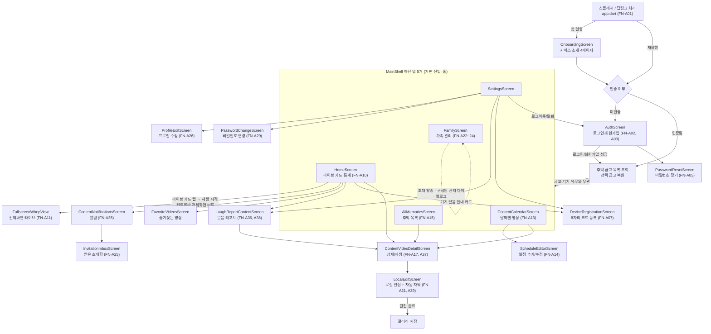

# 기능 명세서

> 기준: to-be 기획(MVP 2026-07-27 확정) · 코드 현황 참조 커밋 cb65eff

본 문서는 **목표(to-be) 기준**의 기능 명세서다. `01-서비스기획.md`·`02-요구사항명세서.md`에서 확정한 **MVP 7단계**를 뼈대로, 각 단계에서 사용자가 마주치는 화면 흐름과 그 화면을 뒷받침하는 기능(FN)을 정의한다.

- FN ID는 기존 as-built 문서에서 사용하던 번호를 그대로 재사용한다(`FN-A`=앱, `FN-S`=서버, `FN-E`=엣지, `FN-H`=하드웨어). 문서 배치는 MVP 7단계 순서로 재구성했지만 번호 자체는 바뀌지 않았다.
- 신규 항목은 기존 max 다음 번호를 부여한다 — **FN-A38**(리포트 화면), **FN-S26**(리포트 집계 API), **FN-A39**(자동 자막, 서버 전사), **FN-A40**(4컷 만화 만들기), **FN-S27**(알림·푸시), **FN-S28**(비밀번호 변경·재설정). 전체 기능 ID는 총 82개다.
- 각 단계 표의 "담당" 열은 폰(Flutter 앱) · 서버(Spring) · 젯슨(엣지 디바이스) 중 실제로 그 기능을 수행하는 주체를 표시한다.
- "관련 REQ·API" 열은 `02-요구사항명세서.md`의 REQ-F ID와 `04-API명세서.md`의 API/MQTT ID를 가리킨다.
- MVP·가족 공유 외의 항목(구독, 소유권 이전, 접근 기록, 알림, 기념일, 소셜 로그인/비밀번호 찾기, YOLO 팬틸트, 라즈베리파이 프로토타입 등)은 **부록 A**로 축약했다. 구현 상태는 본문에 넣지 않고 **부록 B**에서만 요약한다.

---

## 1. 화면 흐름도

- 탭 순서(인덱스 0~4): 캘린더 / 추억 / **홈(기본 진입)** / 가족 / 설정.
- 로그인하면 금고·기기 유무와 무관하게 항상 `MainShell`로 진입한다. 금고에 활성 기기가 없으면 홈의 라이브 카드가 기기 연결 안내로 바뀌고 가족·설정 탭은 `NoDeviceFamilyScreen`/`NoDeviceSettingsScreen`으로 대체된다. 받은 초대함은 이 대체 화면과 알림·기기 등록 화면에서도 열 수 있다.
- **`LiveScreen`(as-built FN-A12)은 진입 경로가 없는 HLS 기반 코드여서 WebRTC 전용 전환에서 삭제**했다(ID는 결번 방지를 위해 부록 A에 제거 표기로 유지). 과거 "기기 없는 금고" 경로에 쓰려던 `VaultArchiveScreen`도 진입 경로가 없는 죽은 코드다.
- **`LaughReportContentScreen`(FN-A38)**이 구현됐다 — 기존 영상 목록의 `LAUGHTER` 항목을 단말에서 주간 집계해 웃음 복주머니, 지난주 대비 변화, 가장 많이 웃은 요일, 요일별 웃음복과 한 줄 요약을 보여준다. 월간·시간대 분포·베스트 클립 서버 집계는 FN-S26/API-62의 미구현 확장 범위다.

---

## 2. MVP ① 회원가입 / 로그인

### 사용자 흐름
1. 앱 실행 시 세션 유무를 확인해 `AuthScreen` 또는 `MainShell`로 분기한다.
2. 미인증 상태면 `AuthScreen`에서 이메일/비밀번호로 로그인하거나 신규 계정을 만든다.
3. 로그인 세션은 앱을 재실행해도 유지된다.
4. 필요 시 `SettingsScreen`에서 로그아웃하거나(소유 기기가 없을 때) 회원 탈퇴한다.

### 관련 기능

| FN ID | 기능 | 담당 | 동작 규칙 | 관련 REQ·API |
|---|---|---|---|---|
| FN-A01 | 앱 진입/세션 확인/딥링크 처리 | 폰 | 로컬 세션 토큰 유무로 `AuthScreen`/`MainShell` 분기. `bbanggeut://membership-request/{token}` 딥링크는 대기열에 저장 후 로그인 상태에 따라 처리 | REQ-F-03 |
| FN-A02 | 로그인 | 폰+서버 | 이메일/비밀번호 검증 후 로그인. 로그인 실패가 5회/10분 초과하면 일시 차단 | REQ-F-02 / API-02 |
| FN-A03 | 회원가입 | 폰+서버 | 이메일/비밀번호/표시 이름으로 계정 생성, 성공 시 즉시 로그인 상태(토큰 발급) | REQ-F-01 / API-01 |
| FN-S01 | 회원가입/로그인/토큰 갱신 | 서버 | 액세스 토큰 TTL 15분, 리프레시 토큰 TTL 14일(사용할 때마다 재발급, rotate-on-use). 리프레시 토큰은 평문이 아닌 해시로 저장. 로그인 실패 제한은 Redis 슬라이딩 윈도우에서 이메일+IP 지문 기준 5회/10분 초과 시 429이며, 성공 요청은 IP 실패 횟수에서 제거한다. 실패 해시는 PostgreSQL 감사 이력으로 별도 보관한다. | REQ-F-01, 02 / API-01, 02, 03 |
| FN-A32 | 로그아웃 | 폰+서버 | 현재 세션 종료 후 로컬 세션 삭제, 로그인 화면으로 이동 | REQ-F-04 / API-04 |
| FN-A33 | 회원 탈퇴 | 폰+서버 | 계정 삭제. 소유 중인 기기가 있으면 탈퇴 불가 | REQ-F-05 / API-05 |
| FN-S02 | 로그아웃/회원 탈퇴 처리 | 서버 | 로그아웃은 세션 단위 무효화, 탈퇴는 소유 기기가 있으면 거부(회원 탈퇴 조건). 프로필 이름 수정은 부록 A(REQ-F-06) 확장 항목으로 별도 관리 | REQ-F-04, 05 / API-04, 05 |

---

## 3. MVP ② 기기 등록

### 사용자 흐름
1. 젯슨이 등록 모드에 진입해 서버에서 등록 코드를 발급받아 표시한다.
2. 폰이 8자리 코드를 직접 입력해 서버에 제출한다.
3. 서버가 코드를 검증해 기기를 계정에 연결(claim)하고 사용자에게 OWNER 권한을 부여한다.
4. 이후 OWNER는 `SettingsScreen`에서 기기 이름 등을 관리할 수 있다.

### 관련 기능

| FN ID | 기능 | 담당 | 동작 규칙 | 관련 REQ·API |
|---|---|---|---|---|
| FN-E02 | 등록 코드 발급 요청/표시 | 젯슨 | 등록 버튼 입력 시 서버에 등록 코드를 요청해 I2C LCD에 표시한다. 서버가 반환한 만료 시각(기본 120초)이 지나면 기존 코드를 `Code expired` / `Press button` 안내로 교체하며, 새 코드 발급 시 이전 만료 예약을 취소한다. | REQ-F-10 / API-43 |
| FN-S20 | 등록 코드 발급 | 서버 | **TTL 120초**. 코드는 해시로만 저장(평문 미보관). 이미 claim된 기기는 재발급 거부. 코드 중복 시 최대 5회 재생성 | REQ-F-10 / API-43 |
| FN-A07 | 코드 기기 등록 | 폰+서버 | 8자리 코드 입력으로 claim 요청. 실패가 반복되면 레이트리밋 | REQ-F-10 / API-08 |
| FN-S04 | 기기 등록(claim) | 서버 | claim 실패 5회/10분 초과 시 429. 물리 기기를 새 추억 금고 또는 OWNER의 기존 금고에 Binding하고 기기별 generation 이력을 보존. 새 금고를 만들 때는 `vaultName`으로 금고 이름을 지정할 수 있다 | REQ-F-10 / API-08 |
| FN-E01 | 기기 프로비저닝(자격증명 발급/회전) | 젯슨+서버 | 1회용 BOOTSTRAP(TTL 15분) 토큰을 OPERATING(TTL 30일) 자격증명으로 교환하고 만료 전 회전 | REQ-F-10 / API-44, 45 |
| FN-S21 | 기기 자격증명 발급/회전 | 서버 | BOOTSTRAP TTL 15분, OPERATING TTL 30일. 기기당 활성(ACTIVE) 자격증명은 1개만 유지 | REQ-F-10 / API-44, 45 |
| FN-E03 | 상태·하트비트 보고 | 젯슨 | 연결/종료 시 상태를 발행(LWT 포함)하고, 30초 주기로 하트비트를 발행 | REQ-F-12 / MQTT-02, 05 |
| FN-S03 | 금고·기기 목록/단건 조회 | 서버 | VaultMembership 기준으로 금고와 활성 Device Binding을 조회한다. 기기가 없는 금고도 영상 보관함으로 노출하며, 연결된 기기의 현재 ONLINE/OFFLINE과 마지막 heartbeat는 Redis presence를 일괄 조회해 합성한다. | REQ-F-12 / Vault API, API-07 |
| FN-S05 | 기기 설정 변경/상태 조회 | 서버 | 이름·보관 기간(1~3650일) 변경은 OWNER만 가능. 온라인 여부·녹화·업로드 큐·버퍼·인원수는 Redis 90초 TTL heartbeat 상태를 조회하며 Redis 장애 시 PostgreSQL 마지막 상태로 폴백한다. | REQ-F-12, 13 / API-10, 11 |
| FN-A27 | 기기 이름 변경 | 폰+서버 | OWNER가 기기 표시 이름을 변경하거나 기기를 해제. 보관 기간 변경은 서버(API-10)는 지원하나 앱 UI가 없다 | REQ-F-13 / API-10 |

---

## 4. MVP ③ 홈에서 라이브 스트리밍 시청

### 사용자 흐름
1. 홈 화면의 라이브 카드를 탭하면 재생이 시작된다(진입 시 자동 재생은 없고, 처음에는 자리표시 화면이 보인다).
2. 연결된 뒤 컨트롤바의 전체화면 버튼으로 전체화면에 진입한다.
3. 화면을 벗어나거나 세션이 만료되면 시청이 자동으로 종료된다.

### 관련 기능

| FN ID | 기능 | 담당 | 동작 규칙 | 관련 REQ·API |
|---|---|---|---|---|
| FN-A06 | 하단 탭 내비게이션 및 새로고침 | 폰 | 홈/캘린더/추억/가족/설정 5개 탭 전환, 당겨서 새로고침 | REQ-F-41 |
| FN-A10 | 임베디드 라이브 미리보기 | 폰+서버+젯슨 | 카드 탭 시 시청 세션 생성 → 상태 폴링 → `whepUrl` WebRTC 연결 → 영상·오디오 RTP 검증(오디오 트랙이 없으면 연결 자체를 실패 처리) → 하트비트 유지 → 화면 이탈 시 세션 종료. 실패 시 HLS 폴백 없이 오류·재시도 표시 | REQ-F-18 / API-35~38 |
| FN-A11 | 전체화면 라이브 보기 | 폰 | WebRTC 전용 재생, 가로 모드 전체화면, 일정 시간 후 컨트롤 자동 숨김 | REQ-F-18 |
| FN-A37 | 재생 컨트롤(공용) | 폰 | 저장 영상/라이브 겸용 재생 UI(재생/일시정지/앞뒤 이동/음소거/전체화면) | REQ-F-18, 22 |
| FN-S16 | 라이브 재생 인가 확인 | 서버 | 재생 토큰 서명을 검증해 재생 허용 여부를 응답 | REQ-F-18 / API-34 |
| FN-S17 | 라이브 세션 생성/조회/종료/하트비트 | 서버 | 기기 오프라인이면 세션 생성 거부. READY 세션에 단기 토큰을 포함한 `whepUrl`만 반환. 뷰어 TTL 45초, 유휴 60초, edge lease 120초, 하트비트 15초, 라이브 토큰 TTL 30초 | REQ-F-18 / API-35~38 |
| FN-S25 | 기기 상태/명령/이벤트 MQTT 채널 | 서버+젯슨 | 스트림 시작/연장/종료 명령(15초 만료)을 기기에 전달한다. 30초 heartbeat는 Redis presence의 90초 TTL을 갱신해 고빈도 PostgreSQL UPDATE와 stale sweep을 피하고, Redis 장애 때만 DB heartbeat 기록으로 폴백한다. | REQ-F-12, 18 / MQTT-01~05 |
| FN-E04 | 원격 명령 수신/ACK | 젯슨 | `START_STREAM`/`EXTEND_STREAM`/`STOP_STREAM` 명령을 처리하고 처리 결과를 ACK로 발행 | REQ-F-18 / MQTT-01, 03 |
| FN-E05 | 라이브 스트림 송출(RTSPS) | 젯슨 | ffmpeg로 카메라 영상을 RTSPS로 미디어 서버에 송출. 하드 만료를 주기적으로 검사해 자동 종료, 기기당 스트림 1개만 유지 | REQ-F-18 / MQTT-04 |

---

## 5. MVP ④ 이벤트(웃음) 감지 영상 확인

### 사용자 흐름
1. 젯슨이 오디오를 분석해 웃음소리를 감지하면 전후 구간을 클립으로 만들어 서버를 거쳐 저장소에 자동 업로드한다.
2. 사용자는 캘린더 또는 추억(영상) 목록에서 날짜별로 저장된 클립을 확인한다.
3. 상세 화면에서 클립을 재생한다.

### 관련 기능

| FN ID | 기능 | 담당 | 동작 규칙 | 관련 REQ·API |
|---|---|---|---|---|
| FN-E06 | 웃음(오디오) 감지 | 젯슨 | YAMNet 오디오 분석으로 웃음 관련 클래스 점수를 집계, 임계값 0.25 이상이 연속 2윈도우 유지되면 트리거(쿨다운 2초) | REQ-F-37 |
| FN-E07 | 이벤트 클립 업로드 | 젯슨+서버 | 트리거 전후 구간을 클립으로 생성해 서버 업로드 흐름으로 전달 | REQ-F-37 / API-25, 26 |
| FN-S11 | 영상 업로드(기기측, presigned URL) | 서버 | `Idempotency-Key`로 중복 업로드 방지. 파일 500MiB 초과 시 거부. presigned 업로드 URL TTL 15분 | REQ-F-37 / API-25, 26 |
| FN-A15 | 영상 목록/필터 | 폰 | 웃음 감지/편집 완료 분류와 기간(날짜 범위)으로 필터링. 목록은 참여 중인 모든 금고의 영상을 병렬 조회해 합친다 | REQ-F-21 |
| FN-S12 | 영상 목록/상세 조회 | 서버 | 커서 페이지네이션(size 1~100 범위) | REQ-F-19, 21 / API-27, 28 |
| FN-A17 | 영상 상세/재생 | 폰+서버 | 영상 상태가 READY일 때만 서명 재생 URL을 발급받아 재생 | REQ-F-22 / API-31 |
| FN-S14 | 영상 재생/다운로드 URL 발급 | 서버 | READY 상태가 아니면 발급 거부. **재생 URL TTL 5분**, 다운로드 URL도 동일 TTL이며 `attachment` 옵션만 다름 | REQ-F-22, 26 / API-31, 32 |

---

## 6. MVP ⑤ 영상 편집

### 사용자 흐름
1. 영상 상세 화면에서 편집을 시작하면 원본을 임시로 내려받는다.
2. 원본을 다 받고 미리보기 준비가 끝난 **뒤에** 앱이 서버에 전사를 부탁한다(API-73) — 다운로드와 나란히 도는 것이 아니라 그다음이다. 폰은 아무것도 올리지 않는다 — 원본은 IoT 기기가 올려 서버에 이미 있으므로 영상 번호만 보내면 된다. 요청을 건 뒤에는 기다리는 동안 화면이 막히지 않는다.
3. 자르기·화면 비율·음량·필터·이모지 스티커 수동 편집을 진행한다.
4. 자막 도구를 열면 직접 입력하는 한 줄 자막과, 서버가 돌려준 **자동 자막 목록**이 함께 보인다. 줄마다 눌러 고칠 수 있다.
5. 저장하면 편집 내용이 **한 번의 인코딩**으로 함께 구워져 갤러리에 저장된다.
6. 같은 화면의 [4컷 만화 만들기]로 들어가면, 자막이 만든 전사문을 서버에 보내 4컷 구성을 받고(API-71) 대사를 고친 뒤 만화 그림을 받는다(API-72).

**폰 안에서 끝나는 것은 편집(FN-A21)뿐이다.** 자동 자막(FN-A39)은 이제 서버가 만든다 — 서버가 저장해 둔 원본에서 오디오와 대표 프레임을 뽑아 **Gemini(구글)로 보내고** 시각이 붙은 자막을 돌려준다. 4컷 만화(FN-A40)도 서버를 쓰며, 그쪽으로 나가는 것은 **전사한 글뿐이고 우리 서버로만 간다.** 폰이 직접 올리는 미디어는 어느 기능에도 없지만, **자막을 만드는 순간 서버에 있던 원본의 오디오와 프레임이 구글로 나간다** — 개인정보 고지 대상이다.

### 관련 기능

| FN ID | 기능 | 담당 | 동작 규칙 | 관련 REQ·API |
|---|---|---|---|---|
| FN-A21 | 로컬 영상 편집 | 폰 | 서명 다운로드 URL로 원본을 내려받아 폰 안에서 자르기·화면 비율(6종)·음량·자막·필터(warm/vivid/mono)·이모지 스티커를 적용. 결과는 갤러리에 저장 | REQ-F-27 / API-32(원본 다운로드 재사용) |
| FN-A39 | 자동 자막(서버 전사) | 폰+서버 | 서버가 저장된 원본에서 오디오와 대표 프레임을 뽑아 Gemini로 전사한 시각별 자막을 받아 온다. 사용자가 줄마다 고칠 수 있고, 저장 시 영상에 함께 구워진다. 전사 결과는 `videoId`로 캐시해 다시 열 때 재사용한다 | REQ-F-27 / API-73(제안·미구현, `04-API명세서.md` 6절) |
| FN-A40 | 4컷 만화 만들기 | 폰+서버 | 자막이 만든 전사문을 서버에 보내 4컷 구성을 받고, 사용자가 대사를 고친 뒤 만화 그림 한 장(2x2 격자)을 받는다. 대사는 영화 자막처럼 각 컷에 앱이 얹고, 완성작은 갤러리에 저장한다 | REQ-F-27 / API-71·API-72(제안·미구현, `04-API명세서.md` 6절) |

폰 완결인 것은 편집(FN-A21)뿐이다 — 원본 다운로드는 ⑥ 단계와 같은 API-32를 재사용한다. 자동 자막(FN-A39)과 4컷 만화(FN-A40)는 서버 AI를 쓴다(API-71·72·73). 폰이 보내는 것은 `videoId`뿐이고(원본은 서버에 이미 있다), 서버가 오디오·대표 프레임을 Gemini에 전달한다. Gemini 키와 이미지 생성 키는 서버가 보관한다.

#### FN-A39 알아둘 점

- **전사는 서버가 한다(API-73).** 폰은 `videoId`만 보내고, 서버가 저장된 원본에서
  오디오와 대표 프레임을 뽑아 Gemini에 전달한다. 온디바이스 모델을 쓰다 옮긴 근거
  (배포 형태 CER 11.3%, 2분 영상 168초)는 06-STT모델가이드에 있다.
- **음성 인식 모델을 앱에 담는다.** `frontend/assets/models/ggml-small-ko-q5_1.bin`(약 181MiB, 한국어 미세조정 모델을 양자화한 것). 그만큼 설치 용량이 늘어난다. 선택 근거와 만들고 교체하는 절차는 `자료/docs/사람이 읽을 문서/06-STT모델가이드.md`에 있다.
- **모델 파일은 아직 앱에 들어 있다.** 온디바이스 전사 코드도 남아 있으나 배선돼
  있지 않다. 발표 뒤에 함께 정리한다 — 지우면 설치 용량이 약 181MiB 줄고, 한글이
  든 경로에서 빌드가 실패하던 문제도 사라진다.
- **서버 통로가 없는 동안은 견본 자막 3줄이 뜬다.** `--dart-define=COMIC_SERVER=true`로 켠다.
- **전사에 시간이 걸린다.** 서버가 Gemini를 부르는 동안 기다린다. 백그라운드로 돌아 화면을 막지는 않지만, 자막 도구를 열면 진행 안내가 보인다. **남은 시간은 보여주지 않는다** — 예전 예상 시간은 온디바이스 실측에 맞춘 숫자라 서버 전사에서는 틀린 값이 된다. 앱을 완전히 닫으면 기다리던 요청이 끊기고 다음에 다시 부른다.
- **조용한 영상도 서버에 물어본다.** 말소리를 먼저 가려내던 판정은 온디바이스 경로에 있던 것이라 지금은 돌지 않는다. 서버가 빈 목록을 돌려주면 "대사를 알아듣지 못했어요"로 안내한다.
- **알아듣지 못해도 편집은 계속된다.** 자막만 비고 자르기·저장은 그대로 동작한다. 서버가 죽어 있을 때도 마찬가지다.
- **직접 쓴 자막이 우선한다.** 자동 자막과 화면 같은 자리를 쓰므로, 한 줄 자막을 입력하면 자동 자막은 표시하지 않는다.
- 외부 자막 서비스는 쓰지 않는다. 전사는 우리 서버(API-73)를 통해서만 하고, 거기서 Gemini로만 나간다.

#### FN-A40 알아둘 점

- **전사문(글)만 서버로 보낸다.** 영상·오디오·프레임은 기기를 떠나지 않는다.
- **이미지 생성 키는 서버가 들고 있다.** 앱에 넣으면 APK를 뜯어 가져갈 수 있다.
  서버 통로는 별도 작업이며, 없는 동안 앱은 가짜 응답으로 화면만 동작한다.
- **API를 두 단계로 나눴다.** 구성을 먼저 받아 사용자가 고친 뒤에 그림을 만든다 —
  이미지 생성은 호출마다 돈이 들어서 엉뚱한 구성에 쓰지 않으려는 것이다.
- **그림에 글자도 말풍선도 넣지 않는다.** 대사는 앱이 얹는다. 말풍선 자리가 있으면
  생성 모델이 거기에 글자를 넣는다.
- 만화는 서버나 앱에 보관하지 않는다. 갤러리 저장으로 끝낸다.
- 컷 하나만 다시 그릴 수 없다 — 격자 한 장으로 받기 때문이다.

---

## 7. MVP ⑥ 편집 영상 다운로드

### 사용자 흐름
1. 편집을 마치면 결과 영상을 기기 갤러리에 저장한다.
2. 저장된 영상은 갤러리에서 다른 앱으로 공유한다(앱 안에 별도 공유 기능은 없다).
3. 원본 클립이 별도로 필요하면 서버에서 다운로드한다.

### 관련 기능

| FN ID | 기능 | 담당 | 동작 규칙 | 관련 REQ·API |
|---|---|---|---|---|
| FN-A21 | 편집 결과 로컬 저장 | 폰 | 편집 결과를 네이티브 저장 경로(MediaStore, `Movies/WilliamJames`)로 기기 갤러리에 저장. 앱 내 영상 공유 기능은 없다 | REQ-F-27(로컬 저장 측면) |
| FN-A20 | 원본 영상 다운로드 | 폰+서버 | 서명 다운로드 URL을 받아 외부 브라우저/앱으로 실행(앱이 직접 파일을 저장하지 않음) | REQ-F-26 / API-32 |
| FN-S14 | 다운로드 URL 발급 | 서버 | 재생 URL과 동일 TTL 5분, `response-content-disposition=attachment` 쿼리만 추가 | REQ-F-26 / API-32 |

---

## 8. MVP ⑦ 통계 / 리포트

### 사용자 흐름
1. 캘린더에서 날짜별 저장 영상 개수를 확인한다.
2. 웃음 리포트 화면에서 주간 웃음 횟수·지난주 대비 변화·요일별 웃음복·한 줄 요약을 확인한다.
3. (확장) 리포트 화면에서 월간 단위 웃음 횟수, 시간대별 분포, 베스트 클립을 확인한다.

### 관련 기능

| FN ID | 기능 | 담당 | 동작 규칙 | 관련 REQ·API |
|---|---|---|---|---|
| FN-A13 | 월별 캘린더 영상 조회 | 폰+서버 | 월 이동 시 해당 월 범위를 재조회, 날짜 선택 시 해당일 영상 목록 표시 | REQ-F-19 / API-27 |
| FN-S12 | 영상 목록 조회(캘린더 집계 재사용) | 서버 | 4단계 표 참고(커서 페이지네이션) | REQ-F-19 / API-27 |
| FN-A36 | 웃음 리포트 | 폰 | FN-A38과 같은 화면(`LaughReportContentScreen`)이 주간 웃음 복주머니·지난주 대비 변화·가장 많이 웃은 요일·가족 공유 수·요일별 웃음복을 표시. API-33 집계는 홈 통계 카드의 숫자로 쓰인다 | REQ-F-36 / API-33 |
| FN-S15 | 영상 통계 | 서버 | 기간별 트리거 타입/일별 집계, 최다 요일·시간대 통계 제공 | REQ-F-36 / API-33 |
| FN-S22 | 이벤트 통계 | 서버 | 기간별 감지 이벤트/업로드된 영상 수 집계. 신규 리포트 화면(FN-A38/FN-S26) 확장 시 기반 로직으로 활용할 수 있다 | REQ-F-36 / API-46 |
| **FN-A38** | 웃음 리포트 화면 | 폰 | 로드된 영상 중 `LAUGHTER`를 주간 단위로 단말 집계. 이번 주 웃음 수, 지난주 대비 변화, 가장 많이 웃은 요일, 가족 공유 수, 요일별 웃음복과 한 줄 요약 제공 | REQ-F-42 / 기존 영상 목록 API |
| **FN-S26**(신규) | 리포트 집계 API | 서버 | 기간(주간/월간) 파라미터로 웃음 횟수 합계·시간대별 분포·베스트 클립(정렬 기준·개수는 상세 설계 시 확정) 목록을 집계해 반환. 기존 FN-S15/FN-S22의 집계 로직·`device_events` 데이터를 확장 기반으로 검토 | REQ-F-42 / API-62 [제안](`04-API명세서.md` 8절) |

---

## 9. 가족 공유

추억 금고 단위로 **OWNER / MEMBER** 2개 역할이 존재한다. 가입은 초대 승인제로만 이루어지며, 링크만으로 자동 가입되는 경로는 없다. 초대로 만들어지는 역할은 항상 MEMBER다. 앱은 금고 스코프 경로(API-63~68)를 기본으로 호출하고, 아래 표의 기기 스코프 API는 금고 정보가 없을 때의 폴백이다.

### 사용자 흐름
1. OWNER가 이메일을 지정해 초대를 발송한다.
2. 초대받은 사용자는 받은 초대함에서 목록을 확인하고 수락 또는 거절한다.
3. 수락 시점에 실제 멤버십이 생성된다.
4. 별도로 "내 계정으로 초대해달라"는 요청 링크를 만들어 공유할 수 있지만, 이 링크 자체는 멤버십을 만들지 않으며 OWNER가 정식 초대를 별도로 진행해야 한다.

### 관련 기능

| FN ID | 기능 | 담당 | 동작 규칙 | 관련 REQ·API |
|---|---|---|---|---|
| FN-A08 | 멤버십 요청 링크 생성/공유 | 폰+서버 | 요청 링크를 생성해 공유. OWNER가 링크를 열면 요청자 정보를 미리보기하고 초대 폼에 이메일을 자동으로 채움 | REQ-F-11 / API-15, 16 |
| FN-S08 | 멤버십 요청 링크 | 서버 | 요청자당 활성 링크 1개만 유지. 링크 자체는 멤버십을 생성하지 않으며 정식 초대(FN-S07)가 별도로 필요 | REQ-F-11 / API-15, 16, 17 |
| FN-A22 | 가족 구성원 목록/초대 | 폰+서버 | 이메일로 신규 구성원(MEMBER) 초대, 구성원 목록·보낸 초대 목록 조회 | REQ-F-28 / API-14, 18, 23 |
| FN-S07 | 초대 발송/보낸 초대 조회/취소 | 서버 | 초대 유효기간 7일. 이미 구성원이거나 동일 대상 PENDING 초대가 있으면 거부 | REQ-F-28, 29 / API-14, 18, 19 |
| FN-S10 | 구성원 목록/추방 | 서버 | OWNER는 추방 불가, 이미 비활성인 멤버십은 재추방 불가 | REQ-F-28, 30 / API-23, 24 |
| FN-A23 | 보낸 초대 취소 | 폰+서버 | PENDING 상태의 초대만 취소 가능 | REQ-F-29 / API-19 |
| FN-A24 | 구성원 소유권 이전/내보내기 | 폰+서버 | 활성(ACTIVE) 구성원 대상 소유권 이전(부록 A, REQ-F-14 확장 기능 참고) 또는 구성원 강제 탈퇴 | REQ-F-30(, 확장 REQ-F-14) / API-12, 24 |
| FN-A25 | 받은 초대 수락/거절 | 폰+서버 | 받은 초대 목록 조회 후 수락(멤버십 생성) 또는 거절 | REQ-F-31 / API-20, 21, 22 |
| FN-S09 | 받은 초대 조회/수락/거절 | 서버 | 초대가 만료(`expiresAt` 경과)되면 수락 거부. 수락/거절 모두 PENDING 상태만 처리 가능 | REQ-F-31 / API-20, 21, 22 |

---

## 10. 부록 A: 확장 기능

MVP 7단계·가족 공유 밖이지만 기능·문서는 유지하는 항목이다. 실험 단계 기능(젯슨 E08~E10, 하드웨어 H01~H04)을 포함한다.

### 앱(App)

| FN ID | 기능(한 줄) | 비고 |
|---|---|---|
| FN-A04 | 소셜 로그인 버튼(Google/카카오) | 미구현(스텁, Apple 버튼은 없음) — REQ-F-07 |
| FN-A05 | 비밀번호 찾기(이메일 재설정 링크) | 서버·앱 구현 완료(API-56, 57), 로그인 화면에서 진입 — REQ-F-08 |
| FN-A09 | 홈 요약 카드(통계 카드·최근 저장 추억) | 구현됨(home-summary API 사용) — REQ-F-17 |
| FN-A12 | 독립형 라이브 화면(`LiveScreen`) | **제거됨** — 진입 경로가 없는 HLS 기반 코드로 WebRTC 전용 전환에서 삭제 |
| FN-A14 | 기념일 배너/편집 | 부분 구현 — 일정 추가·수정·매년 반복은 동작하나 앱 메모리 전용(재실행 시 소실, 서버 미연동) — REQ-F-20 |
| FN-A16 | 영상 삭제(OWNER 전용) | 확장 — REQ-F-25 |
| FN-A18 | 영상 메타데이터(제목/메모) 편집 | 확장 — REQ-F-23 |
| FN-A19 | 즐겨찾기 토글 | 확장 — REQ-F-24 |
| FN-A26 | 프로필 이름 수정 | 앱 화면은 있으나 서버 API 부재(`PATCH /api/auth/me` 없음)로 호출 실패 — REQ-F-06 |
| FN-A28 | 알림 설정(기념일·주간 리포트·새로운 추억 토글) | 로컬 저장 — 서버 발송과 무관. 확장 — REQ-F-32 |
| FN-A29 | 비밀번호 변경 | 서버·앱 구현 완료(API-55), 설정에서 진입 — REQ-F-09 |
| FN-A30 | 구독(보관 플랜) 관리 | 확장(금고 구독 API-51~53 사용) — REQ-F-33 |
| FN-A31 | 접근 기록 조회 | 확장(금고 접근 기록 API-54 사용) — REQ-F-34 |
| FN-A34 | 기기 해제 | 확장 — REQ-F-15 |
| FN-A35 | 알림 목록/읽음 처리·FCM 화면 이동 | 서버·앱 구현 완료(API-58~61) — 알림함이 서버 목록·읽음 API를 사용하고 FCM payload로 해당 화면 이동. 미읽음 개수(API-59)는 앱에서 아직 호출하지 않음 — REQ-F-35 |

### 서버(Server)

| FN ID | 기능(한 줄) | 비고 |
|---|---|---|
| FN-S06 | 기기 소유권 이전/해제 | 확장 — REQ-F-14, 15 |
| FN-S13 | 영상 메타데이터 수정/삭제 | 확장 — REQ-F-23, 24, 25 |
| FN-S18 | 금고 구독 조회/활성화/해지 | 확장 — REQ-F-33 / API-51~53. 구독은 금고 귀속이며 변경 시 `VAULT_UPDATE` 감사 기록을 남긴다 |
| FN-S19 | 홈 요약 집계 | 확장 — REQ-F-17 |
| FN-S23 | 내부 관리자 기기 프로비저닝 | 확장 — REQ-F-16 |
| FN-S24 | 접근 로그 조회(기기·금고 경로) | 확장 — REQ-F-34 / API-50, 54. OWNER 전용, `size` 1~100 |
| **FN-S27**(신규) | 알림 생성·조회·읽음·푸시 토큰 | 구현됨 — REQ-F-32, 35 / API-58~61, 69, 70. 초대 수신·웃음 영상 준비 완료 시 서버가 자동 생성(사용자별 중복 제거), FCM 푸시 게이트웨이 포함. 앱은 로그인 시 푸시 토큰을 자동 등록하고 알림함에서 조회·읽음 API를 사용 |
| **FN-S28**(신규) | 비밀번호 변경·재설정 | 구현됨 — REQ-F-08, 09 / API-55~57. 재설정 토큰은 30분·1회용, SHA-256 해시만 저장 |

### 엣지(Edge) — 실험 기능

| FN ID | 기능(한 줄) | 비고 |
|---|---|---|
| FN-E08 | YOLO 사람/반려동물 추적·프레이밍 계산 | 실험 단계, 운영 배포에서 비활성 — REQ-F-38 |
| FN-E09 | 이벤트 퓨전(웃음+비전 컨텍스트) | 실험 단계, 운영 배포에서 비활성 — REQ-F-39 |
| FN-E10 | 라즈베리파이 프로토타입 RTSP 송출 | 실험 단계, 초기 검증용 — REQ-F-40 |

### 하드웨어(Hardware) — 실험 기능

| FN ID | 기능(한 줄) | 비고 |
|---|---|---|
| FN-H01 | 팬/틸트 기구 프레임(CAD) | 설계 완료(3D 프린트 산출물) — REQ-F-38 |
| FN-H02 | 서보 구동/PWM 제어 | 미구현(설계 문서만 존재) — REQ-F-38 |
| FN-H03 | YOLO→서보 목표값 전달 경로 | 발행부만 존재, 소비 미연동 — REQ-F-38 |
| FN-H04 | 소프트 리밋/부팅 초기화 | 설계 의도만 존재 — REQ-F-38 |

---

## 11. 부록 B: 현재 구현 현황

MVP 7단계 기준 구현 현황이다. FN-A38 Flutter 화면은 구현됐고 FN-S26/API-62 서버 집계는 제안·미구현이다. 자동 자막(FN-A39)과 4컷 만화(FN-A40)도 앱 화면만 구현됐고 서버 절반(자막은 API-73, 만화는 API-71·API-72)이 없다.

| # | MVP 단계 | 상태 | 비고 |
|---|---|---|---|
| 1 | 회원가입 / 로그인 | 구현됨 | FN-A01~03, A32, A33, S01, S02 전체 동작 |
| 2 | 기기 등록 | 구현됨 | 8자리 코드 claim, 자격증명 발급/회전 포함 전체 동작 |
| 3 | 홈에서 라이브 스트리밍 시청 | 구현됨 | 홈 카드 미리보기 + 전체화면, WebRTC/WHEP 전용 |
| 4 | 이벤트(웃음) 감지 영상 확인 | 구현됨 | 감지 → 자동 업로드 → 목록/재생 전체 동작 |
| 5 | 영상 편집 | 부분 구현 | 폰 내 수동 편집(자체 편집 화면) 동작. **자동 자막(FN-A39)과 4컷 만화(FN-A40)는 앱만 구현 — API-73·API-71·API-72 서버 미구현**(둘 다 견본 응답으로 동작) |
| 6 | 편집 영상 다운로드 | 구현됨 | 편집본 갤러리 저장(공유는 갤러리 경유), 원본 서버 다운로드 동작 |
| 7 | 통계 / 리포트 | 부분 구현 | 캘린더·웃음 통계와 **FN-A38 Flutter 리포트 화면은 구현**. **FN-S26/API-62 서버 집계는 제안·미구현** |
