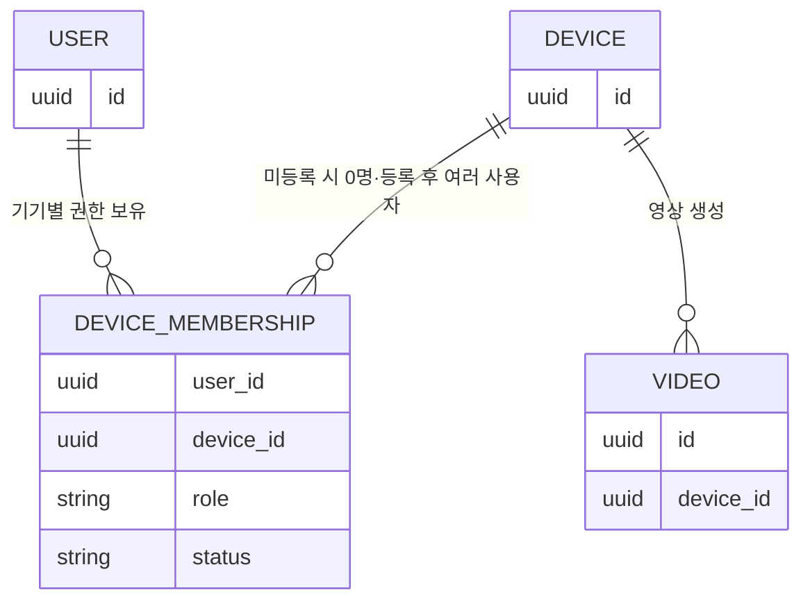
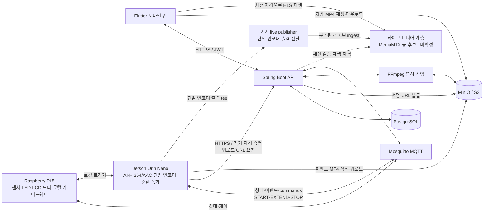

# 윌리엄 제임스 프로젝트 기획서

> 문서 기준: `[기본]`은 7월 31일까지 완성해야 하는 MVP 범위, `[심화]`는 기본 기능 완성 후 진행하는 확장 범위를 의미한다.

---

## 1. 프로젝트 기본 정보

| 항목 | 내용 |
| --- | --- |
| 프로젝트명 | 윌리엄 제임스 (William James) |
| 프로젝트 유형 | IoT·온디바이스 AI 기반 추억 자동 기록 서비스 |
| 개발 기간 | 7월 20일 ~ 7월 31일 |
| 주요 사용자 | 가족, 친구, 반려동물 보호자 등 일상의 자연스러운 순간을 기록하려는 사용자 |
| 제공 형태 | Flutter 모바일 앱 + IoT 카메라 기기 + 백엔드 서버 |

### 1.1 한 줄 콘셉트

> **지나간 추억, 녹화해 드립니다.**

설명형 문구:

> 웃음과 호출의 순간을 놓치지 않고, 그 직전 장면부터 자동으로 기록해 주는 추억 카메라.

### 1.2 핵심 기능 요약

1. `[기본]` 웃음소리·호출어·터치를 감지해 이벤트 발생 전후의 영상을 자동 저장한다.
2. `[기본]` 짧은 시간 안에 반복된 웃음은 하나의 추억 영상으로 자연스럽게 묶는다.
3. `[기본]` 모바일 앱에서 영상을 조회·재생·구간 편집·다운로드한다.
4. `[기본]` 기기 소유자와 초대된 구성원만 해당 기기의 영상에 접근할 수 있다.
5. `[심화]` 웃는 표정 감지와 생성형 AI를 활용해 영상을 4컷 만화·텍스트 영상·애니메이션으로 재구성한다.

---

## 2. 기능 범위

### 2.1 기본 기능(MVP)

| ID | 구분 | 기능 | 상세 내용 |
| --- | --- | --- | --- |
| F-01 | `[기본]` | 순환 영상 버퍼 | IoT 기기는 최근 2분 이상의 영상을 짧은 세그먼트로 계속 임시 보관하고, 보관 시간을 초과한 원본은 자동 삭제한다. |
| F-02 | `[기본]` | 웃음소리 자동 녹화 | YAMNet으로 웃음소리를 감지하면 감지 시점 `T`를 기준으로 `T-60초 ~ T+60초` 영상을 생성하여 서버로 전송한다. |
| F-03 | `[기본]` | 호출어·터치 녹화 | “헤이 제임스!” 호출 또는 터치 센서 입력 시 해당 시점으로부터 2분 전까지의 영상(`T-120초 ~ T`)을 서버로 전송한다. |
| F-04 | `[기본]` | 반복 웃음 병합 | 설정 시간 안에 웃음이 여러 번 감지되면 최초 감지 시점을 기준으로 중복 영상을 만들지 않고 하나의 이벤트 영상으로 병합한다. |
| F-05 | `[기본]` | 영상 업로드 | IoT 기기가 인증받은 뒤 전용 업로드 URL을 발급받아 영상을 비공개 저장소에 직접 업로드한다. 실패 시 일정 횟수 재시도한다. |
| F-06 | `[기본]` | 영상 목록·상세 조회 | 앱에서 썸네일, 촬영 일시, 감지 유형, 재생 길이와 함께 저장된 영상 목록 및 상세 정보를 확인한다. |
| F-07 | `[기본]` | 영상 편집 도구 | 앱에서 시작점·종료점과 편집 옵션을 선택해 로컬로 결과를 내보낸다. 서버에는 편집 작업·편집본을 저장하지 않는다. |
| F-08 | `[기본]` | 영상 관리 | 영상 이름 변경, 즐겨찾기, 삭제 및 감지 유형·기간 기준 정렬/필터 기능을 제공한다. |
| F-09 | `[기본]` | 다운로드 | 접근 권한을 확인한 사용자에게 만료 시간이 짧은 다운로드 URL을 발급한다. |
| F-10 | `[기본]` | 대시보드 | 등록 기기, 온라인 상태, 최근 감지 시각, 저장 영상 수와 최근 영상을 한 화면에서 확인한다. |
| F-11 | `[기본]` | 온디맨드 실시간 보기 | 앱이 스트림 세션을 `POST`하면 서버가 해당 기기의 활성 `OWNER/MEMBER` 멤버십을 검사한다. 첫 시청자일 때 서버는 단일 MQTT 명령 토픽 `{env}/wj/v1/devices/{deviceId}/commands`로 `START_STREAM`을 보내고, 활성 시청 중에는 `EXTEND_STREAM`으로 기본 120초 `hardExpiresAt`을 주기적으로 연장한다. 첫 재생은 수초간 `PENDING`일 수 있다. 생성 시 `createdAt`을 초기 활동 시각으로 두므로 첫 heartbeat가 없어도 `createdAt+45초`에 세션을 만료하고 마지막 시청자라면 `createdAt+60초`에 `STOP_STREAM`을 보낸다. 이후 앱은 15초 heartbeat를 보내고 정상 종료 시 `DELETE`한다. 일반 중지 기준은 마지막 유효 활동 또는 정상 `DELETE`부터 최대 60초이며 TTL 만료 뒤 60초를 다시 세지 않는다. 새 세션은 예약된 중지를 취소한다. 여러 시청자는 기기당 하나의 송출을 공유하며, 제어 경로가 끊겨도 엣지는 마지막 `hardExpiresAt`에 자체 종료한다. 라이브 playlist·segment의 새 요청은 세션 소유자·`READY`·만료·활성 멤버십을 요청 시점에 재검증한다. |
| F-12 | `[기본]` | 최초 기기 등록 | 기기 화면(7" HDMI LCD)에 표시되는 1회용 등록 코드와 물리적 등록 모드를 함께 확인하여 최초 사용자와 기기의 `DeviceMembership(OWNER)`을 생성한다. 코드는 서버가 등록 모드 진입 시마다 새로 생성(120초 만료·1회용)하며, 기기당 활성 `OWNER`는 1명이다. |
| F-13 | `[기본]` | 기기별 구성원 초대 | 해당 기기의 `OWNER`가 이메일 또는 1회용 초대 링크로 그 기기의 구성원을 추가한다. 구성원은 자신의 계정으로 대상 기기가 명시된 초대를 수락한다. |
| F-14 | `[기본]` | 기기별 역할 기반 접근 제어 | 사용자와 기기를 다대다로 연결하고 각 관계에 `OWNER` 또는 `MEMBER` 역할을 둔다. 사용자는 기기마다 다른 역할을 가질 수 있으며, 권한은 대상 기기의 멤버십을 기준으로 적용한다. |
| F-15 | `[기본]` | 기기별 권한 회수 | `OWNER`가 특정 기기의 `MEMBER` 접근 권한을 즉시 회수할 수 있도록 한다. 회수 후에는 그 기기의 영상 URL을 새로 발급받을 수 없으며 다른 기기의 멤버십은 유지된다. |
| F-16 | `[기본]` | 기기별 영상 접근 제어 | 영상은 생성한 기기(`device_id`) 단위로 분리하고, 서버가 모든 요청에서 해당 기기의 활성 `DeviceMembership`과 역할을 검사한다. |
| F-17 | `[기본]` | 개인정보 보호 | 전송 구간 암호화, 비공개 저장소, 녹화·원격 라이브 상태 표시, 접근 기록, 로컬 임시 영상 자동 삭제를 적용한다. |

### 2.2 심화 기능

| ID | 구분 | 기능 | 상세 내용 |
| --- | --- | --- | --- |
| A-01 | `[심화]` | 웃는 표정 감지 | YOLO로 사람을 찾고 MediaPipe로 얼굴 특징을 분석하여 웃음소리와 웃는 표정을 함께 감지한다. 사용자의 별도 동의를 전제로 한다. |
| A-02 | `[심화]` | 가변 길이 영상 | 고정 2분 영상 대신 웃음의 시작·종료, 무음 구간, 장면 전환을 분석하여 자연스러운 길이로 저장한다. |
| A-03 | `[심화]` | 카메라 방향 제어 | 2축 서보모터와 3D 프린팅 프레임을 이용해 앱에서 카메라의 좌우·상하 각도를 조절한다. |
| A-04 | `[심화]` | 추억 콘텐츠 생성 | 저장 영상에서 대표 장면을 추출하여 4컷 만화, 요약 텍스트 영상, 애니메이션 등의 파생 콘텐츠를 생성한다. |
| A-05 | `[심화]` | 저장 공간 최적화 | 썸네일·저해상도 프리뷰 생성, 코덱/해상도 변환, 보관 주기 설정, 오래된 원본 자동 삭제 등 저장 정책을 적용한다. |
| A-06 | `[심화]` | 사용자 영상 업로드 | 사용자가 휴대폰 영상을 직접 업로드하고 IoT 자동 녹화 영상과 함께 관리한다. |
| A-07 | `[심화]` | 영상 플랫폼 | 사용자 동의하에 특정 영상을 친구 또는 외부 사용자에게 공유하고 공개 범위를 설정한다. 기본값은 비공개다. |
| A-08 | `[심화]` | 푸시 알림 | 새 추억 영상 저장, 구성원 초대, 기기 연결 해제 등의 이벤트를 모바일 푸시 알림으로 제공한다. |
| A-09 | `[심화·선택]` | 이동형 카메라 | 오린카·DC 모터·초음파 센서·LiDAR를 연동하여 이동 촬영 및 장애물 회피 기능을 실험한다. 핵심 서비스와 분리된 확장 시나리오로 관리한다. |

### 2.3 범위 우선순위

개발 기간이 짧으므로 다음 순서를 지킨다.

1. 웃음·호출·터치 감지와 순환 영상 버퍼
2. 영상 생성·업로드·재생
3. 회원·기기 등록·기기별 접근 권한
4. 영상 편집·다운로드·대시보드
5. HLS 스트리밍
6. 기본 기능 안정화 후 심화 기능 선택 구현

---

## 3. 사용자와 영상 접근 권한

### 3.1 권한 모델

| 역할 | 권한 |
| --- | --- |
| `OWNER` | 해당 기기의 최초 등록자 1명. 기기 등록 해제, 구성원 초대·회수, 해당 기기 영상 조회·편집·다운로드·삭제, 보관 정책 설정 |
| `MEMBER` | 초대받은 해당 기기의 영상 조회·다운로드와 허용된 범위의 편집 |

사용자와 기기는 직접 다대다 관계로 연결한다. 한 사용자는 여러 기기에 서로 다른 역할로 참여할 수 있고, 한 기기는 `OWNER` 1명과 여러 `MEMBER`에게 공유될 수 있다. 권한은 가족이나 사용자 그룹 전체가 아니라 `DeviceMembership(user_id, device_id, role, status)` 한 건을 기준으로 판단한다.



### 3.2 기기 등록 흐름

1. 사용자가 앱에 로그인한다.
2. 기기의 물리 버튼 또는 터치 센서를 길게 눌러 제한 시간 동안 등록 모드를 활성화한다.
3. 기기가 서버에서 1회용 등록 코드를 발급받아 7" LCD에 `XXXX-XXXX` 형식으로 표시한다.
4. 사용자가 앱에서 화면의 코드를 입력하면 서버가 코드 유효성(120초·미사용), 기존 소유자 존재 여부와 시도 횟수(계정·IP당 실패 5회/10분)를 검사한다.
5. 최초 사용자와 기기의 활성 `DeviceMembership(OWNER)`을 한 건 생성하고 등록 코드를 사용 처리한다.
6. 기기에 이후 통신용 고유 인증서 또는 기기 토큰을 발급한다.
7. 이후 사용자는 등록 코드를 입력하지 않고 해당 기기 `OWNER`의 기기별 초대로만 참여한다.

### 3.3 영상 접근 원칙

- 영상 저장소는 외부에 공개하지 않는다.
- 앱은 영상 파일의 고정 공개 주소를 저장하지 않는다.
- 서버는 영상의 `device_id`를 조회한 뒤 현재 사용자의 해당 기기 `DeviceMembership`이 `ACTIVE`인지 매 요청마다 확인한다.
- 사용자 JWT의 계정 식별자와 IoT 기기의 별도 자격 증명을 혼용하지 않는다.
- 권한 확인 후 1~5분만 유효한 재생·다운로드 URL을 발급한다.
- 영상 조회·다운로드·삭제 주체와 시각을 감사 로그로 기록한다.
- 권한 회수·회원 탈퇴·기기 양도 시 기존 접근 권한과 기기 인증 정보를 폐기한다.

---

## 4. 팀 구성 및 역할

| 담당자 | 주 역할 | 권장 세부 담당 |
| --- | --- | --- |
| 사지한 | PM | 요구사항·일정·리스크 관리, 회의 진행, 산출물 취합, 발표 및 통합 테스트 조율 |
| 박찬형 | 백엔드 | Spring Boot API, 인증·인가, 기기 등록, 영상 메타데이터, 객체 저장소, Swagger, 배포 |
| 이재준 | AI | YAMNet 웃음 감지, YOLO 사람 탐지, MediaPipe 심화 기능, 임계값 조정 및 모델 성능 검증 |
| 유지호 | IoT | 카메라·마이크·터치 센서, 순환 녹화, FFmpeg 영상 병합, 보드 통신, LED 및 모터 제어 |
| 김수원 | 프론트엔드 | Flutter 앱 기반 구조, 로그인·기기 등록·대시보드, API 연동 및 상태 관리 |
| 서유정 | 프론트엔드 | 영상 목록·플레이어·구간 편집·다운로드, 구성원 및 설정 화면 |

> 역할은 주 담당 기준이며, 영상 업로드·재생·편집은 IoT·백엔드·프론트엔드가 초기에 API 계약을 함께 확정해야 한다.

### 4.1 직무별 기본·심화 업무

#### PM — 사지한

| 단계 | 업무 | 완료 기준 |
| --- | --- | --- |
| `[기본]` | 요구사항과 MVP 범위 관리 | 기본·심화 기능을 구분하고 기능별 인수 조건을 문서화한다. |
| `[기본]` | 일정·이슈·리스크 관리 | 일일 진행 상황, 차단 이슈, 담당자와 해결 예정일을 관리한다. |
| `[기본]` | 직무 간 인터페이스 조율 | 앱·백엔드·AI·IoT 간 API, MQTT 메시지, 영상 포맷 계약을 확정한다. |
| `[기본]` | 산출물 관리 | 요구사항, 와이어프레임, ERD, API, 테스트 결과를 최신 상태로 유지한다. |
| `[기본]` | 통합 테스트·시연 관리 | 핵심 사용자 시나리오를 기준으로 리허설하고 시연용 계정·기기·영상을 준비한다. |
| `[기본]` | 발표 자료 제작 | 문제 정의, 핵심 가치, 시스템 구조, 기술적 도전과 결과를 발표 자료로 구성한다. |
| `[심화]` | 사용자 검증 | 가족·친구 대상 인터뷰 또는 사용성 테스트를 진행하고 개선점을 정리한다. |
| `[심화]` | 지표·운영 정책 수립 | 감지 성공률, 영상 생성 시간, 재방문율, 보관 정책 등의 지표를 정의한다. |
| `[심화]` | 확장 로드맵 | 생성형 콘텐츠, 영상 플랫폼, 유료 저장 공간 등 후속 서비스 방향을 정리한다. |

#### 백엔드 — 박찬형

| 단계 | 업무 | 완료 기준 |
| --- | --- | --- |
| `[기본]` | Spring Boot 프로젝트 구축 | 개발·테스트·배포 환경에서 동일하게 실행되는 기본 프로젝트와 환경 설정을 구성한다. |
| `[기본]` | 회원·인증 API | 회원가입, 로그인, JWT 재발급, 로그아웃과 비밀번호 암호화를 구현한다. |
| `[기본]` | 기기·권한 관리 | `DeviceMembership`, 기기별 `OWNER/MEMBER`, 최초 기기 등록, 기기별 구성원 초대·권한 회수를 구현한다. |
| `[기본]` | 영상 메타데이터 API | 영상 목록·상세·삭제·필터·즐겨찾기와 처리 상태를 관리한다. |
| `[기본]` | 객체 저장소 연동 | MinIO/S3 비공개 버킷, 업로드·재생·다운로드용 서명 URL을 구현한다. |
| `[기본]` | 로컬 편집 지원 | 권한 확인 후 원본 단기 다운로드 URL을 발급한다. 편집 실행·결과 저장은 앱 책임이다. |
| `[기본]` | 기기·대시보드·라이브 세션 API | 기기 온라인 상태와 대시보드 데이터를 제공하고, 권한 기반 스트림 세션·15초 heartbeat·45초 active TTL·종료·시청자 수·동일 기준시각 최대 60초 stop을 관리한다. |
| `[기본]` | 문서·테스트·배포 | Swagger, 핵심 서비스 테스트, Docker Compose와 GitHub Actions 배포 흐름을 완성한다. |
| `[기본]` | 보안 검증 | 모든 영상 API에서 `video.device_id`에 대한 활성 멤버십과 역할을 검사하고 접근 로그를 남긴다. |
| `[심화]` | 저장 공간 최적화 | 썸네일·프리뷰·트랜스코딩, 보관 주기, 자동 삭제 정책을 구현한다. |
| `[심화]` | 비동기 작업 고도화 | 영상 편집·콘텐츠 생성 작업을 메시지 큐 기반으로 분리하고 실패 복구를 지원한다. |
| `[심화]` | 플랫폼·알림 API | 사용자 업로드, 공유 범위, 공개 피드, 신고·차단, 푸시 알림 연동을 구현한다. |
| `[심화]` | 보안 고도화 | 2단계 인증, 기기 인증서 회전, 상세 감사 로그와 이상 접근 탐지를 적용한다. |

#### AI — 이재준

| 단계 | 업무 | 완료 기준 |
| --- | --- | --- |
| `[기본]` | 웃음소리 감지 | YAMNet 추론 파이프라인과 웃음 판정 임계값·지속 시간 조건을 구현한다. |
| `[기본]` | 사람 탐지 | YOLO 모델을 Jetson에서 실행하고 촬영 환경에 맞춰 입력 크기와 추론 주기를 최적화한다. |
| `[기본]` | 호출어 기술 검증 | YAMNet과 별도의 Keyword Spotting 후보를 검증하고 “헤이 제임스” 인식 방식을 확정한다. |
| `[기본]` | 이벤트 결과 규격화 | 감지 유형, 발생 시각, 신뢰도와 이벤트 ID를 IoT 모듈에 전달하는 형식을 정의한다. |
| `[기본]` | 성능 평가 | 실제 시연 환경에서 웃음·비웃음·TV 소리·대화 등의 오탐·미탐 사례를 수집한다. |
| `[기본]` | 온디바이스 최적화 | Jetson에서 실시간 동작하도록 ONNX/TensorRT 또는 TensorFlow Lite 적용 여부를 검증한다. |
| `[심화]` | 웃는 표정 감지 | YOLO 사람 탐지 결과와 MediaPipe 얼굴 특징을 결합하여 웃는 표정을 판정한다. |
| `[심화]` | 가변 길이 영상 | 웃음 지속 시간, 무음, 장면 전환을 분석해 자연스러운 영상 시작·종료 시점을 산출한다. |
| `[심화]` | 대표 장면 추출 | 선명도, 표정, 사람 수 등을 바탕으로 4컷 만화용 대표 프레임을 선택한다. |
| `[심화]` | 생성형 콘텐츠 | 사용 동의를 확인한 영상만 4컷 만화·텍스트 영상·애니메이션 생성 파이프라인에 전달한다. |

#### IoT — 유지호

| 단계 | 업무 | 완료 기준 |
| --- | --- | --- |
| `[기본]` | 하드웨어 연결 | 카메라, USB 마이크, 터치 센서, LED와 보드 전원·GPIO 구성을 완료한다. |
| `[기본]` | 순환 영상 버퍼 | 최근 2분 이상의 영상을 세그먼트로 유지하고 오래된 임시 파일을 자동 삭제한다. |
| `[기본]` | 이벤트 영상 생성 | AI·호출어·터치 이벤트를 받아 필요한 세그먼트를 선택하고 FFmpeg로 병합한다. |
| `[기본]` | 반복 이벤트 처리 | 설정 시간 안의 웃음 이벤트를 한 세션으로 묶어 중복 영상 생성을 방지한다. |
| `[기본]` | 서버·저장소 연동 | 기기 인증, 상태 전송, 업로드 URL 요청, 이벤트 MP4 직접 업로드와 실패 재시도를 구현한다. 라이브 전달 경로와 분리한다. |
| `[기본]` | 단일 인코더·라이브 제어 | Jetson의 단일 H.264/AAC 인코더 출력을 순환 버퍼와 기기 live publisher로 tee하고, publisher가 별도 미디어 계층 후보에 전달하도록 구현한다. MQTT 단일 명령 토픽의 `START_STREAM/EXTEND_STREAM/STOP_STREAM`을 멱등 처리하고, 활성 시청 중 기본 120초 `hardExpiresAt`을 연장하며 엣지는 만료 시 자체 종료한다. |
| `[기본]` | 상태 표시 | 녹화·원격 라이브·등록·업로드·오류 상태를 LED 패턴 또는 동등한 표시로 구분한다. |
| `[기본]` | 장시간 안정성 | 임시 파일과 로그가 무한히 늘어나지 않으며 네트워크 복구 후 재업로드되는지 검증한다. |
| `[심화]` | 팬·틸트 제어 | PCA9685와 2개 서보모터를 연결하고 각도 제한·원점 복귀를 구현한다. |
| `[심화]` | 3D 프린팅 프레임 | 카메라·서보·배선 규격에 맞춰 팬·틸트 프레임을 설계·출력·조립한다. |
| `[심화]` | 저지연 스트리밍 | HLS 지연을 측정하고 필요하면 WebRTC 기반 스트리밍을 검토한다. |
| `[심화·선택]` | 이동형 플랫폼 | 오린카, DC 모터, 초음파 센서, LiDAR를 연동한 이동 촬영을 구현한다. |

#### 프론트엔드 — 김수원

| 단계 | 업무 | 완료 기준 |
| --- | --- | --- |
| `[기본]` | Flutter 앱 기반 구조 | 라우팅, 공통 테마, API 클라이언트, 상태 관리와 오류 처리 구조를 구성한다. |
| `[기본]` | 인증 화면 | 회원가입·로그인·자동 로그인·로그아웃 화면과 토큰 재발급 흐름을 구현한다. |
| `[기본]` | 기기 등록 화면 | 기기 화면의 1회용 등록 코드 입력(자동 대문자·하이픈 처리), 물리적 등록 모드 안내와 등록 결과 처리를 구현한다. |
| `[기본]` | 대시보드 | 기기 상태, 최근 영상, 마지막 감지 시각과 저장 영상 수를 표시한다. |
| `[기본]` | 온디맨드 실시간 보기 화면 | 스트림 세션 생성, 수초 `PENDING`, HLS 재생, 15초 heartbeat, 화면 종료 시 `DELETE`, 오프라인·권한·송출 실패 상태를 처리한다. |
| `[기본]` | 공통 품질 | 다양한 Android 화면 크기, 네트워크 오류, 로딩·빈 화면을 검증한다. |
| `[심화]` | 카메라 원격 제어 | 팬·틸트 방향 버튼 또는 조이스틱 UI와 기기 상태 피드백을 구현한다. |
| `[심화]` | 푸시 알림·딥링크 | 새 영상·초대 알림을 받고 관련 화면으로 바로 이동하도록 구현한다. |
| `[심화]` | 앱 디자인 고도화 | 애니메이션, 접근성, 다크 모드와 공통 디자인 시스템을 정리한다. |

#### 프론트엔드 — 서유정

| 단계 | 업무 | 완료 기준 |
| --- | --- | --- |
| `[기본]` | 영상 목록·검색 | 썸네일 목록, 새로고침, 페이지네이션, 기간·감지 유형 필터를 구현한다. |
| `[기본]` | 영상 상세·재생 | 서명 URL을 받아 영상을 재생하고 만료 시 URL을 재발급받는다. |
| `[기본]` | 영상 구간 편집 | 시작·종료 핸들, 미리보기, 편집 요청과 처리 상태 화면을 구현한다. |
| `[기본]` | 영상 관리 | 이름 변경, 즐겨찾기, 다운로드, 삭제와 확인 UI를 구현한다. |
| `[기본]` | 기기별 구성원 관리 | 선택한 기기의 초대 생성·수락, 구성원 목록, 역할 표시와 권한 회수 화면을 구현한다. |
| `[기본]` | 기능 테스트 | 재생·편집·다운로드·권한 회수의 정상·오류 시나리오를 검증한다. |
| `[심화]` | 사용자 업로드 | 휴대폰 영상 선택, 업로드 진행률, 실패 재시도 화면을 구현한다. |
| `[심화]` | 파생 콘텐츠 화면 | 4컷 만화·텍스트 영상·애니메이션 생성 요청과 결과 조회를 구현한다. |
| `[심화]` | 공유·플랫폼 화면 | 공개 범위 설정, 공유 링크, 피드와 신고·차단 UI를 구현한다. |

### 4.2 기능별 주 담당·협업 담당

| 단계 | 기능 영역 | 주 담당 | 협업 담당 |
| --- | --- | --- | --- |
| `[기본]` | 요구사항·일정·통합 시나리오 | 사지한 | 전원 |
| `[기본]` | 회원·기기·기기별 접근 권한 | 박찬형 | 김수원, 서유정, 유지호 |
| `[기본]` | 웃음·사람·호출어 감지 | 이재준 | 유지호 |
| `[기본]` | 카메라·마이크·센서·순환 버퍼 | 유지호 | 이재준 |
| `[기본]` | 영상 생성·업로드 | 유지호 | 박찬형, 이재준 |
| `[기본]` | 영상 저장·편집·서명 URL | 박찬형 | 유지호, 서유정 |
| `[기본]` | 로그인·기기 등록·대시보드·스트리밍 앱 | 김수원 | 박찬형, 유지호 |
| `[기본]` | 영상 목록·재생·편집·다운로드·기기별 구성원 앱 | 서유정 | 박찬형, 김수원 |
| `[기본]` | CI/CD·서버 배포 | 박찬형 | 사지한 |
| `[기본]` | 통합 테스트·발표 | 사지한 | 전원 |
| `[심화]` | 웃는 표정·가변 길이·대표 장면 | 이재준 | 유지호, 박찬형 |
| `[심화]` | 팬·틸트·3D 프레임 | 유지호 | 김수원 |
| `[심화]` | 생성형 콘텐츠·영상 플랫폼 | 이재준, 박찬형 | 김수원, 서유정, 사지한 |

### 4.3 직무 간 필수 계약

| 계약 항목 | 참여 직무 | 확정할 내용 |
| --- | --- | --- |
| AI 이벤트 메시지 | AI ↔ IoT | 이벤트 ID, 감지 유형, 발생 시각, 신뢰도, 중복 판단 시간 |
| IoT 업로드 | IoT ↔ 백엔드 | 기기 인증, 파일 형식, 업로드 URL, 완료 콜백, 실패 재시도 |
| 영상 API | 백엔드 ↔ 프론트엔드 | 목록·상세·재생·로컬 편집용 다운로드·삭제 응답 형식 |
| 기기 등록 | IoT ↔ 백엔드 ↔ 프론트엔드 | 등록 모드 유지 시간, 1회용 등록 코드 발급·표시, 성공·실패 상태와 오류 메시지 |
| 온디맨드 스트리밍 | IoT ↔ 백엔드 ↔ 프론트엔드 | 세션 `POST`·15초 heartbeat·45초 active TTL·`DELETE`, 생성 시 `createdAt` 초기 활동 처리와 첫 heartbeat 없음 `+45초` 만료/`+60초` 중지, 활성 멤버십 검사, 단일 MQTT 명령 토픽과 `START_STREAM/EXTEND_STREAM/STOP_STREAM`, 다중 시청자 공유, 마지막 활동/DELETE 기준 최대 60초 중지와 새 세션 시 취소, 기본 120초 `hardExpiresAt`, playlist·segment별 세션 소유자·상태·만료·멤버십 재검증 |
| 라이브 인코딩·전달 | IoT ↔ 백엔드 | Jetson 단일 H.264/AAC 인코더 출력 → 기기 live publisher → 별도 미디어 계층 후보의 HLS `-c copy` remux·fan-out, GOP/keyframe 2초 기준, 이벤트 MP4 업로드와 라이브 ingest 경로 분리, 미디어 계층 후보 선정 |
| 테스트 기준 | PM ↔ 전 직무 | 정상·예외 시나리오, 완료 기준, 시연 데이터와 담당자 |

---

## 5. 기술 스택

### 5.1 전체 기술 스택

| 영역 | 구분 | 기술 | 용도 |
| --- | --- | --- | --- |
| 모바일 앱 | `[기본]` | Flutter, Dart | Android 우선 개발, 이후 iOS 확장 가능한 모바일 앱 |
| 앱 상태·통신 | `[기본]` | Riverpod, Dio, go_router | 상태 관리, REST API 통신, 화면 이동 |
| 앱 영상 | `[기본]` | video_player | 저장 영상 및 HLS 스트림 재생 |
| 앱 보안 저장소 | `[기본]` | flutter_secure_storage | 액세스·리프레시 토큰 보관 |
| 백엔드 | `[기본]` | Java 21, Spring Boot 3.x | 회원·기기·권한·영상 API |
| 인증·인가 | `[기본]` | Spring Security, JWT | 로그인, 토큰 재발급, 역할 기반 권한 검사 |
| 데이터 접근 | `[기본]` | Spring Data JPA, QueryDSL(선택) | 관계형 데이터 저장 및 영상 목록 검색 |
| API 문서 | `[기본]` | springdoc-openapi, Swagger UI | API 명세 자동 생성 및 테스트 |
| 데이터베이스 | `[기본]` | PostgreSQL | 사용자, 기기, 기기 멤버십, 기기별 초대, 영상 메타데이터, 감사 로그 |
| 영상 저장소 | `[기본]` | MinIO(확정, S3 호환 API) | 비공개 영상 파일·썸네일 저장, 서명 URL 발급. 배포 환경에서 AWS S3 미제공으로 EC2 위 MinIO 운영 |
| 영상 처리 | `[기본]` | FFmpeg | 이벤트 세그먼트 병합·구간 자르기·MP4 변환. 라이브 HLS remux는 선정할 별도 미디어 계층이 `-c copy`로 수행 |
| IoT 애플리케이션 | `[기본]` | Python 3 | 센서·카메라 제어, 이벤트 처리, 서버 통신 |
| 카메라·영상 입력 | `[기본]` | OpenCV, GStreamer 또는 FFmpeg | USB 카메라 프레임 입력 및 순환 녹화 |
| 소리 AI | `[기본]` | YAMNet, TensorFlow/TensorFlow Lite | 웃음소리 분류 |
| 호출어 AI | `[기본·확정 필요]` | TensorFlow Lite 기반 Keyword Spotting 또는 별도 온디바이스 호출어 엔진 | “헤이 제임스” 호출 감지. YAMNet과 별도 구현 필요 |
| 객체 AI | `[기본]` | YOLO, Ultralytics/ONNX Runtime/TensorRT | 사람 탐지 및 관심 영역 추출 |
| 얼굴 분석 | `[심화]` | MediaPipe | 웃는 표정 및 얼굴 특징 분석 |
| 기기 메시징 | `[기본]` | MQTT(Mosquitto) + HTTPS REST | 기기 상태·이벤트 전달 및 영상 업로드 요청 |
| 실시간 영상 | `[기본]` | HLS | 권한 기반 온디맨드 앱 실시간 보기. 첫 세그먼트 준비 중 `PENDING` 지원 |
| 라이브 미디어 계층 | `[기본·미확정]` | MediaMTX 또는 동등 구성 후보 | 기기 live publisher의 단일 H.264/AAC ingest를 `-c copy`로 HLS remux하고 여러 시청자에게 fan-out. 부하·인증·호환성 검증 후 제품 확정 |
| 실시간 영상 | `[심화]` | WebRTC | 저지연 양방향 실시간 영상 |
| 인프라 | `[기본]` | Docker, Docker Compose, Nginx | 백엔드·DB·MinIO·MQTT 실행 및 리버스 프록시. 라이브 미디어 계층은 선정 후 추가 |
| CI/CD | `[기본]` | GitHub Actions | 테스트, Docker 이미지 빌드, 배포 자동화 |
| 백엔드 테스트 | `[기본]` | JUnit 5, Mockito, Testcontainers(선택) | 단위·통합 테스트 |
| 앱·IoT 테스트 | `[기본]` | Flutter Test, pytest | 앱 위젯·로직 및 IoT 이벤트 처리 테스트 |

### 5.2 백엔드 구성 원칙

- 개발 기간을 고려해 마이크로서비스가 아닌 **Spring Boot 단일 애플리케이션**으로 시작한다.
- 영상 바이너리를 PostgreSQL에 저장하지 않고 MinIO/S3에 저장한다.
- IoT 기기는 백엔드가 발급한 업로드 URL을 이용해 영상 저장소로 직접 업로드한다.
- 앱은 영상 편집 시작·종료 시각만 전송하고 실제 자르기는 서버의 FFmpeg가 수행한다.
- 일반 영상 편집은 앱에서 로컬 처리하며 서버 작업 상태를 만들지 않는다.
- Jenkins 서버를 별도로 운영하기보다 GitHub Actions로 CI/CD를 구성한다.

### 5.3 외부 API 및 외부 서비스

| 구분 | 적용 단계 | 서비스 | 용도 | 확정 상태 |
| --- | --- | --- | --- | --- |
| 객체 저장소 API | `[기본]` | MinIO S3 API 또는 AWS S3 | 영상 업로드·다운로드·서명 URL | 배포 환경에 따라 택일 |
| 푸시 알림 | `[심화]` | Firebase Cloud Messaging | 새 영상·기기 상태·초대 알림 | 미확정 |
| 소셜 로그인 | `[심화]` | Google/Apple/Kakao 로그인 | 가입·로그인 간소화 | 미확정 |
| 생성형 콘텐츠 | `[심화]` | 이미지·영상 생성 API | 4컷 만화·애니메이션 생성 | 제공사 및 비용 검토 후 확정 |

> 핵심 감지 기능인 YOLO·YAMNet·MediaPipe는 외부 서버 API 호출보다 온디바이스 실행을 우선한다. 사생활 영상이 외부 AI 서비스로 전송되지 않도록 하는 것이 기본 원칙이다.

### 5.4 착수 전 확정할 기술 항목

- `[기본]` YAMNet은 웃음 등의 음향 이벤트를 분류하며 “헤이 제임스” 같은 사용자 지정 호출어를 직접 담당하지 않는다.
- `[기본]` 호출어는 별도의 온디바이스 Keyword Spotting 모델 또는 호출어 엔진을 7월 21일까지 선정하고 Jetson에서 지연 시간·인식률을 검증한다.
- `[기본]` 호출어 모델이 일정 안에 안정화되지 않더라도 터치 센서를 동일한 저장 트리거로 유지해 전체 MVP 시나리오가 중단되지 않도록 한다.
- `[기본]` MinIO와 AWS S3 중 실제 배포 저장소를 정하고, 앱 재생 호환성을 고려해 영상 코덱을 H.264/AAC 기반 MP4로 통일한다.
- `[기본]` Jetson은 H.264/AAC를 한 번만 인코딩하고 그 출력을 순환 버퍼와 기기 live publisher로 tee한다. GOP/keyframe 2초 기준은 Jetson 실기기에서 검증한다.
- `[기본]` 기기 live publisher는 단일 인코더 출력을 별도 미디어 계층 후보로 보내고, 미디어 계층은 재인코딩 없이 `-c copy`로 HLS remux·fan-out한다. 이벤트 MP4의 MinIO/S3 업로드 경로와 라이브 ingest·HLS 경로는 분리한다. MediaMTX 같은 제품은 구현 후보일 뿐이며 부하·인증·앱 호환성 시험 후 채택 여부를 확정한다.

---

## 6. 권장 시스템 구성



### 6.1 보드 역할

- `[기본]` **Jetson Orin Nano:** USB 카메라·마이크 입력, YAMNet·YOLO 추론, H.264/AAC 단일 인코더 출력을 순환 버퍼와 기기 live publisher로 tee, 이벤트 영상 생성·업로드를 담당한다. 기기 live publisher는 단일 MQTT 명령 토픽의 `START_STREAM/EXTEND_STREAM/STOP_STREAM`을 멱등 처리하고 기본 120초 `hardExpiresAt` 만료 시 자체 종료한다.
- `[기본]` **Raspberry Pi 5:** 터치 센서, LED, LCD 등 주변 장치와 로컬 게이트웨이 역할을 담당한다.
- `[심화]` **Raspberry Pi 5:** PCA9685와 서보모터를 연결해 카메라 팬·틸트 프레임을 제어한다.
- 통합 지연이 발생할 경우 MVP에서는 터치·LED까지 Jetson 한 대에 연결하고, Raspberry Pi 연동을 심화로 이동할 수 있다.
- 외부 접속이 필요한 서비스 백엔드는 라즈베리파이보다 별도 배포 서버에 두는 것을 권장한다. 라즈베리파이는 시연용 로컬 서버로 사용할 수 있다.

---

## 7. 데이터 모델 초안

### 7.1 주요 엔터티

| 엔터티 | 주요 내용 |
| --- | --- |
| `User` | 사용자 계정, 인증 정보, 상태 |
| `Device` | 기기 식별자, 등록·연결 상태, 1회용 등록 코드(별도 테이블·해시 저장) |
| `DeviceMembership` | 사용자와 기기의 다대다 관계, 기기별 `OWNER/MEMBER` 역할과 `ACTIVE/REVOKED` 상태. 기기당 활성 `OWNER`는 1명 |
| `DeviceCredential` | 기기 인증 정보, 발급·폐기 상태 |
| `Invitation` | 대상 기기와 수신자를 지정한 구성원 초대 토큰, 만료 시각, 수락 상태 |
| `Video` | 기기, 촬영 시각, 감지 유형, 길이, 저장소 키, 처리 상태 |
| `StreamSession` | 사용자, 기기, API 상태 `PENDING/READY/CLOSED/EXPIRED/FAILED`, 마지막 heartbeat, 45초 active TTL, 생성·종료 시각. 앱에서는 `CLOSED/EXPIRED`를 모두 “종료됨”으로 표시할 수 있으며 기기 송출 상태와 앱 시청 세션을 구분 |
| `AccessLog` | 영상 조회·다운로드·삭제와 라이브 세션 생성·종료 사용자, 대상 기기 및 시각 |

### 7.2 관계 요약

```text
User ──< DeviceMembership >── Device ──< Video
User ──< Invitation >────────── Device
User ──< StreamSession >─────── Device
User ──< AccessLog >── Video
```

---

## 8. API 범위 초안

| API 그룹 | 기본 엔드포인트 예시 |
| --- | --- |
| 인증 | `/api/auth/signup`, `/login`, `/refresh`, `/logout` |
| 기기·구성원 | `/api/devices`, `/devices/{id}/members`, `/devices/{id}/invitations` |
| 기기 등록 | `/api/devices/claim`, `/devices/{id}`, `/devices/{id}/status` |
| 영상 | `/api/videos`, `/videos/{id}`, `/videos/{id}/play-url`, `/download-url` |
| 영상 로컬 편집 준비 | `/api/videos/{id}/download-url`; 편집 실행·결과 저장 API 없음 |
| IoT 업로드 | `/api/iot/videos/upload-url`, `/api/iot/videos/complete` |
| 온디맨드 스트리밍 | `POST /api/devices/{id}/stream-sessions`, `POST /api/stream-sessions/{id}/heartbeat`, `DELETE /api/stream-sessions/{id}` |
| 감사 로그 | `/api/devices/{id}/access-logs` |

> 실제 요청·응답 스키마, 오류 코드와 권한 조건은 Swagger 문서에서 관리한다.

---

## 9. 하드웨어 구성

### 9.1 보유·제공 장비 분류

| 단계 | 분류 | 장치명 | 프로젝트 용도 | 비고 |
| --- | --- | --- | --- | --- |
| `[기본]` | 메인 보드 | Jetson Orin Nano | 온디바이스 AI, 카메라·마이크 입력, 순환 녹화 및 업로드 | AI·영상 작업의 주 실행 장치 권장 |
| `[기본]` | 메인 보드 | Raspberry Pi 5 | 센서·상태 표시·로컬 게이트웨이 및 통합 제어 | 외부 서비스용 메인 서버보다는 엣지 제어 역할 권장 |
| `[기본]` | 센서 | USB 카메라 | 실시간 영상 수집, YOLO 사람 탐지, 영상 녹화 | 720p/1080p H.264 사용 권장 |
| `[기본]` | 센서 | 터치 센서 TTP223B | 수동 추억 저장 트리거, 기기 등록 모드 진입 | 긴 누름과 짧은 누름 동작 구분 필요 |
| `[기본]` | 출력 | LED | 녹화·업로드·오류·등록 모드 표시 | 사생활 보호를 위해 녹화 상태 표시는 필수 |
| `[기본]` | 부자재 | 브레드보드·점퍼 케이블·저항 | 센서 및 LED 회로 구성 | LED 저항값과 GPIO 전압 확인 |
| `[기본]` | 저장장치 | microSD 64GB 이상 | 보드 OS 및 임시 영상 저장 | 장시간 반복 기록 시 고내구성 제품 권장 |
| `[심화]` | 모터 | 서보모터 SG-90 | 카메라 팬·틸트 각도 제어 | 2축 제어에는 총 2개 필요 |
| `[심화]` | 모터 제어 | PCA9685 PWM 드라이버 | 복수 서보모터 제어 | 서보용 별도 전원 권장 |
| `[심화]` | 출력 | I2C LCD | 기기 상태, 등록 코드, 네트워크 정보 표시 | LED만으로 MVP 구현 가능 |
| `[심화·선택]` | 이동 장치 | 오린카 | 이동형 추억 카메라 플랫폼 | 고정형 카메라 MVP에는 불필요 |
| `[심화·선택]` | 모터 | DC 모터 | 이동형 카메라 전진·후진·속도 제어 | 오린카 확장 시 사용 |
| `[심화·선택]` | 센서 | 초음파 센서 HC-SR04 | 이동형 카메라 장애물 감지 | 고정형 카메라에는 불필요 |
| `[심화·선택]` | 센서 | LiDAR YDLIDAR X4-PRO | 이동형 카메라 지도 작성·정밀 장애물 회피 | 핵심 기능과 분리하여 진행 |
| `[심화·선택]` | 센서 | 온습도 센서 DHT11 | 주변 환경 정보 표시 | 서비스 핵심 가치와 직접 관련 없음 |

### 9.2 추가 구매·확보가 필요한 기본 장비

| 단계 | 장비 | 필요 이유 | 구매 판단 |
| --- | --- | --- | --- |
| `[기본·필수]` | USB 마이크 또는 USB 마이크 어레이 | 웃음소리와 호출어 입력에 반드시 필요하며 기존 목록에 없음 | 보유하지 않았다면 구매 |
| `[기본·필수]` | 보드별 정격 전원 어댑터 | Jetson·Raspberry Pi·카메라의 안정적 구동 | 정격 제품이 없다면 구매 |
| `[기본·필수]` | Jetson/Raspberry Pi 냉각 장치 | 지속적인 영상 처리와 AI 추론 시 발열 제어 | 기본 키트에 없으면 구매 |
| `[기본·권장]` | 고정형 카메라 거치대 또는 삼각대 | 일정한 화각 확보 및 시연 안정성 | 기존 거치 수단이 없으면 구매 |
| `[기본·권장]` | 유선 LAN 또는 안정적인 Wi-Fi 환경 | 영상 업로드·스트리밍 안정성 확보 | 시연 장소 사전 확인 |

### 9.3 심화 기능용 추가 구매·3D 프린팅

| 단계 | 항목 | 용도 | 비고 |
| --- | --- | --- | --- |
| `[심화]` | SG-90 서보모터 1개 추가 | 좌우·상하 2축 제어 | 현재 1개만 있다면 추가 구매 |
| `[심화]` | 서보모터용 5V 외부 전원 | 모터 동작 시 보드 전압 강하 방지 | 보드 GPIO에서 모터 전원을 직접 공급하지 않도록 구성 |
| `[심화]` | 나사·인서트 너트·베어링·케이블 | 팬·틸트 프레임 조립 | 출력물 규격에 맞춰 구매 |
| `[심화]` | 3D 프린팅 팬·틸트 프레임 | 카메라 고정 및 좌우·상하 회전 | MVP에는 필요하지 않음 |
| `[심화]` | 3D 프린팅 보드 케이스 | 보드·배선 보호와 완성도 향상 | 통풍구와 카메라·마이크 위치 고려 |
| `[심화]` | USB SSD | 원본·캐시 영상의 내구성 있는 로컬 보관 | 장기 운용 시 microSD 쓰기 수명 보완 |

### 9.4 3D 프린터 사용 범위

- `[기본]` 고정 거치대나 기존 삼각대를 사용하므로 3D 프린팅은 필수가 아니다.
- `[심화]` 팬·틸트 프레임, 카메라 하우징, 보드 케이스를 출력한다.
- `[심화]` 출력 전 카메라 크기, 케이블 굽힘 반경, 서보 축 위치, LCD·LED·마이크 노출 위치를 측정한다.
- `[심화]` 움직이는 프레임은 전원 케이블이 꼬이지 않도록 회전 각도를 소프트웨어로 제한한다.

---

## 10. 보안 및 개인정보 보호 요구사항

| 구분 | 요구사항 |
| --- | --- |
| `[기본]` 통신 보안 | 앱·기기·서버 통신에 HTTPS/TLS를 사용한다. |
| `[기본]` 계정 보안 | 비밀번호는 Argon2 또는 BCrypt로 해시하고 액세스·리프레시 토큰을 분리한다. |
| `[기본]` 기기 보안 | 기기마다 서로 다른 인증서 또는 비밀 토큰을 발급하고 분실·양도 시 폐기한다. |
| `[기본]` 저장 보안 | 객체 저장소의 공개 접근을 차단하고 저장 암호화를 적용한다. |
| `[기본]` URL 보안 | 영상 재생·다운로드는 만료 시간이 짧은 서명 URL로만 허용한다. |
| `[기본]` 사생활 표시 | 카메라가 녹화할 때 사용자가 알 수 있도록 LED를 켠다. |
| `[기본]` 데이터 최소화 | 영구 저장 대상으로 확정되지 않은 순환 버퍼는 기기에서 자동 삭제한다. 라이브는 권한 있는 활성 세션 동안만 별도 경로로 전달하고 이벤트 저장소에 보관하지 않는다. |
| `[기본]` 권리 보장 | 사용자가 영상을 삭제하고 기기·계정 연결을 해제할 수 있게 한다. |
| `[심화]` 강화 인증 | 소유자 계정에 2단계 인증을 적용한다. |
| `[심화]` 얼굴 정보 | 웃는 표정·얼굴 분석은 명시적 동의 후 활성화하고 원본 특징 벡터의 보관을 최소화한다. |

---

## 11. 산출물

| 산출물 | 단계 | 포함 내용 |
| --- | --- | --- |
| 요구사항 명세서 | `[기본]` | 기능·비기능 요구사항, 우선순위, 인수 조건, 예외 상황 |
| 와이어프레임 | `[기본]` | 로그인, 기기 등록·선택, 대시보드, 영상 목록·상세·편집, 기기별 구성원 관리 화면 |
| ERD | `[기본]` | User, Device, DeviceMembership, Invitation, DeviceCredential, Video, AccessLog |
| API 명세 | `[기본]` | Swagger UI를 기준 문서로 사용하고 필요 시 Notion에 요약 |
| AI 실험 문서 | `[기본]` | 데이터셋, 모델 버전, 임계값, 오탐·미탐 결과, 추론 시간 |
| 하드웨어 회로·배선도 | `[기본]` | GPIO 핀, 센서, LED, 전원 연결 및 주의사항 |
| CI/CD 구성 | `[기본]` | GitHub Actions 테스트·빌드·Docker 이미지·배포 흐름 |
| 테스트 계획·결과서 | `[기본]` | 단위·통합·E2E·권한·네트워크 장애·AI 성능 테스트 결과 |
| 사용자 매뉴얼 | `[기본]` | 기기 등록, 영상 확인·편집·다운로드, 구성원 초대 방법 |
| 3D 모델 파일 | `[심화]` | STL/STEP 원본, 출력 설정, 조립 가이드 |

---

## 12. 테스트 계획

### 12.1 기본 테스트 시나리오

1. 웃음 감지 시 앞뒤 1분 영상이 한 개 생성되는지 확인한다.
2. 호출어와 터치 시 직전 2분 영상이 생성되는지 확인한다.
3. 설정 시간 안에 웃음이 반복되어도 중복 영상이 생성되지 않는지 확인한다.
4. 인터넷 단절 후 복구되었을 때 대기 중인 영상이 재업로드되는지 확인한다.
5. 해당 기기의 멤버가 아닌 사용자가 영상 ID를 알아도 조회·재생·다운로드할 수 없고 존재 은닉 `404`를 받는지 확인한다.
6. 특정 기기의 구성원 권한을 회수한 직후 그 기기 접근은 존재 은닉 `404`로 차단되고, 사용자가 가진 다른 기기의 권한은 유지되는지 확인한다.
7. 앱에서 지정한 시작·종료 구간과 실제 편집 결과가 일치하는지 확인한다.
8. 영상 삭제 시 DB 메타데이터와 객체 저장소 파일이 함께 처리되는지 확인한다.
9. 녹화·원격 라이브·업로드·오류 상태가 LED와 앱에 올바르게 표시되는지 확인한다.
10. 30분 이상 연속 실행했을 때 임시 영상이 무한히 증가하지 않는지 확인한다.
11. 활성 `DeviceMembership`이 없는 사용자의 스트림 세션 생성이 존재 은닉 `404`로 거부되는지 확인한다.
12. 첫 시청자가 세션을 만들면 수초간 `PENDING` 후 재생되고, 앱이 15초마다 heartbeat를 전송하며 마지막 heartbeat+45초에 세션이 만료되는지 확인한다.
13. 두 사용자가 동시에 시청해도 기기 송출과 MQTT `START_STREAM`이 한 번만 생성되고, 한 명의 종료가 다른 시청을 끊지 않는지 확인한다.
14. 단일 `{env}/wj/v1/devices/{deviceId}/commands` 토픽에서 `START_STREAM/EXTEND_STREAM/STOP_STREAM`이 오가고 `START_STREAM/EXTEND_STREAM` payload에 `hardExpiresAt`이 포함되는지 확인한다. 첫 heartbeat 없는 `PENDING`은 `createdAt+45초` 만료·`createdAt+60초` 중지되고, 이후에는 마지막 정상 `DELETE` 또는 마지막 유효 활동부터 최대 60초에 `STOP_STREAM`이 전송되며 TTL 만료 뒤 60초를 다시 세지 않아야 한다. 새 세션은 중지 예약을 취소하고, 활성 시청 중 기본 120초 `hardExpiresAt`이 연장되며 제어 경로 차단 시 마지막 연장 시각에서 약 120초 안에 엣지가 자체 종료되어야 한다. 세션 종료·만료·멤버십 회수 뒤 다음 playlist·segment 요청이 차단되고 다른 시청자는 유지되는지도 확인한다.
15. Jetson 단일 H.264/AAC 인코더 출력이 순환 버퍼와 기기 live publisher에 tee되고, 별도 미디어 계층 후보가 HLS를 `-c copy`로 remux하며 keyframe이 약 2초 간격인지 확인한다.
16. 라이브 중 MinIO/S3에 이벤트 MP4 이외의 라이브 객체가 생성되지 않아 두 전달 경로가 분리됐는지 확인한다.

### 12.2 심화 테스트 시나리오

- 웃음소리만 있을 때와 웃는 표정까지 확인될 때의 오탐률을 비교한다.
- 카메라 팬·틸트의 최대·최소 각도 및 케이블 간섭을 확인한다.
- 여러 해상도·코덱에서 저장 용량과 재생 호환성을 비교한다.
- 생성형 콘텐츠 제작 전 사용자 동의와 원본 삭제 정책을 검증한다.

---

## 13. CI/CD 및 배포 계획

### 13.1 CI/CD

| 이벤트 | 자동화 내용 |
| --- | --- |
| Pull Request | 백엔드 JUnit, Flutter Test, Python pytest 및 정적 분석 실행 |
| `develop` 병합 | 통합 서버용 Docker 이미지 빌드·배포 |
| `main` 병합 또는 태그 | 운영 이미지 빌드, 이미지 저장소 푸시, 운영 서버 배포 |

권장 구성:

```text
GitHub Actions
  → 테스트
  → Docker 이미지 빌드
  → Container Registry 푸시
  → 배포 서버 Docker Compose 갱신
  → Health Check
```

### 13.2 배포 정보

| 항목 | 내용 |
| --- | --- |
| 서비스 URL | 미배포 — 배포 후 입력 |
| API 문서 URL | 미배포 — `/swagger-ui/index.html` 예정 |
| 객체 저장소 | MinIO 확정 (AWS S3 미제공, EC2 위 Docker 운영) |
| 사용자 테스트 계정 | 미생성 — 통합 테스트 전 입력 |
| 기기 소유자 테스트 계정 | 미생성 — 통합 테스트 전 입력 |
| 일반 구성원 테스트 계정 | 미생성 — 통합 테스트 전 입력 |
| 시스템 관리자 계정 | 해당 없음 — MVP는 기기 소유자와 일반 구성원 역할만 제공 |

> 테스트 계정 비밀번호는 공개 문서나 Git 저장소에 커밋하지 않고, 팀 비밀 관리 채널을 통해 공유한다.

---

## 14. 개발 일정 제안

| 기간 | 목표 | 주요 결과물 |
| --- | --- | --- |
| 7월 20일~21일 | 기획·설계 | 요구사항, 와이어프레임, ERD, API 계약, 보드 역할 확정 |
| 7월 22일~24일 | 기본 골격 | Flutter·Spring Boot·IoT 저장소 구축, 인증, 기기 등록, 순환 녹화 |
| 7월 25일~27일 | 핵심 연동 | YAMNet·YOLO, 이벤트 영상 생성, 객체 저장소 업로드, 앱 영상 조회·재생 |
| 7월 28일~29일 | 서비스 기능 | 구성원 권한, 영상 편집·다운로드, 대시보드, 온디맨드 HLS 세션·heartbeat·idle stop |
| 7월 30일 | 통합 테스트 | 권한·네트워크 장애·중복 감지·저장 공간·장시간 실행 테스트 |
| 7월 31일 | 안정화·발표 | 오류 수정, 시연 데이터 준비, 문서·발표 자료 최종화 |

---

## 15. 주요 리스크와 대응

| 리스크 | 영향 | 대응 |
| --- | --- | --- |
| 웃음 오탐·미탐 | 원치 않는 영상 또는 추억 누락 | 임계값 조정, 연속 프레임/시간 조건, 수동 터치 저장 제공 |
| 호출어 기술 미확정 | “헤이 제임스” 기능 일정 지연 | YAMNet과 분리된 Keyword Spotting 모델을 초기에 검증하고 터치 입력을 폴백으로 유지 |
| 이벤트 이전 영상 없음 | 핵심 기능 실패 | 앱 개발보다 먼저 2분 이상 순환 버퍼를 검증 |
| Pi·Jetson 간 통신 지연 | 통합 일정 지연 | MVP는 Jetson 단일 보드로 축소할 수 있도록 모듈 분리 |
| 대용량 영상이 백엔드를 경유 | 서버 메모리·대역폭 증가 | 서명 URL을 통한 객체 저장소 직접 업로드·다운로드 |
| 스트리밍 개발 지연 | 필수 기능 일정 영향 | 먼저 저장 영상 재생을 완성하고 온디맨드 HLS를 후순위로 배치. MediaMTX 등은 후보 비교 후 가장 단순한 구성을 선택 |
| 중복 라이브 인코딩 | Jetson 자원 고갈·녹화 불안정 | Jetson 단일 H.264/AAC 출력 tee, 기기 live publisher 전달, 미디어 계층의 HLS `-c copy`, 2초 GOP 검증 |
| 앱 비정상 종료로 고아 송출 | 사생활·대역폭 낭비 | 생성 시 `createdAt`을 초기 활동 시각으로 사용해 첫 heartbeat 없이도 `+45초` 만료·`+60초` 중지, 이후 15초 heartbeat·45초 TTL과 마지막 활동/정상 DELETE 기준 최대 60초 `STOP_STREAM`, 새 세션 시 중지 취소, 활성 시청 중 120초 `hardExpiresAt` 연장과 엣지 자체 종료 |
| 다중 시청자가 기기 송출을 중복 시작 | 기기·네트워크 부하 증가 | 기기별 단일 송출 상태와 활성 세션 수를 서버에서 원자적으로 관리하고 `START_STREAM/EXTEND_STREAM/STOP_STREAM`을 command ID로 멱등 처리 |
| 라이브와 이벤트 업로드 경로 혼용 | 저장소 오염·보관 정책 혼선 | 이벤트 MP4는 MinIO/S3, 라이브는 별도 ingest/HLS 경로로 분리하고 통합 테스트에서 객체 생성을 확인 |
| 영상 권한 누락 | 심각한 사생활 침해 | 모든 영상 API에서 `video.device_id`의 활성 멤버십과 역할을 서버 측에서 검사 |
| microSD 반복 쓰기 | 저장장치 수명 단축 | 짧은 세그먼트, 자동 삭제, RAM 임시 저장 또는 SSD 심화 적용 |
| 기능 과다 | 기본 기능 미완성 | 7월 29일까지 심화 기능 착수 금지, 기본 인수 테스트 우선 |

---

## 16. 최종 MVP 정의

다음 시나리오가 처음부터 끝까지 성공하면 기본 MVP가 완성된 것으로 본다.

> 기기를 등록한 사용자가 웃음·호출·터치로 직전 장면을 포함한 영상을 자동 저장하고, Flutter 앱에서 해당 영상을 재생·구간 편집·다운로드할 수 있다. 해당 기기에 초대받은 구성원만 그 기기의 저장 영상과 온디맨드 실시간 보기에 접근할 수 있으며, 소유자가 특정 기기의 권한을 회수하면 그 기기에 대한 접근만 즉시 차단된다. 라이브 시청자가 없으면 기기 송출도 제한 시간 안에 종료된다.
